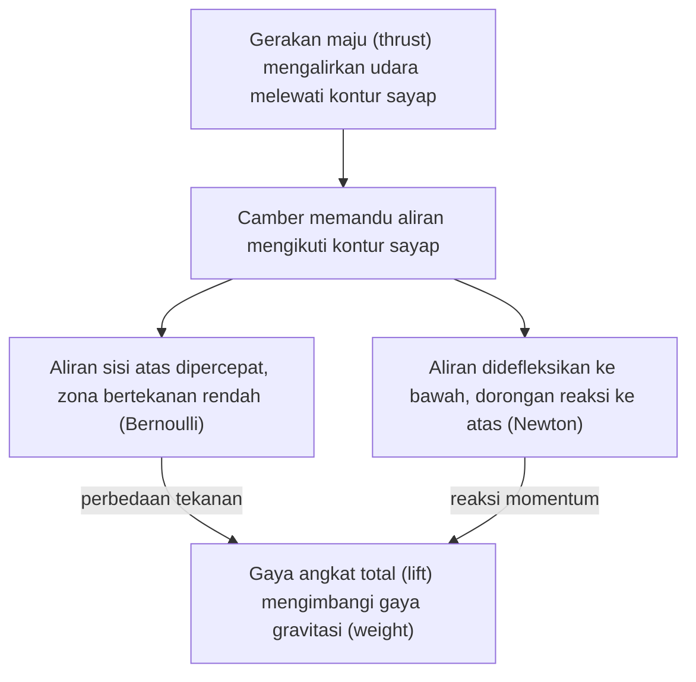

## Pengantar Aerodinamika Pesawat Terbang

Pernahkah terbayang saat berdiri di samping Boeing 747 atau Airbus A380 rasa takjub bagaimana benda seberat ratusan ton tersebut bisa terangkat ke angkasa seolah-olah seringan kapas? Jawabannya tidak terletak pada sihir, melainkan pada interaksi harmonis antara molekul udara dan permukaan benda yang melewatinya. Itulah inti dari **Aerodinamika**.

Secara etimologi, Aerodinamika berasal dari kata Yunani *Aero* (udara) dan *Dynamics* (kekuatan atau perubahan). Bidang ini merupakan studi tentang bagaimana gas (khususnya udara) berinteraksi dengan benda padat yang bergerak melaluinya.

## 1. Udara sebagai Fluida

Sebelum memahami gaya angkat, satu konsep mendasar perlu disepakati: **Udara adalah fluida**. Sama seperti air, udara dapat mengalir, berubah bentuk, dan memberikan tekanan.

### Karakteristik Dasar Aliran Fluida

Dalam aerodinamika, terdapat tiga variabel utama udara yang menjadi perhatian:

1. **Tekanan ($P$):** Gaya yang diberikan molekul udara per satuan luas.
2. **Kecepatan ($v$):** Seberapa cepat partikel udara berpindah.
3. **Kerapatan atau Densitas ($\rho$):** Seberapa padat molekul udara di suatu ruang.

> **Wawasan Penting:** Udara mungkin terasa "kosong", namun fluida ini memiliki massa. Bayangkan situasi saat seseorang berenang di kolam raksasa yang berisi molekul udara; setiap gerakan akan memindahkan molekul-molekul tersebut.

## 2. Prinsip Bernoulli

Salah satu pilar utama aerodinamika adalah prinsip yang dirumuskan oleh Daniel Bernoulli pada abad ke-18.

**Inti dari Hukum Bernoulli:** Dalam aliran fluida yang bergerak (non-kompresibel dan tanpa gesekan), peningkatan kecepatan fluida akan terjadi bersamaan dengan penurunan tekanan atau energi potensial fluida tersebut.

### Persamaan Bernoulli

Secara matematis, untuk aliran tunak (*steady flow*), persamaannya dirumuskan sebagai berikut:

$$
P + \frac{1}{2}\rho v^2 + \rho gh = \text{konstan}
$$

Keterangan variabel:

- $P$ = Tekanan statis ($\text{Pa}$)
- $\rho$ = Massa jenis fluida atau densitas ($\text{kg/m}^3$)
- $v$ = Kecepatan aliran fluida ($\text{m/s}$)
- $g$ = Percepatan gravitasi ($\text{m/s}^2$)
- $h$ = Ketinggian elevasi ($\text{m}$)

Dalam konteks sayap pesawat, persamaan ini dapat disederhanakan karena perbedaan ketinggian ($h$) antara sisi atas dan bawah profil sayap sangat kecil:

$$
P_{\text{atas}} + \frac{1}{2}\rho v_{\text{atas}}^2 = P_{\text{bawah}} + \frac{1}{2}\rho v_{\text{bawah}}^2
$$

### Analogi Jendela Kereta

Bayangkan situasi di dalam gerbong kereta api yang melaju sangat cepat. Jika jendela dibuka sedikit, tirai akan tersedot ke arah luar. Mengapa fenomena ini terjadi? Karena udara di luar kereta bergerak sangat cepat (tekanan rendah) dibandingkan udara di dalam kereta yang relatif diam (tekanan tinggi). Udara bertekanan tinggi selalu mendorong ke arah zona bertekanan rendah.

**Penerapannya pada Sayap:** Profil sayap dirancang sedemikian rupa sehingga udara yang melintas di atas sayap bergerak **lebih cepat** dibandingkan udara di bawah sayap. Akibatnya, tekanan di atas sayap menjadi **lebih rendah** daripada tekanan di bawah sayap. Perbedaan tekanan inilah yang menghasilkan dorongan atau daya hisap ke atas.

## 3. Hukum Ketiga Newton

Jika Bernoulli menjelaskan gaya angkat melalui distribusi tekanan, Sir Isaac Newton menjelaskannya melalui perubahan momentum. Hukum Ketiga Newton menyatakan bahwa:

> "Untuk setiap aksi, terdapat reaksi yang sama besar dan berlawanan arah."

### Downwash (Defleksi Aliran ke Bawah)

Saat sayap pesawat bergerak maju, bentuk dan sudut serang sayap memaksa massa udara untuk berbelok ke arah bawah setelah melintasi tepi belakang sayap (*trailing edge*). Fenomena pembelokan ini disebut **Downwash**.

Berdasarkan Hukum Ketiga Newton:

- **Aksi:** Permukaan sayap mendorong dan membelokkan massa udara ke bawah.
- **Reaksi:** Udara memberikan gaya dorong balik ke sayap ke arah atas.

Sebagai ilustrasi praktis: ketika telapak tangan dikeluarkan dari jendela mobil yang sedang melaju lalu dimiringkan sedikit ke atas, telapak tangan akan terdorong ke atas oleh aliran udara. Fenomena tersebut merupakan manifestasi langsung dari Hukum Ketiga Newton.

## 4. Bagaimana Gaya Angkat (Lift) Tercipta?

Sering kali muncul pertanyaan: *"Mana penjelasan yang benar, Bernoulli atau Newton?"* Jawabannya adalah: **Keduanya benar dan saling melengkapi secara fisika.**

Tidak mungkin tercipta perbedaan tekanan (Bernoulli) tanpa adanya pembelokan aliran massa udara (Newton), demikian pula sebaliknya. Keduanya merupakan dua sudut pandang matematis dan fisis yang mendeskripsikan satu kesatuan fenomena fluida yang sama.

### Tahapan Pembentukan Gaya Angkat (Lift)

1. **Gerakan Maju (*Thrust*):** Propulsi menggerakkan pesawat ke depan, mengalirkan udara melewati kontur sayap.
2. **Pembelokan Aliran:** Kelengkungan profil sayap (*camber*) memandu partikel fluida mengikuti konturnya.
3. **Gradien Kecepatan dan Tekanan:** Aliran fluida di sisi atas mengalami percepatan (Bernoulli), membentuk zona bertekanan rendah.
4. **Perubahan Momentum:** Aliran udara didefleksikan ke arah bawah pada bagian buritan sayap (Newton), memberikan dorongan reaksi ke atas.
5. **Gaya Angkat Efektif:** Resultan perbedaan medan tekanan dan reaksi momentum menghasilkan gaya angkat total (*lift*) yang mampu menyeimbangkan gaya gravitasi (*weight*).

Lewat diagram berikut, kamu bisa melihat jalur Bernoulli dan jalur Newton bertemu pada gaya angkat yang sama.

## 5. Aplikasi Dunia Nyata dan Skenario Teknik

Konsep dasar aerodinamika ini tidak hanya diaplikasikan pada pesawat terbang, melainkan juga pada berbagai inovasi teknologi lainnya:

- **Sayap Belakang Mobil Balap (Formula 1):** Bekerja dengan prinsip terbalik dari sayap pesawat. Profil sayap mobil balap dipasang terbalik untuk menghasilkan *downforce* (gaya tekan ke bawah), meningkatkan cengkeraman ban terhadap aspal saat bermanuver pada kecepatan tinggi.
- **Layar Kapal Layar:** Bekerja menyerupai sayap yang diposisikan vertikal. Perbedaan tekanan antara sisi depan dan belakang layar menghasilkan gaya dorong maju meskipun kapal berlayar tidak persis searah dengan datangnya angin.

### Contoh Perhitungan Sederhana

Sebuah drone berbobot $20 \text{ N}$ dirancang dengan luas efektif sayap sebesar $0.5 \text{ m}^2$. Perhitungan perbedaan tekanan minimum yang dibutuhkan untuk menopang beban drone adalah:

$$
F = \Delta P \times A
$$

$$
\Delta P = \frac{F}{A} = \frac{20 \text{ N}}{0.5 \text{ m}^2} = 40 \text{ Pa}
$$

Dengan demikian, sistem aerodinamika harus mampu menghasilkan perbedaan tekanan rata-rata minimal $40 \text{ Pa}$ antara permukaan bawah dan permukaan atas sayap agar drone dapat melayang seimbang.

## 6. Menghitung Tekanan Berdasarkan Bernoulli

Persamaan Bernoulli versi sayap dari bagian 2 juga bisa dipakai untuk menghitung tekanan di sisi atas sayap ketika tekanan dan kecepatan di sisi bawahnya sudah diketahui. Setelah suku-sukunya dipindahkan, tekanan di sisi atas menjadi:

$$
P_{\text{atas}} = P_{\text{bawah}} + \frac{1}{2}\rho \left(v_{\text{bawah}}^2 - v_{\text{atas}}^2\right)
$$

Misalkan udara di bawah sayap bergerak 50 m/s, sedangkan udara di atas sayap dipercepat menjadi 60 m/s. Tekanan di bawah sayap diambil sama dengan tekanan atmosfer standar di permukaan laut, dan massa jenis udaranya 1,225 kg/m³.

| Besaran | Nilai |
| --- | --- |
| Tekanan di bawah sayap ($P_{\text{bawah}}$) | 101.325 Pa |
| Kecepatan di bawah sayap ($v_{\text{bawah}}$) | 50 m/s |
| Kecepatan di atas sayap ($v_{\text{atas}}$) | 60 m/s |
| Massa jenis udara ($\rho$) | 1,225 kg/m³ |
| Tekanan di atas sayap ($P_{\text{atas}}$) | 101.325 + 0,5 × 1,225 × (2.500 - 3.600) = 100.651,25 Pa |
| Selisih tekanan bawah dan atas | 101.325 - 100.651,25 = 673,75 Pa |

Jadi, percepatan aliran dari 50 m/s menjadi 60 m/s menurunkan tekanan di sisi atas sayap sebesar 673,75 Pa, dan selisih tekanan itulah yang mendorong sayap ke atas.

> **Wawasan Konseptual:** Aerodinamika pada hakikatnya adalah seni memanipulasi distribusi tekanan fluida. Dengan mengontrol dinamika aliran udara di sekitar permukaan benda, wahana penerbangan dapat mengatasi tarikan gravitasi dan menjelajah ruang udara secara terkendali.
