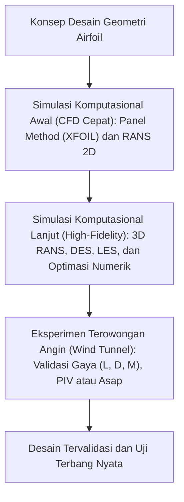

## Metode Pengujian dan Simulasi CFD

Bayangkan sebuah profil airfoil revolusioner baru saja selesai dirancang di atas kertas atau pemodelan CAD. Desain tersebut secara teoritis tampak sangat efisien dan menjanjikan rasio gaya angkat terhadap hambat ($L/D$) yang luar biasa. Namun, memasang profil tersebut secara langsung pada purwarupa pesawat terbang berawak berisiko tinggi tanpa serangkaian tahapan validasi eksperimental dan komputasional yang mendalam.

Dalam mekanika fluida dan aerodinamika terapan, terdapat perbedaan nyata antara formulasi analitis teoretis dengan fenomena aliran fluida nyata yang melibatkan viskositas, turbulensi, separasi, dan efek kompresibilitas. Untuk menjembatani perbedaan tersebut, dunia aerodinamika modern bertumpu pada dua pilar utama validasi: **Computational Fluid Dynamics (CFD)** dan **Pengujian Terowongan Angin (Wind Tunnel Testing)**.

Urutan validasi yang perlu kamu tempuh, dari konsep geometri sampai uji terbang nyata, terlihat pada diagram berikut.

---

### 1. Computational Fluid Dynamics (CFD)

**Computational Fluid Dynamics (CFD)** merupakan cabang mekanika fluida numerik yang memanfaatkan algoritma komputasi dan pemrosesan paralel komputer untuk menganalisis, memvisualisasikan, dan memprediksi perilaku aliran fluida di sekitar benda padat.

#### Persamaan Pembangun Aliran Fluida

CFD menyelesaikan sistem persamaan diferensial parsial non-linear yang dikenal sebagai **Persamaan Navier-Stokes**. Persamaan ini merepresentasikan hukum kekekalan massa (kontinuitas), kekekalan momentum (Hukum Kedua Newton), dan kekekalan energi.

Untuk aliran fluida Newtonian inkompresibel dengan densitas konstan $\rho$ dan viskositas dinamik $\mu$, persamaan kontinuitas dinyatakan sebagai:

$$
\nabla \cdot \mathbf{u} = 0
$$

Sedangkan persamaan momentum Navier-Stokes dirumuskan sebagai:

$$
\rho \left( \frac{\partial \mathbf{u}}{\partial t} + (\mathbf{u} \cdot \nabla)\mathbf{u} \right) = -\nabla p + \mu \nabla^2 \mathbf{u} + \mathbf{f}_b
$$

Keterangan variabel:
- $\mathbf{u} = (u, v, w)$ : Vektor kecepatan fluida ($\text{m/s}$).
- $\rho$ : Kerapatan massa atau densitas fluida ($\text{kg/m}^3$).
- $p$ : Tekanan statis fluida ($\text{Pa}$).
- $\mu$ : Viskositas dinamik fluida ($\text{Pa}\cdot\text{s}$).
- $\mathbf{f}\_b$ : Vektor gaya bodi eksternal per satuan volume (misalnya gravitasi).

#### Hierarki Pemodelan Turbulensi dalam CFD

Karena aliran turbulensi memiliki rentang skala spasial dan temporal dari skala pusaran integral terbesar hingga skala disipasi Kolmogorov terkecil, penyelesaian persamaan Navier-Stokes secara langsung memerlukan daya komputasi yang sangat masif. Oleh karena itu, diterapkan tingkatan pemodelan:

1. **RANS (Reynolds-Averaged Navier-Stokes)**: Memisahkan variabel aliran menjadi nilai rata-rata waktu dan fluktuasi turbulen ($\mathbf{u} = \bar{\mathbf{u}} + \mathbf{u}'$). Menghasilkan tegangan Reynolds (*Reynolds stress*) yang dimodelkan menggunakan model turbulensi seperti Spalart-Allmaras (1 persamaan), $k\text{-}\epsilon$, atau $k\text{-}\omega\text{ SST}$ (2 persamaan). Pendekatan ini merupakan standar industri karena efisiensi komputasinya.
2. **LES (Large Eddy Simulation)**: Menyelesaikan struktur pusaran berskala besar secara spasial (*filtered*) dan hanya memodelkan pusaran sub-grid kecil (*Sub-Grid Scale / SGS model*).
3. **DNS (Direct Numerical Simulation)**: Menyelesaikan seluruh spektrum turbulensi tanpa model empiris sama sekali. Pendekatan ini membutuhkan resolusi kisi yang sangat padat sehingga umumnya masih terbatas pada penelitian fundamental dengan bilangan Reynolds rendah.

#### Resolusi Dinding dan Parameter $y^+$

Pada simulasi lapisan batas aerodinamika, penentuan jarak lapisan kisi pertama dari permukaan dinding sangat kritikal untuk menangkap gradien kecepatan pada sub-lapisan viskos (*viscous sublayer*). Parameter tak berdimensi jarak dinding $y^+$ didefinisikan sebagai:

$$
y^+ = \frac{y u_\tau}{\nu}
$$

Di mana:

$$
u_\tau = \sqrt{\frac{\tau_w}{\rho}}
$$

- $y$ : Jarak fisik titik pusat sel pertama ke dinding sayap ($\text{m}$).
- $u\_\tau$ : Kecepatan geser gesekan dinding (*friction velocity*) ($\text{m/s}$).
- $\tau\_w$ : Tegangan geser dinding ($\text{N/m}^2$).
- $\nu = \frac{\mu}{\rho}$ : Viskositas kinematik fluida ($\text{m}^2\text{/s}$).

Untuk model integrasi dinding penuh (seperti $k\text{-}\omega\text{ SST}$ tanpa fungsi dinding empiris), nilai $y^+$ target biasanya disyaratkan $y^+ \le 1$.

---

### 2. Alur Kerja Simulasi Komputasional

Proses analisis aerodinamika numerik terstruktur dalam tiga tahapan utama:

1. **Pra-Pemrosesan (Pre-Processing)**:
   - Pembuatan dan pembersihan geometri airfoil atau sayap 3D.
   - Pembangunan domain fluida (*farfield domain*) berjarak 20 hingga 50 panjang *chord* ($c$) dari bodi untuk meminimalkan gangguan batas domain.
   - Pembangkitan kisi komputasi (*meshing*), baik terstruktur (*structured hexahedral*), tak terstruktur (*unstructured tetrahedral/polyhedral*), maupun hibrida (*prism layers* pada dinding).
   - Pengaturan kondisi batas (*boundary conditions*): *Velocity Inlet*, *Pressure Outlet*, dan *No-Slip Wall* pada permukaan airfoil.
2. **Penyelesaian Numerik (Solving)**:
   - Pemilihan skema diskretisasi spasial (misalnya *Second-Order Upwind* untuk adveksi).
   - Algoritma kopling tekanan-kecepatan (seperti SIMPLE, SIMPLEC, atau PISO).
   - Iterasi konvergensi hingga residual persamaan momentum, kontinuitas, dan turbulensi turun di bawah ambang batas (umumnya $10^{-6}$) serta nilai koefisien aerodinamika ($C\_l, C\_d$) mencapai nilai konstan stabil.
3. **Pasca-Pemrosesan (Post-Processing)**:
   - Ekstraksi koefisien gaya angkat ($C\_l$), gaya hambat ($C\_d$), dan momen angguk ($C\_m$).
   - Visualisasi kontur medan tekanan ($C\_p$), medan kecepatan ($u, v, w$), garis arus (*streamlines*), vektor aliran, dan titik separasi.

---

### 3. Pengujian Terowongan Angin

Meskipun perangkat lunak simulasi semakin canggih, terowongan angin (*wind tunnel*) tetap menjadi standar kebenaran eksperimental (*ground truth*) dalam dunia aerodinamika dan sertifikasi kelaikudaraan.

Prinsip dasar pengujian terowongan angin bertumpu pada **relativitas aerodinamika Galileo**: gaya dan momen yang dialami sebuah benda padat yang bergerak menembus massa udara diam identik dengan gaya yang dialami benda diam yang dialiri fluida dengan kecepatan seragam yang sama.

#### Prinsip Keserupaan Dinamik (Similitude)

Agar data dari model berskala (misalnya model skala $1:10$) dapat diekstrapolasikan ke pesawat ukuran penuh, hukum keserupaan fluida harus dipenuhi. Dua parameter tak berdimensi terpenting adalah:

1. **Bilangan Reynolds ($\text{Re}$)**: Menjaga keserupaan gaya inersia terhadap gaya viskos:

   

   $$
   \text{Re} = \frac{\rho v c}{\mu}
   $$
   

2. **Bilangan Mach ($\text{Ma}$)**: Menjaga keserupaan efek kompresibilitas:

   

   $$
   \text{Ma} = \frac{v}{a}
   $$
   

Di mana $v$ adalah kecepatan aliran bebas, $c$ adalah panjang *chord*, dan $a$ adalah kecepatan rambat suara lokal ($a = \sqrt{\gamma R T}$).

Jika pengujian model skala kecil dilakukan di udara atmosfer biasa, mencapai bilangan Reynolds yang setara dengan pesawat asli menuntut peningkatan kecepatan fluida atau peningkatan densitas fluida (misalnya menggunakan terowongan angin bertekanan tinggi atau terowongan angin kriogenik nitrogen cair seperti *National Transonic Facility* di NASA).

#### Instrumentasi dan Pengukuran Eksperimental

Pengujian terowongan angin modern mengandalkan instrumentasi presisi tinggi:

- **Timbangan Aerodinamika (Internal/External Strain-Gauge Balance)**: Sensor multi-sumbu berbasis *strain gauge* atau piezoelektrik untuk mengukur 3 gaya ($L, D, Y$) dan 3 momen ($M, N, L$) secara simultan.
- **Transduser Tekanan dan Tap Tekanan (Pressure Taps)**: Lubang-lubang mikro berdiameter kurang dari 1 mm yang dihubungkan ke modul sensor elektronik untuk memetakan distribusi tekanan permukaan secara *real-time*.
- **Visualisasi Aliran**:
  - *Tufts* (benang halus): Menunjukkan arah lokal aliran dan mendeteksi stall/separasi.
  - *Smoke Injection* / *Oil Flow Visualization*: Menampilkan garis arus batas dan formasi pusaran.
  - *Particle Image Velocimetry* (PIV): Teknik pengukuran optik non-intrusif berbasis laser dan partikel pelacak (*tracer particles*) untuk menghasilkan medan vektor kecepatan 2D/3D seketika.
  - *Pressure-Sensitive Paint* (PSP): Cat luminesen optik yang memancarkan intensitas cahaya sesuai dengan distribusi tekanan oksigen lokal di seluruh permukaan airfoil.

---

### 4. CFD vs. Terowongan Angin

Kedua metodologi memiliki keunggulan dan keterbatasan tersendiri yang saling melengkapi dalam siklus rekayasa:

| Parameter Evaluasi | Simulasi CFD (Komputasi) | Eksperimen Terowongan Angin |
| :--- | :--- | :--- |
| **Biaya Marginal Iterasi** | Sangat rendah setelah infrastruktur komputasi tersedia. | Tinggi untuk setiap perubahan geometri model fisik. |
| **Waktu Siklus Desain** | Sangat cepat untuk ratusan variasi geometri dan optimasi parametrik. | Memerlukan waktu pemesinan model fisik toleransi mikro (CNC). |
| **Resolusi Data Spasial** | Menyeluruh di setiap titik volume domain (tekanan, turbulensi, kecepatan). | Terbatas pada titik pemasangan sensor dan jangkauan optik visualisasi. |
| **Ketergantungan Model** | Sensitif terhadap model turbulensi, kualitas kisi, dan skema diskretisasi. | Langsung mengukur fenomena fisika riil fluida tanpa asumsi pemodelan. |
| **Efek Batas Domain** | Kondisi batas *farfield* dapat diatur tanpa interferensi dinding. | Menghadapi interferensi dinding terowongan (*blockage effect*) dan turbulensi bebas terowongan. |

---

### 5. Integrasi Tekanan Permukaan

Dalam pasca-pemrosesan CFD maupun data eksperimen *pressure taps*, koefisien gaya angkat $C\_l$ dan koefisien momen $C\_{m,c/4}$ dihitung dengan mengintegrasikan distribusi koefisien tekanan $C\_p$ di sepanjang permukaan atas (*upper*) dan bawah (*lower*) airfoil:

$$
C_l = \int_{0}^{1} (C_{p,l} - C_{p,u}) \ d\left(\frac{x}{c}\right)
$$

Di mana koefisien tekanan tak berdimensi didefinisikan sebagai:

$$
C_p = \frac{p - p_\infty}{\frac{1}{2} \rho_\infty v_\infty^2}
$$

Dalam praktik, nilai $C\_p$ hanya diketahui pada titik-titik diskret di sepanjang kord, misalnya di posisi setiap lubang *pressure taps*. Integral tersebut lalu dihitung secara numerik, misalnya dengan aturan trapesium (*composite trapezoidal rule*):

1. Kord dibagi menjadi pias-pias kecil di antara titik ukur yang berdekatan.
2. Selisih $C\_{p,l} - C\_{p,u}$ di kedua ujung setiap pias dirata-rata.
3. Rata-rata itu dikalikan lebar piasnya.
4. Semua hasil itu dijumlahkan menjadi $C\_l$.

Pada sudut serang moderat, permukaan atas umumnya mengalami hisapan ($C\_p$ bernilai negatif) dan permukaan bawah mengalami tekanan positif, sehingga selisih itu bernilai positif dan menghasilkan gaya angkat.

---

### 6. Studi Kasus Aplikasi Industri

#### Industri Balap Formula 1
Dalam regulasi teknis *FIA Formula 1*, alokasi waktu pengujian aerodinamika (*Aerodynamic Testing Restrictions* / ATR) dibatasi secara ketat dalam bentuk jam komputasi CFD (*teraflops*) dan waktu operasi terowongan angin (*run time* per pekan). Tim balap menggunakan CFD berkecepatan tinggi untuk menyeleksi ratusan konsep geometri sayap depan (*front wing*) dan sayap belakang (*rear wing*). Hanya beberapa geometri paling menjanjikan yang kemudian diproduksi menjadi model skala $60\text{\%}$ untuk diuji di terowongan angin guna memvalidasi korelasi aliran pusaran (*vortex interaction*) dan sensitivitas jarak tanah (*ride height sensitivity*).

#### Pengembangan Sayap Pesawat Transonik Komersial
Pada perancangan pesawat modern seperti Airbus A350 dan Boeing 787, bentuk kelengkungan sayap dan perangkat ujung sayap (*winglet*) dioptimalkan melalui puluhan ribu jam komputasi CFD dengan formulasi RANS transonik untuk meminimalkan pembentukan gelombang kejut (*shock wave*) di atas sayap pada kecepatan jelajah $\text{Ma} \approx 0.85$. Pengujian terowongan angin skala penuh dan transonik dilakukan pada tahap akhir untuk memverifikasi batas batas buffet (*buffet boundary*), karakteristik *flutter* aeroelastik, serta verifikasi gaya pada konfigurasi *high-lift* (slat dan flap) saat lepas landas dan mendarat.

---

### Rangkuman Inti

1. **CFD dan Terowongan Angin adalah Komplementer**: CFD memberikan fleksibilitas komputasi untuk eksplorasi dan optimasi geometri secara masif, sementara terowongan angin memberikan pembuktian fisik nyata dan sertifikasi desain.
2. **Landasan Matematis CFD**: Bertumpu pada persamaan kontinuitas dan Navier-Stokes. Pemilihan model turbulensi (RANS, LES, DNS) dan resolusi kisi dekat dinding ($y^+ \le 1$) sangat menentukan akurasi hasil simulasi.
3. **Keserupaan Eksperimental**: Pengujian terowongan angin memerlukan kesamaan bilangan tak berdimensi, khususnya bilangan Reynolds ($\text{Re}$) dan bilangan Mach ($\text{Ma}$), agar data model skala representatif terhadap kondisi penerbangan nyata.
4. **Integrasi Tekanan**: Performa aerodinamika terukur dari integrasi distribusi koefisien tekanan permukaan ($C\_p$) dan tegangan geser dinding ($\tau\_w$).

> **Prinsip Rekayasa:** *"Semua model komputasi merupakan penyederhanaan realitas, namun model yang dikalibrasi dan divalidasi dengan benar menjadi fondasi keselamatan serta efisiensi rekayasa penerbangan modern."* (Mengacu pada prinsip George Box).
