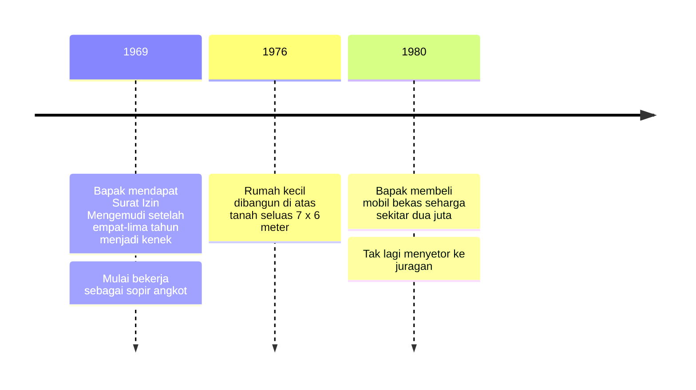

## Sosok Bapak dan Ibu sebagai Inspirasi Terbesar

Keluarga merupakan pusat emosional yang menghubungkan ingatan dan perjuangan hidup seseorang. Dalam novel *9 Summers 10 Autumns*, latar belakang kedua orang tua menjadi sumber inspirasi terbesar bagi pengarang untuk menuangkan pergulatan batin serta rasa syukurnya.

### Representasi Kasih Sayang dan Pengorbanan Orang Tua

Sosok Bapak (Abdul Hasim) dengan etos kerja yang tinggi terinspirasi oleh teladan Pak Ucup yang mengajarkan kemandirian serta kejujuran:

Pak Ucup, mantan tentara, digambarkan berpandangan hidup modern dengan etos kerja luar biasa. Ketika banyak orang pribumi hanya iri pada kesuksesan kaum Tionghoa, ia justru banyak belajar dari mereka, terinspirasi, dan selalu ingin maju. Ia memegang “kerja keras, terus belajar, dan kejujuran” (Hlm. 25) sebagai tiga kunci sederhana, dan sosok inilah yang menjadi inspirasi pertama Bapak.

Keteladanan Bapak tercermin dari perjuangan puluhan tahun bekerja di jalan raya dari kenek hingga sopir mandiri. Pada 1969, setelah empat-lima tahun menjadi kenek, Bapak mendapatkan Surat Izin Mengemudi dan mulai bekerja sebagai sopir angkot, pekerjaan yang menurutnya sangat bagus pada masa itu. Beberapa tahun kemudian ia berusaha mandiri: berkat tabungan berpuluh-puluh tahun, ia membeli mobil bekas seharga sekitar dua juta pada 1980, sehingga tak lagi harus menyetorkan sebagian uang hasil kerjanya ke juragannya. Keluarga memandangnya sebagai sukses yang cukup besar pada masa itu dan membanggakan (Hlm. 26).

Sementara itu, Ibu (Ngatinah) menjaga kesederhanaan dan keadilan berbagi yang melindungi seluruh anggota keluarga:

Garis hidup membentuk kesederhanaan Ibu. Dialah yang mencetuskan ide menabung, dan dia pula yang mengingatkan anak-anak kalau mereka perlu ke dokter, kalau mobil bisa rusak sewaktu-waktu, kalau rumah bisa bocor, dan kalau mereka butuh makanan bergizi. Ibu mengatur berapa liter nasi yang ditanak agar tak tersisa esok hari, kapan anak-anak makan daging, ayam, atau tempe, barang apa yang perlu digadaikan untuk sepatu baru, dan kapan uang sekolah dibayar. Ia membelah satu telur dadar untuk dua atau tiga orang dan menyembunyikan tempe goreng agar tak dihabiskan satu anak saja. Iwan menyebutnya “demokrasi berbagi di tengah pergulatan hidup” (Hlm. 34), dan kesederhanaan itulah yang membangun rumah kecil mereka.

Kebijakan Ibu menyelamatkan keluarga saat biaya sekolah anak-anak mereka membengkak. Awan gelap, kadang badai, sering tampak di atas rumah mereka, apalagi setelah anak-anak beranjak besar dan biaya sekolah, seragam, serta buku membengkak. Ketegaran, ketekunan, dan air mata Ibu yang membawa mereka melewatinya; di balik kelembutan dan kesabarannya ada kekuatan yang menyatukan semua di bawah satu atap. Rumah itu dibangun pada 1976 di atas tanah seluas 7 x 6 meter seharga Rp40.000, dan Ibu jugalah yang membangun rumah dengan fondasi kuat “di hati masing-masing” (Hlm. 35).

Tiga tahun yang muncul dalam uraian tadi bisa kamu urutkan menjadi satu garis waktu.

### Ketangguhan Bapak dan Disiplin Ibu

Perbandingan watak orang tua Iwan menunjukkan adanya sinergi kepribadian yang membentuk etika kerja tokoh utama. Kegigihan fisik Bapak yang bekerja sebagai sopir angkot berpuluh-puluh tahun bersinergi dengan ketegasan manajemen domestik Ibu yang dengan cermat mengatur takaran beras dan pembayaran uang sekolah anak-anaknya. Kombinasi antara ketangguhan Bapak dan disiplin administratif Ibu inilah yang secara ekspresif ditiru oleh Iwan, membentuk dasar etos kerja profesional yang ia bawa ke dunia korporasi global di New York.

### Dari Orang Tua ke Saudara Kandung

Selain kedua orang tuanya, saudara-saudara kandung Iwan juga menjadi sumber motivasi. Pembahasan berikutnya akan menganalisis peran saudara kandung sebagai dorongan moral pengarang.
