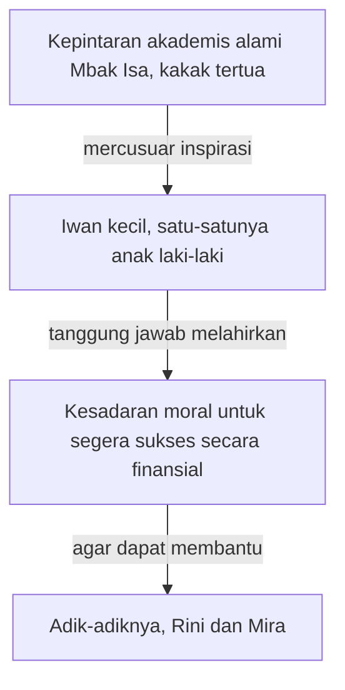

## Karakter Saudara Kandung sebagai Motivasi

### Dukungan Moral Saudara Kandung

Prestasi dan pengorbanan saudara kandung Iwan Setyawan menjadi pemicu dorongan ekspresif (*expressive drive*) yang kuat dalam novel ini. 

Mbak Isa, kakak pertamanya, adalah cermin *independent learning* (kemandirian belajar) yang menularkan gairah belajar bagi seluruh adiknya:

Tanpa les, tanpa bimbingan orang tua, dan tanpa jadwal belajar khusus, Mbak Isa selalu meraih peringkat teratas dari kelas 1 sampai lulus. “Dia maju sendiri,” kenang Iwan (Hlm. 38). Kemampuan matematikanya membuatnya terkenal di SD, dan kedekatannya dengan buku pelajaran membuat adik-adiknya ingin sepintar dia.

Mbak Isa juga merelakan cita-cita kuliahnya demi masa depan adik-adiknya, serta mandiri bekerja sebagai pengajar les privat. Sambil mencari kerja dan mengikuti kursus di Malang, ia memberi les untuk anak SD dan SMP, lalu cepat dikenal sebagai guru les yang andal (Hlm. 40).

Sementara Mbak Inan menanamkan *sentimental sensitivity* (kepekaan emosional) terhadap keindahan seni sastra dan puisi dalam kehidupan mereka. Dialah yang mengajari adik-adiknya membaca puisi, dari intonasi sampai penghayatan, hingga menurut Iwan “rasa sentimental memasuki darah kami” (Hlm. 44).

Ketekunan Rini Agustina dalam keterampilan dan kelembutan hati (*soft-heartedness*) Mira (Denok) semakin melengkapi representasi kehangatan keluarga Iwan Setyawan. Rini bekerja dengan tekun di antara alat dapur, buku pasien, sapu, dan kain pel, dan kegigihannya mencari uang melelehkan hati seluruh keluarga (Hlm. 51). Mira berhati lunak dan mudah tersentuh, jujur tanpa retak, meski kadang terluka karena menggenggam masa lalu terlalu kuat (Hlm. 55).

### Rantai Motivasi dan Tanggung Jawab Moral

Analisis terhadap hubungan persaudaraan dalam keluarga Iwan memperlihatkan rantai motivasi yang saling menguatkan. Kepintaran akademis alami Mbak Isa (kakak tertua) menjadi mercusuar inspirasi bagi Iwan kecil, sementara tanggung jawabnya sebagai satu-satunya anak laki-laki di keluarga melahirkan kesadaran moral yang kuat untuk segera sukses secara finansial agar dapat membantu adik-adiknya (Rini dan Mira). Hubungan erat ini mengekspresikan cinta kasih tanpa syarat (*unconditional love*) sebagai kompensasi atas keterbatasan ekonomi mereka.

Dari atas ke bawah, rantai itu berjalan seperti ini.

### Hangatnya Rumah Mungil 6x7 Meter

*Bagaimana kehangatan hubungan persaudaraan di dalam rumah mungil ukuran 6 x 7 meter dapat mengompensasi keterbatasan ruang fisik dan ekonomi yang dihadapi keluarga Iwan?*

### Dari Keluarga ke Logika Statistik (*Statistical Logic*) dalam Sastra

Dorongan moral dari keluarga ini kemudian menemukan jalannya lewat pencapaian akademis. Di bab selanjutnya, kita akan meneliti bagaimana latar belakang pendidikan tinggi pengarang di bidang Statistika secara ekspresif membentuk cara ia berkarya.
