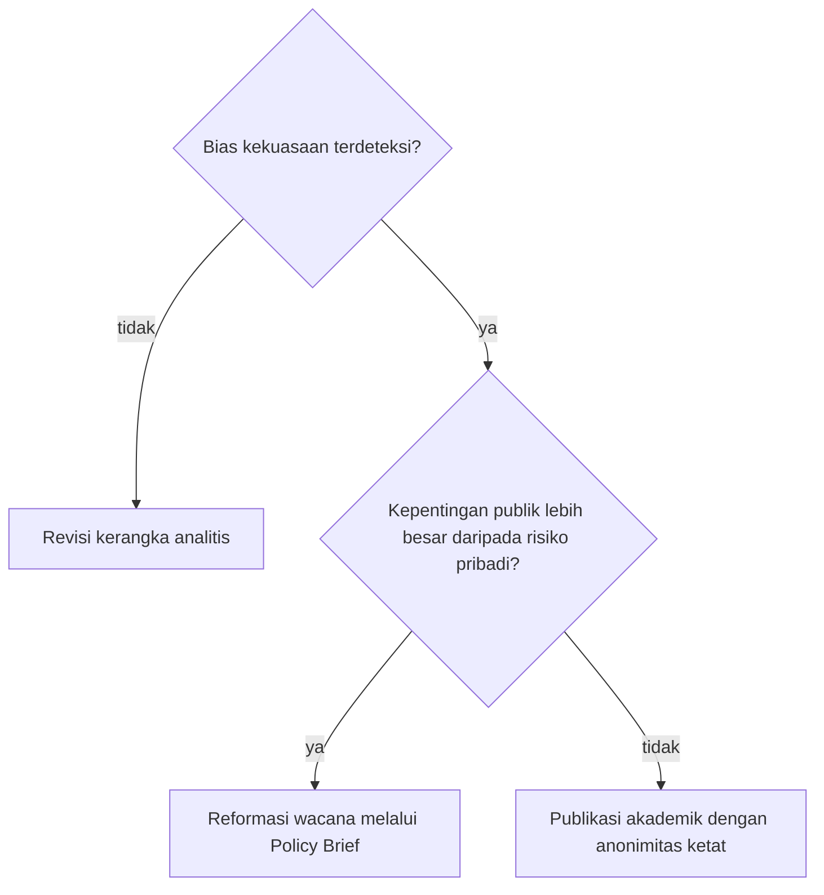

## Etika Penelitian dan Implementasi Analisis Wacana Kritis

Peneliti Analisis Wacana Kritis (AWK) dalam kriminologi memikul dua tugas: menjaga etika penelitian dan membawa temuannya ke reformasi hukum. Jika bab-bab sebelumnya telah membekali pemelajar dengan alat metodologis untuk membongkar ketidakadilan dalam bahasa, bab ini akan menjawab pertanyaan utama: *setelah ketimpangan tersebut ditemukan, apa tanggung jawab etis peneliti? Dan bagaimana hasil analisis tersebut dapat diimplementasikan untuk mengubah dunia nyata?*

Dalam kriminologi kritis, peneliti bukan sekadar penonton yang duduk di menara gading. Peneliti adalah partisipan aktif yang memiliki tanggung jawab etis untuk menyuarakan kelompok yang terbungkam oleh diskursus dominan.

---

### 1. Meneliti dengan Keberpihakan

Dalam riset konvensional, "objektivitas" sering kali diartikan sebagai netralitas total. Namun, dalam AWK, netralitas justru dipandang sebagai bentuk dukungan implisit terhadap status quo.

#### Paradoks Netralitas vs. Emansipasi

Peneliti AWK memiliki komitmen etis untuk **emansipasi**, yaitu upaya membebaskan kelompok tertindas dari dominasi ideologi.

> **Wawasan Penting:**
> Dalam AWK, menjadi "objektif" bukan berarti tidak memihak, melainkan menjadi transparan mengenai posisi teoretis dan politis peneliti, serta memastikan analisis didasarkan pada bukti tekstual yang ketat.

| Dimensi | Riset Konvensional | Analisis Wacana Kritis (AWK) |
| :--- | :--- | :--- |
| **Posisi Peneliti** | Netral, bebas nilai, pengamat luar | Memihak pada emansipasi, partisipan kritis |
| **Definisi Objektivitas** | Bebas dari bias personal | Transparansi posisi & ketepatan bukti tekstual |
| **Tujuan Akhir** | Deskripsi dan eksplanasi fenomena | Transformasi sosial dan praksis penegakan hukum |

> **Analogi Pendaki dan Peta**
> Bayangkan sebuah hutan (sistem hukum) di mana jalan setapak hanya dibuat untuk kendaraan besar (penguasa), sementara pejalan kaki (kaum marginal) harus bersusah payah di semak belukar. Peneliti tradisional mungkin hanya memetakan jalan tersebut. Peneliti AWK akan bertanya: *"Siapa yang membuat jalan ini? Mengapa pejalan kaki diabaikan? Dan di mana trotoar harus dibangun?"*

#### Komitmen terhadap Subjek Penelitian

Etika penelitian AWK dalam kriminologi melibatkan tiga pilar utama:

1. **Refleksivitas:** Peneliti harus terus berefleksi, *"Bagaimana latar belakang peneliti (kelas, gender, ras) memengaruhi cara menafsirkan teks ini?"*
2. **Menghindari Reviktimisasi:** Saat menganalisis wacana korban kejahatan, peneliti harus memastikan bahwa analisis tidak memperkuat stigma atau trauma korban.
3. **Keadilan Representasi:** Memberikan ruang bagi narasi tandingan (*counter-narratives*) yang sering kali dihapus dari dokumen resmi kepolisian atau pengadilan.

---

### 2. Risiko Mengkritik Kekuasaan dan Keberanian Intelektual

Mengkritik institusi seperti kepolisian, kejaksaan, atau pembuat undang-undang memiliki konsekuensi etis dan praktis. Peneliti AWK sering kali berhadapan dengan narasi institusional yang dianggap sebagai kebenaran mutlak.

#### Menantang "Rezim Kebenaran"

Gunakan kerangka berpikir ini saat mengevaluasi etika kritik:

* **Akuntabilitas:** Apakah kritik didasarkan pada data tekstual yang valid atau sekadar opini pribadi?
* **Dampak Publik:** Apakah pembongkaran wacana ini akan membantu memperbaiki sistem atau justru membahayakan individu tertentu?

---

### 3. Dari Analisis Menuju Reformasi Hukum

AWK tidak berhenti pada laporan penelitian. Tujuan akhirnya adalah **Praksis**, yaitu teori yang diwujudkan dalam tindakan untuk mengubah struktur sosial.

#### Advokasi Reformasi Hukum

Hasil analisis wacana dapat digunakan untuk mendorong perubahan konkret dalam sistem peradilan pidana melalui:

1. **Litigasi Strategis:** Menggunakan temuan AWK sebagai saksi ahli di persidangan untuk menunjukkan adanya bias bahasa dalam berita acara pemeriksaan (BAP).
2. **Perubahan Kebijakan (*Policy Brief*):** Menyarankan penghapusan istilah-istilah stigmatis dalam undang-undang yang mengkriminalisasi kelompok rentan.
3. **Edukasi Publik:** Mengubah cara media massa membingkai isu kejahatan agar tidak menciptakan kepanikan moral.

#### Formula Dampak AWK

Secara sederhana, efektivitas implementasi AWK dapat dirumuskan sebagai berikut:

$$
I = (A \times K) + P
$$

Di mana:

* $I$: $\text{Impact}$ (Dampak Reformasi)
* $A$: $\text{Accuracy}$ (Akurasi Analisis Linguistik)
* $K$: $\text{Critique}$ (Ketajaman Kritik terhadap Kekuasaan)
* $P$: $\text{Public Advocacy}$ (Advokasi Publik)

---

### 4. Reformasi Bahasa dalam Regulasi Kekerasan Seksual

**Skenario:** Dalam banyak dokumen hukum lama, istilah yang digunakan sering kali menyudutkan korban (misalnya, menggunakan kata "persetubuhan" yang berkonteks netral alih-alih "pemerkosaan" yang menegaskan adanya paksaan).

**Tindakan Peneliti AWK:** Peneliti melakukan analisis terhadap draf undang-undang dan menemukan bahwa pilihan kata tertentu menormalisasi tindakan pelaku. Hasil riset ini kemudian dipresentasikan kepada legislator dan koalisi masyarakat sipil.

**Hasil Praktis:** Adopsi istilah yang lebih berperspektif korban dalam undang-undang baru (seperti UU TPKS di Indonesia), yang secara hukum mengubah cara aparat penegak hukum memandang dan menangani kasus tersebut.

> **Refleksi Analitis:**
> Penggunaan istilah seperti "kenakalan remaja" untuk tindakan yang sebenarnya dipicu oleh kemiskinan struktural berisiko membatasi pilihan solusi negara, karena mereduksi persoalan sistemik menjadi sekadar kegagalan moral individu.

---

### 5. Panduan Praktis Implementasi bagi Peneliti Muda

Untuk menerapkan AWK bagi tujuan advokasi, langkah-langkah berikut dapat ditempuh:

1. **Identifikasi "Bahasa Berbahaya":** Temukan istilah dalam dokumen hukum yang menciptakan diskriminasi.
2. **Dekonstruksi:** Tunjukkan bagaimana istilah tersebut bekerja untuk mempertahankan kekuasaan pihak tertentu.
3. **Tawarkan Alternatif:** Jangan hanya mengkritik; usulkan glosarium atau terminologi baru yang lebih adil secara sosial.
4. **Kolaborasi:** Hubungkan temuan riset dengan organisasi bantuan hukum (LBH) atau aktivis hak asasi manusia.

Sebelum temuan dibawa keluar, peneliti juga menilai secara etis langkah mana yang pantas diambil. Pertama, apakah analisis benar-benar menemukan bias kekuasaan dalam teks? Jika tidak, kerangka analitisnya yang perlu direvisi. Jika ya, peneliti menimbang kepentingan publik terhadap risiko pribadi. Bila kepentingan publik lebih besar, temuan dibawa ke reformasi wacana melalui *Policy Brief*; bila tidak, temuan diterbitkan sebagai publikasi akademik dengan anonimitas ketat.

Percabangan penilaian itu dapat dilihat sekilas di sini.

Pada akhirnya, tujuan kriminologi kritis bukan hanya memahami dunia, tetapi mengubahnya.

---

### 6. Linguistik Forensik dan Sidik Jari Linguistik

Linguistik forensik adalah cabang ilmu bahasa terapan yang menggunakan analisis bahasa untuk kepentingan hukum dan investigasi kriminal. Seorang peneliti tidak sekadar mencari sidik jari pada benda fisik, melainkan **sidik jari linguistik** yang tertinggal dalam susunan kalimat, pilihan kata, hingga tanda baca.

Dalam kriminologi, bahasa dianggap sebagai manifestasi perilaku. Berikut adalah pilar utama bagaimana kata-kata menjadi alat bukti:

#### 1. Idiolek dan Ciri Tulisan Individu

Sama seperti sidik jari atau DNA, setiap individu memiliki **idiolek**. Idiolek adalah gaya bahasa unik yang dimiliki individu, dipengaruhi oleh latar belakang pendidikan, dialek regional, usia, hingga profesi.

* **Pilihan Leksikal:** Penanda khusus apakah penulis menggunakan kata teknis tertentu atau kosakata umum.
* **Sintaksis:** Struktur kalimat yang dominan, seperti kecenderungan penggunaan kalimat pasif dibanding kalimat aktif.
* **Ortografi:** Kebiasaan penggunaan tanda baca, kapitalisasi, dan pola singkatan.

#### 2. Atribusi Kepenulisan Teks Anonim dengan Sampel Pembanding

Teknik untuk menentukan penulis asli dari teks anonim (seperti surat ancaman, pesan teror, atau dokumen palsu) dengan membandingkan sampel teks bukti terhadap teks pembanding yang telah terverifikasi.

#### 3. Menguji Niat Eksplisit dan Konteks Situasional Ancaman

Dalam kriminologi, pembedaan antara ancaman nyata dan luapan emosi dilakukan dengan menguji:

* Keberadaan niat (*intent*) eksplisit dalam teks.
* Tingkat risiko berdasar pola komunikasi dan konteks situasional.

---

### 7. Dinamika Pembuktian Linguistik Forensik

Dalam praktik kriminologi dan analisis hukum, penerapan linguistik forensik diuji melalui berbagai dinamika pembuktian:

#### A. Kebiasaan Bawah Sadar yang Sulit Dipalsukan
Saat pelaku kejahatan siber mencoba meniru gaya penulisan individu lain, elemen bahasa yang paling sulit dipalsukan secara konsisten adalah kebiasaan bawah sadar (*unconscious linguistic habits*), seperti frekuensi penempatan koma, penggunaan kata hubung, dan pola mikrosintaksis.

#### B. Dinamika Teks Digital
Di era media sosial dan pesan instan, pesan sering kali singkat dan memuat simbol visual non-verbal. Peneliti linguistik forensik memanfaatkan pola konsistensi pemakaian simbol visual dan variasi ejaan non-standar sebagai indikator identifikasi tambahan.

#### C. Struktur Pernyataan Opini dan Pencemaran Nama Baik
Dalam analisis hukum wacana, struktur pernyataan menentukan kualifikasi delik:

* **Pernyataan A:** *"Layanan di toko ini sangat lambat dan tidak profesional."* (Evaluasi subjektif terhadap pengalaman layanan / opini).
* **Pernyataan B:** *"Pemilik toko ini adalah seorang penipu yang sengaja mencuri uang pelanggan."* (Tuduhan faktual atas perbuatan pidana spesifik tanpa pembuktian hukum / potensi pencemaran nama baik).

#### D. Profiling Kriminologis dari Teks Kejahatan
Kombinasi penggunaan istilah teknis medis yang presisi dengan tata bahasa yang tidak teratur pada surat tuntutan tebusan dapat mengindikasikan profil tersangka dengan latar belakang pendidikan spesifik yang mencoba melakukan penyamaran gaya bahasa (*stylistic feigning*).

---

### Yang Perlu Kamu Ingat tentang Etika AWK

Etika dalam Analisis Wacana Kritis bukan sekadar tentang mengisi formulir persetujuan penelitian (*informed consent*). Etika adalah tentang **keberanian moral** untuk menunjukkan bahasa yang melindungi ketidakadilan. Sebagai peneliti kriminologi, kata-kata adalah alat advokasi untuk mengurangi stigma dan mendorong sistem hukum yang lebih manusiawi dan berkeadilan.

Peneliti perlu terus memeriksa dan berefleksi mengenai siapa yang diuntungkan dari penyusunan narasi serta penulisan hasil penelitian yang dihasilkan.
