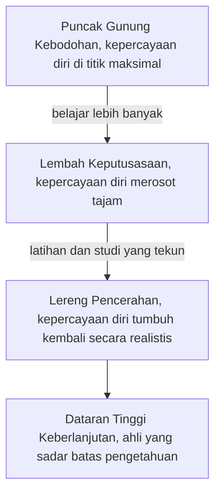

## Efek Dunning-Kruger

Pernahkah kamu bertemu orang yang baru mempelajari dasar-dasar investasi kripto atau strategi sepak bola, namun berbicara seolah ia ahli tingkat dunia? Atau sebaliknya, pernahkah kamu melihat seorang ahli yang sangat kompeten justru merasa bahwa kemampuan mereka "biasa-biasa saja"?

Inilah **Dunning-Kruger Effect**, sebuah fenomena ketika orang yang kemampuannya rendah di suatu bidang cenderung menilai dirinya lebih ahli daripada kenyataannya.

## 1\. Apa Itu Dunning-Kruger Effect?

**Dunning-Kruger Effect** adalah cognitive bias ketika orang dengan tingkat kemampuan atau pengetahuan yang rendah dalam tugas tertentu cenderung **menilai terlalu tinggi** kemampuan mereka sendiri. Sebaliknya, mereka yang sangat kompeten cenderung **meremehkan** kemampuan mereka karena menganggap tugas tersebut mudah bagi orang lain juga.

Fenomena ini pertama kali dipelajari secara formal oleh psikolog sosial **David Dunning** dan **Justin Kruger** pada tahun 1999 di Universitas Cornell.

### Kurangnya Metacognition

Alasan utama di balik bias ini adalah kurangnya **metacognition**.

> **Metacognition** adalah kemampuan seseorang untuk berpikir tentang cara mereka berpikir atau memantau proses kognitif mereka sendiri.

Orang yang tidak kompeten sering kali kekurangan dua hal sekaligus:

1. Pengetahuan untuk melakukan tugas dengan benar.
2. Pengetahuan untuk menyadari bahwa mereka melakukan kesalahan.

## 2\. Grafik Perjalanan Pengetahuan

Untuk memahami Dunning-Kruger Effect, bayangkan sebuah grafik dengan dua sumbu: **Kepercayaan Diri** (Confidence) di sumbu $y$ dan **Kompetensi** (Knowledge/Experience) di sumbu $x$.

$$
\text{Kepercayaan Diri} = f(\text{Kompetensi})
$$

Perjalanan ini sering digambarkan dalam empat tahap:

1. **Puncak "Gunung Kebodohan" (The Peak of Mt. Stupid):** Seseorang tahu sedikit sekali, tapi kepercayaan dirinya berada di titik maksimal. Mereka tidak tahu betapa luasnya bidang tersebut.
2. **Lembah Keputusasaan (Valley of Despair):** Saat mereka belajar lebih banyak, mereka mulai menyadari betapa rumitnya bidang tersebut. Kepercayaan diri merosot tajam.
3. **Lereng Pencerahan (Slope of Enlightenment):** Melalui latihan dan studi yang tekun, kompetensi meningkat, dan kepercayaan diri mulai tumbuh kembali secara realistis.
4. **Dataran Tinggi Keberlanjutan (Plateau of Sustainability):** Seseorang menjadi ahli. Mereka sadar akan batas-batas pengetahuan mereka namun tetap percaya diri pada kemampuan inti mereka.

Jika disusun sebagai alur, keempat tahap itu membentuk perjalanan berikut.

*Di titik manakah kamu berada dalam keterampilan yang sedang kamu pelajari saat ini? Apakah kamu benar-benar tahu, atau kamu hanya "merasa" tahu?*

## 3\. Kisah McArthur Wheeler

Ini adalah kisah klasik yang menginspirasi Dunning dan Kruger. Pada tahun 1995, seorang pria bernama McArthur Wheeler merampok dua bank di Pittsburgh tanpa topeng. Dia justru tersenyum ke arah kamera CCTV.

Ketika polisi menangkapnya, dia terkejut dan bergumam: *"Tapi saya sudah memakai jusnya!"*

**Logikanya:** Wheeler tahu bahwa jus lemon bisa digunakan sebagai tinta rahasia yang tidak terlihat. Dia berasumsi bahwa dengan membasuh wajahnya dengan jus lemon, wajahnya akan menjadi tidak terlihat oleh kamera. Dia sangat yakin dengan "teorinya" sehingga dia tidak merasa perlu memakai penutup wajah. Inilah contoh ekstrem ketika ketidaktahuan total disertai dengan kepercayaan diri yang absolut.

## 4\. Dunning-Kruger Effect di Dunia Engineering & Teknologi

Dalam dunia teknis, bias ini sering muncul saat seseorang mempelajari bahasa pemrograman atau teknologi baru.

### Junior vs. Senior Developer

Bayangkan sebuah tugas untuk mengoptimalkan kode pengolah data.

- **Junior (Peak of Mt. Stupid):** *"Oh, ini gampang! Cukup pakai nested loop dan selesai dalam 5 menit. Saya paling jago di tim ini!"*
- **Senior (Valley of Despair/Slope of Enlightenment):** *"Hm, ini kompleks. Kita harus mempertimbangkan kompleksitas waktu $O(n^2)$, penggunaan memori, dan potensi kebocoran data. Saya harus meriset algoritma yang lebih efisien dulu."*

Ambil contoh tugas mencari data yang muncul ganda. Si junior membandingkan setiap data dengan semua data sesudahnya satu per satu dan yakin itulah solusi terbaik, padahal cara itu memang cepat ditulis tetapi tidak efisien untuk data berskala besar. Si senior cukup menelusuri data sekali sambil mencatat data yang sudah pernah muncul, dengan sadar bahwa catatan itu memakai memori tambahan demi kecepatan.

**Analogi Visual:** Seorang pemula melihat hutan dan berkata, "Ini hanya kumpulan pohon." Seorang ahli melihat hutan dan melihat ekosistem yang terdiri dari ribuan spesies, pola tanah, dan interaksi biologis yang rumit.

## 5\. Mengapa Ini Berbahaya?

1. **Pengambilan Keputusan yang Buruk:** Individu membuat pilihan berisiko tanpa menyadari konsekuensinya.
2. **Ketidakmampuan Menerima Kritik:** Karena mereka merasa sudah tahu segalanya, masukan dari orang lain dianggap sebagai serangan atau tanda bahwa orang lain yang tidak kompeten.
3. **Menghambat Inovasi:** Di tempat kerja, suara yang paling keras (biasanya yang terkena Dunning-Kruger Effect) sering kali mengalahkan suara yang lebih kompeten namun lebih ragu-ragu.

## 6\. Cara Menghindari Jebakan Dunning-Kruger

Meskipun kita semua rentan terhadap bias ini, ada langkah-langkah untuk meminimalkannya:

- **Terus Belajar dan Bertanya:** Semakin banyak kamu tahu, semakin kamu sadar akan apa yang belum kamu ketahui.
- **Cari Umpan Balik (Feedback):** Mintalah kritik jujur dari orang-orang yang lebih ahli dari kamu. Jangan membela diri saat diberi masukan.
- **Gunakan "Pikiran Pemula" (Beginner's Mind):** Dekati setiap topik dengan rasa ingin tahu, bukan dengan niat untuk membuktikan bahwa kamu sudah tahu.
- **Audit Diri Sendiri:** Tanyakan, *"Apa bukti objektif bahwa saya ahli dalam hal ini?"* Jika buktinya hanya perasaanmu sendiri, kamu mungkin sedang berada di Puncak Gunung Kebodohan.

**Pesan Utama:**

> Keraguan sering kali merupakan tanda kecerdasan, sementara kepastian yang berlebihan sering kali merupakan tanda ketidaktahuan yang tidak disadari.

*Refleksi: Ingatlah saat terakhir kali kamu merasa sangat yakin akan sesuatu, namun ternyata kamu salah besar. Apa yang bisa kamu pelajari dari momen tersebut untuk mengasah objektivitasmu hari ini?*