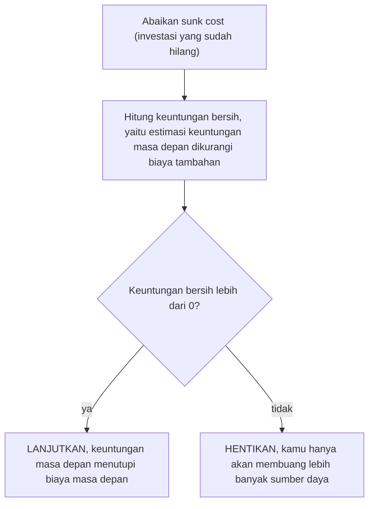

## Kekeliruan Biaya Tertanam (Sunk Cost Fallacy)

Pernahkah kamu duduk di dalam bioskop, menyadari bahwa film yang kamu tonton sangat buruk dan membosankan, namun kamu tetap bertahan hingga akhir? Semua itu hanya karena "sayang tiketnya sudah dibeli". Atau mungkin, kamu terus memperbaiki mobil tua yang terus-menerus mogok karena kamu sudah menghabiskan jutaan rupiah untuk servis sebelumnya?

Jika ya, kamu sedang terjebak dalam salah satu bias kognitif yang paling umum dan merusak secara finansial maupun emosional: **Kekeliruan Biaya Tertanam (Sunk Cost Fallacy).**

## 1. Apa Itu Sunk Cost Fallacy?

**Sunk Cost Fallacy** adalah kecenderungan seseorang untuk melanjutkan suatu usaha, proyek, atau perilaku karena mereka telah menginvestasikan sumber daya ke dalamnya (waktu, uang, atau tenaga), meskipun bukti menunjukkan bahwa melanjutkan hal tersebut tidak lagi memberikan keuntungan atau justru merugikan.

Dalam ekonomi, **Sunk Cost** (Biaya Tertanam) adalah biaya yang sudah terjadi dan tidak dapat dipulihkan kembali. Secara logika, biaya ini tidak boleh memengaruhi keputusan kita di masa depan. Namun, otak manusia sering kali gagal memisahkan investasi masa lalu dari potensi keuntungan masa depan.

> **Insight Utama:** Keputusan yang rasional seharusnya hanya didasarkan pada biaya dan manfaat di masa depan, bukan pada apa yang telah hilang di masa lalu.

## 2. Mengapa Otak Kita Terjebak?

Ada beberapa mekanisme psikologis yang membuat kita sulit melepaskan "biaya tertanam":

### A. Keengganan Merugi (Loss Aversion)

Manusia secara alami lebih takut kehilangan sesuatu daripada keinginan untuk mendapatkan sesuatu dengan nilai yang sama. Berhenti dari proyek yang gagal terasa seperti "mengakui kekalahan" atau "membuang uang", sementara terus melanjutkannya memberikan harapan palsu bahwa kita bisa "impas".

Secara matematis, dalam teori prospek, utilitas kerugian ($U$) dirasakan lebih dalam daripada keuntungan: $|U(-x)| > U(x)$. Artinya, rasa sakit kehilangan Rp1.000.000 lebih kuat daripada rasa senang mendapatkan Rp1.000.000.

### B. Menghindari Penyesalan

Kita sering merasa bahwa jika kita berhenti sekarang, semua investasi sebelumnya akan menjadi "sia-sia". Kita terus melangkah untuk memvalidasi keputusan masa lalu kita, meskipun keputusan tersebut sudah terbukti salah.

### C. Reputasi Sosial

Tidak ada orang yang ingin terlihat sebagai "orang yang mudah menyerah" atau plin-plan. Tekanan sosial sering kali memaksa kita untuk menyelesaikan apa yang sudah dimulai, meskipun secara objektif itu merugikan.

## 3. Concorde Effect

Sunk Cost Fallacy sering disebut juga sebagai **Concorde Effect**. Pada tahun 1950-an hingga 1970-an, pemerintah Inggris dan Prancis bekerja sama membangun pesawat supersonik bernama Concorde.

Di tengah jalan, mereka menyadari bahwa pesawat ini tidak akan pernah menguntungkan secara ekonomi karena biaya operasional yang sangat tinggi dan kapasitas penumpang yang terbatas. Namun, alih-alih menghentikan proyek tersebut, kedua negara terus mengucurkan dana miliaran dolar hanya karena mereka sudah terlanjur berinvestasi terlalu banyak. Mereka tidak ingin kehilangan muka di panggung internasional.

*Hasilnya?* Mereka kehilangan jauh lebih banyak uang daripada jika mereka berhenti lebih awal.

## 4. Implementasi dalam Pengambilan Keputusan Teknis

Dalam dunia rekayasa perangkat lunak atau manajemen proyek, bias ini sering muncul saat kita terjebak pada teknologi lama atau fitur yang tidak relevan.

### Proyek Perangkat Lunak Berbasis Framework A

Bayangkan tim kamu telah menghabiskan 6 bulan membangun arsitektur sistem menggunakan *Framework A*. Di bulan ke-7, muncul teknologi baru yang jauh lebih efisien, dan data menunjukkan bahwa melanjutkan dengan *Framework A* akan membuat biaya *maintenance* membengkak di masa depan.

**Logika Bias (Sunk Cost):** "Kita sudah menulis 10.000 baris kode di Framework A. Sayang kalau harus dibuang dan mulai dari nol."

**Logika Rasional:** Mari kita bandingkan dua opsi menggunakan perhitungan sederhana:

1. **Lanjut Framework A:**

   

   $$
   \text{Biaya Masa Depan} = \text{Rp } 500.000.000
   $$
   

2. **Pindah ke Framework Baru:**

   

   $$
   \text{Biaya Adaptasi} + \text{Biaya Baru} = \text{Rp } 300.000.000
   $$
   

Secara objektif, opsi 2 lebih baik meskipun investasi 6 bulan sebelumnya "hilang".

### Melanjutkan atau Menghentikan Proyek

Prinsip ekonomi yang sama bisa membantu menentukan apakah sebuah proyek layak dilanjutkan. Secara rasional, kita hanya melihat masa depan, jadi investasi yang sudah hilang tidak ikut dihitung. Bila keuntungan bersihnya positif, proyek layak dilanjutkan karena keuntungan masa depan menutupi biaya masa depan. Bila tidak, melanjutkannya hanya membuang lebih banyak sumber daya. Urutan pertimbangannya bisa kamu ikuti lewat alur berikut.

Contohnya, dengan angka ilustrasi: sebuah proyek aplikasi sudah menghabiskan Rp100 juta, tetapi butuh Rp50 juta lagi untuk selesai, padahal pasarnya sudah hilang sehingga aplikasi itu hanya bernilai Rp30 juta.

| Komponen | Nilai |
| --- | --- |
| Investasi yang sudah hilang (sunk cost) | Rp100 juta, diabaikan |
| Biaya tambahan yang dibutuhkan | Rp50 juta |
| Estimasi keuntungan masa depan | Rp30 juta |
| Keuntungan bersih (Rp30 juta - Rp50 juta) | -Rp20 juta |
| Keputusan | Hentikan |

Keuntungan bersihnya negatif, jadi proyek sebaiknya dihentikan. Rp100 juta yang sudah keluar tidak mengubah hasil hitungan ini sama sekali.

## 5. Real-World Applications (Aplikasi Dunia Nyata)

### Dalam Bisnis

Banyak perusahaan mempertahankan lini produk yang merugi karena mereka telah menghabiskan banyak uang untuk riset dan pengembangan (R&D). Sebaliknya, ada perusahaan yang berani melakukan "Pivot" (berubah arah) meskipun harus membuang investasi awal.

### Dalam Hubungan Personal

Banyak orang bertahan dalam hubungan yang beracun (*toxic*) hanya karena mereka "sudah pacaran selama 5 tahun". Mereka menganggap 5 tahun itu sebagai alasan untuk bertahan, tanpa menyadari bahwa dengan bertahan, mereka mungkin akan membuang 50 tahun sisa hidup mereka dalam ketidakbahagiaan.

### Dalam Pendidikan dan Karier

Seorang mahasiswa tetap melanjutkan jurusan yang tidak ia sukai hingga lulus hanya karena "sudah semester 6". Meskipun gelar tersebut mungkin tidak akan pernah ia gunakan di masa depan.

## 6. Teknik Mitigasi Sunk Cost Fallacy

Untuk melawan Sunk Cost Fallacy, kamu perlu melatih cara berpikir objektif:

1. **Abaikan Masa Lalu:** Saat mengambil keputusan, tanyakan pada diri sendiri: *"Jika saya baru memulai hari ini tanpa ada beban masa lalu, apakah saya akan memilih jalan ini?"*
2. **Fokus pada Biaya Peluang (Opportunity Cost):** Sadarilah bahwa setiap rupiah atau jam yang kamu habiskan untuk proyek yang gagal adalah sumber daya yang bisa kamu gunakan untuk proyek lain yang lebih menjanjikan.
3. **Gunakan Penasihat Luar:** Orang luar yang tidak memiliki ikatan emosional dengan investasi kamu akan lebih mudah melihat bahwa suatu proyek sudah tidak layak dilanjutkan.
4. **Tetapkan Batas Berhenti (Stop-Loss):** Sebelum memulai sesuatu, tentukan di titik mana kamu akan berhenti jika target tidak tercapai.

*Coba ingat-ingat satu hal dalam hidup kamu saat ini yang tetap kamu lakukan hanya karena kamu 'sudah terlanjur'. Jika kamu berhenti sekarang, peluang baru apa yang bisa kamu kejar?*

> **Pesan Penting:** Menyerah pada hal yang salah bukanlah sebuah kegagalan. Ini adalah langkah cerdas untuk memberikan ruang bagi hal yang benar.
