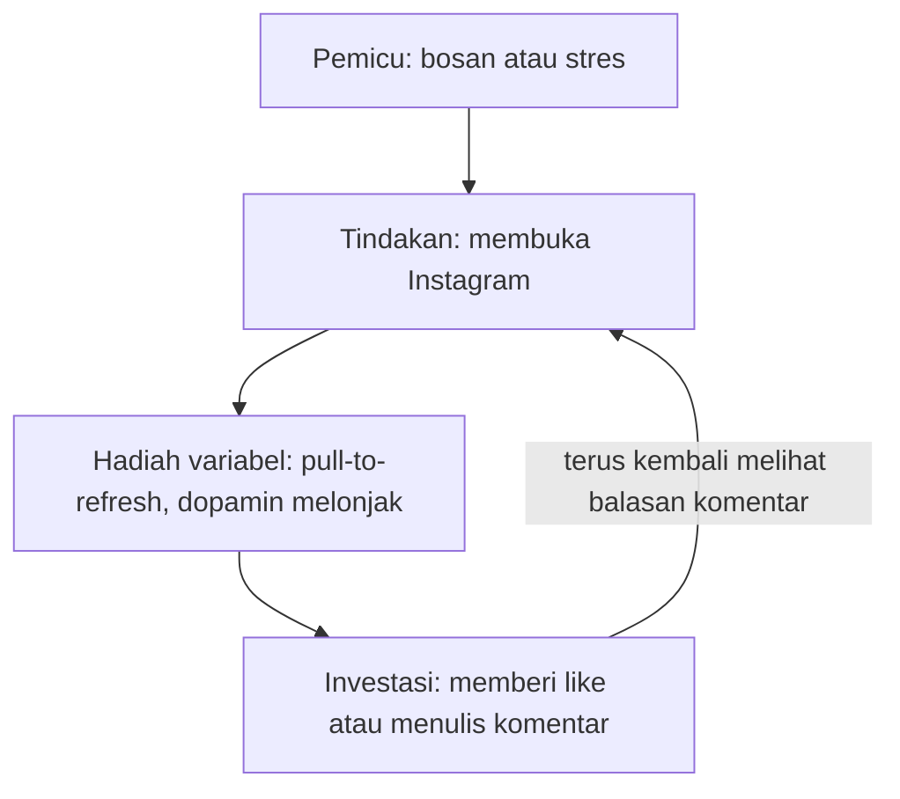

## Psikologi di Balik Attention Economy (Ekonomi Perhatian)

Kebiasaan menatap layar lebih lama dari niat awal berakar pada cara aplikasi dirancang untuk menahan perhatianmu selama mungkin. Jika kamu pernah merasa ingin membuka Instagram "hanya untuk lima menit" tetapi tiba-tiba tersadar satu jam telah berlalu, kamu tidak sedang berhalusinasi. Kamu juga tidak sedang menunjukkan kelemahan karakter.

Kamu sebenarnya sedang berhadapan dengan ribuan insinyur perangkat lunak dan psikolog perilaku di Silicon Valley yang tugas satu-satunya adalah memastikan kamu tetap menatap layar sesering dan selama mungkin. Inilah yang disebut dengan **Ekonomi Perhatian (Attention Economy)**.

## 1\. Perhatian Adalah Mata Uang Baru

Dalam ekonomi tradisional, kita bertukar uang untuk barang atau jasa. Namun, di dunia digital yang "gratis", mata uangnya telah berubah.

> Andrew Lewis, pengguna MetaFilter dengan nama blue_beetle, menulisnya dengan ringkas pada 2010: "Kalau kamu tidak membayar untuk sesuatu, kamu bukan pelanggan; **kamulah produk yang sedang dijual**." Perhatianmu adalah komoditas yang dijual kepada pengiklan.

Bayangkan perhatianmu seperti sebidang tanah yang subur. Perusahaan teknologi adalah "petani" yang berusaha memanen hasil dari tanah tersebut. Semakin lama mereka bisa membuat kamu menatap layar, semakin banyak data yang mereka kumpulkan, dan semakin mahal harga yang bisa mereka tawarkan kepada pengiklan.

## 2\. Peran Dopamin

Banyak orang salah mengira bahwa **Dopamin** adalah hormon "kebahagiaan". Secara teknis, dopamin lebih tepat disebut sebagai neurotransmiter "pencarian" atau "antisipasi".

### Siklus Dopamin

Dopamin dilepaskan bukan saat kita mendapatkan hadiah, tetapi saat kita **mengharapkan** hadiah. Secara matematis, kita bisa melihat hubungan antara ekspektasi dan kepuasan sebagai berikut:

$$
\text{Kepuasan} = \text{Realitas} - \text{Ekspektasi}
$$

Dalam media sosial, variabel ekspektasi ini dimanipulasi secara konstan. Ketika kamu melihat ikon merah notifikasi, otakmu melepaskan dopamin yang membisikkan, *"Siapa yang menyukai foto saya? Pesan apa ini?"*. Rasa ingin tahu ini menciptakan tekanan psikologis yang hanya bisa diredakan dengan membuka aplikasi tersebut.

*Coba Amati Respons Diri: Pernahkah muncul rasa cemas saat ponsel berada di ruangan lain? Hal tersebut merupakan manifestasi fisik dari sinyal dopamin yang memicu dorongan pemeriksaan perangkat.*

## 3\. Efek Slot Machine

Mengapa kita terus melakukan *scrolling* meskipun kontennya membosankan? Jawabannya terletak pada eksperimen psikolog B.F. Skinner tentang **Variable Rewards** (Hadiah Variabel).

### Analogi Mesin Judi (Slot Machine)

Bayangkan sebuah mesin judi. Kamu menarik tuasnya berulang kali bukan karena menang setiap saat, tetapi karena kamu **mungkin** menang di tarikan berikutnya.

Aplikasi modern dirancang persis seperti ini:

- **Pull-to-Refresh:** Tindakan menarik layar ke bawah untuk memperbarui konten sangat mirip dengan menarik tuas mesin judi. Ada jeda sesaat (animasi berputar) yang membangun ketegangan sebelum konten baru muncul.
- **Isi yang Tidak Terprediksi:** Kadang kamu melihat berita duka, kadang video kucing lucu, kadang foto teman yang sedang berlibur. Ketidakteraturan inilah yang membuat otak kita ketagihan.

**Catatan:** Jika setiap kali membuka aplikasi kamu mendapatkan konten yang sama atau selalu bagus, kamu akan cepat bosan. Justru karena tidak semua kontennya menarik, otakmu terus mencari yang menarik itu.

## 4\. Fitur Validasi Sosial

Manusia adalah makhluk sosial yang secara evolusioner takut dikucilkan dari kelompok. Industri teknologi memanfaatkan rasa takut ini melalui fitur-fitur validasi:

1. **Likes dan Reactions:** Indikator numerik dari status sosial kita.
2. **Read Receipts (Centang Biru):** Menciptakan tekanan psikologis untuk segera membalas agar tidak dianggap tidak sopan.
3. **Tags dan Mentions:** Memaksa kita untuk kembali ke aplikasi karena nama kita disebut (identitas kita terlibat).

## 5\. Dark Patterns

Selain psikologi internal, ada teknik desain visual yang digunakan untuk memanen perhatian secara agresif:

- **Infinite Scroll (Gulir Tanpa Batas):** Menghilangkan "sinyal berhenti". Di masa lalu, koran memiliki halaman terakhir dan buku memiliki bab penutup. *Infinite scroll* membuat konsumsi informasi menjadi tanpa dasar, sehingga otak tidak pernah menerima sinyal untuk berhenti.
- **Autoplay:** Sebelum kamu sempat memutuskan untuk berhenti menonton, video berikutnya sudah dimulai. Ini memanfaatkan **inersia kognitif**: lebih mudah untuk terus menonton daripada mengambil tindakan untuk berhenti.
- **The Red Dot (Titik Merah):** Lencana merah ini menarik mata untuk segera melihatnya.

## 6\. Anatomi Sebuah Sesi Media Sosial

Mari kita lihat bagaimana teori-teori di atas bekerja dalam skenario nyata:

**Skenario Siang Hari yang Membosankan di Kantor**

1. **Pemicu (Trigger):** Kamu merasa sedikit bosan atau stres (ketidaknyamanan emosional).
2. **Tindakan (Action):** Secara otomatis, tanganmu merogoh saku dan membuka Instagram.
3. **Hadiah Variabel (Variable Reward):** Kamu melakukan *pull-to-refresh*. Foto pertama biasa saja, foto kedua adalah iklan, tapi foto ketiga adalah foto mantanmu yang baru saja bertunangan. Dopamin melonjak. Kamu terpaku untuk mencari tahu lebih lanjut.
4. **Investasi (Investment):** Kamu memberikan *like* atau menulis komentar. Sekarang kamu telah "menanam saham" dan akan terus kembali untuk melihat apakah ada orang yang membalas komentarmu.

Kalau digambar, keempat langkah itu membentuk lingkaran yang membuatmu terus kembali.

### Perbandingan Efek Psikologis

| Fitur | Mekanisme Psikologi | Dampak pada Pengguna |
| --- | --- | --- |
| **Notifications** | Classical Conditioning | Refleks otomatis untuk mengecek HP |
| **Snapstreaks** | Loss Aversion | Takut kehilangan "prestasi" yang sudah dibangun |
| **Infinite Scroll** | Lack of Stopping Cues | Kehilangan jejak waktu (Time-warping) |

## Merebut Kembali Kendali

Kesadaran adalah langkah pertama. Begitu kamu menyadari bahwa aplikasi-aplikasi ini dirancang layaknya mesin judi, kamu akan mulai mengenali jebakan-jebakan yang berusaha menarik perhatianmu.

Teknologi bisa menjadi pelayan yang sangat baik, tetapi juga tuan yang sangat buruk.

*Tugas refleksi:* Amati perasaanmu saat membuka media sosial nanti. Apakah ada tujuan spesifik, atau jempolmu bergerak sendiri berburu dopamin?

*Materi selanjutnya akan membahas cara memakai nilai-nilai hidup untuk melindungi perhatianmu dari manipulasi.*
