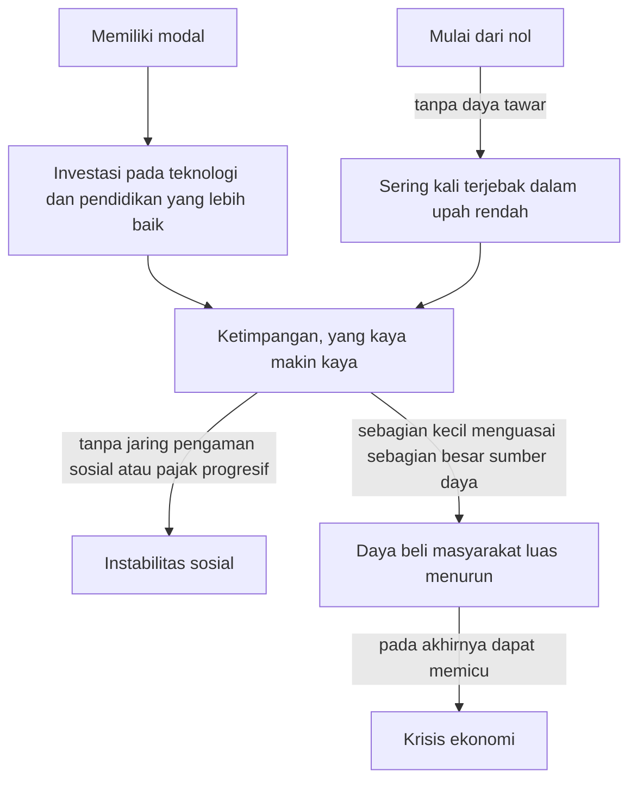

## Kritik terhadap Sistem Laissez-faire

Sistem **Laissez-faire** sering digambarkan sebagai tatanan ekonomi yang sempurna, tempat setiap individu mengejar kepentingan pribadinya. Dari situ, kesejahteraan bagi masyarakat luas dianggap tercipta secara otomatis. Namun, dalam praktiknya, sistem ini sering kali menimbulkan masalah.

Meskipun prinsip "biarkan terjadi" (Laissez-faire) menawarkan kebebasan, para kritikus berpendapat bahwa tanpa aturan main dan wasit yang tegas, yaitu pemerintah, pasar bebas dapat menimbulkan kerusakan. Kritik itu menyoroti dampak buruk dari kebebasan pasar yang tidak dibatasi.

## 1. Risiko Monopoli

Salah satu ironi dari Laissez-faire adalah bahwa persaingan bebas cenderung menghancurkan dirinya sendiri. Tanpa regulasi antimonopoli, perusahaan yang paling efisien atau paling agresif dapat menyingkirkan pesaingnya hingga tidak ada lagi pilihan bagi konsumen.

### Permainan Papan Monopoly

Bayangkan kamu bermain permainan papan *Monopoly*. Pada awalnya, semua orang memiliki peluang yang sama. Namun, begitu satu pemain berhasil menguasai tanah-tanah strategis dan membangun hotel, pemain lain akan perlahan bangkrut karena harus membayar sewa yang mahal. Di akhir permainan, satu orang menguasai segalanya, dan permainan berakhir karena tidak ada lagi persaingan. Inilah yang dikhawatirkan kritikus: **Laissez-faire pada titik ekstremnya akan menghilangkan kompetisi yang menjadi penggeraknya sendiri.**

**Dampak Negatif Monopoli:**

- **Harga Tinggi:** Tanpa pesaing, perusahaan bebas menentukan harga sesuka hati.
- **Inovasi Terhenti:** Jika tidak ada ancaman dari pesaing, perusahaan tidak memiliki insentif untuk memperbaiki produk.
- **Hambatan Masuk:** Perusahaan raksasa dapat menggunakan kekuatannya untuk mencegah pemain baru (startup) masuk ke pasar.

## 2. Ketimpangan Ekonomi

Kritik utama terhadap Laissez-faire adalah kecenderungannya untuk memperlebar jurang antara si kaya dan si miskin. Dalam sistem ini, modal cenderung mengalir kepada mereka yang sudah memilikinya.

> "Pasar bebas sangat ahli dalam memproduksi kekayaan, tetapi sangat buruk dalam mendistribusikannya secara adil."

### Efek Matius (Matthew Effect)

Dalam sosiologi dan ekonomi, fenomena ini sering disebut sebagai kecenderungan "yang kaya makin kaya":

- Mereka yang memiliki modal dapat berinvestasi pada teknologi dan pendidikan yang lebih baik.
- Mereka yang mulai dari nol sering kali terjebak dalam upah rendah karena tidak memiliki daya tawar di hadapan pemilik modal besar.

Tanpa adanya jaring pengaman sosial atau pajak progresif yang dikelola pemerintah, ketimpangan ini dapat menyebabkan **instabilitas sosial**. Ketika sebagian kecil populasi menguasai sebagian besar sumber daya, daya beli masyarakat luas akan menurun, yang pada akhirnya dapat memicu krisis ekonomi.

Bagan berikut merangkum bagaimana Efek Matius bisa berujung pada instabilitas sosial dan krisis ekonomi.

## 3. Pengabaian Eksternalitas Negatif

Dalam model Laissez-faire klasik, transaksi dianggap hanya melibatkan penjual dan pembeli. Namun, sering kali ada pihak ketiga yang menanggung beban dari transaksi tersebut tanpa mendapatkan kompensasi. Inilah yang disebut sebagai **eksternalitas negatif**.

### Masalah Polusi

Sebagai gambaran, sebuah pabrik mungkin memproduksi barang dengan harga murah dan efisien menurut hitungan pasar. Namun, jika pabrik tersebut membuang limbah ke sungai, masyarakat sekitar akan mengalami masalah kesehatan.

- **Biaya Marginal Privat (*Marginal Private Cost* / MPC):** Biaya bahan baku dan tenaga kerja yang ditanggung produsen.
- **Biaya Marginal Sosial (*Marginal Social Cost* / MSC):** Biaya pengobatan masyarakat dan kerusakan ekosistem yang ditanggung publik.

Secara matematis, kegagalan pasar ini terjadi karena harga pasar $P$ tidak mencerminkan biaya sosial yang sebenarnya:

$$
\text{MSC} > \text{MPC}
$$

Dalam sistem Laissez-faire murni, perusahaan tidak memiliki insentif finansial untuk mengurangi polusi karena hal itu akan menambah biaya produksi dan mengurangi keuntungan mereka.

## 4. Eksploitasi Tenaga Kerja

Tanpa campur tangan pemerintah melalui undang-undang ketenagakerjaan, hubungan antara pemberi kerja dan pekerja sering kali tidak seimbang. Kritikus menyoroti bahwa dalam sejarah Laissez-faire (seperti pada awal Revolusi Industri), pasar yang benar-benar bebas berujung pada:

- **Jam kerja yang tidak manusiawi** (12–16 jam sehari).
- **Lingkungan kerja yang berbahaya**.
- **Pekerja anak**, karena mereka adalah tenaga kerja yang paling murah.

> Jika pasar hanya peduli pada efisiensi biaya, apakah martabat manusia akan dikorbankan demi mengejar margin keuntungan yang lebih tinggi?

## Standard Oil (1870–1911)

Salah satu contoh sejarah paling nyata dari kritik terhadap Laissez-faire adalah bangkitnya **Standard Oil** milik John D. Rockefeller di Amerika Serikat.

- **Skenario:** Melalui praktik bisnis yang agresif dan kurangnya regulasi pemerintah saat itu, Standard Oil berhasil menguasai hampir **90% kilang minyak** di AS. Mereka menggunakan teknik *predatory pricing* (menurunkan harga secara ekstrem untuk membangkrutkan pesaing, lalu menaikkannya kembali setelah pesaing tumbang).
- **Hasilnya:** Pemerintah AS akhirnya harus melakukan intervensi melalui *Sherman Antitrust Act* pada tahun 1890, dan Mahkamah Agung AS memerintahkan pemecahan Standard Oil menjadi 34 perusahaan kecil pada tahun 1911. Kasus ini membuktikan bahwa pasar tidak selalu bisa menyembuhkan dirinya sendiri dari praktik monopoli.

## Ringkasan Argumen Kontra

| Masalah | Deskripsi | Konsekuensi |
| --- | --- | --- |
| **Monopoli** | Konsolidasi kekuatan pasar pada satu entitas. | Harga mahal, pilihan terbatas. |
| **Ketimpangan** | Akumulasi kekayaan di puncak piramida ekonomi. | Ketegangan sosial, rendahnya mobilitas vertikal. |
| **Eksternalitas** | Dampak buruk pada pihak ketiga (misal: polusi). | Kerusakan lingkungan, krisis kesehatan publik. |
| **Barang Publik** | Pasar tidak tertarik memproduksi barang yang tidak bisa dijual secara individu. | Infrastruktur publik yang terbengkalai. |

> **Catatan Penting:** Kritik terhadap Laissez-faire bukan berarti menyatakan bahwa pasar itu buruk. Sebaliknya, kritik ini menekankan bahwa **pasar memerlukan koridor hukum dan etika** agar tetap berfungsi untuk kepentingan orang banyak, bukan hanya untuk segelintir pemenang.

Setelah memahami kritik ini, pada bagian selanjutnya kita akan mempelajari bagaimana "Kegagalan Pasar" menjadi alasan fundamental bagi munculnya kebijakan ekonomi modern yang melibatkan intervensi pemerintah.
