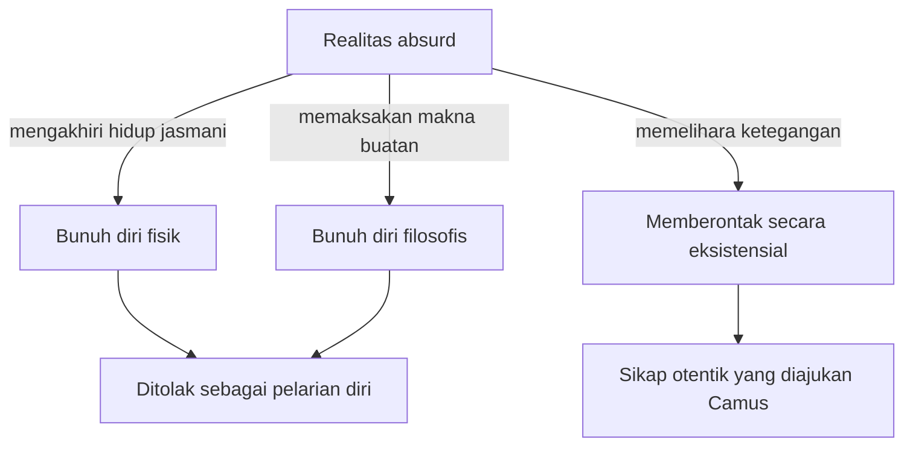

## Dunia yang Absurd dan Pemberontakan Manusia

Konsep absurdisme Albert Camus menelaah ketegangan eksistensial saat hasrat manusia akan makna berbenturan dengan kesunyian alam semesta yang irasional. Jika Jean-Paul Sartre menekankan bahwa kebebasan merupakan kondisi ontologis niscaya, Camus mengajak kita menelaah realitas yang lebih mendasar: disonansi antara kerinduan rasional manusia akan kejelasan dan realitas kosmik yang sepenuhnya membisu.

### 1. Apa yang Dimaksud Absurd

Dalam pemikiran Camus, istilah "absurd" bukanlah sekadar keanehan situasi sehari-hari, melainkan sebuah kategori epistemologis yang spesifik. Absurditas lahir secara eksklusif dari relasi benturan antara dua elemen:

1. Kebutuhan intrinsik kesadaran manusia akan kejelasan, kepastian, dan tatanan makna teleologis.
2. Karakter alam semesta yang dingin, kontingen, dan tidak menyediakan jawaban atas pencarian manusia.

$$
\text{Hasrat Makna (Manusia)} + \text{Kesunyian Kosmik (Dunia)} = \text{Kondisi Absurd}
$$

Absurditas tidak berada di dalam diri subjek semata, tidak pula bersemayam di alam semesta secara terisolasi. Kondisi absurd terartikulasi secara murni dalam jalinan relasi ketegangan antara keduanya.

### 2. Mitos Sisifus

Camus mengangkat figur mitologi Yunani, **Sisifus**, sebagai metafora kondisi eksistensial manusia. Para dewa menjatuhkan kutukan kepada Sisifus untuk mendorong sebongkah batu besar ke puncak gunung, hanya untuk menyaksikan batu tersebut berguling kembali ke dasar gunung, memaksanya mengulangi siklus tersebut tanpa akhir.

| Dimensi Mitologis | Signifikasi Filosofis Eksistensial |
| :--- | :--- |
| **Siklus Repetitif** | Rutinitas aktivitas manusia yang berjalan mekanis tanpa tujuan metafisik final. |
| **Momen Refleksi** | Titik kesadaran saat Sisifus menuruni gunung untuk mengambil kembali batunya. |
| **Kemenangan Batin** | Kesadaran penuh atas absurditas yang melampaui keputusasaan nasib. |

Camus menegaskan bahwa momen paling krusial terletak pada saat Sisifus melangkah turun kembali ke dasar gunung. Pada jeda kesadaran tersebut, Sisifus menyadari sepenuhnya ketidakbermaknaan objektif tugasnya, dan kesadaran inilah yang mentransformasikan penderitaan menjadi kemenangan intelek yang otonom.

### 3. Kemungkinan Sikap terhadap Absurditas

Dalam menghadapi realitas absurd, Camus memetakan tiga kemungkinan sikap yang dapat diambil oleh manusia:

#### a. Bunuh Diri Fisik (*Physical Suicide*)
Upaya mengakhiri hidup jasmani setelah menyimpulkan ketiadaan makna hidup. Camus menolak opsi ini secara tegas karena tindakan bunuh diri bukan pemecahan atas absurditas, melainkan bentuk penyerahan diri dan kekalahan total di hadapan ketiadaan makna.

#### b. Bunuh Diri Filosofis (*Philosophical Suicide / Leap of Faith*)
Tindakan melarikan diri dari ketegangan absurd dengan cara memaksakan makna transenden buatan melalui dogma keagamaan atau ilusi metafisik. Camus mengklasifikasikannya sebagai bunuh diri filosofis karena subjek mengorbankan integritas nalar rasional demi ilusi kepastian mental.

#### c. Pemberontakan Eksistensial (*Rebellion*)
Sikap otentik yang diajukan oleh Camus, yakni memelihara ketegangan absurd tanpa kompromi:
- Mengakui realitas absurd secara jernih dan jujur.
- Menolak pelarian diri melalui bunuh diri fisik maupun ilusi transendensi.
- Memilih untuk terus hidup, berkarya, dan mengartikulasikan kebebasan secara intensif.

Ketiga sikap itu bisa kamu bandingkan sekaligus dalam bagan berikut.

### 4. Tiga Pilar Pahlawan Absurd

Aktualisasi pemberontakan dalam praksis kehidupan ditopang oleh tiga pilar utama:

1. **Pemberontakan (*Rebellion*):** Menolak tunduk pada kepasrahan dan terus menjalani eksistensi sebagai wujud perlawanan sadar terhadap ketidakpedulian alam semesta.
2. **Kebebasan (*Freedom*):** Pelepasan dari ilusi takdir metafisik yang membuka ruang kedaulatan bagi individu untuk menentukan tindakannya sendiri pada masa kini.
3. **Gairah (*Passion*):** Memaksimalkan kualitas dan intensitas pengalaman hidup pada momen kekinian (*here and now*).

### 5. Membayangkan Sisifus Bahagia

Pernyataan kanonik Albert Camus berbunyi: *"Seseorang harus membayangkan Sisifus bahagia."*

Kebahagiaan Sisifus berakar pada kedaulatan batiniahnya. Batu dan gunung tersebut adalah dunianya, dan perjuangan mendorongnya ke atas adalah ekspresi otonom dari keberadaannya. Ketika manusia melepaskan tuntutan akan makna objektif dari luar, ia menemukan kebebasan untuk menciptakan maknanya sendiri di tengah realitas yang absurd.
