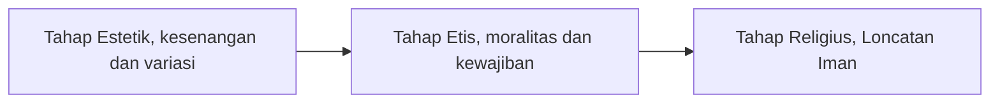
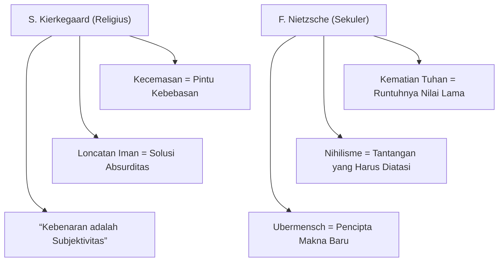

## Akar Historis Kierkegaard dan Nietzsche

Selamat datang di titik awal perjalanan eksistensialisme. Sebelum Jean-Paul Sartre mempopulerkan istilah ini di kafe-kafe Paris pada abad ke-20, dua pemikir besar abad ke-19 telah meletakkan fondasinya. Meskipun mereka tidak pernah bertemu dan memiliki latar belakang yang sangat berbeda (yang satu seorang Kristen taat dan yang lainnya pengkritik keras agama), keduanya sepakat pada satu hal: **Individu adalah pusat dari kebenaran.**

Mari kita telusuri bagaimana kegelisahan Søren Kierkegaard dan pemberontakan Friedrich Nietzsche membentuk cara kita memahami makna hidup hari ini.

## 1. Søren Kierkegaard sebagai Bapak Eksistensialisme dan Kesatria Iman

Søren Kierkegaard (1813–1855) adalah seorang filsuf Denmark yang merasa muak dengan filsafat sistematis zamannya yang mencoba menjelaskan segalanya secara logis. Bagi Kierkegaard, hidup bukanlah teka-teki logika untuk dipecahkan. Hidup adalah kenyataan yang mesti kamu jalani.

### Kecemasan (Angst) sebagai "Pusing karena Kebebasan"

Kierkegaard memperkenalkan konsep *Angst* atau kecemasan. Berbeda dengan rasa takut yang memiliki objek spesifik seperti laba-laba, kecemasan bersifat abstrak.

> **Analogi Jurang:** Bayangkan kamu berdiri di tepi tebing yang sangat tinggi. Kamu merasakan pusing. Menurut Kierkegaard, pening itu tidak sekadar dipicu ketakutan akan ketinggian. Kamu pusing karena menyadari bahwa kamu punya kuasa untuk melompat. Di situlah kecemasan lahir: kesadaran penuh atas kebebasan mutlak yang kamu miliki.

### Tiga Tahap Eksistensi

Kierkegaard berpendapat bahwa manusia bergerak melalui tiga tahap dalam pencarian makna:

1. **Tahap Estetik**: Pencarian kesenangan dan variasi demi menghindari kebosanan. Contoh nyatanya adalah seseorang yang gemar berganti hobi atau pasangan demi sensasi sesaat.
2. **Tahap Etis**: Mulai hidup dengan berpegang pada moralitas, kewajiban, dan tanggung jawab sosial, seperti berkomitmen dalam keluarga atau masyarakat.
3. **Tahap Religius**: Hubungan langsung antara individu dan Tuhan melalui **"Loncatan Iman" (Leap of Faith)**. Langkah ini melampaui logika rasional demi keyakinan personal yang mendalam.

Kalau ketiga tahap itu kamu baca sebagai satu perjalanan, urutannya seperti ini.

### Kebenaran adalah Subjektivitas

Kierkegaard meyakini kebenaran terpenting tidak bersifat objektif seperti rumus matematika $2 + 2 = 4$. Kebenaran sejati bersifat subjektif, yaitu nilai yang kamu yakini secara personal dan membuatmu rela hidup atau mati untuk mempertahankannya.

## 2. Kematian Tuhan dan Kelahiran Nilai Baru menurut Friedrich Nietzsche

Jika Kierkegaard mencari makna di dalam Tuhan, Friedrich Nietzsche (1844–1900) melihat bahwa peradaban Barat sedang menuju krisis besar karena kehilangan landasan moral tradisionalnya.

### "Tuhan Sudah Mati" (Gott ist tot)

Pernyataan Nietzsche ini sangat populer sekaligus paling sering disalahpahami. Dia tidak bermaksud mengumumkan kematian sosok supranatural. Nietzsche ingin menunjukkan bahwa kepercayaan pada Tuhan telah kehilangan perannya sebagai poros moral dan kebudayaan masyarakat modern.

**Konsekuensi Logis:** Jika Tuhan yang menjadi sumber nilai absolut hilang, nihilisme akan membayangi manusia:

$$
\text{Ketiadaan Standar Absolut} \rightarrow \text{Nihilisme}
$$

Nihilisme adalah kondisi ketika hidup terasa hampa, tanpa tujuan, arti, atau nilai bawaan.

### Ubermensch

Nietzsche tidak ingin manusia terpuruk dalam nihilisme. Sebagai penawarnya, dia menggagas konsep **Übermensch** (Manusia Unggul). Konsep ini merujuk pada sosok individu mandiri yang:

- Mereka berani menciptakan nilai-nilainya sendiri saat fondasi lama runtuh.
- Menghadapi penderitaan dengan sikap afirmatif terhadap kehidupan.
- Keberanian untuk lepas dari "moralitas budak" atau mentalitas ikut-ikutan.

### Kehendak untuk Berkuasa (Will to Power)

Nietzsche percaya dorongan dasar manusia melampaui sekadar pertahanan hidup ala teori Darwin. Manusia selalu berhasrat untuk tumbuh, mengekspresikan diri, dan melampaui keterbatasan dirinya.

> **Penting:** Dalam konteks ini, kehendak untuk berkuasa merujuk pada penguasaan atas diri sendiri (*self-mastery*), bukan dominasi untuk menindas orang lain.

## Kierkegaard vs Nietzsche

| Konsep | Søren Kierkegaard | Friedrich Nietzsche |
| --- | --- | --- |
| **Masalah Utama** | Rasa putus asa dan keterasingan dari Tuhan. | Nihilisme akibat hilangnya otoritas agama. |
| **Solusi** | Loncatan Iman ke dalam religiusitas. | Penciptaan nilai baru melalui *Übermensch*. |
| **Pandangan tentang Individu** | Individu yang berdiri sendiri di hadapan Tuhan. | Individu yang mengatasi diri sendiri di dunia. |
| **Fokus Utama** | Subjektivitas dan Iman. | Kehendak untuk Berkuasa dan Kreativitas. |

## Mengapa Mereka Relevan Sekarang?

Gagasan kedua pemikir ini bukan sekadar warisan masa lalu. Kita bisa memanfaatkannya sebagai panduan praktis untuk mengarungi dinamika dunia modern:

- **Menjinakkan FOMO (Fear of Missing Out)**: Gagasan Kierkegaard tentang kecemasan mengingatkan kita bahwa bingung memilih arah adalah tanda kebebasan yang nyata. Alih-alih cemas dan menghindar, kita ditantang mengambil keputusan secara utuh.
- **Navigasi Krisis Makna di Era Digital**: Nietzsche menawarkan jalan keluar dari kehampaan modern lewat konsep *Übermensch*. Kita didorong menolak arus tren media sosial secara buta, lalu merumuskan sendiri prinsip hidup yang berharga, misalnya memprioritaskan integritas dibanding popularitas.

### Karier vs Panggilan

Bayangkan Budi, seorang akuntan sukses yang merasa hampa.

- **Secara Kierkegaardian:** Budi mungkin berada di tahap etis. Ia harus melakukan "loncatan" untuk menemukan apa yang secara subjektif bermakna baginya, mungkin sebuah panggilan spiritual atau pengabdian yang melampaui logika karier.
- **Secara Nietzschean:** Budi harus sadar bahwa "makna" tidak akan turun dari langit. Ia harus menggunakan kehendak untuk berkuasanya untuk mendefinisikan ulang siapa dirinya, mungkin dengan menciptakan karya seni atau membangun sistem baru yang mencerminkan nilai pribadinya, bukan nilai perusahaan.

## Dua Cabang Akar Eksistensialisme

Kedua akar eksistensialisme dalam bab ini bisa kamu rangkum menjadi dua cabang berikut.

