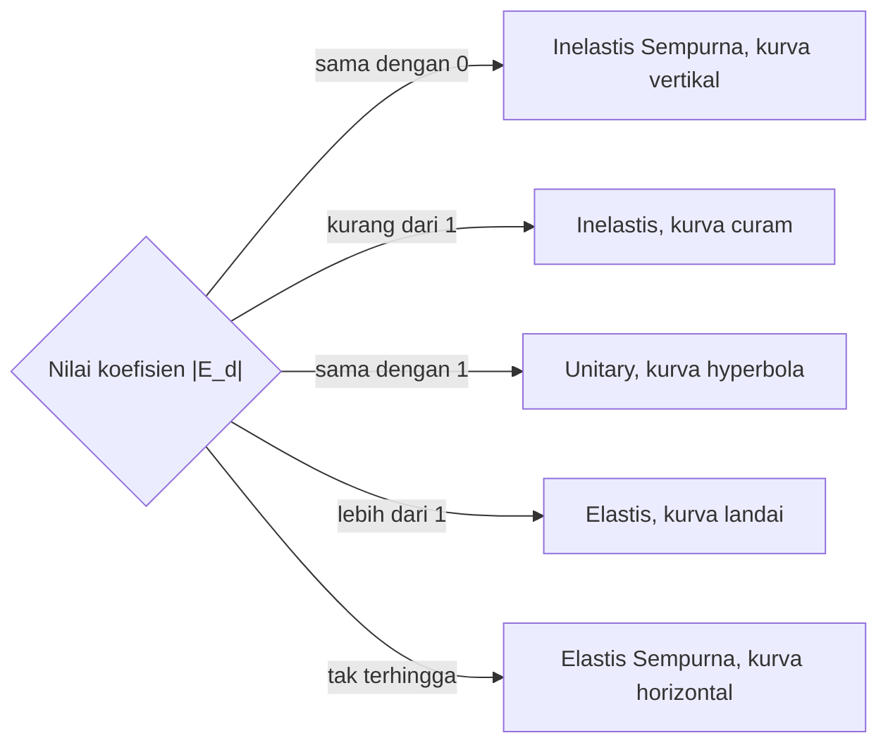

## Klasifikasi dan Derajat Elastisitas Permintaan
Setelah memahami cara menghitung koefisien elastisitas pada materi sebelumnya, muncul pertanyaan berikutnya yang perlu dijawab. **"Apa arti dari angka-angka tersebut?"**
Dalam ekonomi, tidak semua barang memberikan reaksi yang sama terhadap perubahan harga. Ada barang yang permintaannya langsung turun tajam saat harganya naik sedikit saja, namun ada juga barang yang permintaannya hampir tidak berubah meskipun harganya melonjak drastis. Fenomena ini kita klasifikasikan ke dalam lima derajat elastisitas permintaan.
### Karet Gelang vs. Kawat Besi
Bayangkan permintaan konsumen adalah sebuah benda yang ditarik oleh kekuatan bernama "Perubahan Harga".
- Beberapa benda bersifat seperti **karet gelang yang lentur**: ditarik sedikit saja, ia akan meregang panjang (Elastis).
- Beberapa benda seperti **karet yang kaku**: butuh tenaga besar untuk membuatnya berubah sedikit (Inelastis).
- Bahkan ada benda yang seperti **kawat besi**: ditarik sekuat apa pun, panjangnya tidak berubah (Inelastis Sempurna).
### 1. Permintaan Elastis
Permintaan dikatakan elastis jika persentase perubahan jumlah barang yang diminta **lebih besar** daripada persentase perubahan harga. Konsumen dalam kategori ini sangat sensitif terhadap harga.
- **Karakteristik:** Jika harga naik 10%, maka jumlah permintaan akan turun lebih dari 10%.
- **Representasi Grafis:** Kurva cenderung **landai**. Hal ini menunjukkan bahwa sedikit pergeseran pada sumbu vertikal (Harga) mengakibatkan pergeseran besar pada sumbu horizontal (Jumlah).
- **Contoh:** Barang-barang mewah (mobil sport, perhiasan) atau barang yang memiliki banyak substitusi (misalnya, merk sabun tertentu). Jika merk A naik harganya, konsumen dengan mudah pindah ke merk B.
> **Pesan Penting:** Untuk barang elastis, strategi menaikkan harga seringkali justru menurunkan total pendapatan karena penurunan jumlah pembeli jauh lebih besar daripada kenaikan harga per unit.
### 2. Permintaan Inelastis
Permintaan inelastis terjadi ketika persentase perubahan jumlah yang diminta **lebih kecil** daripada persentase perubahan harga. Konsumen tidak terlalu peduli atau tidak memiliki banyak pilihan selain membeli barang tersebut.
- **Karakteristik:** Jika harga naik 10%, jumlah permintaan mungkin hanya turun 2% atau 5%.
- **Representasi Grafis:** Kurva cenderung **curam**. Perubahan harga yang drastis hanya menyebabkan sedikit perubahan pada jumlah barang yang diminta.
- **Contoh:** Barang kebutuhan pokok (beras, garam) atau kebutuhan mendesak (obat-obatan). Meskipun harga beras naik, orang tetap harus makan nasi.
Sebagai contoh penerapan, pemerintah sering mengenakan pajak tinggi pada rokok atau bahan bakar karena barang-barang tersebut cenderung inelastis. Meskipun harga naik akibat pajak, konsumen terus membelinya.
### 3. Permintaan Unitary / Elastisitas Satuan
Ini adalah kondisi di mana persentase perubahan harga diikuti oleh persentase perubahan jumlah permintaan dalam proporsi yang **sama persis**.
- **Karakteristik:** Harga naik 10%, permintaan turun tepat 10%.
- **Representasi Grafis:** Kurva membentuk garis melengkung yang disebut *rectangular hyperbola*.
- **Contoh:** Secara teoritis sulit ditemukan secara absolut di dunia nyata, namun sering digunakan sebagai titik acuan bagi perusahaan dalam menentukan strategi harga yang optimal untuk menjaga pendapatan tetap stabil.
### 4. Permintaan Inelastis Sempurna
Ini adalah kondisi ekstrem di mana perubahan harga **sama sekali tidak berpengaruh** terhadap jumlah barang yang diminta.
- **Karakteristik:** Berapa pun harganya ($P_1, P_2, P_3$), jumlah yang diminta tidak berubah ($Q$).
- **Representasi Grafis:** Kurva berbentuk **garis vertikal tegak lurus**.
- **Contoh Dunia Nyata:** Obat-obatan penyelamat nyawa, seperti insulin bagi penderita diabetes. Berapa pun harganya, pasien harus membeli dosis yang sama untuk bertahan hidup.
### 5. Permintaan Elastis Sempurna
Kondisi ekstrem lainnya di mana pada tingkat harga tertentu, konsumen bersedia membeli **berapa pun** jumlah barang. Namun, jika harga naik sedikit saja (hanya satu Rupiah), permintaan akan langsung jatuh ke angka nol.
- **Karakteristik:** Penjual dapat menjual semua barangnya pada harga pasar, namun tidak ada yang mau membeli jika harga dinaikkan di atas harga tersebut.
- **Representasi Grafis:** Kurva berbentuk **garis horizontal mendatar**.
- **Contoh:** Barang dalam pasar persaingan sempurna, seperti hasil pertanian (gandum atau beras) di pasar induk yang standar mutunya sama persis. Jika satu petani menaikkan harga sendiri, pembeli akan langsung beralih ke ribuan petani lainnya yang harganya normal.
### Ringkasan Perbandingan Derajat Elastisitas
| Jenis Elastisitas | Nilai Koefisien ($|\text{E}_d|$) | Deskripsi | Bentuk Kurva |
| :--- | :--- | :--- | :--- |
| **Elastis** | $|\text{E}_d| > 1$ | Responsif terhadap harga | Landai |
| **Inelastis** | $|\text{E}_d| < 1$ | Kurang responsif | Curam |
| **Unitary** | $|\text{E}_d| = 1$ | Perubahan proporsional | Melengkung (*Hyperbola*) |
| **Inelastis Sempurna** | $|\text{E}_d| = 0$ | Tidak ada respon | Vertikal |
| **Elastis Sempurna** | $|\text{E}_d| = \infty$ | Respon tak terhingga | Horizontal |

Dari nilai koefisien yang kamu hitung, diagram berikut menunjukkan ke kelas mana sebuah barang masuk.

### Strategi Diskon
Mengapa toko baju (fashion) sering memberikan diskon besar-besaran (misalnya 70%), sedangkan perusahaan listrik (PLN) atau penyedia air minum (PDAM) hampir tidak pernah melakukannya?
1. **Industri Fashion (Elastis):** Pakaian memiliki banyak substitusi dan model yang cepat berganti. Dengan menurunkan harga sedikit (diskon), jumlah pembeli akan melonjak drastis ($|\text{E}_d| > 1$), sehingga total keuntungan meningkat karena volume penjualannya naik.
2. **Kebutuhan Publik (Inelastis):** Air dan listrik adalah kebutuhan pokok tanpa banyak alternatif. Jika PDAM memberikan diskon 50%, orang mungkin tidak akan menggunakan air dua kali lebih banyak dari biasanya karena kebutuhan manusia akan air terbatas. Penurunan harga hanya akan menurunkan total penerimaan perusahaan tanpa meningkatkan volume konsumsi secara bertambah banyak.
### Latihan Refleksi
*Jika kamu adalah seorang pengusaha yang menjual "Kopi Kekinian" di area yang memiliki 10 kedai kopi lain, menurut kamu masuk ke kategori manakah elastisitas permintaan produk kamu? Apa yang akan terjadi jika kamu menaikkan harga sebesar 20%?*
