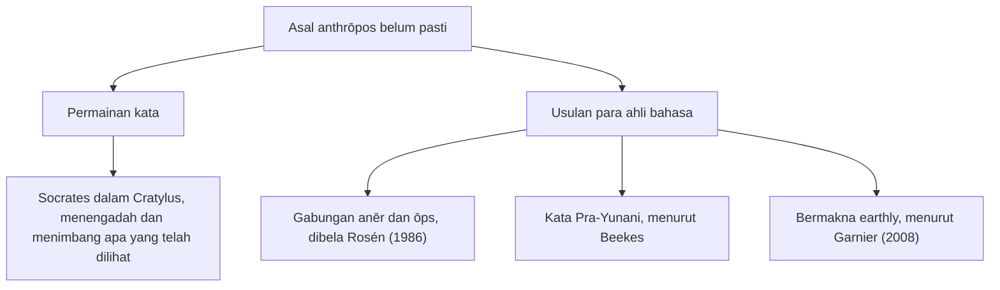

## Akar Kata Anthropos

Bayangkan Sinta, seorang mahasiswi, membuka kamus Yunani kuno dan mendapati dua kata berbeda yang sama-sama dekat dengan arti manusia.

Kata pertama tertulis ἀνήρ (*anēr*), kata kedua ἄνθρωπος (*anthrōpos*). Sinta mengetuk-ngetuk pensilnya di meja. Kalau artinya sama, mengapa orang Yunani perlu dua kata? Pertanyaan kecil itu layak dikejar, karena kata kedua itulah akar yang ditelusuri buku ini.

### Laki-Laki, Manusia, dan Makhluk Fana

Jawabannya mulai tampak ketika Sinta beralih ke sumber yang lebih rinci. Wiktionary mencatat bahwa [*anēr*](https://en.wiktionary.org/wiki/%E1%BC%80%CE%BD%CE%AE%CF%81) berarti laki-laki dewasa atau suami, dan juga dipakai untuk manusia fana yang dibedakan dari para dewa. [*Anthrōpos*](https://en.wiktionary.org/wiki/%E1%BC%84%CE%BD%CE%B8%CF%81%CF%89%CF%80%CE%BF%CF%82) punya lingkup yang lebih lebar. Kata ini menyebut manusia sebagai makhluk yang berbeda dari dewa dan dari binatang, sekaligus umat manusia secara keseluruhan. Dalam tata bahasanya, ia bisa berjenis maskulin maupun feminin.

Jadi pembagian yang rapi, *anēr* untuk laki-laki dan *anthrōpos* untuk manusia, sebaiknya kamu pegang sebagai kecenderungan. Pembagian itu cocok dengan arti pertama *anēr* saja. Begitu *anēr* dipakai untuk menyebut manusia fana di hadapan dewa, garis pemisahnya menjadi kabur.

Bahasa puisi Yunani masih menyimpan kata ketiga, βροτός ([*brotos*](https://en.wiktionary.org/wiki/%CE%B2%CF%81%CE%BF%CF%84%CF%8C%CF%82)), yang berarti fana dan ditelusuri ke sebuah akar yang bermakna mati atau fana. Tiga kata itu seperti tiga jendela yang menghadap ke makhluk yang sama. Lewat *anēr*, ia terlihat sebagai laki-laki. Lewat *anthrōpos*, ia terlihat sebagai sesama manusia. Lewat *brotos*, ia terlihat sebagai makhluk yang suatu hari akan mati.

### Socrates Menebak Asal Nama

Rasa penasaran Sinta ternyata sudah tua. Dalam dialog *Cratylus* karya Plato, pada [bagian 399c](https://www.perseus.tufts.edu/hopper/text?doc=Perseus:text:1999.01.0172:text=Crat.:section=399c), Socrates mencoba menjelaskan nama *anthrōpos*. Binatang lain, katanya, melihat sesuatu tanpa memeriksanya dan tanpa menengadah untuk menimbangnya. Manusia lain lagi. Setelah melihat, ia menengadah dan merenungkan apa yang telah dilihatnya. Socrates lalu merangkum gagasan itu dalam frasa *anathrei ha opōpe*, kira-kira "ia menimbang apa yang telah dilihatnya", dan menganggap nama *anthrōpos* terbentuk dari sana.

Permainan katanya bertumpu pada dua unsur saja. Unsur pertama berarti menengadah dan menimbang, unsur kedua berarti telah melihat.

Sinta sempat ingin menyalin penjelasan itu ke catatannya sebagai jawaban akhir. Ia menahan diri, dan langkah itu tepat. Penjelasan ini adalah etimologi jenaka yang diucapkan seorang tokoh dalam sebuah dialog, sementara ilmu bahasa melacak asal kata dengan cara lain. Gambaran makhluk yang menengadah setelah melihat boleh kamu simpan sebagai renungan tentang manusia yang suka bertanya, asalkan tidak dicatat sebagai asal-usul kata.

### Jejak yang Belum Terpecahkan

Kamus modern menyebut asal *anthrōpos* belum pasti. Kata ini pertama kali tercatat dalam bahasa Yunani Mikenai, dengan bentuk *a-to-ro-qo*.

Menurut ringkasan Wiktionary, gagasan yang lebih tua menggabungkan *anēr* dengan *ōps*, yang berarti wajah atau rupa, sehingga *anthrōpos* bermakna kurang lebih "yang tampak seperti laki-laki". Gagasan ini punya batu sandungan. Kalau kata itu memang turunan *anēr*, orang akan berharap menemukan bunyi δ di dalamnya, seperti pada bentuk genitif *andros*. Rosén (1986) membela gabungan tersebut. Beekes menilai *anthrōpos* kemungkinan besar kata Pra-Yunani. Garnier (2008) mengusulkan penurunan lain yang bermakna *earthly*, sesuatu yang bersifat bumi.

Bila dipilah, keempat penjelasan yang Sinta kumpulkan membentuk dua cabang, permainan kata di satu sisi dan usulan para ahli bahasa di sisi lain.

Sinta kini memegang beberapa jawaban yang saling bersaing. Ketidakpastian itu terasa mengganggu pada awalnya, tetapi ia jujur. Kata yang menjadi akar seluruh buku ini ternyata masih menyimpan asal-usul yang diperdebatkan.

### Andro Datang dari Anēr

Kata Inggris *androgyny*, androgini, membereskan sisa kebingungan Sinta. Kata ini berasal dari ἀνδρόγυνος ([*androgynos*](https://en.wiktionary.org/wiki/%E1%BC%80%CE%BD%CE%B4%CF%81%CF%8C%CE%B3%CF%85%CE%BD%CE%BF%CF%82)), yang menggabungkan *anēr*, dengan bentuk dasar *andr-*, dan *gynē*, perempuan. Artinya, kata-kata berawalan andro- adalah keturunan *anēr*.

Bekal ini sederhana dan berguna. Setiap kali kamu bertemu istilah yang memuat anthrop-, kamu sedang berhadapan dengan warisan *anthrōpos*, sang manusia dalam arti luas. Warisan itu akan kamu ikuti di sepanjang buku, dari antropologi sampai likantropi.

### Intisari

- *Anēr* cenderung menyebut laki-laki dewasa, sedangkan *anthrōpos* menyebut manusia dan umat manusia; pembagian ini hanya kecenderungan, karena *anēr* juga bisa menyebut manusia fana di hadapan dewa.
- Penjelasan Socrates dalam *Cratylus*, tentang makhluk yang menengadah dan menimbang apa yang telah dilihatnya, adalah etimologi jenaka seorang tokoh dalam dialog.
- Asal *anthrōpos* belum pasti, dan usulan para ahli yang dicatat ringkasan Wiktionary belum bermuara pada satu jawaban; awalan andro- sendiri berasal dari *anēr*.

Sinta menutup kamusnya, tetapi satu pertanyaan masih mengganjal. Kalau makhluk ini begitu lama menjadi bahan renungan, ilmu apa yang akhirnya menjadikannya pokok kajian, dan nama apa yang diberikan kepadanya?
