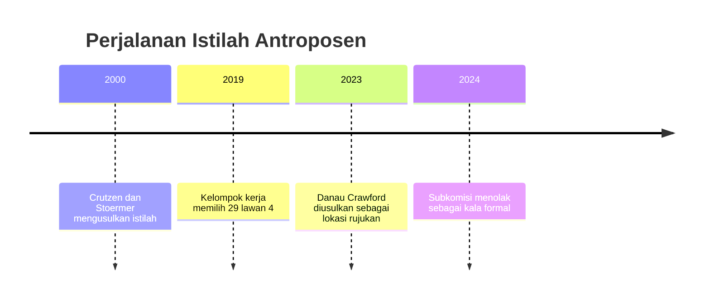

## Antroposen dan Jejak Manusia di Bumi

Jika kelak seorang ahli geologi menggali bebatuan Bumi jauh di masa depan, apa yang akan dia temukan di lapisan batu yang sedang kita tinggalkan?

Bayangkan saja dia bernama Rara, tokoh rekaan yang berdiri di depan tebing berlapis-lapis dan membaca batuan seperti halaman buku. Di lapisan bawah, dia mungkin hanya menjumpai lumpur dan sisa tumbuhan. Di dekat puncak, barangkali muncul hal yang ganjil, seperti butiran plastik dan jejak plutonium. Sejak tahun 2000 hingga 2024, para ilmuwan memperdebatkan apakah lapisan semacam itu layak diberi nama sendiri, Antroposen.

### Kala Baru yang Dinamai dari Manusia

Antroposen dirakit dari dua bagian. Di depan berdiri *anthrōpos*, manusia. Di belakang ada akhiran *-sen* (dalam bahasa Inggris *-cene*) yang berasal dari καινός (*kainos*), artinya baru. Akhiran ini, seperti dicatat [Wiktionary](https://en.wiktionary.org/wiki/-cene), menandai pembagian Kenozoikum, dan Antroposen sengaja dibentuk mengikuti pola nama kala yang sudah ada, yaitu Holosen dan Pleistosen.

Holosen adalah kala yang secara resmi masih kita tempati. Kala ini dimulai sekitar 11.700 tahun sebelum tahun 2000 Masehi, dan [batas awalnya](https://stratigraphy.org/gssps/files/holocene.pdf) ditetapkan pada inti es NGRIP dari Greenland. Dalam pembagian yang lebih halus, kita kini hidup di Zaman Meghalaya dari Holosen.

Gagasan menambah satu kala lagi ditulis Paul Crutzen dan Eugene Stoermer dalam [The Anthropocene](https://mpic.de/3865097/the-anthropocene), terbit di Global Change Newsletter nomor 41 pada Mei 2000. Mereka menawarkan akhir abad ke-18 sebagai titik mula, mengacu pada catatan inti es tentang gas rumah kaca yang mulai naik, sambil mengakui bahwa pilihan itu agak arbitrer. Dua tahun kemudian Crutzen menegaskan lagi gagasannya di jurnal Nature lewat [Geology of mankind](https://doi.org/10.1038/415023a).

### Mencari Garis Awal di Batuan

Memberi nama ternyata baru langkah pertama. Usulan titik awalnya beragam, mulai dari munculnya pertanian, Revolusi Industri sekitar tahun 1780, sampai pertengahan abad ke-20. [Kelompok kerja Antroposen](https://quaternary.stratigraphy.org/working-groups/anthropocene) di bawah Subkomisi Stratigrafi Kuarter memilih yang terakhir, dengan plutonium dari uji coba nuklir sebagai penanda, dan laporan formalnya meletakkan dasar kala itu pada tahun 1952.

Kelompok kerja itu juga memberi suara mengikat, dan hasilnya diumumkan pada 21 Mei 2019, dengan 29 suara setuju dan 4 menolak. Pada Juli 2023 kelompok itu menunjuk Danau Crawford di Ontario sebagai lokasi rujukan yang mereka usulkan.

Usulan itu kandas. Pada Maret 2024 Subkomisi Stratigrafi Kuarter memungut suara dan menolak Antroposen sebagai kala formal, lalu IUGS dan ICS menyetujui hasil itu dalam [pernyataan bersama](https://stratigraphy.org/news/152). Ketua subkomisi sendiri mempersoalkan pemungutan suara tersebut. Hasilnya, di atas kertas kita tetap hidup di Holosen, sementara kata Antroposen terus dipakai untuk menyebut pengaruh manusia pada sistem Bumi.

Perjalanan istilah itu terangkum dalam empat titik waktu berikut.

### Lapisan yang Sedang Kita Tulis

Lepas dari soal status resmi, beberapa angka tentang Bumi hari ini bisa dibaca langsung. Rata-rata tahunan karbon dioksida di atmosfer global mencapai 422,8 ppm pada 2024, menurut data NOAA yang dirangkum [Climate.gov](https://climate.gov/news-features/understanding-climate/climate-change-atmospheric-carbon-dioxide). Inti es menunjukkan kadarnya tidak pernah melewati 300 ppm selama 800.000 tahun terakhir dan berada di sekitar 280 ppm sebelum Revolusi Industri.

Butiran plastik, salah satu benda yang mungkin kelak ditemui Rara, sampai ke tempat yang jauh dari pabrik. Kesebelas sampel salju yang diambil Napper dan rekan (2020) dari Gunung Everest mengandung mikroplastik, dengan kadar tertinggi di *base camp* dan sebagian di ketinggian 8.440 meter, seperti diliput [Science News](https://sciencenews.org/article/plastics-remote-places-microplastics-earth-mount-everest).

### Spesies yang Hilang dan Batas Suhu

Hilangnya spesies vertebrata selama satu abad terakhir mencapai hingga 100 kali laju latar yang dihitung secara konservatif, menurut perbandingan Ceballos dan rekan (2015) dalam [kajian mereka](https://mahb.stanford.edu/wp-content/uploads/2015/07/2015_Ceballos-Ehrlich-Barnosky-Accelerated-Mass-Extinction.pdf). Dari perbandingan itulah mereka menyimpulkan bahwa kepunahan massal keenam sedang berlangsung.

Di meja perundingan, angka yang dikejar adalah suhu. [Persetujuan Paris](https://unfccc.int/process-and-meetings/the-paris-agreement), yang diadopsi pada 12 Desember 2015, menargetkan pemanasan global tetap jauh di bawah 2 °C di atas tingkat praindustri dan berupaya membatasinya pada 1,5 °C.

### Ketika Perubahan Disebut Antropogenik

Dari akar yang sama lahir kata sifat *antropogenik*. Kata ini, menurut [EarthWord dari USGS](https://www.usgs.gov/news/earthword-anthropogenic), menunjuk pada perubahan lingkungan yang disebabkan atau dipengaruhi manusia, baik secara langsung maupun tidak langsung. Bagian *anthropo-* menunjuk pada umat manusia, sedangkan *-genic* berkaitan dengan penciptaan. Contohnya antara lain spesies pendatang seperti ikan *snakehead* dan ular piton Burma.

Dua kata ini saling melengkapi. Antroposen mencoba menamai sebuah rentang waktu, sedangkan antropogenik menamai asal sebuah perubahan, entah ikan yang dibawa ke perairan baru entah perubahan lain yang bermula dari tangan manusia.

### Poin Kunci

- Antroposen dibentuk dari *anthrōpos* dan akhiran *-sen* dari *kainos*, mengikuti pola Holosen dan Pleistosen, dan diusulkan Crutzen dan Stoermer pada 2000 dengan titik mula yang mereka akui agak arbitrer.
- Kelompok kerja memilih pertengahan abad ke-20 sebagai awalnya, tetapi pada Maret 2024 Subkomisi Stratigrafi Kuarter menolaknya sebagai kala formal, keputusan yang dipersoalkan ketua subkomisi itu sendiri.
- Beberapa temuan bisa dibaca langsung, seperti kadar karbon dioksida 422,8 ppm pada 2024 dan mikroplastik di kesebelas sampel salju dari Everest, sementara klaim kepunahan massal keenam bersandar pada perbandingan dengan laju latar.

Dari skala sebuah planet, sorotan kita kini menyempit ke sesuatu yang bisa diukur dengan pita meteran, yaitu tubuh manusia itu sendiri.
