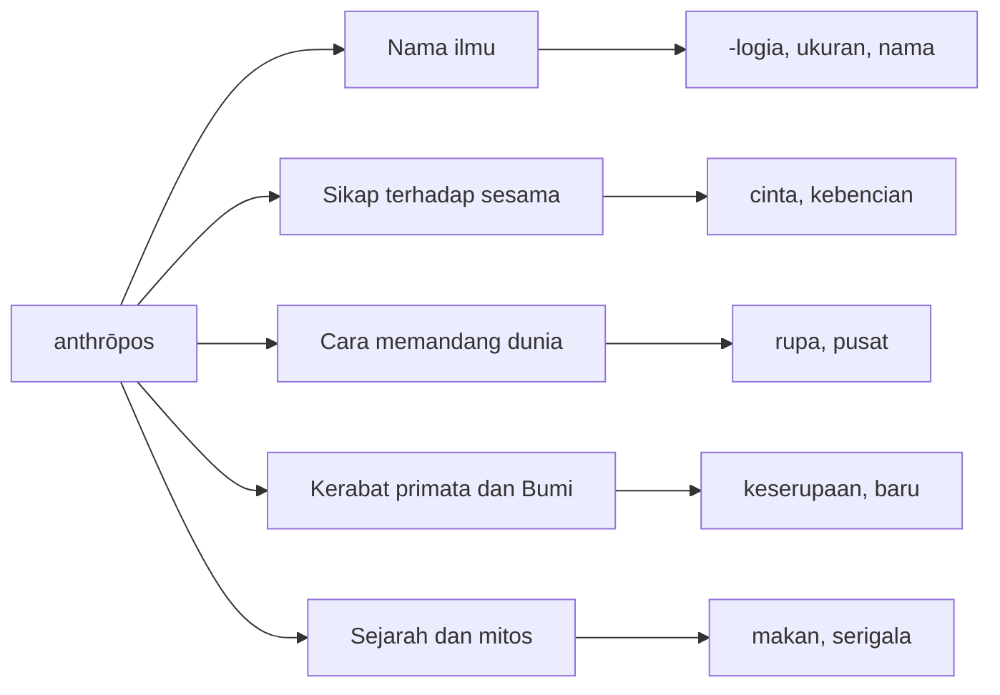

## Warisan Anthropos dalam Kosakata Dunia

Sebelas kata utama yang kamu temui di buku ini, dari antropologi sampai likantropi, tumbuh dari satu akar Yunani dan muat dicatat di satu halaman.

Akar itu adalah ἄνθρωπος (*anthrōpos*), manusia. Dari akar itu tumbuh antropologi, filantropi, misantropi, antropomorfisme, antroposentrisme, antropoid, Antroposen, antropometri, antroponimi, antropofagi, dan likantropi. Setiap kata itu menggandeng satu unsur Yunani lain sebagai pasangan.

Sekilas, sebelas kata itu mirip deretan hafalan menjelang ujian. Kalau dibaca pelan, ia lebih menyerupai peta. Kata yang sama muncul di ruang kuliah, di meja yayasan amal, di catatan para pengamat primata, di perdebatan para ahli lapisan batuan, dan di cerita seram tentang serigala. Bab penutup ini mengajak kamu membaca ulang deretan itu dengan bekal dua belas bab sebelumnya.

### Ilmu, Sikap, dan Cara Memandang

Sebagian pasangan itu menghasilkan nama ilmu. Antropologi merangkai *anthrōpos* dengan akhiran *-logia* lewat bahasa Latin Baru, dan di bab 2 kamu sudah melihat bagaimana ilmu ini memandang manusia secara utuh. Antropometri menggandeng μέτρον (*metron*), ukuran, untuk mengukur tubuh manusia seperti yang diurai di bab 9. Antroponimi meminjam ὄνομα (*onoma*), nama, dan menjadi kajian tentang nama diri manusia di bab 10.

Kelompok kedua menamai sikap terhadap sesama. Filantropi berasal dari φιλανθρωπία (*philanthrōpia*), turunan kata sifat yang berarti mencintai umat manusia, dan kisahnya terbentang di bab 3. Misantropi memasangkan akar yang sama dengan μῖσος (*mîsos*), kebencian. Di bab 4 kata itu dibahas sebagai sikap terhadap sesama. Dua kata itu berbagi akar dan berdiri di kutub perasaan yang berseberangan.

Kelompok ketiga menyangkut cara manusia memandang dunia. Antropomorfisme memakai μορφή (*morphē*), bentuk atau rupa, untuk kebiasaan memberi sifat manusia kepada benda, hewan, sampai dewa, seperti yang kamu temui di bab 5. Antroposentrisme memakai κέντρον (*kentron*), yang tampaknya mula-mula berarti ujung runcing lalu juga pusat lingkaran, untuk pandangan yang menaruh manusia di tengah. Di bab 6 pandangan itu diuji dalam etika lingkungan, dan di sana pula ucapan Protagoras tentang manusia sebagai takaran segala hal muncul dengan makna yang masih diperdebatkan.

### Dari Kerabat Primata sampai Malam Serigala

Dua kata lain membawa akar ini ke kerabat primata dan ke Bumi. Antropoid menempelkan akhiran *-eidēs*, serupa dalam rupa, sehingga artinya menyerupai manusia, dan kata yang sama juga dipakai untuk seekor kera. Di bab 7 kata itu dipakai untuk kelompok primata tempat manusia juga bernaung. Antroposen menyambungkan *anthrōpos* dengan καινός (*kainos*), baru, meniru pola nama Holosen. Di bab 8 nama itu tampil sebagai usulan untuk menandai jejak manusia pada Bumi, dan kini ia dipakai sebagai sebutan dampak manusia tanpa status kala resmi.

Kelompok terakhir berasal dari sejarah dan mitos. Antropofagi memadukan *anthrōpos* dengan φαγεῖν (*phagein*), makan, untuk praktik memakan daging manusia yang ditelusuri di bab 11. Likantropi memadukannya dengan λύκος (*lykos*), serigala, dan di bab 12 kata itu menamai manusia serigala dalam mitos sekaligus delusi seseorang yang merasa berubah menjadi hewan.

Contohnya, kamu menuliskan kesebelas kata itu di satu halaman buku catatan, dengan akar ἄνθρωπος besar-besar di pojok kiri atas dan coretan kecil berisi unsur pasangan di samping setiap kata. Kalau coretan itu disusun ulang menurut bidangnya, dengan arti unsur pasangan di ujung setiap cabang, halaman itu berubah menjadi bagan berikut.

### Akar yang Selalu Butuh Teman

Satu hal tampak jelas dari bagan itu. Di hampir setiap kata, *anthrōpos* hadir sebagai separuh nama, dan separuh lainnya yang menentukan ke mana kata itu pergi. Akar yang sama bisa berdiri di samping cinta dan di samping kebencian. Ia bisa menemani alat ukur, sebuah nama, sebuah zaman baru, dan seekor serigala. Warnanya datang dari pasangan.

Arah pandangnya pun berganti-ganti. Dalam antropologi, antropometri, dan antroponimi, manusia menatap dirinya sendiri, entah lewat budaya, ukuran tubuh, atau nama. Dalam antropomorfisme, manusia meminjamkan rupanya kepada hal lain. Antropoid membalik arah itu, karena di sana makhluk lain yang dinilai serupa dengan manusia. Dua kata terakhir ini sama-sama memakai unsur yang berurusan dengan rupa, *morphē* dan *-eidēs*, dan perbedaan arahnya hanya terbaca kalau kamu tahu pasangan mana yang dipakai.

Hati-hati juga ketika kamu menambah kata ke keluarga ini. Di bab 1 *anthrōpos* sudah dipisahkan dari *anēr*, sehingga kata berawalan andro- seperti androgini berasal dari akar lain dan tidak ikut dihitung di sini. Di bab 1 pula kamu membaca bahwa asal-usul *anthrōpos* sendiri belum pasti. Kata yang menamai begitu banyak bidang ternyata belum punya silsilah yang tuntas.

Keluarga kata ini juga menyimpan pelajaran tentang cara membaca istilah asing. Ketika kamu bertemu kata baru yang diawali antropo- atau berakhiran -antropi, cari dulu pasangannya. Begitu pasangannya ditemukan, separuh maknanya biasanya sudah terbuka, dan sisanya bisa kamu periksa di kamus yang baik.

### Penutup

Sebelas kata itu masih muat dalam satu daftar pendek, dan sebagian besar pertanyaan tentang kata-kata itu kini sudah terjawab. Satu akar yang berarti manusia bergabung dengan *-logia*, cinta, kebencian, rupa, keserupaan, pusat, baru, ukuran, nama, makan, dan serigala, lalu menamai bidang yang sangat berbeda, dari ruang kuliah sampai mitos. Sebagian kisahnya masih menyisakan perdebatan, seperti makna ucapan Protagoras dan asal kata *anthrōpos* itu sendiri. Menyimpan keraguan semacam itu di samping jawabannya sama pentingnya dengan menulis jawaban itu sendiri.
