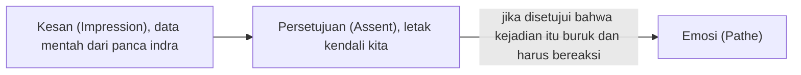
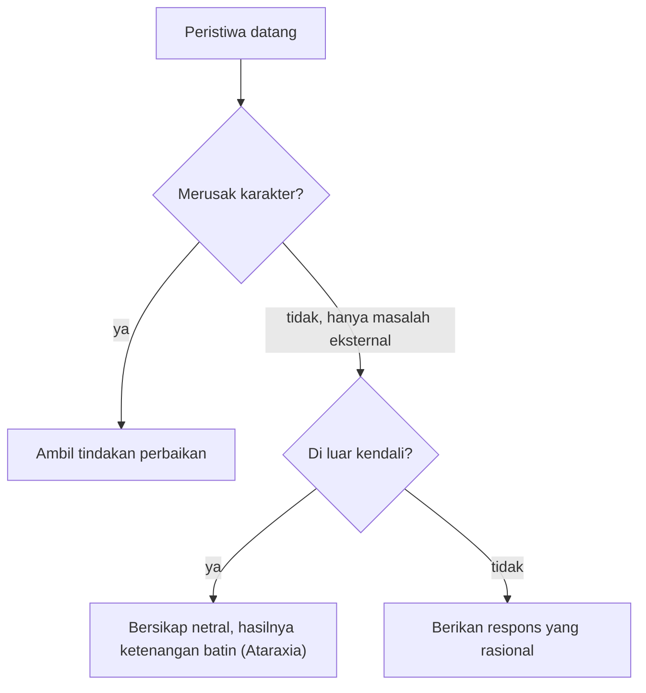

## Memahami Pathe

Dalam terminologi Stoik, emosi yang merusak disebut sebagai **Pathe** (jamak: *pathê*). Kata ini secara etimologis berakar dari bahasa Yunani yang berarti "penderitaan" atau "sesuatu yang menimpa".

Bagi kaum Stoik, emosi negatif seperti kemarahan yang meluap-luap, kecemasan yang melumpuhkan, atau kegembiraan yang euforik dan dangkal, dianggap sebagai **gangguan akal sehat**. Emosi-emosi ini bukanlah sesuatu yang datang dari luar, melainkan hasil dari penilaian internal yang keliru terhadap realitas.

> "Manusia tidak terganggu oleh hal-hal yang terjadi, tetapi oleh pendapat mereka tentang hal-hal tersebut." , **Epictetus**

## Anatomi Emosi

Kaum Stoik memiliki model psikologi yang sangat canggih untuk menjelaskan bagaimana sebuah stimulus berubah menjadi emosi yang meledak. Proses ini dapat digambarkan melalui rumus sederhana berikut:

$$
\text{Kesan (Impression)} + \text{Persetujuan (Assent)} = \text{Emosi}
$$

Mari kita bedah komponennya:

1. **Kesan (Phantasia/Impression):** Ini adalah data mentah yang masuk ke panca indra kita. Contoh: Seseorang memotong jalur kamu saat berkendara.
2. **Persetujuan (Sunkatathesis/Assent):** Di sinilah letak kendali kita. Kita memberikan "stempel setuju" pada penilaian bahwa kejadian tersebut "buruk" atau "menghina".
3. **Emosi (Pathe):** Jika kita menyetujui bahwa kejadian itu buruk dan kita harus bereaksi, maka muncullah kemarahan.

Urutan tiga komponen tadi tampak seperti ini, dengan persetujuan sebagai letak kendalinya.

*Jika kamu melihat seseorang berteriak pada kamu dalam bahasa yang tidak kamu mengerti, apakah kamu akan merasa terhina? Mungkin tidak, karena kamu tidak memberikan "persetujuan" pada makna kata-katanya. Ini membuktikan bahwa emosi bergantung pada penilaian kamu, bukan pada kejadiannya.*

## Empat Nafsu Utama (The Four Passions)

Stoikisme mengklasifikasikan emosi destruktif ke dalam empat kategori besar yang saling berkaitan:

| Kategori | Deskripsi | Perspektif Waktu |
| --- | --- | --- |
| **Distress (Lupē)** | Rasa sakit mental atas apa yang dianggap buruk saat ini. | Masa Kini |
| **Fear (Phobos)** | Kecemasan terhadap apa yang dianggap buruk di masa depan. | Masa Depan |
| **Lust (Epithumia)** | Keinginan yang tidak rasional akan apa yang dianggap baik. | Masa Depan |
| **Delight (Hēdonē)** | Kegembiraan yang berlebihan atas hal yang dangkal/fana. | Masa Kini |

**Penting:** Stoikisme tidak mengajarkan kita untuk menjadi robot tanpa perasaan. Tujuan mereka adalah mengganti *Pathe* dengan **Eupatheia** (perasaan baik/sehat) yang berlandaskan pada akal budi, seperti kegembiraan yang tenang, kehendak baik, dan kewaspadaan yang rasional.

## Mengubah Lensa Pandang

Untuk tidak diperbudak oleh nafsu impulsif, kita perlu menerapkan teknik identifikasi dan transformasi berikut:

### 1\. Menunda Respon (Cognitive Distancing)

Saat emosi mulai memuncak, jangan langsung bertindak. Stoik menyarankan untuk memberi jarak antara kesan dan respon.

- **Latihan:** Katakan pada emosi kamu, *"Tunggu sebentar, biarkan aku memeriksa siapa kamu dan apa yang kamu wakili."*

### 2\. Dekonstruksi Objektif (Phantasia Kataleptike)

Lihatlah hal-hal sebagaimana adanya, tanpa label nilai yang kita tempelkan.

- **Analogi:** Marcus Aurelius sering mempraktikkan ini. Baginya, anggur mahal hanyalah sari buah busuk, dan jubah ungu kaisar hanyalah bulu domba yang dicelupkan ke dalam darah kerang.
- **Aplikasi:** Jika kamu menginginkan gadget terbaru (Lust), katakan: *"Ini hanya tumpukan kaca, silikon, dan plastik yang akan usang dalam dua tahun."*

### 3\. Menguji Persetujuan

Tanyakan pada diri sendiri: *"Apakah hal ini benar-benar di bawah kendaliku? Apakah penilaianku bahwa ini 'buruk' benar-benar akurat?"*

## Dua Pertanyaan Sebelum Bereaksi

Seorang Stoik memeriksa sebuah peristiwa sebelum emosinya sempat menguasai dirinya. Saat peristiwa datang, ia mengajukan dua pertanyaan berurutan. Pertama, apakah peristiwa ini secara moral buruk, yaitu merusak karakter? Kalau ya, ambil tindakan perbaikan. Kalau tidak, berarti ini hanya masalah eksternal, misalnya macet, kritik orang, atau kehilangan uang. Lalu muncul pertanyaan kedua: apakah hal ini berada di luar kendali kamu? Kalau ya, bersikaplah netral (*indifferent*), dan hasilnya adalah ketenangan batin (*Ataraxia*). Kalau masih dalam kendali kamu, berikan respons yang rasional.

Dua pertanyaan itu membentuk percabangan berikut.

## Kritik Pedas dari Atasan

**Skenario:** Atasan kamu mengkritik pekerjaan kamu di depan rekan kerja dengan nada tinggi.

- **Reaksi Impulsif (Pathe):** Merasa dipermalukan (Distress), lalu muncul keinginan untuk membalas atau mengundurkan diri secara impulsif (Lust for revenge/escape).
- **Penerapan Stoik:**
	1. **Identifikasi:** "Saya merasa panas di dada. Ini adalah kesan bahwa saya dihina."
		2. **Uji Persetujuan:** "Apakah kata-katanya merusak karakter saya? Tidak, kecuali saya membalas dengan kata-kata kasar juga. Apakah saya bisa mengendalikan mulutnya? Tidak."
		3. **Transformasi:** Ubah fokus dari "Saya dihina" menjadi "Ada informasi tentang pekerjaan saya yang bisa diperbaiki, meskipun cara penyampaiannya tidak ideal."

## Menjadi Tuan bagi Diri Sendiri

Mengelola emosi dalam Stoikisme bukanlah tentang menekan atau memendam perasaan (*suppression*), melainkan tentang **mengedukasi perasaan** kita melalui akal sehat. Dengan mengubah cara kita menilai sebuah peristiwa, kita secara otomatis mengubah perasaan yang muncul dari peristiwa tersebut.

> **Latihan Refleksi:** *Pikirkan satu hal yang membuat kamu kesal hari ini. Apakah kamu bisa melihat kejadian itu sebagai sesuatu yang "netral" jika kamu melepaskan label "buruk" yang kamu berikan padanya?*