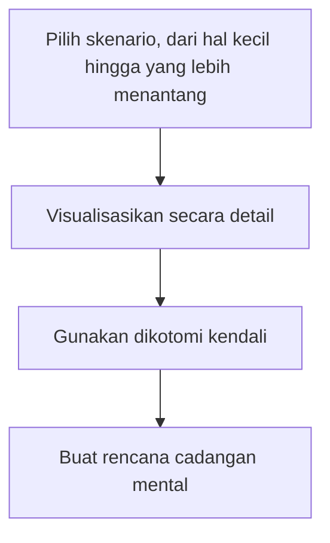

## Latihan Praktis Premeditatio Malorum

Bayangkan kamu sedang merencanakan liburan impian ke pantai. kamu sudah membayangkan sinar matahari yang hangat, suara ombak yang menenangkan, dan es kelapa muda di tangan. Namun, begitu kamu tiba di bandara, penerbangan dibatalkan, koper kamu hilang, dan hujan badai diprediksi akan berlangsung seminggu penuh.

Bagi kebanyakan orang, ini adalah resep untuk kemarahan dan frustrasi yang meledak-ledak. Namun bagi seorang Stoik, skenario ini sudah "dimainkan" di dalam kepala mereka jauh sebelum mereka berangkat. Inilah inti dari **Premeditatio Malorum**.

## Apa itu Premeditatio Malorum?

Secara etimologi, *Premeditatio Malorum* berasal dari bahasa Latin yang berarti **"pra-meditasi atas kemalangan"**. Ini adalah latihan mental di mana kita secara sengaja membayangkan rintangan, kesulitan, atau tragedi yang mungkin terjadi di masa depan.

**Analogi Latihan Pemadam Kebakaran**

> Mengapa gedung-gedung melakukan latihan evakuasi kebakaran padahal tidak ada api? Karena ketika api benar-benar muncul, kepanikan adalah musuh terbesar. Latihan memungkinkan tubuh dan pikiran bergerak secara otomatis dan tenang. *Premeditatio Malorum* adalah latihan pemadam kebakaran untuk jiwa kamu.

Latihan ini bukan tentang menjadi pesimis atau menyebarkan aura negatif. Sebaliknya, ini adalah alat untuk membangun **resiliensi psikologis** dan menghargai apa yang kita miliki saat ini sebelum hal itu hilang.

## Mengapa Kita Melakukannya?

Ada dua alasan psikologis utama mengapa teknik yang berusia ribuan tahun ini tetap relevan hingga era modern:

### 1\. Menghilangkan Efek Kejut (The Element of Surprise)

Seneca, salah satu filsuf Stoik terbesar, menulis:

> "Sesuatu yang sudah diantisipasi sebelumnya akan datang dengan hantaman yang lebih ringan."

Penderitaan manusia sering kali bukan berasal dari kejadian itu sendiri, melainkan dari **kesenjangan antara ekspektasi kita dan realitas**. Dengan membayangkan kemungkinan terburuk, kita menutup celah tersebut. Jika hal buruk terjadi, kita tidak terkejut. Jika hal buruk tidak terjadi, kita merasa jauh lebih beruntung.

### 2\. Melawan Adaptasi Hedonik (Hedonic Adaptation)

Sebagai manusia, kita sangat cepat terbiasa dengan hal-hal baik. Mobil baru, promosi jabatan, atau pasangan yang mencintai kita akan terasa "biasa saja" setelah beberapa bulan. Ini disebut adaptasi hedonik. *Premeditatio Malorum* memaksa kita membayangkan hidup *tanpa* hal-hal tersebut, yang secara instan memicu rasa syukur yang mendalam atas apa yang masih kita miliki saat ini.

## Panduan Langkah-Demi-Langkah Latihan

kamu bisa melakukan latihan ini setiap pagi (sebagai persiapan hari) atau secara berkala untuk hal-hal besar dalam hidup.

### 1\. Pilih Skenario

Mulai dari hal kecil hingga yang lebih menantang.

- **Kecil:** Terjebak macet total saat menuju rapat penting.
- **Menengah:** Mendapat kritik tajam dari atasan atau kehilangan gawai (HP/Laptop).
- **Besar:** Kehilangan pekerjaan atau mengalami masalah kesehatan.

### 2\. Visualisasikan Secara Detail

Jangan hanya berpikir "mungkin saya akan gagal." Bayangkan detailnya. Jika kamu membayangkan kehilangan pekerjaan:

- Bagaimana rasanya saat dipanggil ke ruang HR?
- Bagaimana kamu akan menjelaskan hal ini kepada keluarga?
- Apa makanan yang akan kamu makan saat anggaran sangat terbatas?

### 3\. Gunakan Dikotomi Kendali

Ini adalah bagian terpenting. Saat skenario buruk terjadi dalam pikiran kamu, tanyakan:

- *"Apa yang tetap berada di bawah kendali saya dalam situasi ini?"*
- *"Bagaimana saya bisa merespons dengan kebajikan (Virtue)?"*

### 4\. Buat Rencana Cadangan Mental

Jika kamu membayangkan ban bocor di tengah jalan tol, bayangkan kamu keluar dari mobil dengan tenang, menghubungi bantuan, dan menggunakan waktu menunggu untuk membaca buku atau mendengarkan podcast bermanfaat, alih-alih memukul kemudi dengan marah.

Keempat langkah tersebut bisa kamu jalankan berurutan mengikuti alur di bawah.

## Saat Kejadian Benar-Benar Datang

Latihan *Premeditatio Malorum* menentukan cara kamu memproses emosi ketika sebuah kejadian benar-benar terjadi. Ada tiga kemungkinan respons:

| Kejadian | Sudah kamu antisipasi? | Respons Stoik |
| --- | --- | --- |
| Negatif | Sudah | *"Saya sudah siap. Mari fokus pada solusi."* Kamu tetap tenang karena pikiran sudah berlatih. |
| Negatif | Belum | *"Guncangan ini adalah pelajaran. Gunakan akal sehat."* Kejadian ini sekaligus menjadi pengingat untuk berlatih di masa depan. |
| Bukan negatif | Tidak perlu ditanyakan | *"Nikmati dengan penuh kesadaran, karena ini tidak abadi."* |

Misalnya, koneksi internet kamu mati saat presentasi. Itu kejadian negatif, jadi pertanyaannya tinggal satu: sudahkah kamu mengantisipasinya?

## Penggunaan Praktis

### A. Presentasi Bisnis

**Latihan:** Bayangkan proyektor rusak, audiens tidak tertarik, atau kamu lupa poin utama. **Hasil:** kamu akan menyiapkan salinan cetak materi (solusi praktis) dan mental kamu tetap stabil jika seseorang melontarkan pertanyaan sulit.

### B. Hubungan Asmara

**Latihan:** Bayangkan orang yang kamu cintai suatu saat akan pergi, baik karena perpisahan atau kematian (sejalan dengan *Memento Mori*). **Hasil:** Bukannya menjadi sedih, kamu justru akan berhenti bermain HP saat makan malam bersama mereka dan benar-benar menghargai kehadiran mereka malam ini.

### C. Perjalanan Udara

**Latihan:** Bayangkan antrean panjang, kursi yang tidak nyaman, dan tangisan bayi di sebelah kamu. **Hasil:** Saat itu benar-benar terjadi, kamu akan tersenyum dan berpikir, *"Ah, persis seperti yang saya bayangkan,"* dan ketenangan kamu tetap terjaga.

## Visualisasi Negatif vs. Kecemasan (Anxiety)

Banyak orang salah paham dan menganggap latihan ini sama dengan rasa cemas. Mari kita bedakan:

| Karakteristik | Kecemasan (Anxiety) | Premeditatio Malorum |
| --- | --- | --- |
| **Kontrol** | Pikiran liar yang mengendalikan kamu. | kamu yang mengendalikan pikiran secara sadar. |
| **Tujuan** | Ketakutan yang melumpuhkan. | Persiapan yang memberdayakan. |
| **Waktu** | Terus-menerus dan menguras energi. | Terjadwal, singkat, dan terarah. |
| **Hasil Akhir** | Kepanikan dan keputusasaan. | Ketenangan dan rencana aksi. |

## Refleksi Untuk kamu

*Pikirkan satu hal yang paling kamu takuti terjadi minggu ini. Cobalah duduk tenang selama 2 menit, bayangkan hal itu benar-benar terjadi, dan lihatlah bagaimana karakter terbaik kamu (sabar, berani, atau bijaksana) bisa merespons situasi tersebut.*

> **Pesan Utama:** Kita tidak bisa mengendalikan apa yang dilemparkan kehidupan kepada kita, tetapi kita bisa mengendalikan bagaimana kita mempersiapkan diri untuk menerimanya. Dengan berlatih menghadapi badai di dalam pikiran, kita menjadi pelaut yang tak tergoyahkan saat badai yang sebenarnya tiba di lautan kenyataan.