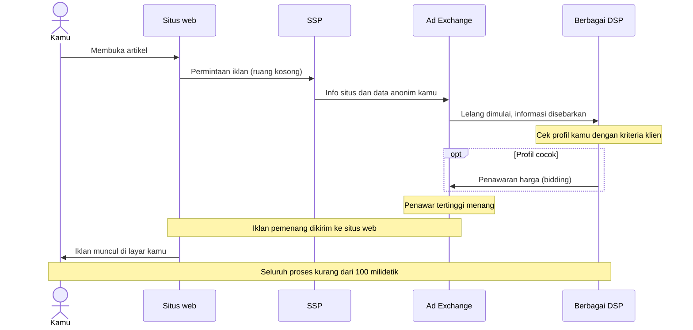

## Ekosistem AdTech dan Iklan Programatik

Periklanan digital modern dijalankan oleh sebuah sistem teknologi. Pernahkah kamu bertanya-tanya mengapa setelah mencari "sepatu lari" di mesin pencari, tiba-tiba iklan sepatu tersebut muncul di blog berita yang kamu baca hanya beberapa detik kemudian?

Ini bukan kebetulan, dan bukan juga karena ponsel kamu "mendengarkan" pembicaraan kamu. Ini adalah hasil kerja dari **Ekosistem AdTech (Advertising Technology)** yang beroperasi dalam hitungan milidetik.

### Apa itu AdTech dan Iklan Programatik?

Dahulu, membeli iklan digital dilakukan secara manual: seorang pemasar menelepon pemilik situs web, bernegosiasi harga, dan mengirimkan file gambar iklan. Proses ini lambat dan tidak efisien.

**Iklan Programatik** adalah otomatisasi dari proses jual-beli ruang iklan digital. Alih-alih manusia yang bernegosiasi, algoritma dan perangkat lunaklah yang melakukannya.

> **Wawasan Penting:** Iklan programatik mengubah ruang iklan menjadi komoditas yang diperdagangkan secara real-time, mirip dengan cara saham diperdagangkan di Bursa Efek.

### Pemain Utama dalam Ekosistem AdTech

Untuk memahami cara kerja sistem ini, kita perlu mengenal para aktor di balik layar:

1. **Demand-Side Platform (DSP):** Alat yang digunakan oleh **pengiklan** (seperti Nike atau Traveloka) untuk membeli ruang iklan secara otomatis. Di sini, pengiklan menentukan target audiens dan anggaran mereka.
2. **Supply-Side Platform (SSP):** Alat yang digunakan oleh **penerbit/publisher** (seperti Kompas.com atau Detik.com) untuk menjual ruang iklan yang kosong di situs mereka kepada penawar tertinggi.
3. **Ad Exchange:** "Lantai bursa" digital tempat DSP dan SSP bertemu. Di sinilah proses lelang terjadi secara otomatis.
4. **Data Management Platform (DMP):** Gudang data yang memberi tahu sistem siapa audiens tersebut (misal: "Pria, 25 tahun, suka lari, tinggal di Jakarta").

### Real-Time Bidding (RTB)

**Real-Time Bidding (RTB)** adalah protokol yang memungkinkan ruang iklan dijual dan dibeli melalui lelang instan. Seluruh proses ini terjadi dalam waktu kurang dari **100 milidetik**, lebih cepat daripada satu kedipan mata manusia ($\approx 300-400$ ms).

#### Bagaimana Prosesnya Berlangsung? (Langkah demi Langkah)

1. **Kunjungan Pengguna:** Kamu membuka sebuah artikel di situs web.
2. **Permintaan Iklan (Ad Request):** Saat halaman dimuat, situs tersebut mengirim sinyal ke SSP bahwa ada ruang iklan kosong.
3. **Pengiriman Data:** SSP mengirimkan informasi tentang situs tersebut dan data anonim tentang kamu (lokasi, minat, perangkat) ke Ad Exchange.
4. **Lelang Dimulai:** Ad Exchange menyebarkan informasi ini ke berbagai DSP.
5. **Penawaran (Bidding):** DSP memeriksa apakah profil kamu cocok dengan kriteria klien mereka. Jika cocok, DSP akan mengajukan penawaran harga.
6. **Pemenang Dipilih:** Penawar tertinggi memenangkan lelang.
7. **Penayangan Iklan:** Iklan pemenang dikirim ke situs web dan muncul di layar kamu.

Agar lebih mudah dibayangkan, ketujuh langkah tadi bisa digambarkan sebagai pertukaran pesan di antara para aktor berikut.

### Logika Matematika di Balik Lelang

Dalam AdTech, sering digunakan sistem **Second-Price Auction** (meskipun kini sebagian besar *Ad Exchange* sudah beralih ke *First-Price*). Dalam lelang harga kedua, pemenang membayar harga penawar tertinggi kedua ditambah satu sen.

Misalkan untuk satu slot iklan (CPM, *Cost Per Mille*):

- Pengiklan A menawar: USD 2,50
- Pengiklan B menawar: USD 3,10
- Pengiklan C menawar: USD 2,00

**Pemenang:** Pengiklan B. **Harga yang dibayar:** Harga tertinggi kedua (USD 2,50) + USD 0,01 = **USD 2,51**.

Rumus sederhananya:

$$
\text{Harga Pemenang} = \text{Penawaran Tertinggi Ke-2} + \epsilon
$$

dengan $\epsilon$ adalah unit terkecil mata uang (misalnya USD 0,01).

### Struktur Bid Request

Pesan yang dikirim oleh SSP atau Ad Exchange kepada DSP untuk meminta penawaran disebut *bid request*. Tabel berikut menguraikan isi sebuah contoh sederhana (semua nilainya contoh rekaan):

| Bagian | Isi contoh | Artinya |
| --- | --- | --- |
| ID permintaan | 89bda7b-1234 | Penanda untuk satu permintaan iklan ini |
| Situs | PortalBeritaKeren.com, kategori Otomotif | Tempat ruang iklan kosong itu berada |
| Perangkat | Android | Sistem operasi perangkat kamu |
| Lokasi | Jakarta, IDN (Indonesia) | Kota dan negara tempat kamu berada |
| Pengguna | ID user-99-xyz, minat olahraga dan mendaki | Data anonim tentang kamu |
| Ruang iklan | Banner 300 × 250, *bidfloor* 1,50 | Ukuran slot iklan dan batas bawah penawaran untuk slot itu |

### Jenis-Jenis Pembelian Programatik

Tidak semua iklan dibeli melalui lelang terbuka (RTB). Ada beberapa metode lain:

- **Open Auction (RTB):** Pasar terbuka tempat siapa saja bisa menawar. Mirip pasar loak yang sangat efisien.
- **Private Marketplace (PMP):** Lelang eksklusif yang hanya bisa diikuti oleh pengiklan undangan. Biasanya untuk situs web premium.
- **Programmatic Direct:** Pembelian ruang iklan secara otomatis tanpa lelang, dengan harga yang sudah disepakati di depan (seperti memesan meja di restoran).

### Retargeting Sepatu Lari Santi

**Skenario:** Santi mengunjungi situs e-commerce "TokoSepatu" dan memasukkan sepatu lari ke keranjang belanja, tetapi tidak jadi membeli (*cart abandonment*).

1. Santi meninggalkan situs dan pergi membaca berita di situs lain.
2. Situs berita tersebut terhubung ke SSP.
3. DSP milik "TokoSepatu" mengenali ID anonim Santi dan tahu bahwa dia hampir membeli sepatu.
4. DSP "TokoSepatu" memberikan penawaran sangat tinggi di Ad Exchange untuk memastikan iklan sepatu tersebut muncul di depan Santi lagi.
5. **Hasil:** Santi melihat iklan sepatu yang tadi ia tinggalkan, lengkap dengan diskon 10% (dinamis), dan akhirnya menyelesaikan pembelian.

### Keuntungan dan Tantangan

**Keuntungan:**

- **Efisiensi:** Ruang iklan yang terbuang sia-sia dapat diperkecil.
- **Relevansi:** Pengguna melihat iklan yang kemungkinan besar mereka sukai.
- **Skalabilitas:** Pengiklan bisa menjangkau jutaan orang di ribuan situs web hanya melalui satu pintu (DSP).

**Tantangan:**

- **Ad Fraud:** Bot yang berpura-pura menjadi manusia untuk mengklik iklan.
- **Brand Safety:** Iklan muncul di situs web yang kontennya tidak pantas atau negatif.
- **Kompleksitas:** Terlalu banyak perantara (sering disebut *AdTech Tax*) yang mengambil potongan biaya di setiap tahap.

> **Pesan Utama:** Ekosistem AdTech adalah sistem teknis yang mengubah perilaku internet menjadi peluang ekonomi. Namun, kecepatan dan otomatisasi ini menuntut pengawasan yang ketat agar tetap transparan dan adil bagi semua pihak.
