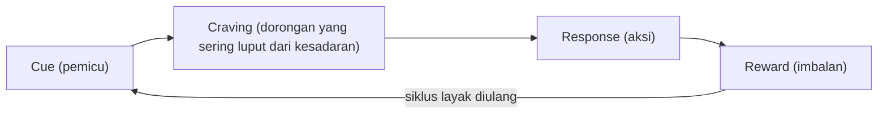

## Anatomi Loop Kebiasaan

Kamu tahu persis berapa jam yang dihabiskan ponselmu setiap hari, karena layarnya sendiri yang melaporkan angkanya. Kamu juga tahu konsekuensinya: tidur molor, mata lelah, pekerjaan menumpuk. Kalau ada ujian tentang seberapa paham kamu akan bahaya menggulir tanpa henti, kemungkinan besar nilai kamu sempurna.

Tapi sore tadi, begitu duduk diam sejenak, tanganmu meraih ponsel. Tanpa negosiasi batin yang berarti, jempolmu sudah menyapu layar. Bukan cuma sekali. Ini terulang di tempat yang sama, dalam suasana yang sama, hari demi hari.

Di sinilah paradoks yang bikin jengkel: mengetahui ternyata tidak mengubah apa pun. Kamu bisa punya data lengkap, niat bulat, bahkan pidato motivasi dari dirimu sendiri, dan tangan masih bergerak seperti biasa. Kalau kebiasaan semata soal informasi, semua orang yang tahu pasti langsung berubah. Kenyataannya tidak. Penelitian Wood, Quinn, dan Kashy (2002) menunjukkan seberapa dalam persoalan ini: dalam salah satu studinya, sekitar 43% perilaku harian orang dilakukan hampir setiap hari, biasanya di lokasi yang sama, dan sering sambil memikirkan hal lain. Hampir separuh perilaku harian kita berjalan lewat jalur yang tidak banyak melibatkan pikiran sadar.

Jadi masalahnya bukan kamu kurang tahu. Masalahnya ada mesin lain yang bekerja di bawah sadar, dan mesin itu punya struktur yang bisa dipetakan. Struktur inilah yang disebut loop kebiasaan.

### Kasus Eugene Pauly yang amnesia

Untuk melihat mesin itu bekerja, kita perlu kasus yang menyingkirkan satu variabel besar: ingatan sadar. Charles Duhigg, dalam bab pembuka The Power of Habit (2012), menuturkan kisah Eugene Pauly, pria dengan amnesia berat yang kehilangan kemampuan mengingat kejadian baru. Nama orang baru, atau peristiwa lima menit lalu, tidak sanggup ia simpan dalam ingatan.

Yang mengejutkan datang dari hal sepele: kue kering di dapur. Meski tidak bisa mengingat apa pun tentang pagi harinya, Eugene tetap menemukan jalannya ke dapur dan menemukan kue itu, berulang-ulang. Ketika ditanya, ia tidak bisa menjelaskan kenapa ia ke sana, bahkan tidak ingat pernah makan. Kebiasaannya terus berjalan, meski pengalamannya hilang.

> Ibarat sebuah gedung yang hampir seluruhnya hangus, tapi lorong menuju kantin masih bisa dilalui petugas keamanan secara otomatis. Lorong itu tidak butuh denah di kepala, karena tubuh petugas itu sudah hafal lantainya.

Bagi peneliti, kisah Eugene menjadi petunjuk kuat bahwa loop kebiasaan tidak bergantung pada ingatan sadar. Ada sistem saraf terpisah yang menggerakkannya, sistem yang tidak butuh kamu "ingat" untuk terus bekerja. Kenapa sistem itu bisa seotomatis itu, kita bahas di bab ketiga.

### Tiga mata rantai loop

Duhigg merangkum pola Eugene, dan pola kebiasaan pada umumnya, menjadi tiga unsur: cue, routine, dan reward.

Cue adalah pemicu, hal yang menyalakan kebiasaan. Bisa berupa waktu, tempat, keadaan emosi, kehadiran orang tertentu, atau aksi yang barusan terjadi. Routine adalah aksinya sendiri, bagian paling terlihat dari kebiasaan. Reward adalah hasil yang membuat otak menganggap siklus ini layak diulang.

Pada kasus Eugene, kebiasaan menemukan kue kering mengikuti pola yang sama dengan kebiasaan siapa pun yang tidak bisa berhenti menggulir ponsel. Cue muncul dari konteks yang khas, routine berjalan hampir sama tiap kali, dan reward selalu hadir di ujungnya. Begitu tiga unsur ini menyatu berulang-ulang, mereka melekat menjadi satu kesatuan yang memicu dirinya sendiri. Begitu cue muncul, sisanya menyusul tanpa banyak bicara.

> Coba bedah kebiasaan ponselmu pakai cetakan ini. Cue-nya mungkin suasana hening sesaat di antara dua pekerjaan, routine-nya menggulir layar, reward-nya hiburan singkat plus rasa tidak ketinggalan. Niatmu berdiri di luar loop ini, berteriak dari kejauhan, sementara loop sudah selesai berputar sebelum kamu sempat bersuara.

### Langkah craving yang luput dari kesadaran

Model tiga unsur Duhigg kemudian diperbarui. James Clear dalam Atomic Habits (2018) membedah loop menjadi empat langkah: cue, craving, response, dan reward. Yang ditambahkan adalah craving, dorongan yang muncul tepat saat cue muncul, jembatan antara pemicu dan aksi.

Craving inilah bagian yang paling sering luput dari kesadaran. Kamu biasanya hanya menyadari dua ujungnya: ponsel yang kamu lihat (cue) dan layar yang sudah terbuka (response). Dorongan di tengahnya bekerja cepat dan senyap, muncul sebelum sempat kamu rumuskan dalam pikiran. Kesadaranmu baru hadir di tengah jalan, saat aksi sudah separuh selesai, dan saat itu membatalkannya terasa seperti melawan arus.

Kalau empat langkah Clear itu dijajarkan, putarannya kira-kira begini.

Dari empat langkah ini pula Clear menurunkan empat hukum membentuk dan memecah kebiasaan: buat pemicunya jelas, buat dorongannya menarik, buat responsnya mudah, dan buat imbalannya memuaskan, beserta kebalikannya untuk memutus kebiasaan. Kita tidak akan memakai keempat hukum itu sekarang, karena alat paling dasarnya masih harus kita bongkar lebih dulu.

### Golden rule untuk mengganti rutinitas, bukan menghapus loop

Duhigg menyebut satu prinsip yang menjadi tulang punggung hampir semua upaya perubahan kebiasaan: golden rule of habit change. Bunyinya sederhana. Pertahankan cue dan reward, lalu ganti routine-nya.

Logikanya kembali ke bukti tadi. Loop kebiasaan tidak bisa dihapus begitu saja, dan menumpasnya dengan kehendak murni jarang berhasil. Yang bisa dilakukan adalah menyambung ulang loop yang sama: cue yang sudah dikenali tubuh dan reward yang tetap dikejar, tetapi dijalankan lewat aksi yang berbeda. Cara kerjanya, syarat-syaratnya, dan contoh penerapannya akan kita tuntaskan di bab kesepuluh. Untuk sekarang cukup dicatat posisinya: golden rule adalah konsekuensi langsung dari anatomi loop yang baru kamu pelajari.

### Loop ini bukan metafora

Sampai titik ini, loop kebiasaan bisa terdengar seperti sekadar diagram pengajaran, cara merapikan gagasan agar mudah diingat. Padahal bukan itu statusnya. Graybiel (2008) dalam tinjauannya tentang otak dan kebiasaan menunjukkan bahwa kebiasaan berjalan sebagai chunk, rangkaian aksi yang terkompilasi menjadi satu kesatuan di dalam sistem saraf. Wood dan Rünger (2016) merumuskannya serupa: kebiasaan adalah respons otomatis yang dipicu konteks, lahir dari pengulangan yang diberi imbalan.

Artinya, cue, craving, response, dan reward bukan sekadar nama-nama di atas kertas. Rangkaian ini punya alamat kerja di otak, dan loop yang kamu jalankan tiap pagi itu nyata sebagai pola kerja saraf, bukan kiasan. Pertanyaannya tinggal satu: di mana alamat itu, dan kenapa otak rela menyerahkan hampir separuh perilakumu ke sistem otomatis?

## Ringkasan

- Kisah Eugene Pauly dalam The Power of Habit (2012) menunjukkan bahwa loop kebiasaan dapat bekerja tanpa ingatan sadar.
- Loop versi Duhigg tersusun dari cue, routine, dan reward; Clear (2018) menambahkan craving, dorongan senyap di antara pemicu dan aksi, bagian yang paling sering luput dari kesadaran.
- Golden rule of habit change menyatakan pertahankan cue dan reward lalu ganti routine, prinsip yang akan dituntaskan di bab kesepuluh.
