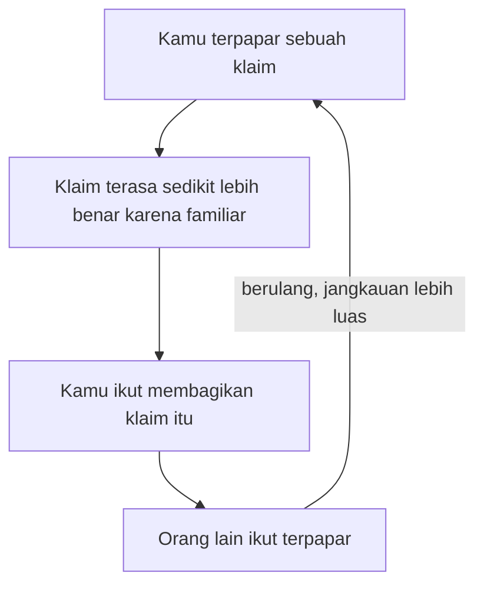

## Efek Kebenaran Ilusi

Ingat kalimat "kita cuma pakai 10 persen otak kita." Itu keliru; otak dipakai hampir seluruhnya, bahkan saat tidur. Tapi karena diulang di film, buku motivasi, dan obrolan warung kopi selama puluhan tahun, ia terasa benar, padahal salah sejak awal. Di bab ini kita bongkar kenapa sesuatu yang cuma sering kamu dengar bisa terasa lebih benar daripada yang baru, walau keduanya sama-sama belum kamu cek.

### Apa itu efek kebenaran ilusi

**Efek kebenaran ilusi** (*illusory truth effect*) adalah kecenderungan otak menilai sebuah pernyataan lebih benar hanya karena pernah kamu dengar. Tidak ada bukti tambahan atau argumen baru yang masuk; pernyataan itu semata diulang.

Efek ini pertama kali ditunjukkan secara sistematis oleh Hasher, Goldstein, dan Toppino pada tahun 1977. Mereka memberi peserta serangkaian pernyataan untuk dinilai kebenarannya, dan sebagian muncul berulang di sesi berikutnya. Pernyataan yang diulang secara konsisten dinilai lebih benar daripada yang baru, terlepas dari benar atau tidaknya. Otak tidak menyimpan label "aku pernah dengar ini dari sumber tepercaya" bersama informasinya; yang tersimpan sering cuma rasa familiar, dan itu gampang tertukar dengan rasa benar.

### Otak suka yang gampang diproses

Kenapa pengulangan bisa menipu? Kuncinya ada pada **kefasihan pemrosesan** (*processing fluency*). Setiap kali bertemu informasi, otakmu harus memprosesnya dengan membaca, mengurai makna, dan mencocokkannya dengan yang sudah kamu tahu. Kalau informasi itu baru dan asing, proses ini terasa berat; kalau sudah pernah lewat, ia jadi ringan dan cepat. Otak lalu menjadikan kelancaran itu petunjuk. Yang terasa mudah dicerna dianggap sudah pernah diketahui, dan yang sudah pernah diketahui dianggap benar.

Lompatan ini masuk akal sehari-hari, karena hal yang benar memang cenderung lebih sering kita temui. Tapi begitu ada pihak yang sengaja mengulang-ulang kebohongan, jalan pintas ini berbalik menyerangmu. Otak salah membaca **"mudah" dan "familiar" sebagai "benar"**.

### Kenapa efek ini sulit dilawan

Efek ini berbahaya juga karena ia sulit dilawan.

**Ia bekerja untuk pernyataan benar maupun salah.** Pengulangan tidak pilih-pilih; ia menaikkan rasa benar untuk fakta asli sekaligus kebohongan, bahkan pada klaim yang cukup janggal.

**Ia bertahan meski kamu tahu jawaban yang benar.** Penelitian Fazio dan rekan pada tahun 2015 menunjukkan efek ini muncul bahkan untuk pernyataan yang bertentangan dengan pengetahuan yang sudah dimiliki peserta. Orang yang sebenarnya tahu jawabannya ikut kena, karena saat menilai cepat, kamu bersandar pada rasa familiar ketimbang isi ingatan.

**Ia muncul pada judul berita palsu.** Pennycook, Cannon, dan Rand pada tahun 2018 menunjukkan sekadar satu kali paparan terhadap judul berita palsu sudah cukup menaikkan penilaian akurasinya saat judul itu muncul lagi. Cukup satu kali.

**Ia relatif tidak bergantung pada kecerdasan.** Orang analitis dan cerdas sekalipun terpengaruh. Penyebabnya ada pada cara kerja dasar otak manusia. Efek ini masuk lewat pintu belakang rasa familiar, tanpa melalui pintu depan penalaran sadar.

### Dari percaya ke membagikan

Urusan hoaks berlanjut setelah ia dipercaya, karena ia lalu disebarkan. Paparan berulang menaikkan persepsi akurasi, dan persepsi akurasi yang naik meningkatkan niat untuk **membagikan** informasi itu. Penelitian Vellani dan rekan pada tahun 2023 menunjukkan kaitan ini secara langsung. Makin sebuah klaim terasa akurat karena pernah dilihat, makin besar dorongan meneruskannya. Terbentuklah sebuah lingkaran:

1. Kamu terpapar sebuah klaim.
2. Klaim itu terasa sedikit lebih benar karena familiar.
3. Karena terasa benar, kamu ikut membagikannya.
4. Orang lain jadi ikut terpapar, dan siklusnya berulang dengan jangkauan lebih luas.

Kalau empat langkah tadi digambar melingkar, kamu bisa melihat di mana putaran itu menutup dirinya sendiri.

Sebuah kebohongan bisa menang hanya dengan diulang lebih sering daripada koreksinya, walau argumennya lemah.

### Kenapa propaganda dan iklan doyan mengulang

Para pembujuk profesional sudah lama memakai prinsip ini, jauh sebelum ada namanya.

| Bidang | Wujud pengulangan |
|--------|-------------------|
| Iklan | Slogan yang sama diputar ratusan kali sampai lekat di kepala |
| Politik | Frasa atau tuduhan yang disebut terus di setiap kesempatan |
| Propaganda | Narasi tunggal dibanjirkan lewat banyak kanal sekaligus |

Taktiknya sederhana. Sebut sesuatu berulang-ulang sampai ia terasa seperti kebenaran yang disepakati bersama. Pembuktian bisa dilewati asal klaimnya terasa familiar. Begitu sebuah klaim terasa seperti "yang sudah semua orang tahu", beban pembuktian seolah menguap.

### Seberapa besar efeknya

Efek ini **tidak** mengubah orang dalam sekejap dari yakin salah menjadi yakin benar. Dirangkum dari puluhan studi, efeknya tergolong kecil sampai sedang untuk sekali putaran. Tapi jangan tertipu kata "kecil". Bahayanya terletak pada **konsistensinya**, karena efek ini muncul berulang lintas puluhan penelitian, lintas topik, lintas jenis orang. Efek kecil yang bekerja terus-menerus, dikalikan jutaan paparan di lini masa media sosial, menjadi pengaruh yang besar. Kalau besar dorongan itu $d$ per paparan dan paparan terjadi $n$ kali, total dorongannya bergerak seiring $n$. Angka pastinya tidak penting di sini. Yang kecil, kalau diulang cukup sering, menjadi besar.

### Dua cara menekan efek ini

Kabar baiknya, efek ini masih bisa diredam. Ada dua hal yang terbukti menekannya, dan keduanya jadi jembatan ke bab pertahanan.

**Pertama, menilai akurasi sejak pandangan pertama.** Kalau saat pertama bertemu sebuah klaim kamu berhenti sejenak dan bertanya "ini benar tidak ya?", kamu memaksa otak ikut memproses isinya.

**Kedua, label "salah" yang eksplisit.** Ketika informasi keliru diberi tanda jelas bahwa ia keliru, dampak pengulangannya bisa ditekan. Koreksi yang tegas bekerja lebih baik daripada membiarkan klaim mengambang tanpa bantahan.

## Recap

Efek kebenaran ilusi adalah kecenderungan menilai pernyataan yang diulang sebagai lebih benar, semata karena diulang. Mesinnya adalah kefasihan pemrosesan, yang membuat otak salah membaca yang familiar dan mudah dicerna sebagai yang benar. Efek ini bandel. Ia mengenai klaim benar maupun salah, bertahan meski kamu tahu jawaban sebenarnya, muncul cuma dari satu kali paparan judul palsu, dan tidak pandang bulu soal kecerdasan. Karena rasa benar mendorong niat membagikan, terbentuk lingkaran paparan, percaya, dan sebar yang dimanfaatkan propaganda, iklan, dan politik. Ukuran efeknya kecil namun konsisten lintas puluhan studi, dan konsistensi itulah yang membuatnya berbahaya di skala jutaan paparan. Untungnya, menilai akurasi sejak awal dan koreksi yang tegas terbukti bisa menekannya.

Sampai sini kita sudah melihat bagaimana pengulangan bisa membajak rasa benar. Tapi perasaanmu sendiri adalah pendorong lain yang bekerja lebih cepat. Di bab 6 kita masuk ke **Emosi, Kemarahan Moral, dan Viralitas**, tempat kita akan melihat kenapa konten yang membuatmu marah justru yang paling gampang menyebar.
