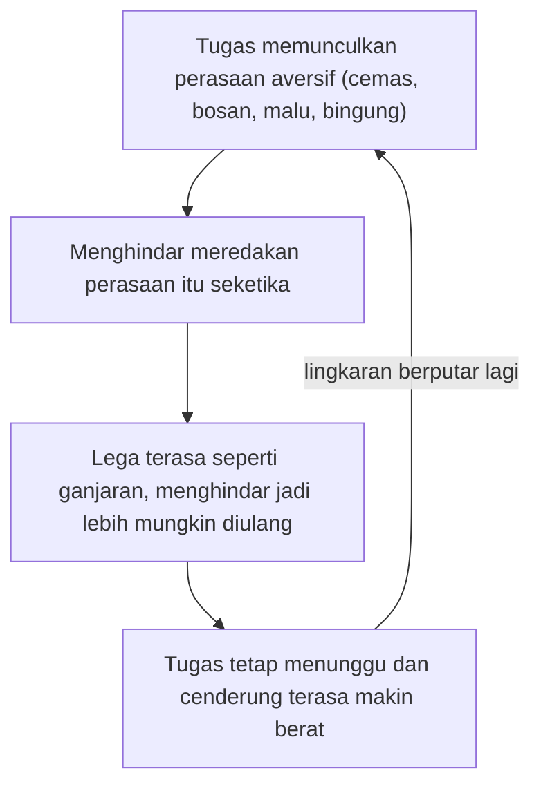

## Menunda untuk Menenangkan Perasaan

Kita semua pernah membuka kulkas padahal tidak lapar, hanya karena ada email penting yang belum juga dibalas sejak pagi. Kita menggulir layar sampai jempol pegal, lalu merasa sedikit lega, sementara email itu tetap menunggu di tempatnya. Rasa lega itulah bagian yang paling sering luput dari perhatian kita.

### Yang kita hindari sebenarnya perasaannya

Penundaan sering dianggap urusan jadwal, seperti kurang disiplin atau kurang rapi mengatur waktu. Tinjauan teoretis Sirois dan Pychyl (2013) menawarkan sudut lain. Mereka memandang penundaan sebagai kegagalan regulasi diri yang digerakkan oleh perbaikan *mood* jangka pendek. Saat sebuah tugas mengundang rasa tidak enak, kita mengutamakan merasa lebih baik sekarang, dan biayanya ditanggung **diri masa depan**. Karena makalah ini tinjauan teoretis, isinya kerangka berpikir dan tidak memuat angka.

Kerangka yang sama menjadi benang merah buku suntingan Sirois dan Pychyl (2016), *Procrastination, Health, and Well-Being*. Buku itu memandang penundaan terutama sebagai kegagalan mengatur keadaan emosi, dan membahas kaitannya dengan kesehatan mental dan fisik. Artinya, kalender yang rapi dan aplikasi pengingat saja sering belum cukup. Yang mengganggu adalah perasaan yang muncul saat kamu membuka tugasnya.

### Siklus menghindar yang terus berulang

Dari sudut pandang perbaikan *mood*, kita bisa menyusun sebuah lingkaran. Lingkaran ini **ringkasan penalaran** dari pandangan tersebut, tanpa merujuk eksperimen dari studi tertentu.

1. Tugas memunculkan perasaan aversif berupa cemas, bosan, malu, atau bingung.
2. Menghindar, entah lewat kulkas, layar, atau merapikan laci, meredakan perasaan itu seketika.
3. Lega yang datang terasa seperti ganjaran, sehingga menghindar jadi lebih mungkin diulang pada kesempatan berikutnya.

Tugasnya sendiri tidak ikut hilang. Ia menunggu, dan karena kita makin lama tidak menyentuhnya, ia cenderung terasa makin berat. Lingkaran pun berputar lagi.

Digambar sebagai ringkasan penalaran, putaran itu tampak seperti ini.

Tabel berikut hanya ilustrasi buatan penulis untuk memperlihatkan bagaimana lingkaran itu bisa terasa dari dalam.

| Sinyal tubuh | Yang kamu lakukan | Yang sebenarnya terjadi |
|---|---|---|
| Dada terasa sesak saat membuka dokumen | Berpindah ke tab media sosial | Rasa tidak enak mereda, dan menghindar terasa "berhasil" |
| Perut mulas membayangkan balasan atasan | Merapikan meja dulu | Tegang turun sebentar, tugas tetap menunggu |
| Terdengar bisikan "nanti saja kalau suasana hati lebih baik" | Menutup laptop | Lega yang tadi menguatkan kebiasaan menutup laptop |

> Untuk mengenali lingkaran ini dengan cepat, amati apa yang tubuhmu rasakan beberapa detik sebelum tanganmu berpindah ke ponsel. Biasanya ada sesuatu di sana.

### Perasaan tidak enak bisa dilatih

Kabar baiknya datang dari Eckert dan rekan (2016), yang melaporkan tiga studi. Pada studi pertama (potong lintang), keterampilan regulasi emosi berkaitan dengan penundaan, dengan kemampuan menoleransi emosi aversif sebagai penengah. Studi kedua (*cross-lagged*) menunjukkan bahwa kemampuan mengubah emosi aversif mengurangi penundaan berikutnya, sedangkan penundaan juga memengaruhi kemampuan menoleransi emosi aversif berikutnya. Jadi arah pengaruhnya tampak berputar, selaras dengan lingkaran tadi.

Studi ketiga berupa uji acak terkontrol (RCT) dua lengan, dan hasilnya menunjukkan bahwa pelatihan sistematis keterampilan *menoleransi* dan *mengubah* emosi aversif mengurangi penundaan. Abstrak studi ini tidak menyebut ukuran sampel maupun ukuran efek, jadi jangan membayangkan hasilnya lebih besar atau lebih kecil daripada yang sebenarnya. Bila yang bermasalah adalah cara kita menghadapi perasaan, melatih cara itu ikut menolong.

### Saat stres menumpuk

Sirois (2023), dalam tinjauan konseptual, mengajukan *stress context vulnerability model*. Menurut model ini, konteks yang penuh stres menguras sumber daya koping dan menurunkan toleransi terhadap emosi negatif, sehingga risiko menunda naik. Dalam keadaan lelah, menunda menjadi cara yang hemat tenaga untuk menghindari emosi aversif dari sebuah tugas. Penulisnya menerapkan model ini pada stresor masa pandemi COVID-19.

Implikasinya menyentuh cara kita menilai diri. Kalau menunda sebagian dipengaruhi oleh isi tangki koping yang sedang menipis, label malas tidak menjelaskannya dengan akurat. Sirois mendorong pandangan yang lebih penuh welas asih terhadap orang yang menunda, dan itu layak kamu terapkan pada dirimu sendiri tanpa mengurangi tanggung jawab atas tugasmu.

## Recap

- Penundaan dipandang sebagai upaya merasa lebih baik sekarang, dengan biaya ditanggung diri masa depan (Sirois dan Pychyl, 2013; 2016). Gambaran lingkaran penghindaran hanyalah ringkasan penalaran penulis.
- Dalam RCT Eckert dan rekan (2016), pelatihan menoleransi dan mengubah emosi aversif mengurangi penundaan.
- Dalam model Sirois (2023), stres menguras sumber daya koping dan menurunkan toleransi terhadap emosi negatif, sehingga pandangan yang welas asih lebih tepat.

Kalau yang dihindari adalah perasaan, wajar bila kamu bertanya kenapa sebagian tugas memicu rasa tidak enak sedangkan tugas lain tidak. Petunjuknya ada pada tugas itu sendiri.
