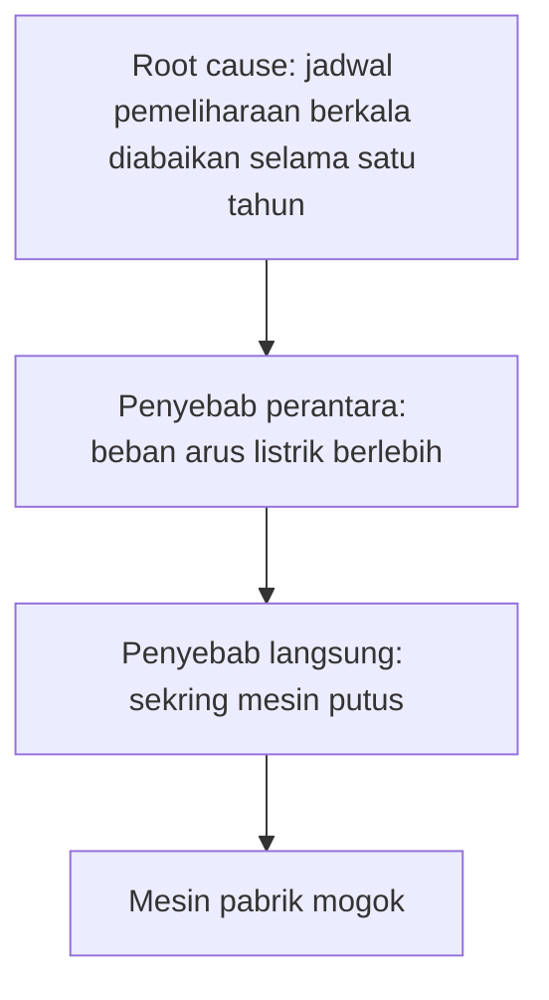
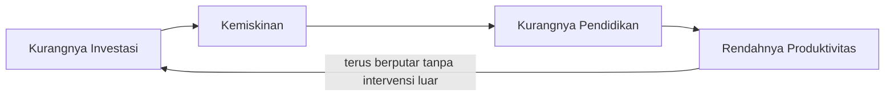

## Analisis Hubungan Sebab-Akibat

Sering kali, ketika kamu membawa payung, hujan tidak kunjung turun. Namun, saat kamu meninggalkannya di rumah, hujan turun deras. Secara intuitif, otak kita cenderung menghubungkan dua kejadian yang terjadi berdekatan ini sebagai hubungan sebab-akibat. Dalam penalaran kritis, asumsi terburu-buru seperti ini adalah jebakan.

Memahami kausalitas (hubungan sebab-akibat) secara tepat menjadi dasar untuk mengambil keputusan yang akurat, baik dalam sains, bisnis, maupun keputusan personal sehari-hari.

## 1. Korelasi vs Kausalitas

Langkah awal untuk melatih ketajaman berpikir adalah memisahkan antara **korelasi** dan **kausalitas**. Dua konsep ini sering disamakan, padahal maknanya berbeda:

* **Korelasi** merujuk pada hubungan statistik ketika dua variabel cenderung bergerak bersamaan. Misalnya, jika variabel $A$ meningkat, variabel $B$ juga ikut naik (korelasi positif), atau sebaliknya (korelasi negatif). Namun, gerakan bersama ini tidak menjamin adanya hubungan sebab-akibat.
* **Kausalitas**, di sisi lain, menuntut adanya hubungan langsung: satu peristiwa (sebab) memicu peristiwa lain (akibat).

> **Analogi Sederhana:** Bayangkan kamu membaca data bahwa wilayah dengan jumlah pos pemadam kebakaran yang banyak selalu mencatat kerugian material akibat kebakaran yang tinggi. Apakah itu berarti keberadaan petugas pemadam memicu kerugian? Jelas tidak. Keduanya tampak berhubungan karena dipengaruhi oleh variabel ketiga (*confounding variable*), yaitu **skala kebakaran**. Kebakaran hebat pasti membutuhkan lebih banyak petugas sekaligus melahirkan kerugian yang lebih besar.

### Mengapa Kita Sering Keliru?

Otak manusia berevolusi untuk membaca pola demi bertahan hidup. Di masa purba, mengaitkan buah beri merah tertentu dengan sakit perut teman adalah mekanisme pertahanan yang efektif. Masalahnya, di era modern yang penuh dengan data kompleks, pola yang kita lihat sering kali hanyalah kebetulan atau hasil dari variabel tersembunyi.

## 2. Syarat Menentukan Hubungan Kausal

Untuk menyimpulkan bahwa $A$ menyebabkan $B$, para pemikir kritis dan peneliti bersandar pada tiga syarat ilmiah:

1. **Temporal Precedence (Urutan Temporal):** Sebab wajib mendahului akibat secara kronologis. Jika $B$ sudah terjadi sebelum $A$ muncul, maka $A$ mustahil menjadi penyebab bagi $B$.
2. **Covariation (Kovariasi):** Harus ada pola perubahan yang selaras secara konsisten di antara keduanya. Apabila $A$ berubah, $B$ juga harus menunjukkan perubahan yang terukur.
3. **Non-spuriousness (Ketiadaan Hubungan Semu):** Ini merupakan kriteria paling menantang. Kamu harus memastikan tidak ada faktor $C$, yang biasa disebut variabel perancu (*confounding variable*), yang sebenarnya menyebabkan kemunculan $A$ dan $B$ secara bersamaan.

   

   $$
   A \rightarrow B \text{ (Hanya jika faktor } C, D, \text{ dan } E \text{ sudah ditiadakan)}
   $$
   

## 3. Kompleksitas Causal Chain (Rantai Kausalitas)

Di dunia nyata, sangat jarang sebuah akibat dipicu oleh penyebab tunggal. Kita hampir selalu berhadapan dengan **Causal Chain (Rantai Kausalitas)** atau **Causal Web (Jaring Kausal)** yang saling terkait.

### A. Penyebab Langsung vs. Root Cause (Akar Masalah)

Sebagai ilustrasi, bayangkan sebuah mesin pabrik mendadak mogok.

* **Penyebab langsung:** Sekring mesin putus.
* **Penyebab perantara (*intermediate cause*):** Terjadi beban arus listrik yang berlebih.
* **Root cause (akar masalah):** Jadwal pemeliharaan mesin berkala yang diabaikan selama satu tahun penuh.

Urutan dari akar masalah sampai mesin berhenti bekerja tersusun seperti ini.

Jika kamu hanya mengganti sekring tanpa membenahi jadwal pemeliharaan berkala, masalah serupa akan terus berulang karena akar masalahnya tidak pernah diselesaikan.

### B. Feedback Loop (Lingkar Umpan Balik)

Ada kalanya hubungan bersifat melingkar: $A$ memicu $B$, lalu $B$ berbalik memperkuat $A$. Contoh klasik dalam ekonomi makro: 

$$
\text{Kurangnya Investasi} \rightarrow \text{Kemiskinan}
$$

$$
\rightarrow \text{Kurangnya Pendidikan} \rightarrow \text{Rendahnya Produktivitas}
$$

Fenomena ini dikenal sebagai *vicious cycle* (lingkaran setan) yang terus berputar jika tidak ada intervensi luar.

Kalau digambar, lingkaran setan itu kembali ke titik awalnya.

## 4. Jebakan dalam Analisis Kausalitas

Dalam menarik kesimpulan, ada beberapa kesalahan berpikir (*logical fallacies*) terkait sebab-akibat yang kerap mengaburkan analisis kita:

* **Reverse Causality (Kausalitas Terbalik):** Kesalahan ketika kita mengira $A \rightarrow B$, padahal arah aslinya adalah $B \rightarrow A$.
  Sebagai contoh, apakah seseorang menjadi optimis karena ia sukses, atau justru sikap optimis itulah yang membawanya menuju kesuksesan?
* **The Third Variable Problem:** Kondisi di mana ada faktor ketiga (variabel tersembunyi) yang mengendalikan kedua variabel utama.
  Misalnya, statistik menunjukkan lonjakan penjualan es krim berjalan beriringan dengan naiknya frekuensi serangan hiu di pantai. Faktor sebenarnya bukanlah es krim yang mengundang hiu, melainkan musim panas: suhu yang terik mendorong orang membeli es krim sekaligus menarik minat mereka untuk berenang di laut.
* **Post Hoc Ergo Propter Hoc:** Asumsi keliru bahwa karena peristiwa $X$ terjadi setelah peristiwa $Y$, maka $Y$ pasti merupakan penyebab dari $X$. Hubungan berurutan secara waktu tidak otomatis berarti hubungan sebab-akibat.

## 5. Skenario Aplikasi Praktis

### Server yang Mati Setiap Tengah Malam

Dalam dunia rekayasa perangkat lunak, seorang *engineer* sering memanfaatkan metode **"The 5 Whys"** untuk melacak akar masalah (*root cause*) dari kegagalan sistem. Dalam pelacakan itu, ia tetap harus memisahkan korelasi dari sebab yang terbukti.

Misalnya, sebuah server selalu mati setiap pukul 00.00, dan pada jam yang sama pembaruan (*update*) otomatis juga berjalan. Sejauh ini, yang ditemukan baru korelasi. Dari sana, *engineer* menyusun hipotesis kausal: pembaruan otomatis memakan memori terlalu besar (sebab) sehingga server *crash* (akibat). Hipotesis itu baru menguat jika catatan galat (*error log*) memuat pesan bahwa batas memori terlampaui. Jika pesan itu ada, akar masalahnya kemungkinan besar ditemukan dan proses pembaruannya perlu dioptimalkan. Jika tidak ada, yang tersisa hanyalah korelasi, sedangkan hubungan sebab-akibatnya belum terkonfirmasi.

### Formulasi Kebijakan Publik

Pemerintah suatu kota mencatat tingkat kriminalitas menurun tajam bertepatan dengan pemasangan lampu jalan baru. Namun, analisis yang lebih saksama mendeteksi bahwa pemasangan lampu jalan dilakukan di wilayah yang saat itu juga sedang diintensifkan patroli kepolisiannya. Guna mengukur kebijakan mana yang benar-benar efektif, pemerintah wajib mengisolasi variabel-variabel tersebut, misalnya dengan menguji dampak pemasangan lampu jalan di wilayah yang tidak mendapatkan tambahan unit patroli.

## Panduan Praktis Menganalisis Hubungan Kausal

Saat kamu mengevaluasi suatu klaim atau peristiwa, gunakan panduan berikut untuk membedakan korelasi dan kausalitas:

1. **Evaluasi kemungkinan kebetulan:** Periksa apakah hubungan tersebut didukung oleh data statistik yang memadai atau sekadar kejadian acak yang terjadi bersamaan.
2. **Identifikasi variabel ketiga:** Selidiki apakah ada faktor eksternal tersembunyi yang menjadi pemicu sesungguhnya bagi kedua variabel.
3. **Validasi urutan temporal:** Pastikan kembali variabel sebab terjadi mendahului akibat, bukan sebaliknya.
4. **Gunakan Analisis Kontrafaktual (*Counterfactual*):** Tanyakan pada diri sendiri, "Jika $A$ tidak pernah terjadi, apakah $B$ akan tetap muncul?" Apabila jawabannya ya, berarti $A$ bukan penyebab utama dari $B$.

Mengetahui *apa* yang terjadi membekali kita dengan informasi. Mengetahui *mengapa* hal itu terjadi memberi kita pengetahuan. Namun, untuk bernalar kritis, kamu perlu membedakan dengan jeli mana penyebab nyata dan mana korelasi semu.
