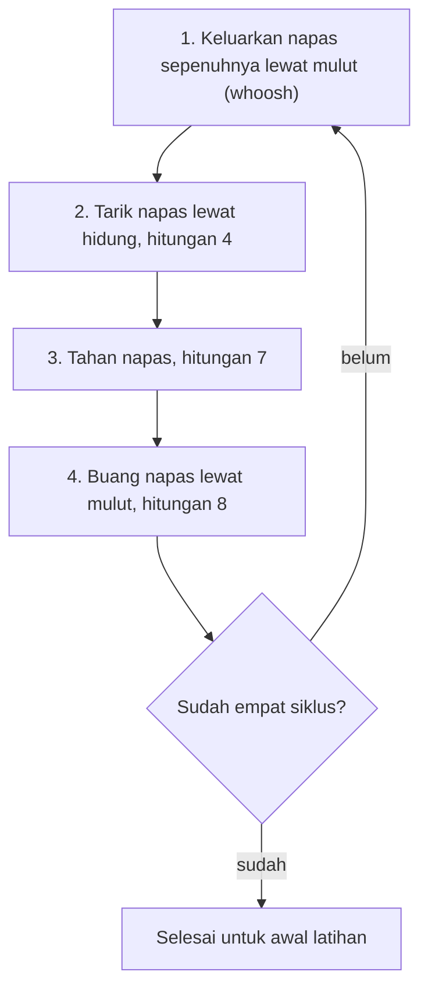

## Teknik Pernapasan 4-7-8

Pernahkah kamu merasa jantung berdebar kencang sebelum presentasi penting, atau merasa pikiran sulit berhenti berputar saat mencoba tidur di malam hari? Dalam momen-momen penuh tekanan seperti itu, tubuh sering kali terjebak dalam mode *fight-or-flight* (lawan atau lari).

Teknik Pernapasan 4-7-8 adalah salah satu cara cepat untuk mengambil alih kendali sistem sarafmu secara sadar. Dipopulerkan oleh Dr. Andrew Weil, metode ini adalah bentuk pengondisian sistem saraf yang dirancang untuk membawa tubuh kembali ke keadaan tenang dengan cepat.

## Mengapa Ritmenya 4-7-8

Mengapa angkanya 4, 7, dan 8? Mengapa tidak 5-5-5 atau 3-3-3? Jawabannya ada pada cara ritme ini berinteraksi dengan sistem saraf otonom.

### 1. Mengaktifkan Sistem Parasimpatis

Tubuh memiliki dua mode utama dalam merespons lingkungan:

- **Sistem Simpatis:** Ibarat pedal gas (stres, kewaspadaan, dan peningkatan detak jantung).
- **Sistem Parasimpatis:** Ibarat pedal rem (relaksasi, pencernaan, dan pemulihan).

Saat kamu menarik napas dalam 4 hitungan, menahannya selama 7 hitungan, dan mengembuskannya selama 8 hitungan, kamu secara aktif menekan pedal rem tersebut. Menahan napas memperpanjang jeda dan memperlambat ritme pernapasan, sementara pengeluaran napas yang perlahan merangsang *vagus nerve* (saraf vagus), yaitu saraf utama yang mengirimkan sinyal aman ke otak.

### 2. Keseimbangan Gas Darah

Secara kimiawi, teknik ini membantu menyeimbangkan kadar karbon dioksida ($\text{CO}_2$) dan oksigen ($\text{O}_2$) di dalam darah.

> **Catatan Penting:** Saat cemas, kita cenderung bernapas pendek dan cepat (*hiperventilasi*), yang membuang terlalu banyak $\text{CO}_2$. Dengan memperlambat napas melalui rasio 4:7:8, kita menstabilkan kembali kimia darah.

## Panduan Langkah demi Langkah Teknik 4-7-8

Sebelum memulai, carilah posisi duduk yang nyaman dengan punggung tegak, atau berbaringlah jika kamu melakukannya sebelum tidur.

### Posisi Lidah

Tempatkan ujung lidahmu tepat di belakang gigi depan atas, pada jaringan gusi yang menonjol. Pertahankan lidah di sana selama seluruh latihan. Kamu akan membuang napas melalui mulut di sekitar lidahmu; jika ini terasa canggung, cobalah mengerutkan bibir sedikit.

### Siklus Pernapasan

1. **Keluarkan napas sepenuhnya** melalui mulut hingga terdengar suara desis (*whoosh*).
2. **Tutup mulut dan tarik napas** dengan tenang melalui hidung dalam hitungan **4**.
3. **Tahan napasmu** selama hitungan **7**.
4. **Buang napas sepenuhnya** melalui mulut dengan suara desis kembali dalam hitungan **8**.

Empat tahap di atas dihitung sebagai **satu siklus**. Ulangi hingga total **empat siklus** pada awal latihan.

Urutan satu siklus beserta pengulangannya terangkum seperti ini:

Cobalah rasakan perbedaan suhu udara: terasa sejuk saat masuk melalui hidung dan hangat saat keluar melalui mulut. Detail kecil ini membantu memfokuskan pikiranmu pada momen saat ini.

## Analogi Komputer yang Kelebihan Aplikasi

Bayangkan pikiranmu adalah sebuah komputer yang memiliki terlalu banyak aplikasi terbuka secara bersamaan, menyebabkan sistem menjadi panas dan lambat (*lag*).

- **Menarik napas (4):** Proses mengidentifikasi aplikasi yang tidak perlu.
- **Menahan napas (7):** Momen ketika kamu menekan tombol *Shut Down*.
- **Mengembuskan napas (8):** Proses membersihkan memori dan mendinginkan mesin.

Setelah melakukan teknik ini, tubuh dan pikiranmu kembali bekerja dengan lebih segar, seperti komputer yang beban prosesornya sudah berkurang.

## Skenario Penggunaan dalam Kehidupan Sehari-hari

Teknik 4-7-8 praktis karena tidak memerlukan alat apa pun dan bisa dilakukan tanpa menarik perhatian. Berikut adalah beberapa skenario ketika teknik ini berguna:

- **Sebelum Tidur (Insomnia):** Ini adalah penggunaan paling populer. Ritme ini membantu menurunkan detak jantung dan mempersiapkan otak untuk masuk ke gelombang tidur.
- **Menghadapi Konfrontasi:** Jika kamu merasa marah atau tersinggung oleh perkataan seseorang, lakukan satu siklus 4-7-8 sebelum merespons. Ini memberi jeda antara impuls emosional dan tindakan.
- **Serangan Panik (*Panic Attack*):** Saat merasa kewalahan, teknik ini berfungsi sebagai jangkar fisik untuk mencegah pikiran melayang ke skenario terburuk.
- **Keinginan Impulsif (*Cravings*):** Gunakan teknik ini saat kamu merasakan dorongan kuat untuk merokok atau makan berlebihan secara emosional. Langkah ini membantu memutus sirkuit keinginan di otak.

## Tips untuk Keberhasilan Jangka Panjang

Meskipun kamu bisa merasakan manfaatnya segera, teknik 4-7-8 bekerja paling baik sebagai latihan kumulatif yang dilakukan secara berkala.

1. **Konsistensi:** Lakukan setidaknya dua kali sehari. Otot yang kuat tidak terbentuk hanya dengan pergi ke tempat fitnes sekali; hal yang sama berlaku untuk sistem sarafmu.
2. **Jangan Terburu-buru:** Jika kamu tidak bisa menahan napas selama 7 hitungan di awal, jangan dipaksakan. Yang terpenting adalah menjaga rasio 4:7:8. Kamu bisa menghitung lebih cepat asalkan rasionya tetap konsisten.
3. **Batasan Awal:** Jangan melakukan lebih dari 4 siklus per sesi selama bulan pertama latihan. Setelah terbiasa, kamu bisa meningkatkannya hingga maksimal 8 siklus.
4. **Peringatan Keamanan:** Karena teknik ini bisa menyebabkan sedikit pusing pada awalnya (akibat penyesuaian kadar oksigen), **jangan pernah** melakukannya saat sedang menyetir atau mengoperasikan mesin berat sampai kamu tahu pasti bagaimana tubuhmu bereaksi.

## Tabel Latihan Mandiri

Gunakan panduan cepat ini untuk sesi latihanmu berikutnya:

| Tahap | Aksi | Fokus Utama | Manfaat |
| --- | --- | --- | --- |
| **Inhalasi** | Tarik napas (Hidung) - 4 hitungan | Ketenangan | Oksigenasi awal |
| **Retensi** | Tahan napas - 7 hitungan | Keheningan | Memperlambat ritme napas |
| **Ekshalasi** | Buang napas (Mulut) - 8 hitungan | Pelepasan | Aktivasi *vagus nerve* |

> **Ingat:** Pernapasan adalah salah satu fungsi sistem saraf otonom yang dapat kita kendalikan secara sadar. Dengan menguasai napasmu, kamu memegang kunci untuk mengendalikan stresmu sendiri.
