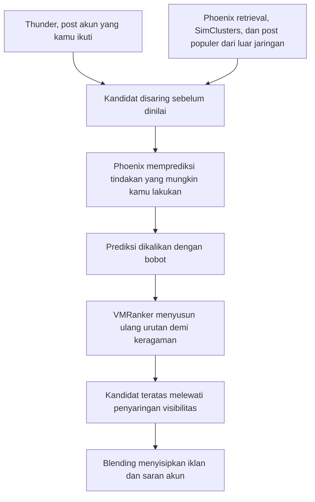

## Perjalanan Sebuah Post Menuju For You

Bayangkan sebuah post yang baru diunggah sebagai pesanan di dapur restoran yang sibuk, yang harus melewati beberapa meja sebelum tersaji di depanmu. Ada meja yang mengambil bahan, meja yang menakar bumbu, juru masak yang menebak selera tamu, petugas yang memeriksa piring, lalu pelayan yang menata semuanya. Post yang sampai di tab For You menempuh perjalanan serupa, hanya saja dapurnya berupa server dan juru masaknya berupa model. Bab ini mengikuti perjalanan itu supaya kamu tahu meja mana yang bisa kamu pengaruhi dan mana yang tidak.

### Lima Tahap Penyusunan Feed

Peta paling sederhana dari perjalanan itu terdiri dari lima tahap:

1. **Mencari calon post.** Sistem mengumpulkan kandidat dari beberapa sumber, baik dari akun yang kamu ikuti maupun dari luar jaringanmu.
2. **Mengisi fitur (feature hydration).** Setiap kandidat dilengkapi informasi pendukung, seperti hubungan antarpengguna, konteks post, dan riwayat aktivitas. README Home Mixer menyebut sekitar 6.000 fitur.
3. **Memprediksi respons.** Model menebak respons apa yang mungkin kamu berikan pada setiap kandidat.
4. **Menyaring dan mengatur ulang.** Kandidat yang tidak layak dikeluarkan, dan urutan disesuaikan agar layar tidak dikuasai satu hal saja.
5. **Menyusun layar.** Post yang lolos dicampur dengan komponen lain, misalnya iklan dan saran akun, lalu dikirim ke aplikasimu.

Daftar ini adalah peta konsep, bukan urutan eksekusi yang persis. Sebagian filter sudah berjalan sebelum penilaian, dan kode juga punya jalur cadangan serta jalur bersyarat, misalnya pipeline kronologis terbalik yang dipakai bila penilaian gagal. Ada satu hal yang membuat dapur ini berbeda dari restoran biasa: setelah kamu membaca atau berinteraksi dengan sebuah post, aktivitas itu bisa menjadi bahan untuk permintaan feed berikutnya. Tamunya ikut menulis resep pesanan selanjutnya.

### Dari Mana Calon Post Datang

Di repositori [twitter/the-algorithm](https://github.com/twitter/the-algorithm) (pembaruan September 2025), [README Home Mixer](https://github.com/twitter/the-algorithm/blob/main/home-mixer/README.md) menyebut beberapa sumber kandidat:

- **Earlybird**, indeks pencarian yang menyimpan post agar bisa ditemukan kembali. Dari sinilah post akun yang kamu ikuti (in-network) diambil, dan README utama repositori menyebut sekitar separuh post berasal dari indeks pencarian ini.
- **UTEG** (User Tweet Entity Graph), peta hubungan antara pengguna dan post berdasarkan interaksi mereka, yang menurut README utama dibangun di atas kerangka GraphJet. Lewat jalur ini, aktivitas orang di sekitar jaringanmu bisa membawa post dari akun yang tidak kamu ikuti.
- **Cr Mixer**, sumber kandidat lain yang juga tercantum di README tersebut.
- **Tweet Mixer**, yang oleh README utama repositori disebut sebagai lapisan koordinasi untuk mengambil kandidat dari luar jaringan.
- **FRS** (Follow Recommendations Service), layanan rekomendasi akun yang juga menjadi salah satu sumber kandidat.

Di luar daftar itu, pola follow dan interaksi bisa diolah menjadi representasi minat lewat metode bernama SimClusters, yang dibahas di bab 5. Gabungan jalur ini menjelaskan mengapa post dari akun asing bisa muncul di layarmu. Kamu tidak perlu pernah menyukai akun tersebut, karena kandidatnya bisa masuk lewat jaringan atau kemiripan perilaku.

### Istilah yang Sering Muncul

- **Candidate sourcing**: mengambil sekumpulan calon post sebelum memilih yang akan ditampilkan.
- **Feature**: informasi yang dipakai model, misalnya hubungan pengguna, konteks post, atau riwayat aktivitas.
- **Feature hydration**: melengkapi kandidat dengan feature yang diambil dari layanan lain.
- **Ranking**: memberi skor untuk menentukan prioritas kandidat.
- **Rescoring**: menyesuaikan skor, misalnya agar satu penulis tidak memenuhi layar.
- **Filtering**: mengeluarkan atau membatasi kandidat berdasarkan aturan tertentu.
- **Mixing**: menata post bersama komponen lain, termasuk iklan dan rekomendasi akun.

### Feed Bukan Daftar Skor Tertinggi

Kalau dapur hanya menyajikan hidangan bernilai tertinggi, kamu bisa saja menerima sepuluh piring dari juru masak yang sama. Home Mixer punya penyesuaian untuk mencegahnya: keragaman penulis, keseimbangan konten, kelelahan umpan balik (feedback fatigue), penghapusan duplikat dan konten yang sudah pernah kamu lihat, serta penyaringan visibilitas. Setelah itu, layar akhir masih dicampur dengan iklan, saran akun, dan modul lain seperti percakapan.

Akibatnya, dua post dengan prediksi berbeda belum tentu muncul dalam urutan yang bisa kamu tebak dari satu tindakan saja. Screenshot sebuah feed juga tidak bisa membuka bobot algoritma, karena yang terlihat hanya piring yang sudah tersaji, bukan resep dan takarannya.

### Alur Baru di xai-org/x-algorithm

Repositori kedua, [xai-org/x-algorithm](https://github.com/xai-org/x-algorithm), dibuat pada Januari 2026 dan [diumumkan @Engineering](https://x.com/Engineering/status/2013471689087086804) pada 20 Januari 2026 sebagai sistem yang memakai arsitektur transformer yang sama dengan model Grok milik xAI. Pembaruan besar datang pada 15 Mei 2026, dan sejak Agustus 2026 repositori ini diperbarui nyaris setiap hari. Dalam bahasa sederhana, alurnya begini:

1. Post dari akun yang kamu ikuti datang dari Thunder, tempat penyimpanan post terbaru akun-akun tersebut. Post dari luar jaringan datang dari Phoenix retrieval, SimClusters, dan post populer.
2. Sebelum dinilai, kandidat disaring. Yang dibuang antara lain post yang lebih tua dari 48 jam, post milikmu sendiri, post dari akun yang kamu blokir atau bisukan, post yang memuat kata yang kamu bisukan, serta post yang sudah pernah kamu lihat atau sudah dikirim kepadamu.
3. Phoenix memprediksi tindakan yang mungkin kamu lakukan dengan membaca sekitar seribu aktivitas terbarumu.
4. Prediksi itu dikalikan dengan bobot, lalu VMRanker menyusun ulang urutan demi keragaman. Bobot mengalikan peluang tindakan yang diprediksi, bukan memberi poin per tindakan.
5. Kandidat teratas melewati penyaringan visibilitas, kemudian tahap blending menyisipkan iklan dan saran akun.

Kelima langkah tadi bisa kamu telusuri sebagai satu alur dari atas ke bawah.

Ingat bahwa tidak satu pun dari kedua repositori ini adalah salinan lengkap sistem yang berjalan. Konfigurasi per permintaan, model terlatih, data pengguna, dan banyak eksperimen langsung berada di luar jangkauan siapa pun yang membaca kodenya. Repositori baru memang menyalin nilai bawaan dari produksi dan menargetkan agar eksperimen yang menyentuh sekitar 10% lalu lintas atau lebih ikut terlihat, tetapi itu tetap bukan keseluruhan sistem.

### Apa yang Berubah bagi Pembaca

- **Masih berlaku.** For You mencampur post dari akun yang kamu ikuti dengan post rekomendasi.
- **Masih berlaku.** Alur besarnya sama, yaitu mengumpulkan, menyaring, menilai, menyaring visibilitas, lalu mencampur.
- **Masih berlaku.** Mute, blokir, kata yang dibisukan, dan "not interested" tetap menjadi kendali utamamu sebagai pembaca.
- **Berubah.** Nama Earlybird dan UTEG tidak muncul di README baru. Jalur akun yang kamu ikuti kini dilayani Thunder, dan prediksi dikerjakan Phoenix.
- **Berubah.** Di repositori baru, kandidat dibatasi usia 48 jam, dan model membaca urutan aktivitas terbarumu, sehingga kebiasaan baca belakangan ini ikut menentukan apa yang ditebak.

## Benang Merah

- Post di For You melewati lima tahap: dicari, dilengkapi fitur, diprediksi, disaring dan diatur ulang, lalu disusun di layar.
- Kandidat datang dari akun yang kamu ikuti dan dari luar jaringan, jadi akun asing bisa muncul tanpa pernah kamu sukai.
- Urutan feed bukan daftar skor tertinggi, dan screenshot tidak bisa membuka bobotnya.
- Repositori baru mengganti nama komponen, tetapi alur besar dan kendali utama pembaca tetap sama.

Sisi dapur sudah kita telusuri dari meja ke meja, sementara separuh cerita lainnya ada di tanganmu, yaitu sinyal yang kamu kirim setiap kali membaca, berhenti, atau menggulir lewat.
