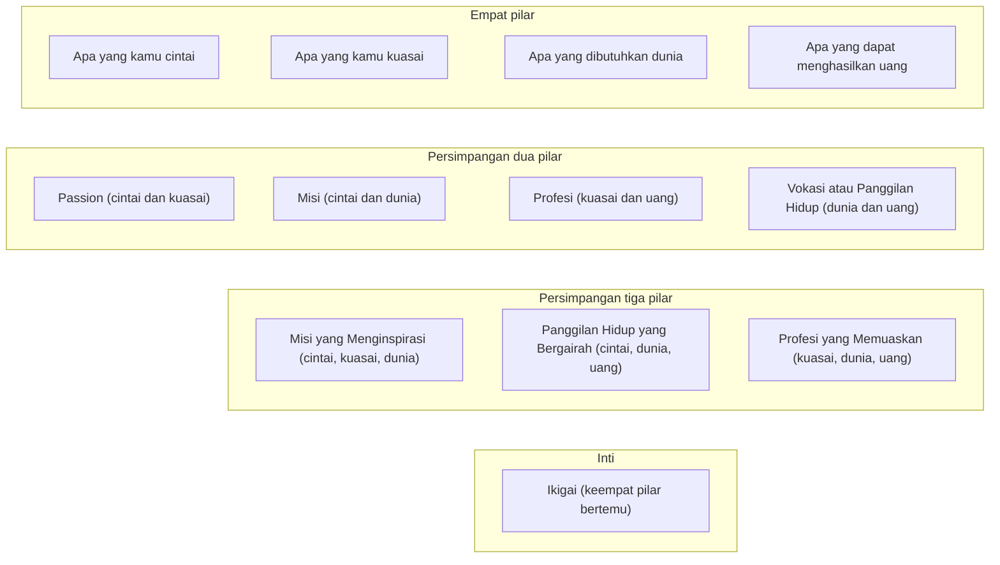

## Zona Persimpangan Ikigai

Kini, setelah keempat pilar utama Ikigai dipahami secara terpisah, saatnya melihat bagaimana pilar-pilar itu saling berinteraksi dan berpadu. Perpaduan itu menciptakan area persimpangan, dan konsep zona persimpangan ini penting karena di sinilah tujuan hidup mulai terlihat.

> Ikigai muncul dari perpaduan keempat pilarnya, dan hasilnya lebih bernilai dari sekadar gabungan bagian-bagiannya.

Secara visual, Ikigai sering digambarkan melalui diagram Venn empat lingkaran. Setiap lingkaran mewakili satu pilar, dan area tumpang tindihnya menggambarkan arah hidup kita.

## Memahami Diagram Venn Ikigai

Mari kita bedah persimpangan-persimpangan yang muncul dari gabungan dua atau tiga pilar sebelum mencapai inti utamanya.

### 1. Persimpangan Dua Pilar

Ketika dua pilar utama bertemu, area yang tercipta memiliki karakteristik unik meski belum mencapai tahap Ikigai sepenuhnya.

Area **Passion** terbentuk ketika kamu menggabungkan hal yang kamu cintai dengan hal yang kamu kuasai. Di zona ini, kamu menemukan kesenangan sekaligus keunggulan. Aktivitasnya sering kali membawa kamu ke dalam kondisi *flow*, di mana waktu berlalu tanpa terasa dan kamu merasa sepenuhnya tenggelam dalam pekerjaan. Seorang pelukis dengan bakat alami, misalnya, bisa menghabiskan waktu berjam-jam di studio tanpa merasa lelah.

Di sisi lain, ada **Misi** yang merupakan perpaduan antara apa yang kamu cintai dan apa yang dibutuhkan dunia. Zona ini berisi kegiatan yang kamu nikmati sekaligus memberikan dorongan batin karena bermanfaat bagi orang lain atau lingkungan. Contoh nyatanya adalah seorang aktivis yang mendedikasikan hidupnya melestarikan alam karena peduli pada nasib planet ini.

Sementara itu, **Profesi** berfokus pada apa yang kamu kuasai dan apa yang bisa menghasilkan uang. Keterampilan kamu dihargai secara finansial di area ini. Seorang *developer software* yang pandai dalam urusan *coding* dan dibayar tinggi untuk membangun aplikasi kompleks berada di persimpangan ini. Area ini biasanya menjanjikan stabilitas dan keamanan finansial.

Terakhir, **Vokasi** atau Panggilan Hidup adalah titik temu antara apa yang dibutuhkan dunia dan apa yang bisa menghasilkan pendapatan. Di sini, kamu memenuhi kebutuhan pasar atau permasalahan sosial, seperti seorang dokter yang bertugas di daerah terpencil. Keahlian medisnya dibutuhkan, dan ia tetap mendapat penghasilan dari dedikasinya.

Hanya berfokus pada salah satu irisan ini akan memunculkan keterbatasan. Memiliki *Passion* tanpa Misi atau Vokasi bisa terasa menyenangkan tapi kurang berkelanjutan secara finansial. Misi tanpa *Passion* atau Profesi rentan menyebabkan kelelahan atau kesulitan ekonomi. Sebaliknya, Profesi tanpa *Passion* dan Misi akan terasa monoton dan hampa, sementara Vokasi tanpa *Passion* dan Profesi lambat laun bisa menjadi beban tersendiri.

### 2. Persimpangan Tiga Pilar

Ketika tiga pilar mulai menyatu, kita semakin dekat dengan inti Ikigai, meskipun masih ada satu elemen yang belum terisi.

Jika pekerjaan itu kamu cintai, kamu kuasai, dan dunia membutuhkannya, kamu akan mendapatkan **Misi yang Menginspirasi**. Kamu merasa terdorong oleh tujuan yang lebih besar, namun aktivitas tersebut mungkin belum cukup menghidupi secara finansial. Misalnya seorang seniman mural yang gigih menyebarkan pesan sosial di komunitasnya, tapi masih kesulitan mencari nafkah.

Apabila aktivitasnya mencakup hal yang kamu cintai, dibutuhkan dunia, dan mendatangkan uang, itu menjadi **Panggilan Hidup yang Bergairah**. Kamu dibayar untuk membantu masalah nyata dan menyukai pekerjaan tersebut, tetapi ada potensi atau keahlian terbaikmu yang masih terpendam dan tidak dimanfaatkan. Konsultan keberlanjutan yang ramah lingkungan mungkin dibayar mahal dan mencintai dampaknya, tapi ia belum menggunakan bakat analitis utamanya.

Selanjutnya, gabungan antara keahlian, kebutuhan dunia, dan penghasilan akan menciptakan **Profesi yang Memuaskan**. Pekerjaan ini bermakna dan mapan secara finansial. Namun, tanpa adanya elemen "cinta" atau gairah yang mendalam, keseharian akan terasa seperti rutinitas wajib alih-alih sesuatu yang menyenangkan. Seorang insinyur handal yang membangun infrastruktur penting mungkin tidak selalu merasa antusias menghadapi rincian tugasnya.

### 3. Inti Sejati Ikigai

Inti dari Ikigai terletak di titik tengah yang mempertemukan keempat pilar tersebut secara selaras:

$$
\text{Ikigai} = \text{(Apa yang kamu Cintai)} \quad \cap \text{(Apa yang kamu Kuasai)}
$$

$$
\quad \cap \text{(Apa yang Dibutuhkan Dunia)} \quad \cap \text{(Apa yang Dapat Menghasilkan Uang)}
$$

Supaya diagram Venn tadi tidak hanya ada di bayanganmu, berikut setiap zona beserta pilar yang membentuknya, tersusun dari dua pilar sampai inti.

Menemukan Ikigai berarti kamu bisa menikmati aktivitasmu karena sejalan dengan *passion*. Kamu merasa percaya diri lantaran menggunakan keterampilan terbaik. Kamu juga sadar bahwa pekerjaanmu membawa dampak positif bagi dunia yang lebih luas, dan pada saat bersamaan, kamu mampu berkembang secara finansial. 

Kondisi ini memberikan rasa senang dan kepuasan yang tulus. Inilah dorongan batin yang membuatmu bersemangat bangun di pagi hari.

## Dinamika dan Keseimbangan

Ikigai bukan sebuah pencapaian yang statis. Seiring berjalannya waktu, minat, keterampilan, dan keadaan dunia terus berubah. Oleh karena itu, perjalanan ini menuntut penyesuaian yang terus-menerus.

Kamu harus bersikap fleksibel untuk meninjau kembali setiap pilar dalam hidupmu. Mencapai Ikigai juga sangat bergantung pada keseimbangan; terlalu berfokus pada mencari uang dapat mengikis gairah atau menghilangkan makna pekerjaan. Proses penemuan ini biasanya berjalan secara iteratif. Jarang seseorang langsung menemukan titik tengahnya; sebagian besar mencapainya perlahan lewat eksplorasi dan percobaan berulang.

Bayangkan seorang fotografer amatir yang mencintai dunia potret satwa liar. Ia menghabiskan waktu bertahun-tahun untuk mengasah kemampuannya di bidang ini. Belakangan, ia menyadari bahwa dunia membutuhkan publikasi nyata untuk meningkatkan kesadaran konservasi lingkungan. Jika pada awalnya ia hanya memotret sebagai hobi, ia lantas mulai menjual karyanya, menerbitkan buku, atau menjadi fotografer resmi bagi organisasi pelestarian alam. Saat keempat elemen ini membaur, ia menikmati pekerjaannya, memberikan dampak nyata, sekaligus mendapatkan imbalan finansial yang layak.

Pada praktiknya, Ikigai tidak selalu berwujud satu pekerjaan tunggal. Ia bisa saja terbentuk dari kombinasi berbagai kegiatan atau ragam proyek yang secara kolektif memenuhi keempat pilar tersebut.