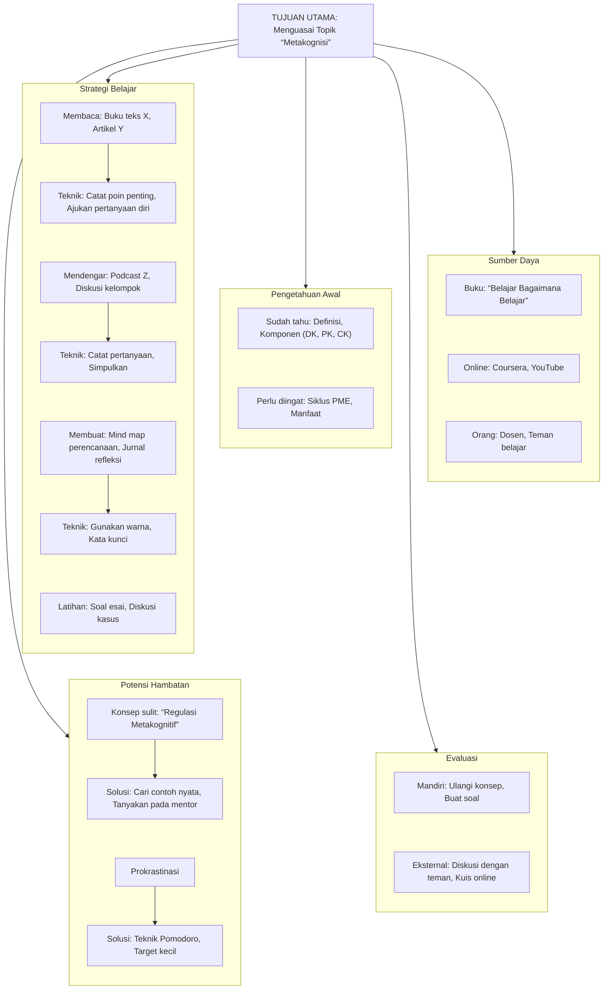

## Mengembangkan Kesadaran Metakognitif

Metakognisi, atau "berpikir tentang berpikir," adalah keterampilan dasar untuk mengerti, memantau, dan mengatur cara belajar kita sendiri. Kalau kita punya kesadaran metakognitif yang baik, kita jadi lebih peka sama cara pikiran bekerja. Kita tahu mana strategi yang pas dan kapan harus ganti pendekatan. Tentu saja kemampuan ini tidak muncul tiba-tiba. Butuh latihan dan pembiasaan. Kalau kita sering refleksi, lama-lama kemampuan belajar dan memecahkan masalah bakal ikut naik.

**Penting:** Metakognisi bikin kita bisa merencanakan, memantau, sekaligus mengevaluasi strategi saat menghadapi masalah atau mempelajari hal baru.

Di bawah ini ada beberapa langkah praktis buat melatih keterampilan metakognitif sehari-hari.

## 1\. Jurnal Belajar

Jurnal belajar adalah alat sederhana untuk melacak progres belajar dan emosi kamu selama prosesnya. Kalau kamu rutin menulis pikiranmu, perlahan kamu bakal mengenali pola, kelebihan, dan bagian mana dari cara belajarmu yang masih perlu diperbaiki.

### Cara Memulainya

1. **Pilih Format yang Nyaman:** Boleh pakai buku tulis biasa, catatan di laptop, atau aplikasi jurnal di HP.
2. **Jadwalkan Waktu Khusus:** Sempatkan 5-10 menit setiap hari, atau sehabis sesi belajar yang lumayan berat.
3. **Gunakan Pertanyaan Pemandu:** Pertanyaan-pertanyaan ini akan bantu kamu fokus pada sisi metakognitif.

### Contoh Pertanyaan Jurnal Belajar

- **Sebelum Belajar:**
	- Apa targetku untuk sesi belajar ini?
		- Strategi apa yang mau aku pakai? Kenapa pilih strategi ini?
		- Apa yang udah aku tahu soal topik ini? Apa yang aku harap bisa aku pelajari?
		- Gimana perasaanku menghadapi tugas ini? Ada rasa cemas atau malah semangat?
- **Selama Belajar (opsional, kalau kamu merasa perlu):**
	- Apa strategi ini berhasil? Kalau nggak, kenapa ya?
		- Ada kesulitan tertentu? Gimana cara aku mengatasinya tadi?
		- Perlukah aku ganti pendekatan sekarang juga?
- **Setelah Belajar:**
	- Hari ini aku belajar apa saja? Targetku tercapai nggak?
		- Strategi mana yang paling efektif (atau yang malah bikin repot)? Kenapa?
		- Bagian mana yang masih bikin bingung atau belum terlalu aku pahami?
		- Gimana perasaanku sehabis sesi belajar ini?
		- Besok-besok aku harus ngapain biar lebih baik?
		- Gimana aku bisa pakai pengetahuan ini nantinya?

**Manfaat Jurnal Belajar:**

- Membantu menganalisis dan mencari jalan keluar pas mentok belajar sesuatu.
- Bikin kita lebih antusias dan terlibat dalam prosesnya.
- Membantu mengenali strategi belajar yang paling cocok.
- Memberikan gambaran progres yang sudah dicapai.
- Membantu mengatur jadwal dan melatih kebiasaan menulis.

## 2\. Refleksi Pasca-Tugas

Refleksi pasca-tugas itu intinya mengevaluasi lagi apa yang baru saja kamu pelajari, gimana prosesnya tadi, dan apa yang bisa diperbaiki ke depannya. Kegiatan ini berguna untuk menarik pelajaran dari setiap tugas atau proyek yang sudah kamu kerjakan.

### Langkah-langkah Melakukan Refleksi Pasca-Tugas

1. **Deskripsikan Tugas dan Hasilnya:** Tuliskan singkat tugas yang baru saja selesai dan apa hasilnya (misal: nilai ujian, atau sekadar berhasil paham materi).
2. **Analisis Proses:**
	- Cara apa yang kamu pakai buat menyelesaikan tugas ini?
		- Mana yang berjalan lancar? Kenapa?
		- Mana yang macet? Kenapa?
		- Gimana kamu mengatur waktu dan tenaga?
		- Ada hambatan? Gimana kamu menyelesaikannya?
		- Emosi atau suasana hati kamu saat itu ngaruh nggak ke hasilnya?
3. **Identifikasi Pembelajaran:**
	- Dari segi materi, apa yang didapat?
		- Terus, apa yang kamu pelajari soal cara belajarmu sendiri?
		- Ada trik baru yang kepikiran, atau mungkin cara lama yang ternyata harus diperbaiki?
4. **Rencanakan Perbaikan:**
	- Kalau nanti dapat tugas yang mirip, apa yang bakal kamu lakukan dengan cara beda?
		- Strategi apa yang bakal kamu pertahankan?
		- Tindakan nyata apa yang bakal kamu ambil setelah melakukan refleksi ini?

> **Penting:** Refleksi setelah belajar itu bakal ningkatin metakognisi kamu. Kamu jadi tahu apakah strategi yang dipakai efektif atau butuh penyesuaian buat sesi berikutnya.

### Contoh Penerapan

Setelah mengerjakan soal ujian matematika:

- *Strategi yang digunakan:* "Saya membaca soal dengan cepat, mencoba rumus yang paling familiar, lalu memeriksa ulang jawaban."
- *Refleksi:* "Saya menyadari bahwa saya sering terburu-buru membaca soal dan sering salah dalam mengidentifikasi jenis masalahnya. Beberapa rumus yang saya gunakan tidak sesuai. Saya juga kesulitan pada bagian aljabar."
- *Pembelajaran & Perbaikan:* "Lain kali, saya akan meluangkan lebih banyak waktu untuk memahami setiap soal sebelum mencoba menyelesaikannya. Saya akan melatih identifikasi masalah dan mempelajari ulang konsep aljabar. Saya juga akan membuat daftar rumus dan kondisi penggunaannya."

## 3\. Penggunaan Mind Map untuk Perencanaan Metakognitif

Mind map itu sifatnya visual dan ngebantu kalau kamu mau menata informasi yang berantakan di kepala. Buat urusan metakognitif, alat ini pas buat bikin rencana belajar atau *problem-solving*. Kamu bisa memetakan strategi, target, sampai nebak masalah apa yang kira-kira bakal muncul nanti. Mind map bikin pikiran kita lebih gampang nangkep pola secara keseluruhan.

### Cara Menggunakan Mind Map untuk Perencanaan

1. **Tentukan Tujuan Utama:** Tulis target belajar atau masalah yang mau diselesaikan di bagian tengah mind map. Misalnya, "Paham Konsep X" atau "Beresin Proyek Y".
2. **Cabang Utama (Aspek Metakognitif):** Bikin cabang-cabang yang isinya bagian penting dari rencanamu. Contoh:
	- **Tujuan Belajar:** Aku mau capai apa?
		- **Pengetahuan Awal:** Aku udah tahu apa aja soal ini? (Pengetahuan deklaratif)
		- **Strategi:** Nanti aku mau belajar atau ngerjainnya pakai cara apa? (Pengetahuan prosedural)
		- **Sumber Daya:** Aku butuh referensi atau bantuan siapa aja?
		- **Potensi Hambatan:** Kira-kira nanti bakal mentok di mana?
		- **Evaluasi:** Dari mana aku tahu kalau aku udah paham?
3. **Cabang Sekunder (Detail Strategi):** Di tiap cabang utama tadi, tambahin cabang sekunder buat hal-hal yang lebih detail.
	- **Strategi:**
		- Baca buku bab X (metode)
		- Tonton video tutorial (visual)
		- Buat ringkasan dengan kata-katamu sendiri (aktif)
		- Latih soal-soal di halaman Y
	- **Potensi Hambatan:**
		- Konsep sulit (Solusi: cari penjelasan lain, bertanya ke orang yang paham)
		- Kurang waktu (Solusi: pecah tugas jadi bagian kecil, bikin jadwal)
		- Gampang ke-distract (Solusi: matikan notifikasi HP, cari tempat sepi)
4. **Gunakan Warna dan Gambar:** Warna dan gambar itu ampuh buat ngingetin otak kita. Coba kasih warna beda di tiap cabang dan kalau bisa pakai satu kata kunci per baris biar mind map-nya nggak kepenuhan teks.

**Contoh Visualisasi:**

Dengan topik “Metakognisi” sebagai pusatnya, cabang-cabang mind map itu bisa disusun begini.

## 4\. Diskusi Kelompok Reflektif

Ngobrol dan diskusi bareng teman itu ngasih pengaruh gede buat mendalami suatu materi. Tapi diskusi reflektif ini sedikit beda dari kerja kelompok biasa. Di sini, fokus utamanya adalah nge-bedah proses berpikir, nyari tahu strategi belajar satu sama lain, dan cerita soal tantangan masing-masing. Kegiatan ini ngasih kesempatan buat lihat gimana cara orang lain menangani masalah, yang ujung-ujungnya bisa ngasih kamu ide pendekatan metakognitif yang baru.

### Elemen Kunci Diskusi Kelompok Reflektif

1. **Tujuan Jelas:** Sebelum mulai, sepakati dulu target diskusinya. Mau bahas konsep yang susah, ngevaluasi strategi belajar buat PR kelompok, atau cuma sekadar bagi-bagi pengalaman?
2. **Lingkungan yang Aman:** Bikin suasana jadi senyaman mungkin supaya semua orang berani cerita soal kegagalan atau kebingungan tanpa takut di-judge.
3. **Pertanyaan Pemicu Reflektif:** Siapkan pertanyaan yang mancing teman-teman buat introspeksi dan menganalisis proses belajarnya.
4. **Fokus pada Proses, Bukan Cuma Hasil:** Ajak kelompok buat ngebahas *gimana* mereka bisa dapat jawaban atau pemahaman itu, bukan sekadar bahas *apa* kunci jawabannya.

### Contoh Pertanyaan untuk Diskusi Kelompok Reflektif

- "Waktu belajar topik X, kamu pakai cara apa, dan kenapa pilih cara itu?"
- "Pas ngerjain tugas ini, kamu paling mentok di mana? Terus ngakalinnya gimana?"
- "Andai bisa ngulang, apa yang bakal kamu ubah dari caramu ngerjain tugas tadi?"
- "Dari tugas ini, kamu jadi nyadar apa soal cara belajarmu sendiri?"
- "Setelah kita ngobrol begini, ada pandanganmu yang berubah soal topiknya nggak?"
- "Ada ide atau cara dari teman lain yang pengen kamu coba terapkan nanti?"

**Manfaat Diskusi Kelompok Reflektif:**

- Makin paham materinya karena mikir bareng-bareng.
- Ngelatih cara komunikasi dan pola pikir yang lebih kritis.
- Bikin semua orang ikut aktif memecahkan masalah.
- Kelompok jadi tahu apa kurangnya diskusi mereka selama ini (misalnya ketahuan kalau ada yang diam aja atau tugas numpuk di satu orang).
- Ningkatin keahlian kolaborasi kayak mendengarkan pendapat orang lain dan bikin keputusan bareng.

Kalau kamu mulai membiasakan latihan-latihan ini, kesadaran metakognitifmu akan terbangun pelan-pelan. Hasilnya, belajar jadi kerasa lebih efektif dan kamu punya bekal yang cukup buat jadi pembelajar mandiri dalam jangka panjang.