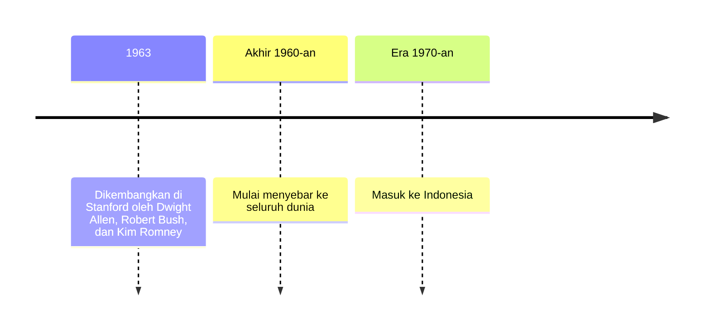
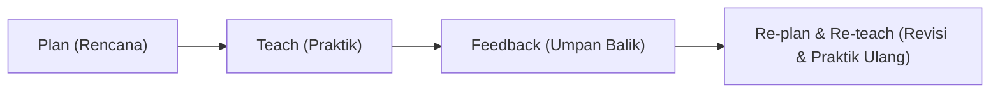

## Pengantar dan Filosofi Microteaching

Langkah pertama kamu untuk menjadi pendidik yang inspiratif dan kompeten dimulai dari fondasi metodenya, bukan dari teknik mengajar. Sebelum kita masuk ke teknis penyusunan rencana pembelajaran atau teknik bertanya, kita perlu memahami fondasi utama dari metode yang kini dipakai dalam pendidikan guru di seluruh dunia: **Microteaching** (Pembelajaran Mikro).

## Apa itu Microteaching?

Secara etimologi, *micro* berarti kecil atau terbatas, dan *teaching* berarti mengajar. Namun, microteaching bukan sekadar "mengajar dalam skala kecil".

**Microteaching adalah sebuah metode latihan penampilan mengajar yang dirancang secara isolatif dan terkontrol untuk menguasai keterampilan dasar mengajar tertentu.**

Bayangkan seorang calon pilot. Sebelum ia dipercaya menerbangkan pesawat komersial dengan ratusan penumpang, ia harus menghabiskan ratusan jam di dalam sebuah **Flight Simulator**. Di sana, ia bisa berlatih lepas landas, menghadapi cuaca buruk, hingga mendarat darurat tanpa risiko kecelakaan nyata.

> **Microteaching adalah "Flight Simulator" bagi guru.** Ia menyediakan ruang aman tempat kesalahan bukan merupakan kegagalan, melainkan data berharga untuk perbaikan.

Dalam microteaching, kompleksitas pengajaran di kelas yang sebenarnya dikurangi secara signifikan:

- **Jumlah siswa:** Biasanya hanya 5-10 orang (umumnya teman sejawat/peer-teaching).
- **Waktu:** Dibatasi sekitar 10-15 menit.
- **Fokus:** Hanya melatih satu atau dua keterampilan spesifik (misalnya: hanya cara membuka pelajaran atau cara memberikan penguatan).

## Dari Stanford ke Seluruh Dunia

Microteaching tidak muncul begitu saja. Ia lahir dari kebutuhan akan efektivitas dalam pendidikan guru.

1. **Lahir di Stanford (1963):** Konsep ini pertama kali dikembangkan oleh **Dwight Allen, Robert Bush, dan Kim Romney** di Stanford University, Amerika Serikat. Mereka merasa praktik lapangan tradisional bagi calon guru kurang efektif karena terlalu kompleks untuk dikuasai sekaligus.
2. **Kebutuhan akan Pengukuran:** Pada masa itu, pengawasan terhadap calon guru bersifat subjektif. Dwight Allen ingin menciptakan metode tempat keterampilan mengajar bisa diukur, diamati, dan diperbaiki secara objektif melalui rekaman video.
3. **Ekspansi Global:** Sejak akhir 1960-an, metode ini menyebar ke seluruh dunia, termasuk Indonesia pada era 1970-an, dan kini menjadi kurikulum wajib bagi mahasiswa keguruan (LPTK) dan program sertifikasi guru profesional.

Tiga penanda waktu dalam perjalanan itu bisa kamu ringkas pada garis waktu berikut.

## Mengapa Microteaching Itu Penting? (Urgensi)

Mengajar adalah sebuah seni sekaligus sains. Tanpa microteaching, seorang pendidik pemula sering kali mengalami *reality shock* saat pertama kali berdiri di depan kelas sungguhan. Berikut adalah alasan mengapa microteaching penting:

### 1. Menghubungkan Teori dan Praktik

Banyak mahasiswa menguasai teori psikologi pendidikan atau metodologi secara akademis, tetapi "blank" saat harus mengaplikasikannya. Microteaching mengubah pengetahuan abstrak menjadi tindakan nyata.

### 2. Mengurangi Risiko (Risk-Free Environment)

Di kelas asli, kesalahan guru bisa berdampak pada pemahaman siswa atau manajemen kelas selama satu semester. Dalam microteaching, jika kamu gagal mengelola kelas, kamu bisa segera mengulanginya tanpa merugikan masa depan siswa mana pun.

### 3. Pengembangan Keterampilan Secara Terisolasi

Sulit untuk memperbaiki cara bicara, bahasa tubuh, penggunaan media, dan teknik bertanya secara bersamaan. Microteaching memungkinkan kita untuk "membedah" komponen tersebut satu per satu hingga mahir.

### 4. Membangun Kepercayaan Diri

*Pernahkah kamu merasa gemetar saat berbicara di depan umum?* Microteaching membantu mengikis kecemasan tersebut secara bertahap melalui latihan yang berulang dalam lingkungan yang mendukung.

## Microteaching sebagai Laboratorium Pendidik

Dalam dunia sains, laboratorium adalah tempat untuk melakukan eksperimen yang terkendali. Microteaching berfungsi sebagai **Laboratorium Pendidik**.

Di dalam "laboratorium" ini, berlaku siklus eksperimen:

1. **Plan (Rencana):** Menyusun skenario pengajaran mikro.
2. **Teach (Praktik):** Melakukan simulasi yang diamati oleh pembimbing dan rekan.
3. **Feedback (Umpan Balik):** Melihat kembali performa melalui diskusi dan rekaman video.
4. **Re-plan & Re-teach (Revisi & Praktik Ulang):** Memperbaiki apa yang kurang.
   $$\text{Kualitas Guru} = \sum (\text{Latihan} + \text{Refleksi})^n$$

Jika keempat langkah itu dijajarkan, urutannya tampak seperti ini.

*Pikirkan tentang ini: Jika seorang atlet profesional berlatih ribuan kali hanya untuk satu gerakan smash atau tendangan penalti, bukankah seorang pendidik juga butuh latihan yang sama intensnya?*

## Contoh dari Calon Guru dan Guru Profesional

Microteaching tidak hanya untuk mahasiswa. Guru profesional pun menggunakannya untuk beradaptasi dengan kurikulum baru atau teknologi baru.

**Calon Pendidik (Pre-service):** Seorang mahasiswa keguruan merasa sangat pemalu. Melalui microteaching, ia fokus pada satu keterampilan: **Keterampilan Variasi Stimulus**. Ia berlatih menggerakkan tangan, mengubah nada suara, dan berpindah posisi berdiri. Setelah 3 kali sesi simulasi, ia mulai merasa nyaman dengan bahasa tubuhnya sendiri sebelum terjun ke sekolah formal.

**Guru Profesional (In-service):** Seorang guru senior yang terbiasa mengajar ceramah konvensional ingin beralih ke metode *Problem-Based Learning*. Ia melakukan sesi microteaching di depan rekan sejawatnya untuk mendapatkan masukan apakah instruksi masalah yang ia berikan sudah cukup menantang dan jelas bagi siswa masa kini.

## Filosofi Utama Microteaching

Filosofi utama microteaching adalah **"Simple to Complex"**. Kita tidak belajar mengendarai mobil langsung di jalan tol; kita mulai dari lapangan kosong. Dengan menyederhanakan situasi mengajar, kita memberikan kesempatan bagi otak dan tubuh kita untuk membentuk "muscle memory" dalam mengajar.

> **Pesan Utama:** Microteaching bukan tentang menjadi sempurna dalam satu kali coba. Ini tentang kesediaan untuk diamati, dikritik, dan kemauan untuk terus memperbaiki diri demi memberikan yang terbaik bagi peserta didik.

*Pertanyaan Refleksi:* *Jika kamu diminta memilih satu saja keterampilan mengajar yang menurut kamu paling sulit (misalnya: membuka pelajaran, bertanya, atau menutup pelajaran), manakah yang ingin kamu latih pertama kali di laboratorium microteaching? Mengapa?*