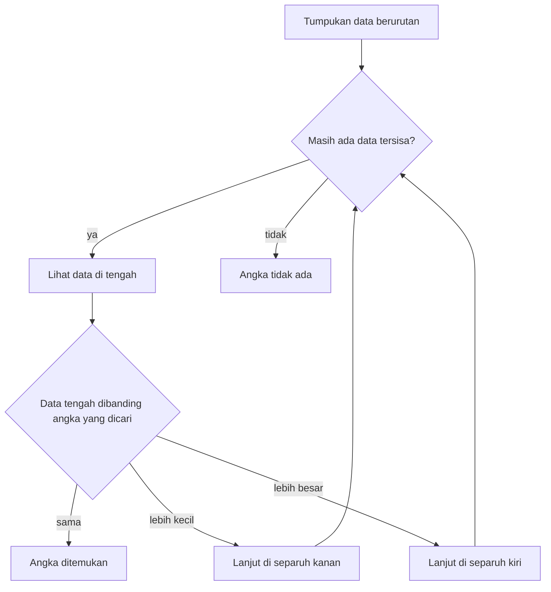

## Kecerdasan Logis-Matematis

Pernahkah kamu mengamati bagaimana beberapa orang begitu cepat menangkap kejanggalan dalam sebuah argumen? Atau melihat seorang programmer yang memelototi ribuan baris kode dan hampir instan menyadari di mana letak cacat logikanya? Inilah wujud nyata dari **Kecerdasan Logis-Matematis**.

Kemampuan ini sering disalahpahami sebagai bakat bawaan mencerna deret angka di luar kepala. Inti dari kecerdasan ini sebenarnya terletak pada kepekaan mengenali pola dan menyusun penalaran, baik secara deduktif maupun induktif. Kalau kecerdasan linguistik bermain-main dengan "kata", logis-matematis bekerja dengan **"hubungan"** antar informasi yang berserakan.

### 1. Membedah Karakteristik Utama

Mereka yang menonjol di area ini cenderung memandang dunia sebagai teka-teki yang menantang untuk diurai. Kepekaan terhadap **pola abstrak** membuat mereka tangkas menghubungkan gagasan-gagasan yang di mata orang lain tampak bertebaran tanpa arah.

Selain itu, ada semacam dorongan alamiah untuk mengklasifikasi sesuatu. Informasi yang masuk tak dibiarkan menumpuk berantakan; semuanya langsung dipilah ke dalam skema atau hierarki logis. Ciri lainnya adalah kegemaran bereksperimen. Mereka suka mengotak-atik variabel, merangkai tebakan kausalitas langsung di lapangan demi membuktikan hipotesis, dan betah menelusuri data kuantitatif dalam jumlah besar. Cara mereka merespons klaim juga kentara sekuensial. Mereka otomatis sangsi menghadapi rentetan informasi yang pijakan logikanya rapuh.

> **Analogi:** Coba bayangkan cara kerja detektif semacam Sherlock Holmes. Saat ia masuk ke sebuah ruangan, ia tidak sekadar memandang perabotan. Ruangan itu langsung terbaca sebagai urutan kejadian. Noda tanah di ujung sepatu dikaitkan dengan rute jalan tertentu, hingga tersusun sebuah rentetan kronologi utuh. Realitas bagi pikiran analitis adalah rantai sebab dan akibat yang terus menyambung.

### 2. Induksi dan Deduksi

Dua dasar penalaran matematis adalah deduksi dan induksi.

**Penalaran Deduktif (Top-Down)** adalah cara menarik kesimpulan spesifik dari premis universal. Di sinilah kepastian logika diuji. Aturannya ketat: Jika $A = B$ dan $B = C$, mutlak berlaku $A = C$. Pola ini sering dicontohkan lewat silogisme klasik. Kita berangkat dari kepastian seperti "Semua manusia pada akhirnya akan mati." Ketika dihadapkan pada fakta "Socrates adalah manusia," hasil turunannya tak bisa digeser: Socrates pasti mati.

Di sisi lain, **Penalaran Induktif (Bottom-Up)** merangkai kejadian-kejadian parsial demi mencetak dalil umum. Kita merekam pengamatan harian, misalnya kenyataan bahwa matahari muncul dari balik ufuk timur sejak hari-hari sebelumnya. Dari akumulasi fenomena terpisah itu, ditariklah postulat bahwa secara konstan matahari terbit di arah timur.

### 3. Pemikiran Algoritmik

Dalam ranah rekayasa teknologi, dasar ini berkembang menjadi kemampuan berpikir algoritmis, yaitu menerjemahkan rumusan mentah ke rentetan instruksi paling masuk akal demi menuntaskan tugas.

Ambil situasi ketika kamu harus memburu sebuah angka di tumpukan data berurutan. Mengecek setiap entri secara sekuensial jelas menyita sumber daya. Pikiran analitis spontan merespons dengan pendekatan membelah porsi pencarian secara bertahap, semacam *Binary Search*.

Caranya, lihat data yang berada tepat di tengah tumpukan, yang tersusun dari nilai terkecil sampai terbesar. Kalau data tengah itu sama dengan angka yang dicari, pencarian selesai. Kalau lebih kecil, separuh kiri dibuang dan pencarian berlanjut di separuh kanan. Kalau lebih besar, separuh kanan yang dibuang dan pencarian berlanjut di separuh kiri. Langkah ini diulang sampai angkanya ketemu, atau sampai tidak ada lagi data yang tersisa, dan saat itulah angka tersebut dinyatakan tidak ada.

Putaran membelah tumpukan itu bisa digambar sebagai alur yang berulang sampai angkanya ketemu atau datanya habis:

Ada landasan yang jelas di balik cara kerja ini. Percepatannya bertumpu pada formula $T(n) = T(n/2) + c$. Beban pencarian dipangkas menjadi separuhnya di setiap langkah, membuktikan bagaimana pengenalan pola sanggup merampingkan proses yang tadinya boros.

### 4. Pendekatan Asah Nalar Sesuai Karakter

Gaya belajar setiap orang menentukan cara yang paling cocok untuk mempertajam nalar.

Jika kamu lebih lekat dengan orientasi visual, cara seperti memetakan alur menggunakan *flowchart*, menyusun diagram Venn, atau merakit hierarki lewat *mind-map* akan amat mendongkrak kejelasan. Melihat perpindahan data secara visual sering kali membuat logika sistem yang rumit lebih mudah dipahami.

Bagi pihak yang condong menangkap intisari lewat medium suara, berdebat secara logis atau tekun menyimak wacana saintifik dan filosofis lewat siniar adalah cara yang tepat. Melafalkan proses pemecahan masalah dengan gamblang terbukti membuat ingatan tentang sebab-akibat bertahan lebih lama.

Sementara itu, aktivitas fisik menjadi tempat berlatih paling produktif untuk profil kinestetik. Interaksi fisiknya bermacam-macam, mulai dari berkonsentrasi di depan papan catur, menguji hipotesis rekayasa di meja eksperimen, hingga membongkar komponen mesin untuk melacak cara geraknya. Praktik fisik langsung mengubah hubungan sebab-akibat yang abstrak menjadi sesuatu yang nyata.

### 5. Jejak Penerapan di Lapangan

Daya pikir ini dipakai jauh di luar ujian kalkulus. Ia menopang berbagai bidang berisiko tinggi.

Di bidang ekonomi dan keuangan, instrumen kuantitatif dipakai untuk membaca tren bursa serta memetakan probabilitas risiko berdasarkan rasio dan statistik. Profesi pengolahan data memakai cara serupa; jutaan data mentah dirangkum jadi panduan langkah, seperti melacak persebaran epidemi berdasarkan kepadatan dan laju mobilitas harian penduduk.

Bidang peradilan sama-sama menuntut kemampuan ini. Praktisi hukum bertugas menyusun fakta yang tersebar di tumpukan berkas menjadi argumen yang saling mengikat dan tahan terhadap bantahan logis. Terakhir, di rekayasa sipil, kekokohan struktur besar seperti jembatan bergantung pada perhitungan ekuilibrium beban tegangan: $\sum F\_x = 0$, $\sum F\_y = 0$, dan $\sum M = 0$.

### 6. Memanaskan Kinerja Logika

Ada beragam cara santai untuk menjaga kelincahan penalaran. Mengamati pola deret angka bisa menjadi permulaan yang bagus.

Coba lihat deret ini: $2, 6, 12, 20, 30, \dots$
Polanya terlihat dari selisih antarangka. Dari $2$ ke $6$ selisihnya $4$. Ke $12$ selisihnya $6$, lalu $8$, kemudian $10$. Selisih itu terus bertambah dua satuan. Jadi selisih berikutnya adalah $12$. Menambahkannya ke angka terakhir, $30$, menghasilkan $42$.

Landasan logis-matematis tidak dimaksudkan sekadar melatih manusia berhitung secepat kalkulator saku. Intinya adalah kebiasaan mengajukan pertanyaan kritis, yaitu keinginan untuk menelisik **"Mengapa gejalanya begini?"** sebelum merunut satu per satu bukti penopangnya dengan sabar dan presisi.
