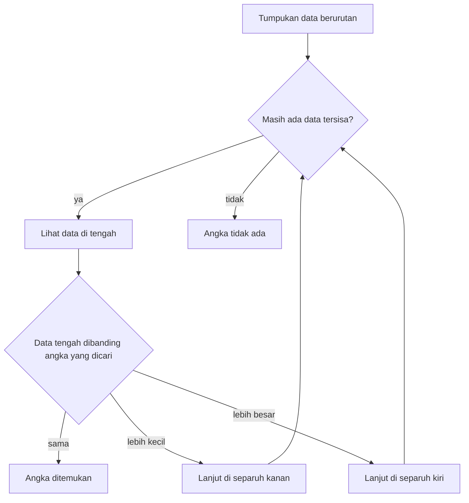

## Kecerdasan Logis-Matematis

Pernahkah kamu mengamati bagaimana beberapa orang begitu cepat menangkap kejanggalan dalam sebuah argumen? Atau melihat seorang programmer yang memelototi ribuan baris kode dan hampir instan menyadari di mana letak cacat logikanya? Inilah wujud nyata dari **Kecerdasan Logis-Matematis**.

Kemampuan ini sering disalahpahami sebagai bakat bawaan mencerna deret angka di luar kepala. Inti dari kecerdasan ini sebenarnya terletak pada kepekaan mengenali pola dan menyusun penalaran, baik secara deduktif maupun induktif. Kalau kecerdasan linguistik bermain-main dengan "kata", logis-matematis bernapas lewat tarikan **"hubungan"** antar informasi yang berserakan.

### 1. Membedah Karakteristik Utama

Mereka yang menonjol di area ini cenderung memandang dunia bagai teka-teki raksasa yang menantang untuk diurai. Kepekaan terhadap **pola abstrak** membuat mereka tangkas menghubungkan gagasan-gagasan yang di mata orang lain tampak bertebaran tanpa arah.

Selain itu, ada semacam dorongan alamiah untuk mengklasifikasi sesuatu. Informasi yang masuk tak dibiarkan menumpuk berantakan; semuanya langsung dipilah ke dalam skema atau hierarki logis. Ciri lainnya adalah kegemaran bereksperimen. Mereka suka mengotak-atik variabel, merangkai tebakan kausalitas langsung di lapangan demi membuktikan hipotesis, dan sangat betah menyelami lautan data kuantitatif. Cara mereka merespons klaim juga kentara sekuensial. Mereka otomatis sangsi menghadapi rentetan informasi yang pijakan logikanya rapuh.

> **Analogi:** Coba bayangkan cara kerja detektif semacam Sherlock Holmes. Saat ia masuk ke sebuah ruangan, ia tidak sekadar memandang perabotan. Ruangan itu langsung terbaca sebagai urutan kejadian. Noda tanah di ujung sepatu dikaitkan dengan rute jalan tertentu, hingga tersusun sebuah rentetan kronologi utuh. Realitas bagi pikiran analitis adalah rantai sebab dan akibat yang terus menyambung.

### 2. Induksi dan Deduksi

Dua roda gigi penopang pijakan matematis ini adalah deduksi dan induksi.

**Penalaran Deduktif (Top-Down)** adalah seni menarik kesimpulan spesifik dari premis universal. Di sinilah kepastian logika diuji. Aturannya ketat: Jika $A = B$ dan $B = C$, mutlak berlaku $A = C$. Pola ini sering dicontohkan lewat silogisme klasik. Kita berangkat dari kepastian seperti "Semua manusia pada akhirnya akan mati." Ketika dihadapkan pada fakta "Socrates adalah manusia," hasil turunannya tak bisa digeser: Socrates pasti mati.

Di sisi lain, **Penalaran Induktif (Bottom-Up)** merangkai kejadian-kejadian parsial demi mencetak dalil umum. Kita merekam pengamatan harian, misalnya kenyataan bahwa matahari muncul dari balik ufuk timur sejak hari-hari sebelumnya. Dari akumulasi fenomena terpisah itu, ditariklah postulat bahwa secara konstan matahari terbit di arah timur.

### 3. Pemikiran Algoritmik

Dalam ranah rekayasa teknologi, pondasi ini bermetamorfosis menjadi kemampuan berpikir algoritmis, yaitu menerjemahkan rumusan mentah ke rentetan instruksi paling masuk akal demi menuntaskan tugas.

Ambil situasi ketika kamu harus memburu sebuah angka di tumpukan data berurutan. Mengecek setiap entri secara sekuensial jelas menyita sumber daya. Pikiran analitis spontan merespons dengan pendekatan membelah porsi pencarian secara bertahap, semacam *Binary Search*.

Caranya, lihat data yang berada tepat di tengah tumpukan, yang tersusun dari nilai terkecil sampai terbesar. Kalau data tengah itu sama dengan angka yang dicari, pencarian selesai. Kalau lebih kecil, separuh kiri dibuang dan pencarian berlanjut di separuh kanan. Kalau lebih besar, separuh kanan yang dibuang dan pencarian berlanjut di separuh kiri. Langkah ini diulang sampai angkanya ketemu, atau sampai tidak ada lagi data yang tersisa, dan saat itulah angka tersebut dinyatakan tidak ada.

Putaran membelah tumpukan itu bisa digambar sebagai alur yang berulang sampai angkanya ketemu atau datanya habis:

Ada landasan mekanika kokoh di balik cara kerja ini. Percepatannya bertumpu pada formula $T(n) = T(n/2) + c$. Beban pencarian digerus menjadi separuhnya di setiap langkah, membuktikan secara elegan bagaimana pengenalan pola sanggup merampingkan proses yang tadinya boros.

### 4. Pendekatan Asah Nalar Sesuai Karakter

Gaya penyerapan setiap orang mengarahkan lintasan paling terarah untuk mempertajam rasionalitas.

Jika kamu lebih lekat dengan orientasi visual, manuver seperti memetakan alur menggunakan *flowchart*, menyusun diagram Venn, atau merakit hierarki lewat *mind-map* akan amat mendongkrak kejelasan. Menatap wujud perpindahan data sering kali menyingkap selubung logika sistem yang rumit.

Bagi pihak yang condong menangkap intisari lewat medium suara, terjun ke arena silat lidah logis atau tekun membongkar wacana saintifik dan filosofis via siniar adalah taktik jitu. Melafalkan proses pemecahan masalah dengan gamblang terbukti menjahit memori kausalitas di otak secara lebih permanen.

Sementara itu, arena sentuhan dan aksi menjadi lahan berlatih paling produktif untuk profil kinestetik. Interaksi fisiknya bermacam-macam, mulai dari memeras fokus di hadapan bidak catur, menguji hipotesis rekayasa di meja eksperimen, hingga melucuti komponen mesin murni demi melacak rahasia pergerakannya. Praktik fisik langsung mentranslasikan abstraksi kausalitas menjadi wujud riil.

### 5. Jejak Penerapan di Lapangan

Cakupan daya pikir ini membentang melampaui teritorial ujian kalkulus. Jejaknya menyokong berjalannya disiplin-disiplin berisiko tinggi.

Di lanskap ekonomi dan finansial, instrumen kuantitatif dikerahkan membongkar tren bursa serta memetakan probabilitas risiko berpijak pada landasan rasio dan statistik. Profesi pengolahan data mengadopsi manuver serupa; jutaan data mentah dirangkum jadi panduan langkah, seperti melacak persebaran epidemi murni berlandaskan densitas dan laju mobilisasi harian massa.

Arena peradilan tak kalah menuntut daya pilar matematis ini. Praktisi hukum bertugas memilin serpihan fakta keonggokan berkas menjadi argumen tebal yang saling mengikat dan kebal patahan logika balasan. Terakhir, rekayasa sipil menjadi arena eksekusi fisik; kelangsungan struktur masif seperti jembatan bersandar utuh pada perhitungan ekuilibrium beban tegangan: $\sum F\_x = 0$, $\sum F\_y = 0$, dan $\sum M = 0$.

### 6. Memanaskan Kinerja Logika

Ada beragam pendekatan kasual yang sanggup menjaga kelincahan insting penalaran. Pengamatan terhadap fluktuasi pola numerik menjadi permulaan bagus.

Bila kamu melempar fokus ke sekuens progresif ini: $2, 6, 12, 20, 30, \dots$
Rahasianya tersingkap dengan membongkar selisih loncatannya. Langkah awal dari $2$ ke $6$ merentangkan selisih $4$. Transisi ke $12$ melompat $6$, lalu melompat $8$, kemudian $10$. Pondasi susunannya adalah interval penambahan yang konsisten membesar ganda sebesar dua satuan. Skema tersebut mendaulat nilai interval berikutnya setebal $12$. Menyematkan porsi ini ke pos terakhir yang bernilai $30$ dengan mudah mengungkap ujungnya yakni $42$.

Landasan logis-matematis tidak pernah didesain sekadar melatih manusia berakrobat secepat kalkulator saku. Garis besarnya memuara pada kesiagaan melontarkan interogasi kritis, yaitu hasrat untuk menelisik **"Mengapa gejalanya begini?"** sebelum merunut satu per satu bukti penopangnya dengan sabar dan presisi.
