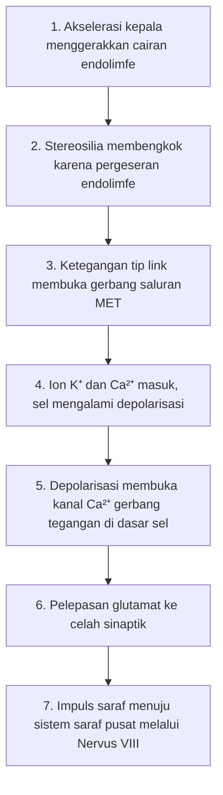

## Fisiologi Sel Rambut Vestibular dan Transduksi Sinyal

Bagaimana otak dapat mengetahui secara presisi ke mana arah kepala miring, bahkan saat mata tertutup? Jawabannya terletak pada sel mikroskopis yang disebut **sel rambut vestibular**. Sel-sel ini merupakan transduser biologis, yaitu perangkat yang mengubah energi mekanik menjadi sinyal listrik.

Dalam bagian ini, kita akan membahas mekanisme tingkat seluler tentang bagaimana gerakan fisik yang halus pada rambut-rambut kecil ini memicu rentetan aktivitas kimia dan listrik yang memungkinkan tubuh tetap tegak dan seimbang.

### 1. Arsitektur Sel Rambut

Sel rambut vestibular memiliki struktur yang sangat terspesialisasi di bagian apikalnya (ujung atas). Karakteristik struktural ini tersusun rapi menyerupai deretan pipa dengan gradasi ketinggian tertentu.

- **Stereosilia:** Berkas aktin kaku yang membentuk rambut sensorik utama. Stereosilia tersusun dalam barisan yang tingginya meningkat secara bertahap.
- **Kinosilium:** Satu silium terbesar dan tertinggi yang terletak di ujung barisan stereosilia tertinggi. Kinosilium berfungsi sebagai titik referensi morfologis utama untuk polarisasi arah gerakan.
- **Tip Links (Tautan Ujung):** Jembatan filamen protein halus (terutama cadherin-23 dan protocadherin-15) yang menghubungkan ujung satu stereosilia ke sisi stereosilia yang lebih tinggi di sebelahnya. Tautan ini memegang peranan kunci dalam mengontrol gerbang kanal ion.

> **Analogi:** Bayangkan sekelompok orang berdiri berderet dari yang paling pendek hingga yang paling tinggi. Setiap orang memegang tali yang terhubung ke kerah baju orang yang lebih tinggi di sampingnya. Jika orang yang paling tinggi ditarik menjauh, tali tersebut akan menarik kerah baju semua orang di deretan tersebut.

### 2. Mekanotransduksi

Proses pengubahan energi mekanik menjadi sinyal listrik disebut **mekanotransduksi**. Keunikan sistem vestibular dan pendengaran terletak pada kecepatannya yang tinggi karena tidak bergantung pada kurir kimiawi sekunder yang lambat, melainkan pada pembukaan gerbang saluran ion secara fisik langsung.

#### Defleksi dan Pembukaan Kanal

Ketika kepala bergerak, inersia cairan di telinga dalam (endolimfe) menggerakkan stereosilia.

- **Eksitasi (Depolarisasi):** Jika stereosilia membengkok **ke arah kinosilium**, *tip links* akan meregang. Peregangan ini secara mekanis menarik terbuka saluran ion sensitif regangan ($\text{MET}$, *mechano-electrical transduction channels*) di ujung stereosilia.
- **Inhibisi (Hiperpolarisasi):** Jika stereosilia membengkok **menjauhi kinosilium**, *tip links* mengendur, menyebabkan saluran $\text{MET}$ yang biasanya terbuka sebagian pada saat istirahat menjadi tertutup rapat.

#### Arus Ionik

Berbeda dengan mayoritas sel saraf yang memanfaatkan gradien natrium ($\text{Na}^+$), sel rambut berada dalam lingkungan **endolimfe** apikal yang sangat kaya akan kalium ($\text{K}^+$).

- Potensial listrik endolimfe berkisar $+80\text{ mV}$ di koklea dan jauh lebih rendah di organ vestibular, dibandingkan dengan bagian intraseluler sel yang berkisar $-40\text{ mV}$ hingga $-60\text{ mV}$.
- Akibat gradien elektrokimia yang sangat curam ini, saat saluran $\text{MET}$ terbuka, ion $\text{K}^+$ mengalir masuk dengan sangat cepat ke dalam sel.
- Selain $\text{K}^+$, ion kalsium ($\text{Ca}^{2+}$) juga masuk melalui kanal yang sama, memainkan peranan esensial dalam modulasi adaptasi dan pelepasan neurotransmiter.

#### Potensial Reseptor dan Pelepasan Neurotransmiter

Masuknya kation ($\text{K}^+$ dan $\text{Ca}^{2+}$) memicu **depolarisasi** membran sel reseptor.

1. Depolarisasi menjalar dari domain apikal menuju dasar basolateral sel.
2. Di membran basolateral, saluran kalsium gerbang tegangan (*voltage-gated* $\text{Ca}^{2+}$ *channels*) terbuka.
3. Influks $\text{Ca}^{2+}$ memicu eksositosis vesikel sinaptik yang melepaskan neurotransmiter utama, yaitu **glutamat**.
4. Glutamat berdifusi melintasi celah sinaptik dan mengaktivasi reseptor postsinaptik pada terminal saraf vestibular (Nervus Kranialis VIII), membangkitkan potensial aksi.

### 3. Eksitasi vs. Inhibisi

Sistem vestibular bekerja dengan **laju penembakan basal** (*resting firing rate*). Artinya, bahkan saat kepala dalam posisi diam statis, sel rambut secara kontinu melepaskan sejumlah kecil neurotransmiter.

- **Kondisi Istirahat:** Saluran $\text{MET}$ terbuka sekitar $10\text{\%}$ hingga $15\text{\%}$, mempertahankan pelepasan impuls basal yang stabil.
- **Defleksi ke Arah Kinosilium:** Saluran membuka lebih lebar $\rightarrow$ Influks $\text{K}^+$ meningkat $\rightarrow$ Pelepasan neurotransmiter meningkat $\rightarrow$ Frekuensi impuls saraf **meningkat**.
- **Defleksi Menjauhi Kinosilium:** Saluran tertutup $\rightarrow$ Arus $\text{K}^+$ terhenti $\rightarrow$ Pelepasan neurotransmiter menurun $\rightarrow$ Frekuensi impuls saraf **menurun**.

Mengapa sel rambut mempertahankan aktivitas penembakan basal saat istirahat? Mekanisme ini memungkinkan sistem vestibular melaporkan vektor gerakan dua arah (kiri atau kanan, akselerasi positif atau negatif) hanya melalui modulasi frekuensi penembakan impuls di atas atau di bawah laju basal, menghasilkan sensitivitas sensorik yang jauh lebih tinggi.

### 4. Adaptasi Sel Rambut

Ketika posisi kepala dimiringkan dan dipertahankan dalam posisi tersebut, sel rambut tidak terus-menerus memancarkan sinyal maksimal. Sel menjalankan proses **adaptasi**.

Melalui aktivitas protein motorik berbasis miosin (seperti Myosin-1c), titik penjangkaran *tip link* pada stereosilia dapat bergeser ke arah bawah. Pergeseran ini merelaksasi kembali ketegangan mekanis pada saluran $\text{MET}$ meskipun berkas stereosilia masih berada dalam posisi terdefleksi. Mekanisme ini memastikan sel rambut selalu siap merespons perubahan akselerasi baru tanpa mengalami kejenuhan (*saturation*) sinyal pada posisi statis yang berkepanjangan.

### 5. Mabuk Perjalanan (Motion Sickness)

**Skenario:** Seseorang sedang membaca buku di dalam kendaraan yang melaju di jalanan berliku.

- **Input Vestibular:** Sel rambut di kanalis semisirkularis mendeteksi adanya akselerasi sudut dan rotasi kepala (defleksi stereosilia terjadi secara dinamis).
- **Input Visual:** Mata terfokus pada teks buku yang statis terhadap kerangka kendaraan, menyampaikan sinyal visual ke otak bahwa tubuh berada dalam kondisi diam.
- **Konflik Sensorik:** Otak menerima sinyal mekanotransduksi vestibular yang menyatakan adanya gerakan dinamis, sementara input visual menyatakan kondisi statis. Ketidakcocokan sinyal (*sensory mismatch*) ini diintegrasikan di nukleus vestibular batang otak, memicu respons sistem saraf otonom berupa gejala mabuk perjalanan seperti mual, keringat dingin, dan pusing.

### Ringkasan Proses Transduksi

1. **Gerakan Mekanik:** Akselerasi kepala menggerakkan cairan endolimfe $\rightarrow$
2. **Defleksi Berkas Sensorik:** Pergeseran endolimfe membengkokkan stereosilia $\rightarrow$
3. **Ketegangan Tip Link:** Membuka gerbang saluran $\text{MET}$ secara mekanis $\rightarrow$
4. **Influks Kation:** Ion $\text{K}^+$ dan $\text{Ca}^{2+}$ masuk mendepolarisasi sel $\rightarrow$
5. **Aktivasi Kanal Basal:** Depolarisasi membuka kanal $\text{Ca}^{2+}$ gerbang tegangan di dasar sel $\rightarrow$
6. **Eksositosis Neurotransmiter:** Pelepasan glutamat ke celah sinaptik $\rightarrow$
7. **Pembangkitan Potensial Aksi:** Impuls saraf dihantarkan menuju sistem saraf pusat melalui Nervus Vestibulokoklearis (Nervus VIII).

Bagan berikut merangkum ketujuh langkah tadi sebagai satu alur, dari gerakan kepala sampai potensial aksi.

> **Poin Penting:** Hilangnya sel rambut vestibular pada mamalia dewasa bersifat permanen karena keterbatasan kapasitas regenerasi spontan. Kerusakan struktural akibat infeksi labirin, obat-obatan ototoksik (seperti aminoglikosida), atau degenerasi terkait usia (presbistasis) dapat mengakibatkan disfungsi keseimbangan kronis.
