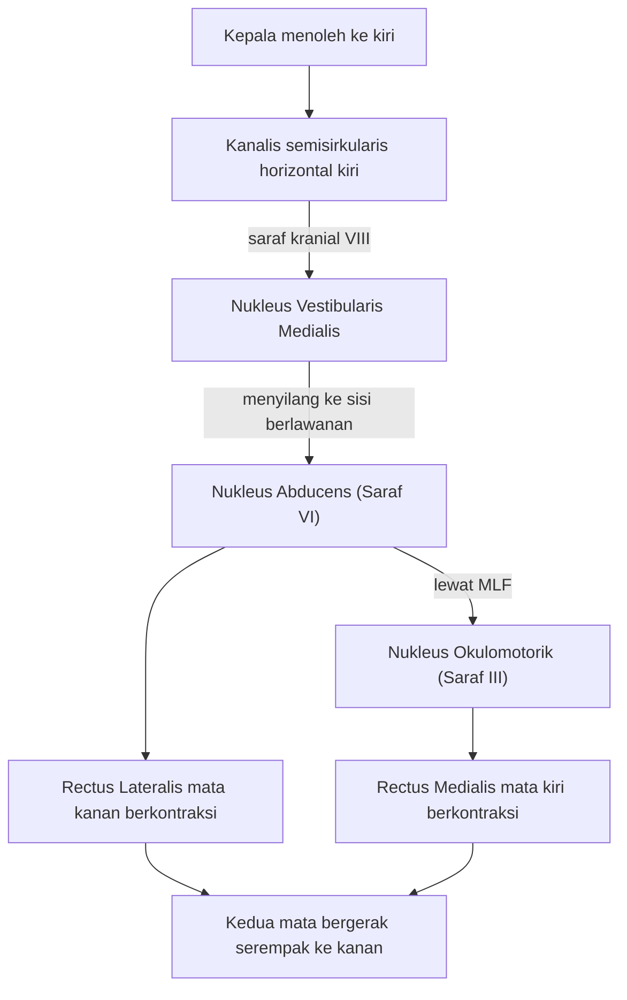

## Refleks Vestibulo-Okular (VOR)

Pernahkah kita mencoba membaca pesan teks di ponsel saat sedang berjalan cepat atau berlari? Meskipun kepala bergerak naik-turun dan bergoyang ke samping, mata kita masih mampu "mengunci" teks tersebut sehingga terbaca dengan jelas. Kemampuan ini bukan terjadi secara kebetulan; ini adalah hasil kerja **Refleks Vestibulo-Okular (VOR)**.

VOR adalah salah satu refleks tercepat dalam tubuh manusia. Fungsinya spesifik: menghasilkan gerakan mata yang berlawanan arah dengan gerakan kepala untuk menjaga bayangan objek tetap stabil di pusat retina (**fovea**).

## Gimbal Biologis

Bayangkan seorang sinematografer yang sedang merekam adegan aksi. Jika kamera dipegang langsung dengan tangan sambil berlari, hasil rekaman akan sangat goyang dan buram (*motion blur*). Untuk mengatasinya, sinematografer menggunakan **gimbal** atau **Steadicam** yang secara otomatis mengompensasi setiap guncangan tangan sehingga kamera tetap stabil.

Dalam tubuh kita:

- **Kamera** adalah bola mata.
- **Sensor Guncangan** adalah kanalis semisirkularis di telinga dalam.
- **Gimbal** adalah otot-otot mata yang digerakkan oleh sirkuit saraf VOR.

## Mengapa VOR Sangat Cepat?

Sistem visual kita sebenarnya cukup lambat. Jika kita hanya mengandalkan pemrosesan cahaya di retina untuk mengikuti gerakan (refleks *optokinetic*), akan ada jeda (latensi) sekitar 70-100 milidetik. Pada kecepatan gerakan kepala yang tinggi, jeda ini akan membuat pandangan kita buram.

**VOR bekerja jauh lebih cepat:**

- **Latensi VOR:** Kurang dari 10 milidetik.
- Hal ini dimungkinkan karena VOR menggunakan **Jalur Tiga Neuron (Three-Neuron Arc)** yang sangat efisien dan terhubung langsung dari sensor di telinga ke otot mata tanpa harus mampir ke korteks serebri yang kompleks.

## Sirkuit Saraf Tiga Neuron

Untuk memahami bagaimana VOR bekerja, mari kita bedah jalurnya saat kepala menoleh ke arah **kiri**. Agar pandangan tetap stabil, mata harus bergerak ke **kanan** dengan kecepatan yang sama.

### 1. Aferen Primer (Ganglion Scarpa)

Ketika kepala menoleh ke kiri, cairan endolymph di kanalis semisirkularis horizontal kiri menekan kupula dan mendepolarisasi sel rambut. Sinyal listrik ini dibawa oleh saraf kranial ke-VIII (Vestibulocochlear) menuju batang otak.

### 2. Nukleus Vestibularis

Sinyal tiba di **Nukleus Vestibularis Medialis** di medula/pons. Dari sini, neuron mengirimkan proyeksi (akson) yang menyilang ke sisi berlawanan (kontralateral) menuju **Nukleus Abducens** (Saraf VI).

### 3. Neuron Motorik Okular

Nukleus Abducens memiliki dua tugas simultan:

- Menginstruksikan otot **Rectus Lateralis** mata kanan untuk berkontraksi (menarik mata ke kanan).
- Mengirim sinyal kembali melalui jalur yang disebut **Medial Longitudinal Fasciculus (MLF)** menuju **Nukleus Okulomotorik** (Saraf III) untuk menginstruksikan otot **Rectus Medialis** mata kiri berkontraksi (menarik mata kiri ke arah hidung/kanan).

> **Hasil Akhir:** Kedua mata bergerak serempak ke kanan untuk mengompensasi rotasi kepala ke kiri.

Supaya percabangan sinyal di Nukleus Abducens lebih mudah kamu ikuti, berikut jalur yang sama dalam bentuk bagan.

## Karakteristik Fisiologis VOR

### 1. Gain VOR

Dalam kondisi ideal, kecepatan gerakan mata harus persis sama dengan kecepatan gerakan kepala, namun dalam arah yang berlawanan. Rasio ini disebut sebagai **Gain**.

$$
\text{Gain} = \frac{\text{Kecepatan Gerakan Mata}}{\text{Kecepatan Gerakan Kepala}}
$$

- $\text{Gain}$ yang sempurna bernilai $-1$ (atau $1$ dalam nilai mutlak).
- Jika $\text{Gain} < 1$, mata tertinggal dari gerakan kepala, dan kita akan mengalami pandangan buram (*oscillopsia*).

### 2. Fase (Phase)

Fase mengukur ketepatan waktu. Jika mata bergerak tepat saat kepala bergerak, maka fase berada pada 180 derajat (berlawanan sempurna).

## VOR dalam Aksi

### Membaca di Dalam Bus

Bayangkan saat menumpangi bus yang melintasi jalanan berlubang. Kepala terhentak ke atas dan ke bawah secara tiba-tiba.

1. **Sensor:** Kanalis semisirkularis posterior dan anterior mendeteksi rotasi vertikal.
2. **Proses:** Sirkuit VOR menghitung akselerasi tersebut dalam hitungan milidetik.
3. **Aksi:** Otot-otot rektus superior dan inferior mata bergerak secara otomatis untuk melawan arah hentakan bus.
4. **Hasil:** Huruf-huruf di buku yang sedang dibaca masih tajam, meskipun tubuh berguncang hebat.

## Bagaimana Dokter Menguji VOR?

Dalam dunia medis, integritas jalur VOR sangat penting untuk mendiagnosis gangguan keseimbangan.

### 1. Head Impulse Test (HIT)

Dokter akan meminta pasien fokus pada hidung dokter, lalu dokter memutar kepala pasien secara cepat dan tidak terduga ke satu sisi.

- **Normal:** Mata pasien terus terkunci pada hidung dokter.
- **Abnormal:** Mata pasien ikut bergerak searah kepala, lalu melakukan gerakan koreksi cepat (*catch-up saccade*) kembali ke hidung. Ini menandakan adanya kerusakan pada organ vestibular di sisi tersebut.

### 2. Tes Kalori (COWS)

Air hangat atau dingin dimasukkan ke liang telinga untuk menciptakan arus konveksi pada endolymph, yang secara buatan merangsang VOR. Ini digunakan untuk memeriksa fungsi batang otak pada pasien yang tidak sadar.

> **Refleksi Fisiologis:** Bayangkan jika VOR tiba-tiba berhenti bekerja selama satu menit saat seseorang sedang berjalan. Dunia akan tampak seperti rekaman kamera yang berguncang hebat (*shaky cam*) dalam film horor karena bayangan retina tidak lagi terstabilkan.

## Kesimpulan

Refleks Vestibulo-Okular adalah jembatan fungsional antara sistem keseimbangan dan sistem penglihatan. Melalui jalur tiga neuron yang sangat cepat, VOR memastikan bahwa meskipun kepala kita selalu bergerak, persepsi visual kita tetap stabil dan tajam. Tanpa VOR, aktivitas sederhana seperti berjalan atau mengemudi akan membuat pandangan berguncang dan buram.

> **Poin Utama untuk Diingat:**
>
> - VOR menstabilkan bayangan di retina selama gerakan kepala.
> - Menggunakan jalur tiga neuron: Saraf VIII $\rightarrow$ Nukleus Vestibularis $\rightarrow$ Nukleus Motorik Mata.
> - Memiliki latensi yang sangat rendah ($< 10\text{ ms}$), jauh lebih cepat daripada sistem visual murni.
