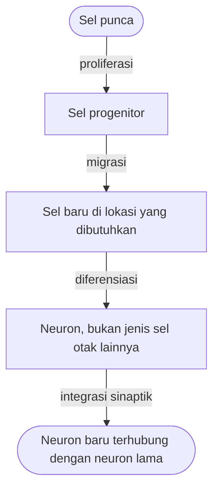

## Neurogenesis

Selama puluhan tahun, dunia sains meyakini sebuah dogma yang cukup suram: kita semua terlahir dengan jumlah sel otak tertentu. Menurut dogma itu, seiring bertambahnya usia, sel-sel tersebut akan mati tanpa pernah bisa digantikan. Namun, memasuki akhir abad ke-20, paradigma ini runtuh. Para ilmuwan menemukan bahwa otak orang dewasa bukanlah sebuah patung batu yang statis, melainkan sebuah taman yang dinamis tempat sel-sel baru terus tumbuh.

Fenomena ini disebut **Neurogenesis**.

### Apa Itu Neurogenesis?

**Neurogenesis** adalah proses pembentukan neuron (sel saraf) baru dari sel punca neural (*neural stem cells*). Jika bagian lain dari neuroplastisitas berfokus pada penguatan atau penyusunan ulang "kabel" yang sudah ada, neurogenesis adalah tentang menambahkan "perangkat keras" baru ke dalam sistem.

> "Otak kamu tidak hanya belajar dengan cara mengubah koneksi, tetapi dalam area tertentu, ia belajar dengan cara melahirkan anggota baru dalam tim sel sarafnya."

Meskipun terjadi secara terbatas di otak dewasa dibandingkan saat masa perkembangan janin, proses ini penting bagi fungsi kognitif kita.

### Pabrik Neuron di Otak Kita

Di otak manusia dewasa, neurogenesis terutama terjadi di dua lokasi utama, namun yang paling relevan dengan proses belajar dan memori adalah **Hippocampus**, tepatnya di area yang disebut *Gyrus Dentatus*.

**Perpustakaan yang Terus Berpindah** Bayangkan Hippocampus sebagai sebuah gudang logistik atau pusat sortir di sebuah perpustakaan besar. Tugasnya adalah menerima buku-buku baru (informasi), mengkategorikannya, dan mengirimkannya ke rak yang tepat (memori jangka panjang di korteks).

- **Tanpa Neurogenesis:** Gudang tersebut akan penuh sesak, petugasnya kelelahan, dan buku-buku baru akan berserakan tanpa teratur.
- **Dengan Neurogenesis:** Otak terus mendatangkan "karyawan baru" (neuron baru) untuk membantu memproses arus informasi yang terus masuk.

### Peran Neurogenesis dalam Fungsi Kognitif

Mengapa kita butuh sel saraf baru jika kita sudah punya miliaran sel lainnya? Neuron muda memiliki karakteristik unik: mereka lebih fleksibel dan lebih mudah membentuk koneksi dibandingkan neuron "senior".

#### 1\. Memori dan Pembelajaran

Neuron baru sangat penting untuk **Pattern Separation** (Pemisahan Pola). Ini adalah kemampuan otak untuk membedakan dua memori yang sangat mirip.

- *Contoh:* Mengingat di mana kamu memarkir mobil hari ini dibandingkan dengan posisi parkir kemarin di tempat yang sama. Tanpa neurogenesis, memori-memori ini akan tumpang tindih dan menyebabkan kebingungan.

#### 2\. Kapasitas Penyimpanan Informasi

Setiap neuron baru menambah kapasitas "bandwidth" otak untuk menyerap informasi baru tanpa harus menghapus informasi lama yang masih penting.

### Neurogenesis dan Regulasi Emosi

Neurogenesis tidak hanya membuat kita cerdas, tetapi juga menjaga kesehatan mental kita. Hippocampus memiliki hubungan erat dengan sistem limbik, pusat kendali emosi.

- **Resiliensi terhadap Stres:** Penelitian menunjukkan bahwa tingkat neurogenesis yang tinggi berkorelasi dengan kemampuan seseorang untuk pulih dari stres psikologis.
- **Kaitan dengan Depresi:** Banyak ilmuwan menemukan bahwa penderita depresi klinis seringkali mengalami penyusutan volume hippocampus. Obat-obatan antidepresan dan aktivitas fisik bekerja (sebagian) dengan cara memicu kembali kelahiran neuron baru di area ini.

*Indikator Regenerasi Otak: Sensasi pikiran yang terasa lebih jernih serta suasana hati yang membaik pasca mempelajari hal baru atau berolahraga merupakan indikasi fisik bahwa jaringan otak sedang melakukan regenerasi.*

### Dari Sel Punca ke Neuron Fungsional

Proses ini tidak terjadi dalam sekejap. Ini adalah perjalanan perkembangan yang sistematis:

1. **Proliferasi:** Sel punca membelah diri untuk menciptakan sel progenitor.
2. **Migrasi:** Sel baru berpindah ke lokasi di mana mereka dibutuhkan.
3. **Diferensiasi:** Sel tersebut memilih identitasnya (menjadi neuron, bukan jenis sel otak lainnya).
4. **Integrasi Sinaptik:** Neuron baru mulai menumbuhkan dendrit dan akson untuk "berjabat tangan" dengan neuron lama.

Perjalanan dari sel punca sampai neuron yang siap bekerja tergambar pada bagan di bawah ini.

Dalam bahasa biokimia, proses ini sangat dipengaruhi oleh protein bernama **BDNF** (*Brain-Derived Neurotrophic Factor*), yang sering dijuluki sebagai "pupuk bagi otak".

$$
\text{BDNF} \rightarrow \text{Mendukung Kelangsungan Hidup Neuron} + \text{Memicu Neurogenesis}
$$

### Studi Supir Taksi London

Salah satu bukti paling terkenal tentang neurogenesis dan plastisitas adalah studi terhadap supir taksi di London. Untuk mendapatkan lisensi, mereka harus menghafal "The Knowledge", peta rumit dari 25.000 jalan di London.

**Hasil penelitian menunjukkan:**

- Supir taksi yang berhasil menghafal peta tersebut memiliki volume hippocampus posterior yang jauh lebih besar dibandingkan rata-rata orang biasa.
- Pertumbuhan ini terjadi karena tuntutan kognitif yang intens secara terus-menerus memicu kelahiran dan integrasi neuron baru untuk memproses navigasi spasial yang kompleks.

### Bagaimana Memacu Kelahiran Neuron Baru?

Meskipun mekanisme mendalam akan dibahas di bagian selanjutnya, kamu bisa mulai menerapkan prinsip neurogenesis dalam rutinitas belajar kamu:

- **Novelty (Kebaruan):** Otak tidak akan melahirkan neuron baru jika kamu hanya melakukan rutinitas yang sama. Pelajari instrumen musik baru, bahasa baru, atau rute pulang yang berbeda untuk memberikan stimulus.
- **Aerobic Exercise:** Aktivitas fisik yang meningkatkan detak jantung adalah pemicu utama produksi BDNF.
- **Kendalikan Kortisol:** Stres kronis melepaskan hormon kortisol yang bertindak seperti "racun tanaman" bagi neurogenesis di hippocampus.

**Penting:**

> Neurogenesis adalah bukti fisik bahwa tidak ada kata terlambat untuk belajar. Otak kamu secara biologis dirancang untuk memperbarui dirinya sendiri selama kamu memberinya tantangan dan lingkungan yang tepat.

*Refleksi: Jika hari ini kamu mempelajari satu konsep sulit yang belum pernah kamu ketahui sebelumnya, bayangkan sel-sel saraf baru di otak kamu sedang tumbuh dan menjalin koneksi. Apa satu hal baru yang akan kamu pelajari besok untuk tetap menjaga "taman" otak kamu tetap hijau?*