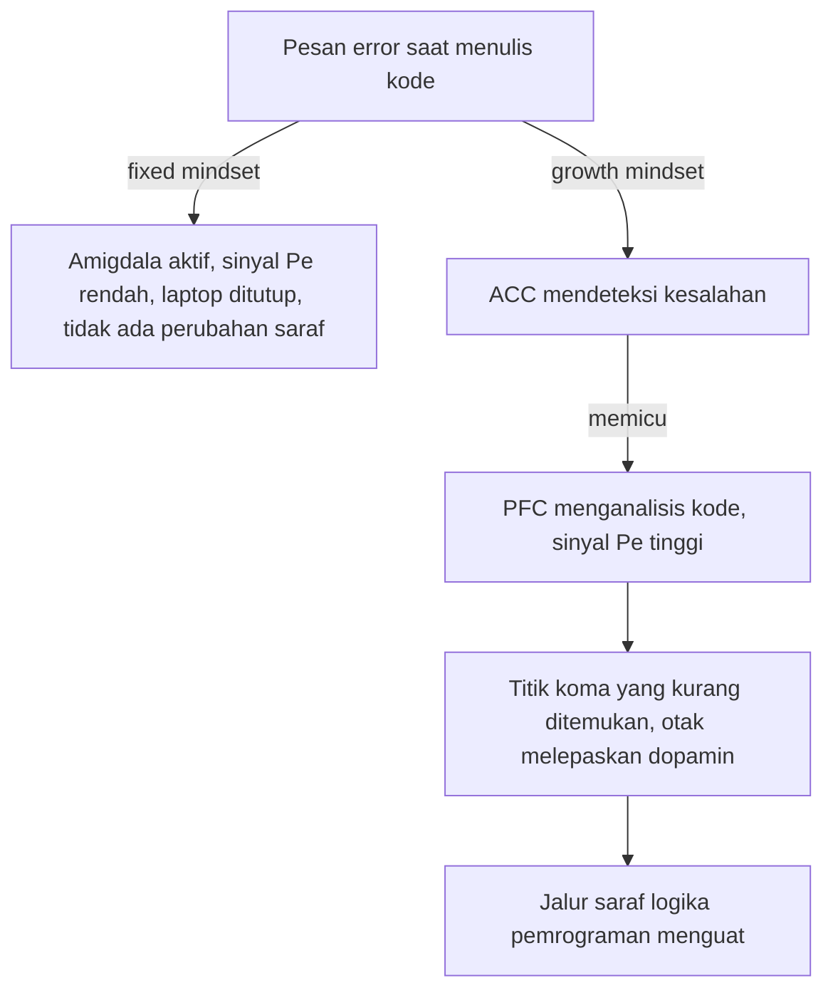

## Bagaimana Mindset Mengubah Otak

Di bagian sebelumnya, kita telah mempelajari perbedaan psikologis antara **Growth Mindset** (pola pikir bertumbuh) dan **Fixed Mindset** (pola pikir tetap). Namun, apakah kamu tahu bahwa perbedaan ini bukan sekadar masalah "sikap positif"?

Mindset sebenarnya ikut **membentuk otak kamu secara fisik**. Keyakinan kamu tentang kemampuan belajar memengaruhi bagaimana sirkuit saraf kamu merespons kegagalan, memproses informasi, dan membangun ketangguhan. Mari kita bedah bagaimana "kepercayaan" berubah menjadi "biologi".

### 1\. Sinyal ERN dan Pe dalam Pemrosesan Kesalahan

Ketika kamu membuat kesalahan, misalnya salah menjawab soal matematika atau salah menekan tombol saat belajar alat musik, otak kamu menghasilkan dua sinyal listrik utama yang dapat diukur melalui EEG (*Electroencephalogram*).

- **ERN (Error-Related Negativity):** Ini adalah respons "Ups!" otomatis. Sinyal ini muncul hanya dalam hitungan milidetik setelah kesalahan terjadi. Ini adalah alarm bawah sadar yang mendeteksi konflik antara apa yang kamu harapkan dan apa yang sebenarnya terjadi.
- **Pe (Error Positivity):** Ini adalah sinyal kesadaran. Sinyal ini mencerminkan perhatian yang diarahkan pada kesalahan dan upaya otak untuk memproses apa yang salah agar tidak terulang kembali.

**Perbedaan Berbasis Mindset:** Penelitian oleh Dr. Jason Moser menunjukkan perbedaan yang mencolok pada sinyal Pe:

- Individu dengan **Growth Mindset** memiliki sinyal **Pe yang jauh lebih kuat**. Otak mereka memberikan perhatian lebih besar pada kesalahan. Mereka tidak mengabaikan kegagalan; sebaliknya, mereka memakai kesalahan tersebut untuk belajar.
- Individu dengan **Fixed Mindset** cenderung memiliki sinyal Pe yang lemah. Otak mereka mencoba "menutup mata" terhadap kesalahan karena menganggap kesalahan sebagai ancaman terhadap identitas cerdas mereka.

> **Insight Penting:** Pertumbuhan otak tidak hanya terjadi saat kamu melakukan segalanya dengan benar, tetapi juga saat kamu melakukan kesalahan dan otak kamu bekerja keras untuk memperbaikinya.

### 2\. Peran ACC dalam Ketangguhan (Resilience)

Struktur otak yang berperan penting dalam cara mindset mengubah otak adalah **Anterior Cingulate Cortex (ACC)**. ACC bertindak seperti menara pengawas yang memantau konflik dan mengatur emosi.

Dalam konteks Growth Mindset, ACC terhubung lebih kuat dengan **Prefrontal Cortex (PFC)**, bagian otak yang bertanggung jawab atas logika dan perencanaan.

**Analogi Pilot dan Menara Pengawas:** Bayangkan otak kamu adalah sebuah pesawat.

- **Fixed Mindset:** Ketika ada lampu indikator merah (kesalahan), pilot merasa panik dan menganggap pesawatnya rusak permanen. Ia mematikan alarm agar tidak perlu mendengar suaranya (menghindari tantangan).
- **Growth Mindset:** Pilot melihat lampu merah sebagai data navigasi yang berharga. Ia berkomunikasi dengan menara pengawas (ACC) untuk menyesuaikan arah terbang. Baginya, lampu merah bukan tanda kegagalan, melainkan instruksi untuk kalibrasi.

### 3\. Dopamin dan Tantangan

Mindset diduga juga mengubah cara otak memproses **Dopamin**, neurotransmiter yang sering diasosiasikan dengan hadiah (*reward*).

- Pada **Fixed Mindset**, dopamin hanya dilepaskan saat mencapai hasil akhir (mendapat nilai A, menang lomba). Jika gagal, sistem dopamin "anjlok", menyebabkan demotivasi.
- Pada **Growth Mindset**, otak mulai melepaskan dopamin selama **proses berjuang**. Otak belajar untuk menikmati sensasi "sulit" karena ia mengasosiasikan kesulitan dengan pertumbuhan saraf.

Secara matematis, kita bisa melihat hubungan antara usaha ($u$), keyakinan ($k$), dan pertumbuhan sinapsis ($\Delta S$): $\Delta S \propto k \times u$ Jika keyakinan ($k$) kamu adalah nol (Fixed Mindset: "Saya tidak bisa berubah"), maka sebesar apa pun usaha ($u$) yang kamu lakukan, pertumbuhan sinapsis ($\Delta S$) akan minimal karena otak tidak dalam keadaan "siap" untuk plastisitas.

### 4\. Dua Respons Otak terhadap Error

Bagaimana pengetahuan ini diterapkan dalam kehidupan sehari-hari? Mari kita lihat skenario berikut:

**Mempelajari Bahasa Pemrograman Baru** Seorang pemula mencoba menulis kode dan terus-menerus mendapatkan pesan *error*.

- **Respons Otak Fixed Mindset:** Amigdala (pusat rasa takut) aktif. Muncul pikiran "Saya bukan orang IT". Sinyal Pe rendah. Ia menutup laptop. Tidak ada perubahan saraf yang terjadi.
- **Respons Otak Growth Mindset:** ACC mendeteksi kesalahan, namun karena si pemula yakin otaknya bisa berkembang, PFC terpicu untuk menganalisis kode tersebut. Sinyal Pe tinggi. Saat ia menemukan letak titik koma yang kurang, otak melepaskan dopamin. Jalur saraf untuk logika pemrograman pun menguat.

Kedua respons itu berangkat dari pesan error yang sama, lalu bercabang seperti yang kamu lihat di sini.

**Latihan Praktis untuk Memacu Plastisitas:**

1. **Reframe Kesalahan:** Saat salah, katakan dalam hati: *"Ah, ini adalah sinyal Pe saya sedang bekerja. Otak saya sedang memetakan jalur baru."*
2. **Fokus pada "Belum":** Gunakan kata "Belum" ($\text{Not Yet}$). Kalimat "Saya tidak bisa" adalah jalan buntu bagi neuron. Kalimat "Saya belum bisa" adalah undangan bagi neuroplastisitas untuk mulai bekerja.

### 5\. Perbandingan Otak Kedua Mindset

| Aspek | Fixed Mindset | Growth Mindset |
| --- | --- | --- |
| **Fokus Utama** | Validasi (Ingin terlihat pintar) | Pembelajaran (Ingin menjadi pintar) |
| **Respons Amigdala** | Tinggi (Kesalahan dianggap ancaman) | Terkendali (Kesalahan dianggap data) |
| **Sinyal Pe (EEG)** | Lemah | Jauh lebih kuat |
| **Koneksi ACC-PFC** | Terputus/Lemah saat gagal | Lebih kuat (Regulasi diri) |
| **Hasil Jangka Panjang** | Stagnasi sirkuit saraf | Penguatan sirkuit saraf secara kontinu |

*Refleksi Proses Belajar: Jika hari ini tidak ada kekeliruan atau tantangan dalam proses belajar, akankah jaringan otak terdorong untuk melakukan adaptasi fisik secara optimal?*

> **Kesimpulan:** Mindset bukan sekadar motivasi. Ia adalah **sakelar biologis**. Dengan meyakini bahwa otak dapat berubah, kamu mungkin sedang menurunkan ambang batas kimiawi bagi neuron-neuron kamu untuk membentuk koneksi baru. Kamu tidak hanya belajar lebih baik; kamu secara fisik sedang membangun otak yang lebih tangguh.