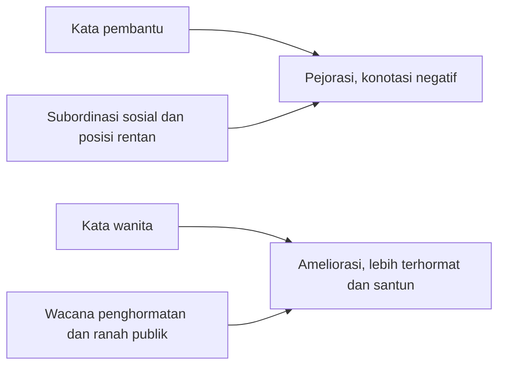

## Proses Psikologis di Balik Perubahan Makna

Perubahan makna kata berakar pada dinamika kognitif otak manusia yang menghubungkan konsep linguistik dengan rekaman emosi dan pengalaman sosial.

Kerap muncul pertanyaan mengenai alasan sebuah kata yang dahulu terdengar wajar tiba-tiba terasa menyakitkan atau merendahkan. Sebaliknya, terdapat pula istilah yang dahulu dianggap tabu namun kini menjadi sebutan terhormat.

Pergeseran makna seperti **ameliorasi** (peningkatan nilai rasa) dan **pejorasi** (penurunan nilai rasa) berawal dari kerja kognitif di dalam benak manusia. Bahasa bukan sekadar kumpulan definisi kamus, melainkan sistem dinamis yang bergantung pada psikologi massa serta persepsi individu.

### 1. Mekanisme Asosiasi antara Label dan Isi di Dalam Otak

Secara psikologis, otak bekerja menyerupai sistem pengarsipan konseptual. Setiap kata memiliki folder mental tersendiri. Di dalam folder tersebut, tersimpan definisi teknis (denotasi) sekaligus rekaman emosional, nilai budaya, dan asosiasi visual (konotasi).

> **Analogi Catatan Tempel (Sticky Notes):** Bayangkan pikiran manusia sebagai sebuah dinding galeri yang dipenuhi foto representasi konsep. Kata berperan sebagai foto tersebut. Setiap kali kata itu terdengar dalam konteks buruk, benak kita menempelkan catatan tempel merah bernada negatif pada foto bersangkutan. Ketika ribuan penutur menempelkan catatan merah serupa secara konsisten, representasi kata tersebut secara kolektif bergeser menjadi buruk. Pola inilah yang mengawali proses **pejorasi**.

#### Pembentukan Asosiasi Mental

1. **Pengalaman Berulang:** Ketika kata *oknum* terus-menerus muncul dalam pemberitaan kasus pelanggaran hukum, benak publik secara otomatis mengaitkan kata tersebut dengan pelaku kejahatan, kendati secara etimologis dan leksikal *oknum* bermakna 'orang seorang' atau 'pribadi'.
2. **Kekuatan Konteks Emosional:** Sistem kognitif memproses informasi bermuatan afektif secara lebih intensif. Kata-kata yang bersinggungan dengan rasa takut, amarah, prestise, atau penghormatan mengalami pergeseran makna jauh lebih cepat dibandingkan kosakata teknis yang netral.

### 2. Pengondisian Klasik dalam Dinamika Bahasa

Konsep pengondisian klasik (*classical conditioning*) yang dipopulerkan oleh Ivan Pavlov berlaku pula pada ranah semantik. Otak manusia menghubungkan stimulus linguistik dengan respons lingkungan sosial.

$$
\text{Kata (Stimulus)} + \text{Konteks Sosial (Respons)} \rightarrow \text{Makna Baru}
$$

Ketika sebuah kata (stimulus) secara ajek dipasangkan dengan situasi yang tidak menyenangkan (respons negatif), lambat laun kata itu sendiri memicu impresi negatif pada pendengar.

| Pola Perubahan | Kata Asal | Konteks Pengondisian | Hasil Pergeseran |
| :--- | :--- | :--- | :--- |
| **Pejorasi** | *Pembantu* | Asosiasi dengan subordinasi sosial dan posisi rentan | Menciptakan beban konotasi negatif; digantikan oleh istilah *asisten rumah tangga*. |
| **Ameliorasi** | *Wanita* | Digunakan dalam wacana penghormatan dan ranah publik | Memperoleh nilai rasa yang lebih terhormat dan santun dalam konteks formal kenegaraan. |

Bagan ini menerapkan rumus kata ditambah konteks sosial pada kedua contoh dalam tabel.

### 3. Teori Skema Kognitif dan Kategorisasi Mental

Otak manusia menghemat energi kognitif melalui pembentukan **skema**, yaitu jalan pintas mental untuk mengorganisasikan dan menginterpretasikan informasi dunia sekitar. Begitu sebuah kata terpatri ke dalam skema negatif, pemaknaan netralnya menjadi sulit dipulihkan.

Bandingkan sebutan *koruptor* dan *maling*. Sebutan *koruptor* kerap dipersepsikan lebih berjarak dan abstrak secara psikologis dibandingkan kata *maling*, kendati substansi tindakannya sama-sama merupakan pencurian hak orang lain.

Hal tersebut terjadi karena skema mental mengaitkan *koruptor* dengan figur berdasi, birokrasi, dan ruang kantor, sementara *maling* langsung mengaktifkan skema kejahatan jalanan. Pergeseran makna di sini dipengaruhi oleh **persepsi visual** dan **hierarki status sosial** yang tersimpan di dalam memori jangka panjang.

### 4. Konformitas Sosial dan Psikologi Massa

Perubahan makna tidak berlangsung secara terisolasi pada individu tunggal. Bahasa merupakan produk kesepakatan sosial. Secara psikologis, manusia memiliki kecenderungan bawaan menuju **konformitas**, yaitu dorongan untuk menyelaraskan perilaku dan pilihan kata dengan kelompok sosialnya.

Ketika mayoritas masyarakat memandang penggunaan kata tertentu sebagai bentuk pelecehan atau perendahan, penutur lain akan menghindari kata tersebut agar tidak dicap tidak beradab. Tekanan konformitas sosial inilah yang mendorong adopsi istilah-istilah amelioratif baru, seperti peralihan dari sebutan *cacat* menuju *difabel* atau *penyandang disabilitas*.

### 5. Strategi Pemasaran dan Penjenamaan

Dalam komunikasi profesional dan strategis, pemahaman atas psikologi perubahan semantik menjadi dasar penjenamaan (*branding*). Praktisi komunikasi merancang pilihan kata secara cermat demi menghindari asosiasi pejoratif yang tidak disengaja.

**Skenario Penjenamaan Produk:**
Sebuah produsen pangan tidak akan mencantumkan label "Sisa Olahan Daging", karena kata *sisa* memicu skema mental terkait limbah dan kualitas rendah (pejorasi). Sebaliknya, label yang dipilih adalah "Daging Olahan Pilihan" atau "Daging Olahan Premium" (ameliorasi) guna mengaktifkan asosiasi mutu tinggi dan eksklusivitas.

Pilihan kata dalam konteks formal mengikuti logika yang sama. Dari setiap pasangan berikut, kata yang cenderung dipilih adalah yang bernilai rasa lebih positif (*betina* lazim dipakai untuk hewan, sehingga terasa merendahkan bila dipakai untuk manusia):

| Cenderung Pejoratif (Dihindari) | Cenderung Amelioratif (Dipilih) |
| :--- | :--- |
| *pembantu* | *asisten rumah tangga* |
| *cacat* | *difabel* |
| *betina* | *wanita* |

### 6. *Negativity Bias*

Manusia memiliki kecenderungan psikologis yang dikenal sebagai *negativity bias* (bias negativitas), yaitu kecenderungan untuk memproses, mengingat, dan merespons stimulus negatif secara lebih kuat daripada stimulus positif.

Bias kognitif ini menjelaskan mengapa proses **pejorasi** kerap berlangsung lebih cepat dan masif dibandingkan **ameliorasi**. Sebuah kosakata positif dapat tercemar dengan cepat hanya karena satu peristiwa kontroversial, sedangkan pemulihan kata yang berkonotasi buruk memerlukan waktu bertahun-tahun melalui rekayasa wacana yang berkesinambungan.

> **Poin Kunci:** Perubahan makna kata mencerminkan perubahan empati, persepsi sosial, dan nilai yang dianut masyarakat. Memahami dinamika psikologis di balik bahasa melatih kepekaan dalam memilih tuturan yang membangun martabat bersama.

*Refleksi: Coba ingat sebuah kata yang pada masa lalu dianggap bergengsi, tetapi kini bergeser menjadi berkonotasi canggung atau klise. Pergeseran tersebut mencerminkan adaptasi skema psikologis dan dinamika norma sosial yang terus bergerak.*
