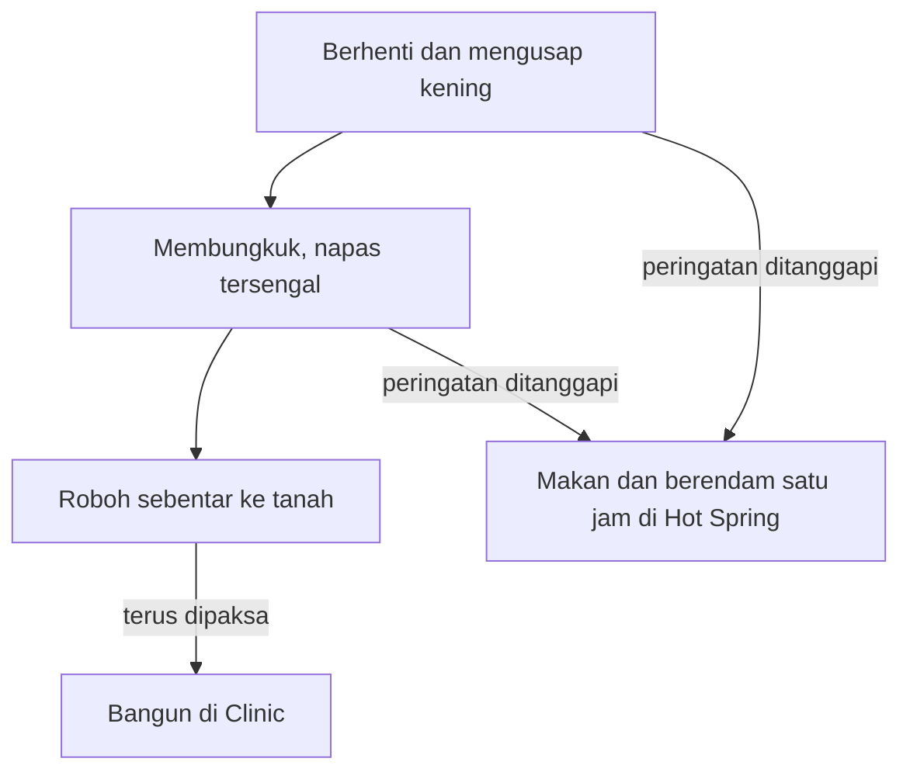

## Stamina Bukan Sumber Daya Tak Terbatas

Di tengah ladang, si petani muda tiba-tiba berhenti sejenak dan mengusap keningnya, padahal masih banyak petak yang belum digarap. Kamu tetap menekan tombol. Beberapa gerakan kemudian, ia membungkuk dengan napas tersengal.

Banyak dari kita mengenali adegan itu dari masa kecil. Layar seperti sedang bicara, tetapi kita terlalu sibuk mengejar target hari itu untuk mendengarkan.

### Tiga Tanda Sebelum Tokoh Kita Roboh

Panduan resmi Prima menjelaskan bahwa tubuh tokoh kita memberi peringatan bertahap. Mula-mula ia berhenti dan mengusap kening. Lalu ia membungkuk, terengah-engah. Kalau terus dipaksa, ia kehabisan tenaga sebentar dan jatuh ke tanah. Abaikan semua tanda itu, dan kamu baru melihatnya lagi saat ia terbangun di Clinic.

Harganya mahal. Menurut panduan, dokter menahannya di Clinic sampai tenaganya pulih, praktis sepanjang hari. Keesokan harinya ia bangun di rumah dalam keadaan kesiangan, sampai tengah hari, dan belum bisa bekerja banyak sebelum benar-benar segar. Panduan juga mencatat bahwa kerja terlalu keras bisa membuat tokoh kita sakit atau kelelahan. Di bagian kerja sambilan di kebun anggur Aja Winery milik Duke, ada pengingat serupa: terlalu capek bisa membuatmu kesiangan dan melewatkan panen sama sekali.

Kalau kamu menanggapi peringatan itu, panduan menawarkan jalan keluar: makan dan berendam satu jam di Hot Spring. Urutan tanda itu bisa digambar begini.

### Hot Spring, Makanan, dan Buah Ajaib

Untuk memulihkan diri, ada Hot Spring. Duduk di sana selama satu jam membuat tokoh kita rileks dan memulihkan tenaga. Panduan bahkan memberi kebiasaan sederhana: mampir ke Hot Spring setiap malam sebelum tidur. Selama ia berendam satu jam dan sudah di tempat tidur sebelum pukul 1 dini hari, ia seharusnya tetap sehat dan bangun tepat waktu.

Makanan bekerja dari sisi lain. Permainan ini mengenal dua ukuran, *Strength* (tenaga) dan *Fatigue* (rasa lelah). Doug menjual makanan di penginapannya pada siang dan petang hari untuk menambah tenaga dan mengurangi lelah. Masakan buatan sendiri juga bisa dimakan, berguna pada hari panjang di tambang (bab 13). Di tabel panduan, sebutir telur yang dimakan, misalnya, tercatat menambah Strength 3 dan menurunkan Fatigue 1, sedangkan Turbojolt tercatat menurunkan Fatigue 20.

Ada juga bantuan kecil di rumah. Setelah rumah diperbesar, bunga di dalam vas dari Won bisa mengurangi rasa lelah. Ada pula Mystic Berry, yang membuat Fatigue hanya bertambah separuh dari biasanya setiap kali tokoh kita bekerja. Untuk mendapatkannya, kamu harus menemui Kappa di danau di kaki Mother's Hill: berdiri di depan dua pohon di sisi kiri danau, lalu lempar tiga mentimun (*Cucumber*) ke air. Kappa tidak muncul di musim dingin. Alat yang ditingkatkan juga meringankan beban, dan itu kita bahas di bab 6.

Pada hari badai, panduan bahkan bercanda: tidur saja, bayangkan segarnya tokoh kita setelah 24 jam terlelap.

### Rasa Kantuk yang Tidak Bisa Dipercaya

Di dunia nyata, tubuh kita tidak selalu memberi tanda sejelas usapan kening. Dalam studi laboratorium [Van Dongen dan rekan (2003)](https://doi.org/10.1093/sleep/26.2.117), 48 orang dewasa sehat berusia 21 sampai 38 tahun diberi waktu di tempat tidur 4, 6, atau 8 jam per malam selama 14 hari. Kelompok 4 dan 6 jam mengalami penurunan kemampuan kognitif yang terus menumpuk.

Bagian yang paling mengusik justru rasa kantuk. Penilaian kantuk dari peserta sendiri hanya naik sedikit setelah hari-hari awal, dan tidak membedakan secara signifikan kelompok 6 jam dari 4 jam. Menurut para peneliti, penilaian kantuk itu mengisyaratkan bahwa peserta sebagian besar tidak menyadari penurunan tersebut. Untuk pembatasan 6 jam atau kurang, defisitnya setara dengan hingga dua malam tanpa tidur. Angka itu batas atas, jadi jangan dibaca bahwa tidur 6 jam sama dengan begadang dua malam.

Kalau dipikir-pikir, ini mirip si petani muda tanpa animasi peringatan: tenaganya turun, tetapi kita merasa masih baik-baik saja.

### Tujuh Jam Tidur dan Batas Jam Kerja

Konsensus American Academy of Sleep Medicine dan Sleep Research Society ([Watson dkk., 2015](https://pmc.ncbi.nlm.nih.gov/articles/PMC4434546/)) merekomendasikan orang dewasa berusia 18 sampai 60 tahun tidur 7 jam atau lebih per malam secara teratur. Tidur kurang dari 7 jam secara teratur dikaitkan dengan berbagai gangguan kesehatan, juga dengan kinerja yang menurun, kesalahan yang bertambah, dan risiko kecelakaan yang lebih tinggi. Panel yang sama mengingatkan bahwa kebutuhan tidur tiap orang berbeda.

Jam kerja punya cerita serupa. Analisis WHO dan ILO (Pega dkk., 2021) menemukan bahwa bekerja 55 jam atau lebih per minggu dikaitkan dengan perkiraan risiko stroke 35 persen lebih tinggi dan risiko meninggal karena penyakit jantung iskemik 17 persen lebih tinggi, dibanding bekerja 35 sampai 40 jam ([rilis WHO, 2021](https://www.who.int/news/item/17-05-2021-long-working-hours-increasing-deaths-from-heart-disease-and-stroke-who-ilo)). Angka ini berasal dari studi observasional, dan para penulisnya menyatakan tidak bisa memastikan bahwa hubungannya sebab-akibat.

Aturan Hot Spring dan tidur sebelum pukul 1 terasa seperti versi permainan dari rambu-rambu itu. Satu jam berendam terlihat seperti waktu yang hilang, padahal di permainan, Clinic merampas satu hari penuh ditambah separuh hari berikutnya.

### Ringkasan

- Tokoh kita memberi tiga tanda sebelum roboh: mengusap kening, membungkuk terengah, lalu jatuh sebentar. Abaikan semuanya, dan ia bangun di Clinic lalu kesiangan esok harinya.
- Makan dan satu jam di Hot Spring memulihkan tenaga, dan tidur sebelum pukul 1 menjaga ia bangun tepat waktu.
- Di dunia nyata, rasa kantuk sendiri bisa menipu: dalam studi laboratorium Van Dongen dan rekan, kemampuan kognitif peserta dengan jatah tidur 4 atau 6 jam terus turun, sementara kantuk yang mereka nilai sendiri hanya naik sedikit setelah hari-hari awal.
- Tidur kurang dari 7 jam dan kerja 55 jam atau lebih per minggu sama-sama dikaitkan dengan risiko kesehatan, bukan dibuktikan sebagai penyebabnya.

Tenaga sudah kita jaga, kini saatnya melihat jam-jam dalam sehari: di bab berikutnya, kita ikuti urutan kerja si petani muda dan tenggat-tenggat yang mengaturnya.
