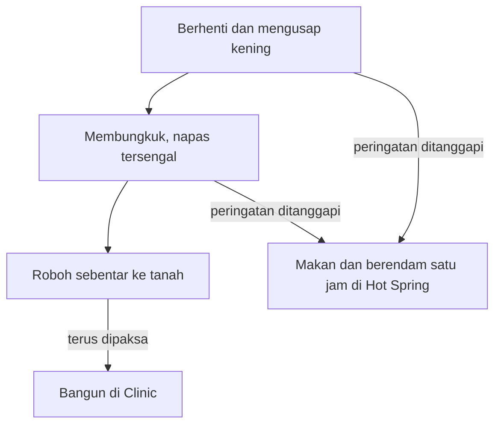

## Stamina Bukan Sumber Daya Tak Terbatas

Di tengah ladang, si petani muda tiba-tiba berhenti dan mengusap keningnya, padahal masih banyak petak yang belum tersentuh cangkul sejak pagi. Kamu tetap menekan tombol. Beberapa ayunan kemudian, ia membungkuk dengan napas tersengal.

Banyak dari kita mengenali adegan itu dari masa kecil. Layar sedang memberi isyarat, tetapi kita terlalu sibuk mengejar target hari itu untuk mendengarkannya. Kita baru sadar ketika si petani sudah terbaring di Clinic dan rencana hari itu sudah berantakan.

### Tiga Tanda Sebelum Roboh

Di HM BTN, tubuh si petani tidak langsung tumbang. Tandanya datang bertahap: ia berhenti untuk mengusap kening, lalu membungkuk terengah-engah, lalu roboh sebentar ke tanah. Kalau kamu tetap memaksanya bekerja, pemandangan berikutnya adalah ruang Clinic.

Harga pingsan itu mahal. Dokter menahannya di sana sampai tenaganya pulih, praktis sepanjang hari. Esoknya ia bangun di rumah dalam keadaan kesiangan, sampai tengah hari, dan belum sanggup bekerja banyak sebelum benar-benar segar. Satu hari yang dipaksa dibayar dengan satu setengah hari yang hilang. Kerja terlalu keras juga bisa membuatnya sakit, dan saat ia bekerja sambilan di kebun anggur Aja Winery milik Duke, terlalu capek bisa membuatnya kesiangan lalu melewatkan panen sama sekali.

Padahal jalan keluarnya tersedia selama peringatan itu masih kamu dengar. Alurnya kira-kira seperti ini.

### Satu Jam di Hot Spring

Gim ini menyediakan penawarnya sendiri, dan penawar itu murah. Mampirlah ke Hot Spring setiap malam, berendam satu jam, lalu pastikan si petani sudah berbaring sebelum pukul 1 dini hari. Dengan kebiasaan itu, ia seharusnya tetap sehat dan bangun tepat waktu.

Makanan bekerja dari sisi lain. Gim ini mengukur dua hal, *Strength* (tenaga) dan *Fatigue* (rasa lelah), dan makanan yang dijual Doug di penginapannya menambah yang pertama sekaligus mengurangi yang kedua. Satu jam berendam memang terasa seperti waktu yang terbuang ketika ladang masih menunggu. Bandingkan dengan Clinic, yang merampas sehari penuh ditambah separuh hari berikutnya.

Pada hari badai, panduan resminya bahkan bercanda: tidur saja, dan bayangkan betapa segarnya si petani setelah terlelap 24 jam.

### Kantuk yang Pandai Menipu

Dunia nyata jarang sebaik itu memberi tanda. Dalam percobaan [Van Dongen dan rekan-rekannya (2003)](https://doi.org/10.1093/sleep/26.2.117), 48 orang dewasa sehat mendapat jatah empat, enam, atau delapan jam di tempat tidur setiap malam selama dua minggu. Kemampuan berpikir kelompok empat dan enam jam terus merosot, sementara rasa kantuk yang mereka nilai sendiri hanya naik sedikit setelah hari-hari awal. Pada peserta percobaan itu, penurunan tersebut tampaknya sebagian besar tidak mereka sadari. Perasaan sendiri, alat ukur yang biasa kita andalkan, ternyata bisa meleset.

Bayangkan si petani tanpa animasi mengusap kening. Tenaganya terus terkuras, tetapi dari dalam, rasanya masih baik-baik saja.

### Tujuh Jam Semalam

Kalau perasaan bisa meleset seperti itu, patokan dari luar jadi berguna. Konsensus American Academy of Sleep Medicine dan Sleep Research Society ([Watson dkk., 2015](https://pmc.ncbi.nlm.nih.gov/articles/PMC4434546/)) menganjurkan orang dewasa berusia 18 sampai 60 tahun tidur tujuh jam atau lebih secara teratur. Tidur kurang dari itu dikaitkan dengan gangguan kesehatan, kinerja yang menurun, kesalahan yang bertambah, dan risiko kecelakaan yang lebih tinggi, meski kebutuhan tidur tiap orang berbeda.

Jam kerja punya rambu serupa. Analisis WHO dan ILO (Pega dkk., 2021) mengaitkan kerja 55 jam atau lebih per minggu dengan perkiraan risiko stroke 35 persen lebih tinggi dan risiko meninggal karena penyakit jantung iskemik 17 persen lebih tinggi, dibanding kerja 35 sampai 40 jam ([rilis WHO, 2021](https://www.who.int/news/item/17-05-2021-long-working-hours-increasing-deaths-from-heart-disease-and-stroke-who-ilo)). Datanya observasional, sehingga hubungan itu belum bisa disebut sebab-akibat.

Sejam berendam dan tidur sebelum pukul 1 adalah versi gim dari rambu-rambu tadi. Bedanya, di dunia nyata kamu sendiri yang harus menetapkan jam berhenti, sebelum tubuhmu menetapkannya dengan cara yang lebih kasar. Lembur semalam demi tenggat mungkin terasa seperti kemenangan. Kalau berubah menjadi kebiasaan, ia lebih mirip ayunan cangkul sesudah tanda ketiga.

### Ringkasan

Si petani muda memberi tiga tanda sebelum roboh, dan mengabaikannya berarti kehilangan satu setengah hari di Clinic dan di tempat tidur. Makan, sejam di Hot Spring, dan tidur sebelum pukul 1 jauh lebih murah. Perasaan tidak selalu jujur: dalam percobaan Van Dongen, rasa kantuk yang dinilai pesertanya hanya naik sedikit, padahal kemampuan berpikir mereka terus merosot. Karena itu, tujuh jam tidur dan jam kerja yang wajar layak dipegang sebagai patokan, meski hubungannya dengan kesehatan baru berupa keterkaitan.

Tenaga sudah terjaga, tetapi jam di ladang terus berdetak. Besok pagi pertanyaannya bergeser: pekerjaan mana yang didahulukan, dan tenggat apa yang harus dikejar?
