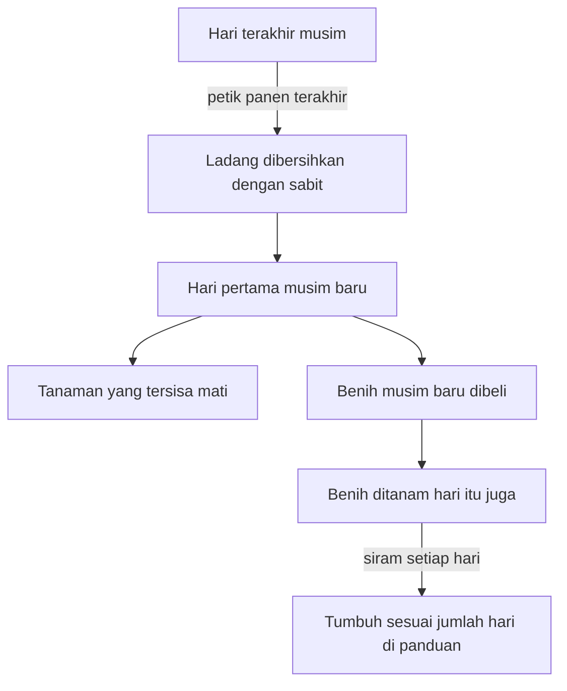

## Benih yang Sesuai dengan Musimnya

Sebatang tanaman tinggal sehari lagi siap dipanen, tetapi pagi berikutnya ia sudah mati karena musim telah berganti. Pemain HM BTN yang kurang teliti membaca kalender bisa mengalaminya.

Panduan resmi Prima menuliskannya tanpa basa-basi. Semua tanaman musim semi mati pada hari pertama musim panas, dan tanaman yang tinggal sehari lagi pun ikut tidak bernilai. Hal yang sama terjadi saat musim panas berakhir. Pagi itu tokoh kita hanya bisa mengambil sabit dan memotong batang-batang yang sudah mati.

Rasanya tidak adil, padahal kerjanya sudah benar: mencangkul, menanam, menyiram. Yang keliru cuma satu hal, yaitu waktunya.

### Kalender yang Tidak Bisa Ditawar

Di Harvest Moon: Back to Nature, setiap musim kecuali musim dingin punya tanaman sendiri. Musim dingin tidak punya benih sendiri, dan tidak ada yang tumbuh di luar. Ladang jadi kosong, dan panduan pun mengakui bahwa di musim itu uang agak seret.

Karena itu, petani yang cermat bekerja di tepi musim. Menjelang akhir musim semi, ketika tanaman sudah tidak akan berbuah lagi, panduan menyarankan ladang dibersihkan dengan sabit agar siap untuk musim panas. Benih musim panas belum bisa dibeli sebelum musim panas tiba, sebab Supermarket hanya menjual benih untuk musim yang sedang berjalan. Untuk musim panas dan musim gugur, sarannya sedikit berbeda: jangan memotong tanaman sebelum hari terakhir, karena mungkin masih ada satu panen lagi. Lalu, pada hari pertama musim baru, benih baru langsung ditanam.

Ada satu syarat lagi yang sering dilupakan. Menurut panduan, cepat lambatnya tanaman tumbuh sepenuhnya bergantung pada air yang diterimanya. Jumlah hari tumbuh yang tercatat di panduan hanya berlaku kalau tanaman disiram setiap hari. Lupa menyiram bisa membuat panen mundur, dan di ujung musim, selisih beberapa hari itu menentukan.

Kalau digambar, pergantian musim di ladang tokoh kita kira-kira berjalan begini.

### Panen Sekali atau Berkali-kali

Sebelum membeli benih, panduan Prima mengajak pemain bertanya: apakah tanaman ini dipanen sekali saja, atau bisa dipanen berulang kali? Lobak (*Turnip*), misalnya, butuh 5 hari dan selesai setelah sekali panen. Mentimun (*Cucumber*) butuh 10 hari untuk panen pertama, lalu bisa dipetik lagi setiap 5 hari. Di musim gugur ada terong (*Eggplant*), 10 hari untuk panen pertama dan setelah itu setiap 3 hari.

Hitungan ini jadi penting menjelang akhir musim. Tanaman berulang yang ditanam terlambat mungkin hanya sempat dipanen sekali sebelum mati. Ada pula benih istimewa yang baru dijual setelah kamu mengirim 100 buah dari setiap jenis hasil panen lain di musim yang sama. Hadiahnya ada, tetapi syaratnya kerja panjang.

### Hothouse yang Mahal dan Rapuh

Lalu datang tawaran yang menggoda. Hothouse memungkinkan tokoh kita bertanam sepanjang tahun, tanpa peduli musim. Kalau sudah punya Hothouse, benih musim semi, musim panas, dan musim gugur bahkan bisa dibeli di Supermarket saat musim dingin.

Harganya tidak murah: 30.000 G dan 580 potong kayu, dan Gotz baru mau membangunnya setelah semua bangunan lain di peternakan ditingkatkan. Panduan memberi bujukan. Menurut hitungannya, uang dari memanen nanas (*Pineapple*) sepanjang tahun bisa menutup biaya itu hanya dalam satu musim. Nanas sendiri butuh 21 hari untuk panen pertama, lalu bisa dipetik setiap 5 hari.

Namun ada catatannya. Hothouse dibuat dari bahan tembus cahaya yang mudah hancur oleh badai di musim panas dan badai salju di musim dingin. Kehilangan Hothouse jauh lebih berat daripada kehilangan tanaman di ladang, karena biaya bangunannya lenyap bersama semua isinya. "You must decide whether it's worth the risk," tulis panduan resmi Prima.

Kalau dipikir-pikir, Hothouse mirip dengan keadaan yang membuat menunggu terasa lebih ringan. Ia tidak membuat tokoh kita lebih sabar. Ia mengubah keadaannya, dan keadaan itu ada harganya.

### Anak-anak yang Diminta Menunggu

Salah satu rujukan klasik tentang menunda kesenangan adalah [Mischel, Shoda, dan Rodriguez (1989)](https://doi.org/10.1126/science.2658056), ulasan di jurnal Science yang merangkum program riset Mischel. Menurut abstraknya, anak usia 4 tahun yang menunggu lebih lama dalam situasi laboratorium tertentu tumbuh menjadi remaja yang lebih cakap secara kognitif dan sosial, nilai sekolahnya lebih tinggi, dan lebih mampu menghadapi frustrasi serta stres.

Temuan seperti itu mudah dibaca sebagai "menunggu lebih lama menyebabkan hasil lebih baik". Abstraknya sendiri melaporkan hubungan antara lama menunggu di laboratorium dan hasil di masa remaja, tanpa menyebut ukuran sampel atau ukuran efeknya.

### Sabar Juga Soal Keadaan

[Watts, Duncan, dan Quan (2018)](https://doi.org/10.1177/0956797618761661) di jurnal Psychological Science menguji ulang tes *marshmallow* lewat replikasi konseptual, bukan pengulangan persis. Mereka memakai data yang lebih besar, lebih dari 900 anak, dengan analisis utama pada anak-anak yang ibunya tidak tamat kuliah. Menurut abstraknya, keterkaitan antara lama menunggu di usia 4 tahun dan prestasi belajar di usia 15 tahun hanya sekitar separuh dari ukuran di studi-studi awal. Keterkaitan itu lalu berkurang dua pertiga setelah latar belakang keluarga, kemampuan kognitif sejak dini, dan lingkungan rumah ikut diperhitungkan. Kaitannya dengan perilaku di usia 15 tahun jauh lebih kecil dan jarang signifikan secara statistik.

Jadi keterkaitan itu tidak hilang, tetapi mengecil. Sekitar dua pertiganya hilang begitu latar belakang keluarga, kemampuan awal, dan lingkungan rumah ikut diperhitungkan.

Ladang tokoh kita memberi gambaran yang mirip. Menyiram setiap hari baru berbuah kalau benihnya cocok dengan musim dan harinya masih cukup. Sesabar apa pun, tanaman yang ditanam terlambat tetap mati di hari pertama musim berikutnya. Maka saat kamu merasa kurang sabar, ada baiknya bertanya juga: apakah musimnya memang tepat, dan apakah keadaanmu memberi cukup ruang untuk menunggu? Menyalahkan kemauan saja belum tentu adil, baik untuk dirimu sendiri maupun untuk orang lain.

### Poin Penting

- Di HM BTN, tanaman yang belum dipanen mati di hari pertama musim baru, sekalipun tinggal sehari lagi.
- Bersihkan ladang di tepi musim, tanam di hari pertama, dan siram setiap hari, karena air menentukan cepatnya tumbuh.
- Hothouse membebaskan tokoh kita dari kalender, tetapi mahal dan bisa hancur oleh badai.
- Dalam studi Watts dan rekan (2018), keterkaitan antara menunggu dan prestasi hanya separuh dari studi awal dan berkurang dua pertiga setelah faktor keluarga dan rumah diperhitungkan.
- Dalam studi Watts, sebagian besar kaitan itu mengecil begitu keadaan keluarga diperhitungkan, jadi kemauan saja belum tentu menjelaskan semuanya.

Selagi tanaman masih tumbuh, tokoh kita tidak harus berdiam diri, dan bab berikutnya membahas rezeki kecil yang bisa dikumpulkan selama masa menunggu panen itu.
