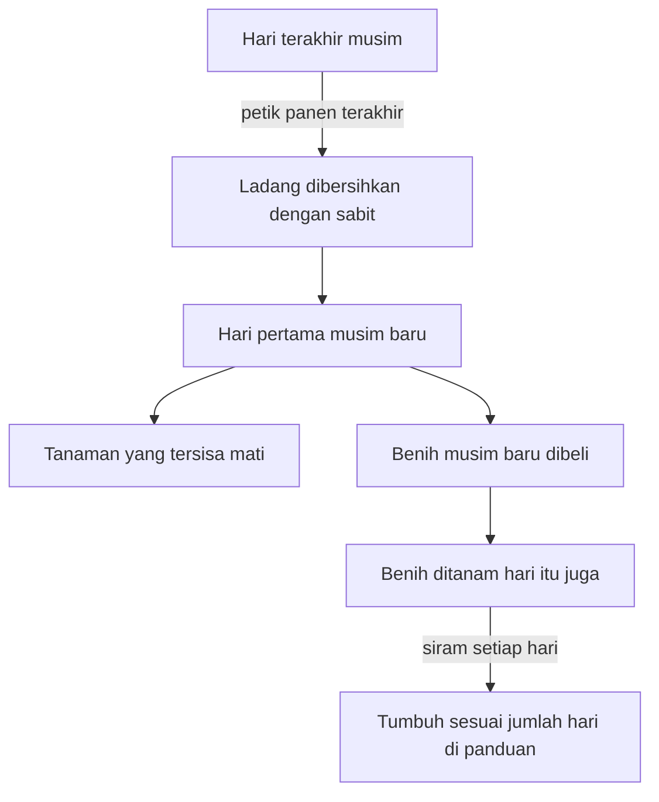

## Benih yang Sesuai dengan Musimnya

Petak itu sudah kamu siram setiap pagi dan panennya tinggal sehari lagi, tetapi besoknya musim berganti dan seluruh tanamannya mati.

Di HM BTN, tanaman musim semi mati pada hari pertama musim panas, berapa pun sisa harinya, dan hal yang sama terjadi ketika musim panas berakhir. Pagi itu tidak ada yang bisa dipetik. Kamu hanya bisa mengambil sabit dan memotong batang-batang yang sudah mati.

Kerjanya sudah benar, dari mencangkul, menanam, sampai menyiram. Yang keliru hanya waktunya.

### Kalender yang Tidak Bisa Ditawar

Musim semi, musim panas, dan musim gugur masing-masing punya benih sendiri. Musim dingin tidak punya. Tidak ada yang tumbuh di luar, ladang kosong, dan uang biasanya agak seret. Supermarket juga hanya menjual benih untuk musim yang sedang berjalan, jadi benih musim panas tidak bisa disiapkan sejak musim semi.

Karena itu, petani yang cermat bekerja di tepi musim. Menjelang akhir musim semi, begitu tanaman tidak akan berbuah lagi, ladang dibersihkan dengan sabit. Di musim panas dan musim gugur, tunggu sampai hari terakhir sebelum memotong, sebab mungkin masih ada satu panen lagi. Begitu hari pertama musim baru tiba, benih baru langsung masuk ke tanah.

Satu syarat lagi sering terlupa. Cepat lambatnya tanaman tumbuh sepenuhnya ditentukan oleh air yang diterimanya, dan jumlah hari tumbuh setiap benih hanya berlaku kalau tanaman itu disiram setiap hari. Lupa menyiram bisa membuat panen mundur, dan di ujung musim, selisih beberapa hari itulah yang menentukan.

Satu putaran pergantian musim, dari panen terakhir sampai benih baru tumbuh, berjalan kira-kira seperti ini.

### Panen Sekali atau Berkali-kali

Sebelum membeli benih, ada satu pertanyaan yang layak diajukan: tanaman ini dipanen sekali, atau bisa berkali-kali? Lobak (*Turnip*) siap dalam 5 hari, lalu selesai. Mentimun (*Cucumber*) butuh 10 hari untuk panen pertama dan setelah itu bisa dipetik lagi setiap 5 hari. Terong (*Eggplant*) di musim gugur juga butuh 10 hari, lalu berbuah setiap 3 hari.

Hitungan itu terasa betul menjelang akhir musim. Tanaman berulang yang terlambat ditanam mungkin hanya sempat dipanen sekali sebelum mati. Bahkan ada benih istimewa yang baru dijual setelah kamu mengirim 100 buah dari setiap jenis hasil panen lain di musim yang sama. Hadiahnya nyata, tetapi jalannya panjang.

### Hothouse yang Mahal dan Rapuh

Lalu datang tawaran yang menggoda. Hothouse memungkinkan kamu bertanam sepanjang tahun tanpa peduli musim, dan begitu ia berdiri, Supermarket bahkan menjual benih musim semi, musim panas, dan musim gugur di tengah musim dingin.

Harganya 30.000 G dan 580 potong kayu, dan Gotz baru mau membangunnya setelah semua bangunan lain di peternakan diperbesar. Hitungan di buku Prima menggiurkan. Nanas (*Pineapple*) butuh 21 hari untuk panen pertama, lalu bisa dipetik setiap 5 hari, dan uang dari memanennya bisa menutup biaya Hothouse hanya dalam satu musim.

Masalahnya, bangunan itu terbuat dari bahan tembus cahaya yang mudah hancur oleh badai di musim panas dan badai salju di musim dingin. Kalau itu terjadi, yang hilang bukan sekadar tanaman, melainkan seluruh biaya bangunan beserta isinya. Sepadan atau tidak risikonya, kamu sendiri yang menimbang.

Hothouse tidak membuat petaninya lebih sabar. Ia mengubah keadaan sehingga menunggu terasa lebih ringan, dan keadaan itu ada harganya.

### Tes Marshmallow yang Diuji Ulang

Salah satu rujukan tentang riset menunda kesenangan yang dikenal sebagai tes marshmallow adalah ulasan [Mischel, Shoda, dan Rodriguez (1989)](https://doi.org/10.1126/science.2658056) di jurnal Science, yang merangkum program riset Mischel. Di sana, anak usia 4 tahun yang menunggu lebih lama dalam situasi laboratorium tertentu tumbuh menjadi remaja yang lebih cakap secara kognitif dan sosial, dengan nilai sekolah lebih tinggi dan daya tahan lebih baik menghadapi frustrasi serta stres. Yang dilaporkan adalah keterkaitan, bukan bukti bahwa menunggu menyebabkan semua itu.

[Watts, Duncan, dan Quan (2018)](https://doi.org/10.1177/0956797618761661) mengulang gagasan itu secara konseptual (bukan pengulangan persis) pada lebih dari 900 anak, terutama yang ibunya tidak tamat kuliah. Kaitan antara lama menunggu di usia 4 tahun dan prestasi belajar di usia 15 tahun ternyata hanya separuh dari studi-studi awal, lalu berkurang sekitar dua pertiga setelah latar belakang keluarga, kemampuan awal anak, dan lingkungan rumah diperhitungkan. Kaitan itu tidak hilang, tetapi jauh lebih kecil daripada yang tampak semula.

### Sabar Juga Soal Keadaan

Ladang mengajarkan hal yang sama dengan bahasa lain. Menyiram setiap hari baru berbuah kalau benihnya cocok dengan musim dan harinya masih cukup. Sesabar apa pun kamu, tanaman yang ditanam terlambat tetap mati di hari pertama musim berikutnya.

Jadi saat kamu merasa kurang sabar, ajukan juga dua pertanyaan lain. Apakah musimnya memang tepat? Apakah keadaanmu memberi cukup ruang untuk menunggu? Menyalahkan kemauan saja belum tentu adil, baik untuk dirimu sendiri maupun untuk orang lain.

### Poin Penting

- Di HM BTN, tanaman yang belum dipanen mati di hari pertama musim baru, jadi kerja yang benar tetap sia-sia kalau waktunya keliru.
- Hothouse membebaskan petani dari kalender, tetapi mahal dan bisa hancur oleh badai.
- Dalam studi Watts dan rekan (2018), kaitan antara menunggu dan prestasi jauh lebih kecil daripada di studi awal, terutama setelah keluarga dan rumah diperhitungkan, jadi kemauan saja belum tentu menjelaskan semuanya.

Selama tanaman masih tumbuh, petani tidak harus berdiam diri: ada rezeki kecil yang bisa dikumpulkan sambil menunggu.
