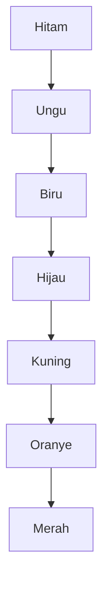

## Hati yang Berubah Warna Perlahan

Setiap kali kamu menyapa gadis yang kelak bisa kamu nikahi, sebuah hati kecil muncul di pojok kanan bawah kotak dialognya, mula-mula berwarna hitam.

Itulah *Heart Meter*, cara HM BTN menunjukkan seberapa besar rasa sayang perempuan itu kepada si petani. Lima perempuan di Mineral Village bisa kamu nikahi: Ann di penginapan Doug, Elli di Clinic, Karen yang sesekali menjaga Supermarket, Mary di Library, dan Popuri di Poultry Farm. Kamu tidak bertemu mereka sekaligus. Mereka muncul satu per satu selama kamu menjelajahi desa dan mengajak orang bicara. Hati di pojok dialog itu bergeser sedikit demi sedikit, seperti kedekatan di dunia nyata.

Kamu juga bukan satu-satunya yang menaruh hati. Dokter diam-diam menyukai Elli, Cliff diam-diam menyukai Ann, dan Kai menaruh hati pada Popuri. Para perempuan itu juga bukan sasaran yang duduk menunggu didekati. Setiap orang di desa itu punya perasaannya sendiri.

### Tujuh Warna Menuju Merah

Hitam berarti belum ada rasa sayang sama sekali. Dari sana warnanya naik ke ungu, biru, hijau, kuning, oranye, dan akhirnya merah. Makin besar rasa sayangnya, makin dekat warnanya ke ujung tangga.

Kalau digambar dari atas ke bawah, tangganya seperti ini.

Setiap anak tangga itu diisi oleh hari-hari biasa: sapaan, hadiah, dan perhatian yang diulang.

### Bunga bagi Elli, Jamur bagi Mary

Panduan resmi Prima menyarankan hal yang sederhana tetapi melelahkan: pelajari apa yang disukai dan dibenci tiap orang, hafalkan jadwal hariannya supaya mudah ditemui, lalu beri hadiah sesering mungkin. Pada musim dingin, panduan yang sama menganjurkan hadiah setiap hari.

Seleranya tidak seragam, sama seperti wataknya. Ann periang dan tomboi, Mary gemar membaca dan menulis, sedangkan Karen pandai mendengarkan tetapi agak sulit didekati karena ia sangat aktif dan tidak selalu ada di toko. Elli senang menerima bunga, sedangkan Mary senang diberi jamur. Hadiah yang sama tidak menyentuh semua orang, jadi kamu harus benar-benar mengenal orang yang kamu dekati.

Ada juga momen yang ikut menaikkan rasa sayang: memberinya kue kering saat Spring Thanksgiving, mengajaknya ke Goddess Festival, menonton kembang api bersama, atau membawakan hadiah di hari ulang tahunnya. Karen bisa membalas perhatianmu: kalau ia menyukaimu, ia memberimu benih Moondrop di musim semi. Kamu menanamnya, menunggunya mekar, lalu membawakan bunganya kembali kepadanya.

Hadiah yang lebih mahal tetap hanya satu hadiah. Saibara bisa membuatkan perhiasan dari Orichalc dan 1.000 G yang disukai sebagian besar perempuan, tetapi perhiasan itu hanya mengisi satu hari di antara banyak hari lain. Rasa sayang di desa ini diraih perlahan, bukan dibeli sekali bayar.

### Blue Feather yang Menunggu Giliran

Lamaran dilakukan dengan Blue Feather, yang dijual di Supermarket seharga 1.000 G. Barang itu tidak dipajang sejak awal. Ia baru muncul setelah rumahmu dua kali diperbesar dan hati perempuan yang kamu dekati sudah hampir atau benar-benar merah.

Urutan ini yang membuat Blue Feather bermakna. Ia tidak membuat siapa pun jatuh hati. Ia hanya menutup kedekatan yang sudah terbentuk lewat sapaan dan hadiah kecil yang terus diulang. Lamaran diterima kalau rasa sukanya sudah cukup, dan baru sesudah itu ia pindah ke rumahmu. Kalau rasa itu belum ada, Blue Feather seharga 1.000 G hanyalah sehelai bulu.

Pernikahan pun bukan garis akhir. Beberapa musim kemudian, rumah itu bertambah ramai dengan seorang bayi laki-laki, dan rasa sayang keluarga tetap perlu dijaga supaya si kecil tidak terabaikan. Hati yang sudah merah masih harus dirawat.

### Jam-Jam yang Menjadikan Teman

Di luar gim, [Hall (2019)](https://doi.org/10.1177/0265407518761225) mencoba menghitung berapa lama kedekatan tumbuh di antara orang yang baru saling kenal. Ia menanyai 355 orang dewasa yang baru pindah dan mengikuti 112 mahasiswa tahun pertama selama sembilan minggu. Jam bersama yang lebih banyak berkaitan dengan pertemanan yang lebih dekat, dan waktu bersantai ikut memprediksinya.

Siaran pers kampusnya ([KU News, 2018](https://news.ku.edu/news/article/2018/03/06/study-reveals-number-hours-it-takes-make-friend)) menambahkan bahwa jam bekerja bersama tidak terlalu berpengaruh, lalu menaksir sekitar 50 jam dari kenalan ke teman santai dan lebih dari 200 jam ke sahabat dekat. Itu kisaran kasar dari jam yang ditaksir peserta sendiri, dan yang diteliti adalah pertemanan, bukan cinta.

Meski begitu, gambarannya terasa akrab bagi siapa pun yang pernah menunggu hati di pojok dialog berganti warna. Di gim, yang menggeser warna adalah perhatian yang diulang. Dalam studi Hall, yang berkaitan dengan pertemanan yang lebih dekat adalah jam yang terkumpul. Dua-duanya menempatkan waktu yang menumpuk di depan satu momen besar, meski studi Hall hanya soal pertemanan dan baru menunjukkan keterkaitan.

### Key Takeaways

- Hati di HM BTN bergeser dari hitam ke merah seiring rasa sayang tumbuh.
- Satu hadiah mahal tetap hanya satu hari; yang menggeser warna adalah hadiah tepat sasaran yang terus diulang.
- Blue Feather baru muncul setelah hatinya hampir atau sudah merah; ia menutup kedekatan, bukan menciptakannya, dan dalam studi Hall pertemanan yang dekat juga berkaitan dengan banyaknya jam bersama.

Rasa sayang itu menyenangkan untuk dirawat, tetapi ladang yang makin luas menuntut keberanian lain: menerima bantuan dari tangan-tangan kecil Harvest Sprites.
