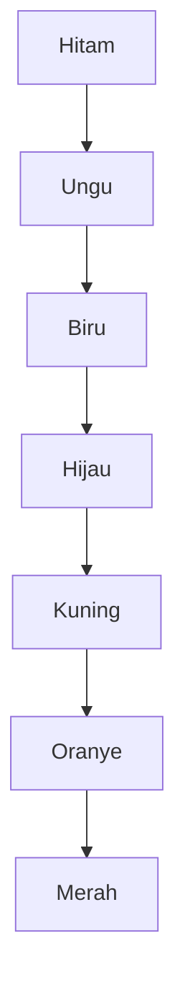

## Hati yang Berubah Warna Perlahan

Sebuah hati kecil di pojok kotak dialog mula-mula hitam, lalu bergeser pelan ke ungu, biru, dan hijau, sebelum akhirnya menyala merah.

Hati itu adalah *Heart Meter*, penanda seberapa besar rasa sayang seorang perempuan desa kepada tokoh kita. Ia tampil di pojok kanan bawah kotak dialognya saat kamu mengajaknya bicara, dan warnanya bergeser seiring rasa sayangnya tumbuh. Bab ini tentang perubahan yang berjalan perlahan itu.

### Lima Nama, Lima Tempat

Menurut panduan resmi Prima, ada lima perempuan di Mineral Village yang bisa dinikahi si petani muda, dan masing-masing punya tempatnya sendiri. Ann bekerja dan tinggal di penginapan Doug. Elli bekerja di Clinic. Karen kadang-kadang menjaga Supermarket. Mary mengurus Library dan tinggal di sebelahnya. Popuri tinggal di Poultry Farm.

Mereka tidak muncul sekaligus. Panduan menyebut kamu akan bertemu mereka satu per satu, jadi sarannya sederhana: jelajahi desa dan ajak semua orang bicara. Catatan karakternya pun memberi gambaran yang berbeda-beda. Ann periang dan tomboi. Elli sangat setia pada pekerjaannya di Clinic. Karen bisa diandalkan dan pandai mendengarkan, tetapi agak sulit didekati karena ia sangat aktif dan tidak selalu ada di toko. Mary gemar membaca dan menulis.

Panduan juga mencatat bahwa beberapa pemuda desa menaruh hati: Dokter pada Elli dan Cliff pada Ann (keduanya disebut diam-diam), serta Kai pada Popuri. Detail kecil ini mengingatkan bahwa setiap orang di desa punya perasaannya sendiri, bukan sekadar target yang menunggu didekati.

### Tujuh Warna di Pojok Kotak Dialog

Warna hati itu berurutan. Mulai dari hitam, yang berarti belum ada rasa sayang sama sekali, lalu ungu, biru, hijau, kuning, oranye, dan terakhir merah. Makin besar rasa sayangnya, makin dekat warnanya ke merah.

Urutan itu bisa dibaca dari atas ke bawah seperti ini.

Panduan membaca urutan warna ini sebagai tanda rasa sayang yang tumbuh, dan menyarankan hadiah serta perhatian yang diulang untuk menggesernya.

### Hadiah Kecil yang Diulang

Lalu bagaimana warnanya bergeser? Panduan menyarankan kamu mempelajari apa yang disukai dan tidak disukai tiap orang, juga jadwal hariannya agar mudah ditemui. Sesudah itu, beri hadiah sesering mungkin. Seleranya berbeda-beda: Elli, misalnya, menyukai bunga, sedangkan Mary senang diberi jamur. Pada musim dingin, panduan bahkan menyarankan memberi hadiah setiap hari.

Kalimat panduan yang paling pas untuk bab ini pendek saja. Dengan hadiah dan perhatian, "you'll slowly earn her love," tulis panduan resmi Prima. Kata kuncinya *slowly*, perlahan.

Ada juga momen yang ikut menaikkan rasa sayang: memberi kue kering (Cookie) saat Spring Thanksgiving, mengajaknya ke Goddess Festival, menonton kembang api bersama, atau memberi hadiah ulang tahun. Karen, kalau ia menyukaimu, akan memberimu benih Moondrop di musim semi. Tanam benih itu, lalu berikan bunganya saat mekar. Ada pula hadiah yang lebih mahal: bawa Orichalc dan 1.000 G ke Saibara, dan ia akan membuat perhiasan yang disukai sebagian besar perempuan di desa. Namun, perhiasan itu tetap satu hadiah di antara banyak hari.

### Blue Feather Datang Paling Akhir

Lamaran dilakukan dengan Blue Feather, yang dijual di Supermarket seharga 1.000 G. Barang ini tidak tersedia sejak awal. Ia baru muncul ketika hatinya hampir atau sudah merah, dan setelah rumahmu dua kali diperbesar. Perbesaran kedua dikerjakan Gotz: kamar tidur baru di sisi rumah, cukup untuk ranjang kedua, dengan biaya 10.000 G dan 750 kayu (*Lumber*), selesai dalam tiga hari.

Perhatikan urutannya. Blue Feather bukan jalan pintas yang membuat seseorang jatuh hati. Ia hanya penutup dari kedekatan yang sudah terbentuk. Panduan pun menulis bahwa lamaran diterima kalau rasa sukanya sudah cukup, dan barulah ia pindah ke rumahmu. Panduan juga memasang target: usahakan sudah menikah sebelum tahun kedua berakhir.

Setelah menikah, ceritanya tidak berhenti. Beberapa musim kemudian, keluarga kecil itu bertambah dengan seorang bayi laki-laki. Panduan mengingatkan bahwa rasa sayang keluarga tetap penting, jadi si kecil jangan sampai diabaikan. Hati yang sudah merah pun perlu dirawat.

### Berapa Jam Menuju Sahabat

Di luar gim, Hall mencoba mengukur sesuatu yang mirip, tetapi untuk pertemanan, bukan cinta romantis ([Hall, 2019](https://doi.org/10.1177/0265407518761225)). Studi pertamanya melibatkan 355 orang dewasa yang baru pindah dalam enam bulan terakhir. Studi keduanya mengikuti 112 mahasiswa tahun pertama sebanyak tiga kali selama 9 minggu. Di kedua studi, peserta sendiri yang memperkirakan berapa jam mereka habiskan bersama kenalan barunya.

Menurut abstraknya, jumlah jam bersama dikaitkan dengan pertemanan yang lebih dekat, dan waktu untuk kegiatan santai juga memprediksi kedekatan. Siaran pers University of Kansas menambahkan bahwa jam yang dihabiskan untuk bekerja bersama tidak terlalu berpengaruh ([KU News, 2018](https://news.ku.edu/news/article/2018/03/06/study-reveals-number-hours-it-takes-make-friend)).

Siaran pers itu juga memberi angka perkiraan: sekitar 50 jam untuk naik dari sekadar kenalan menjadi teman santai, sekitar 90 jam lagi dari tahap itu untuk sampai ke status teman, dan lebih dari 200 jam sebelum seseorang bisa disebut sahabat dekat. Angka ini perlu dibaca dengan jujur. Jamnya diperkirakan sendiri oleh peserta, abstraknya hanya bicara soal keterkaitan, bukan ambang yang pasti, dan sumber lain melaporkan angka yang berbeda. Studinya pun tentang pertemanan, jadi bukan bukti apa pun soal asmara.

Meski begitu, kalau dipikir-pikir, gambarannya mirip dengan hati di pojok kotak dialog. Dalam studi Hall, makin banyak jam bersama dikaitkan dengan pertemanan yang makin dekat, dan di gim panduan menyarankan hadiah serta perhatian yang diulang. Di gim pun, Blue Feather tidak bisa dibeli sebelum hatinya hampir merah: kedekatan harus datang lebih dulu, baru kemudian momen besarnya.

### Key Takeaways

- Di gim ini, warna hati bergeser dari hitam sampai merah seiring rasa sayang tumbuh, dan menurut panduan rasa sayang itu diraih perlahan.
- Panduan menyarankan mengenal selera dan jadwal tiap orang, lalu memberi hadiah sesering mungkin, karena rasa sayang tumbuh perlahan.
- Blue Feather baru muncul setelah hatinya hampir atau sudah merah; ia menutup kedekatan, bukan menciptakannya.
- Studi Hall (2019) mengaitkan jam bersama dengan pertemanan yang lebih dekat, dengan angka jam yang hanya perkiraan dan khusus soal pertemanan.

Dirawat dengan perhatian itu menyenangkan, tetapi ladang yang makin luas menuntut hal lain lagi: berani menerima bantuan dari tangan-tangan kecil Harvest Sprites.
