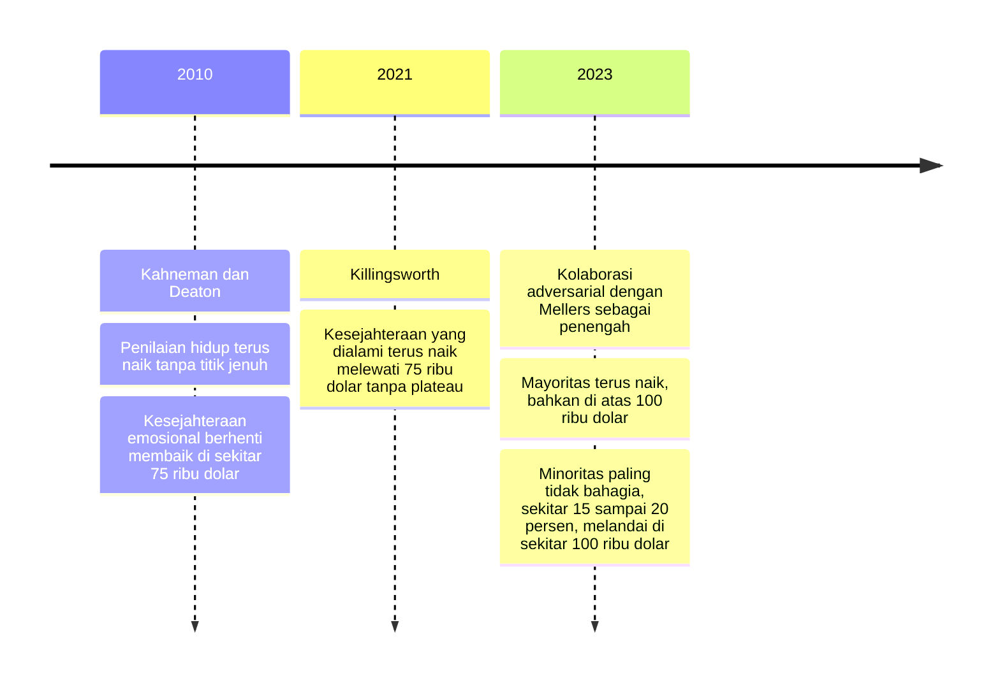

## Kontroversi Plateau 75 Ribu Dolar

Bayangkan kamu membaca dua berita tentang uang dan kebahagiaan yang judulnya saling membantah, padahal keduanya berangkat dari riset serius. Headline pertama, tahun 2010: "Kebahagiaan berhenti naik saat pendapatan menyentuh 75.000 dolar per tahun." Headline kedua, tahun 2021: "Kesejahteraan terus meningkat tanpa plafon, seberapa pun penghasilannya."

Penelitian di balik keduanya dimuat di jurnal ilmiah yang sama, PNAS (Proceedings of the National Academy of Sciences), tentang pertanyaan yang persis sama. Dua tim peneliti serius, dua dataset besar, dua kesimpulan yang saling bertolak belakang.

### Dua jenis kesejahteraan dalam survei 2010

Studi pertama datang dari Daniel Kahneman, psikolog peraih Nobel, dan Angus Deaton, ekonom peraih Nobel. Mereka menganalisis sekitar 450.000 respons survei harian Gallup dari penduduk Amerika Serikat, yang tiap hari menjawab pertanyaan tentang hidup dan perasaan mereka kemarin.

Dari data itu muncul temuan ganda yang sering disederhanakan sampai melenceng:

1. **Penilaian hidup**, yaitu bagaimana seseorang menilai hidupnya secara keseluruhan lewat pertanyaan tangga Cantril, terus naik mengikuti pendapatan tanpa titik jenuh. Makin tinggi pendapatan, makin tinggi pula orang menempatkan dirinya di tangga hidup.
2. **Kesejahteraan emosional**, yaitu kualitas perasaan yang dialami kemarin, seperti senang, stres, khawatir, dan sedih, berhenti membaik di sekitar 75.000 dolar per tahun pada harga 2010. Setelah titik itu, rata-rata perasaan harian tidak lagi ikut membaik.

Jadi temuan aslinya sebenarnya jauh lebih halus daripada slogan "uang tidak membuat bahagia". Ringkasan yang menyebar luas dari studi ini berbunyi: uang membeli kepuasan terhadap hidup, tapi tidak membeli perasaan bahagia. Kepuasan naik tanpa batas, sementara suasana hati harian punya langit-langit.

> Ibaratnya hidupmu punya dua laporan berbeda. Yang satu seperti nilai portofolio investasi, semakin kamu menabung semakin tinggi angkanya tanpa henti. Yang satu seperti kualitas tidur, setelah kebutuhan dasarnya terpenuhi, gaji tambahan tidak otomatis membuat malammu lebih nyenyak.

Angka 75.000 dolar itu lalu berkeliling dunia, muncul di buku populer, slide seminar, dan ribuan artikel dengan kalimat serempak: "Sudah, di titik ini uang berhenti menambah kebahagiaan." Yang jarang disebutkan, peneliti aslinya tidak pernah bicara sekuat itu.

### Hasil berlawanan dari studi 2021

Sebelas tahun kemudian, Matthew Killingsworth dari Wharton, Universitas Pennsylvania, mengambil pendekatan yang berbeda. Alih-alih meminta orang mengingat perasaan mereka kemarin, ia memakai aplikasi yang mengirim pertanyaan secara acak di tengah hari dan menanyakan perasaanmu saat ini juga.

Skala penelitiannya besar: lebih dari 33.000 orang dewasa di Amerika Serikat, dengan sekitar 1,7 juta laporan pengalaman secara real-time. Kalau Kahneman dan Deaton membaca potret memori, Killingsworth merekam film yang sedang berjalan.

Hasilnya adalah kebalikan headline 2010. Kesejahteraan yang dialami orang terus naik seiring pendapatan, melewati 75.000 dolar, tanpa tanda-tanda plateau. Ya, kecepatan kenaikannya melambat di pendapatan tinggi, tapi kurvanya tidak pernah berubah jadi garis datar.

### Ketika dua kubu duduk bersama

Di sinilah cerita ini berubah dari perdebatan biasa menjadi contoh langka cara kerja sains. Dua peneliti itu tidak berbalas status di media sosial atau saling membongkar kelemahan di wawancara. Sebaliknya, mereka membentuk kolaborasi adversarial, bersama Barbara Mellers sebagai penengah yang netral, dan tahun 2023 hasilnya dimuat di PNAS.

Dalam kolaborasi adversarial, dua kubu yang berseberangan membuka seluruh datanya, merancang analisis bersama, lalu menjalankan kedua metode pada data gabungan di bawah pengawasan mediator netral. Tujuannya bukan mencari pemenang, tapi menjelaskan klaim keduanya sekaligus.

Kesimpulannya mengurai pertentangan itu dengan cara yang tidak diduga banyak orang:

- Untuk **mayoritas orang**, perasaan bahagia terus naik bersama pendapatan di atas 75.000 dolar, termasuk di atas 100.000 dolar. Bagi kelompok ini, memang tidak ada plafon yang terlihat.
- Tapi untuk **minoritas yang paling tidak bahagia**, sekitar 15 sampai 20 persen partisipan, kurvanya melandai di sekitar 100.000 dolar. Setelah titik itu, uang tambahan praktis tidak lagi mengubah perasaan mereka.

Artinya, plateau itu nyata, tapi ia bukan hukum umum. Ia hanya berlaku untuk satu kelompok: mereka yang paling tidak bahagia. Dan bagi kelompok itu pun, garis datarnya berada di angka yang lebih tinggi daripada 75.000 dolar.

Supaya ketiga studi itu tidak tertukar, urutan tahunnya bisa kamu lihat di garis waktu berikut.

Pelajaran terpentingnya ada di luar angka-angka: uang tidak bisa memperbaiki kesedihan yang akarnya bukan uang. Kehilangan orang tersayang, depresi klinis, kesepian yang dalam. Untuk luka-luka seperti ini tambahan gaji tidak punya khasiat, dan itu bukan berarti uang gagal, melainkan karena masalahnya memang bukan jenis yang solusinya bisa dibeli.

### Kenapa dua studi bisa berpisah sejauh itu

Bagaimana dua penelitian serius bisa sampai pada kesimpulan yang bertabrakan? Penjelasannya tidak mistis: mereka mengukur kesejahteraan dengan cara yang berbeda. Satu mengandalkan ingatan harian tentang kemarin, satu menangkap perasaan saat itu juga lewat laporan real-time.

Dua cara ukur yang berbeda memang bisa memberi hasil berbeda. Tapi ada temuan lain di sana: ketika data kedua studi digabung dan dianalisis dengan kedua metode, perbedaan itu ternyata menyembunyikan perbedaan antar kelompok orang. Rata-rata keseluruhan selama ini memayungi dua kurva, mayoritas yang terus naik dan minoritas tidak bahagia yang melandai. Satu angka tunggal terlalu kasar untuk menampung keduanya, dan itulah sebabnya perdebatan bertahun-tahun terasa seperti dua orang membicarakan dua hal berbeda sambil merasa membicarakan hal yang sama.

Dari sini kamu bisa membawa pulang pelajaran berpikir kritis: sains maju lewat konflik data yang diselesaikan dengan data yang sama, bukan lewat debat opini. Kahneman awalnya skeptis pada temuan Killingsworth, lalu keduanya menguji dugaan itu langsung pada data gabungan, dan ketika hasilnya menunjukkan Kahneman sebagian keliru, beliau justru berterima kasih pada data.

### Apa artinya untuk keputusanmu

Ada dua pesan praktis dari seluruh perdebatan ini. Pertama, kalau kamu pernah membaca bahwa gaji di atas angka tertentu tidak menambah kebahagiaan, sekarang kamu tahu kalimat itu terlalu dipermudah. Untuk kebanyakan orang, penghasilan tambahan tetap memperbaiki kesejahteraan yang dirasakan, walau manfaatnya makin kecil di tiap kenaikan.

Kedua, kalau hidupmu terasa berat meski penghasilanmu sudah tidak kecil, temuan ini mengajakmu jujur pada diri sendiri. Mungkin sebagian masalah memang bisa diringankan oleh kondisi finansial yang lebih baik, dan itu wajar untuk diperjuangkan. Tapi mungkin pula akarnya ada di tempat lain: relasi, kesehatan, atau makna, tempat uang hanya bisa membantu, bukan menyembuhkan.

## Ringkasan

Angka 75.000 dolar berasal dari kesejahteraan emosional dalam studi Kahneman dan Deaton (2010), sementara Killingsworth (2021) menemukan kesejahteraan yang dialami terus naik tanpa plateau. Kolaborasi adversarial 2023 mendamaikan keduanya: plateau itu nyata, tapi hanya pada minoritas paling tidak bahagia, sekitar 15 sampai 20 persen, dan letaknya di sekitar 100.000 dolar. Bagi kebanyakan orang, dolar tambahan masih menambah kesejahteraan dengan manfaat yang makin kecil, sedangkan kesedihan yang akarnya bukan uang tidak bisa diperbaiki dengan uang.

Kalau di dalam satu negara uang tetap menambah kesejahteraan pribadi, apakah negara yang makin kaya otomatis menjadi negara yang makin bahagia?
