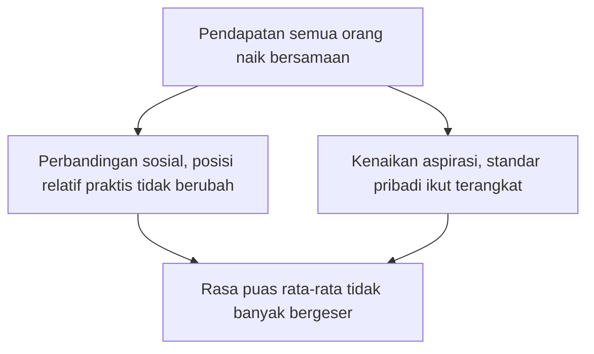

## Paradoks Easterlin

Sebuah negara tumbuh hampir tanpa henti selama beberapa dekade, dengan pabrik bermunculan, jalan raya memanjang, dan pendapatan rata-ratanya naik tajam. Kalau kamu diminta menebak nasib rasa bahagia warganya, tebakan paling wajar tentu ikut naik, kan?

Sekarang bagian yang membingungkan. Pada 1974, ekonom Richard Easterlin dari Universitas Pennsylvania menjodohkan catatan pertumbuhan ekonomi dengan hasil survei kebahagiaan, dua jenis data yang jarang dipertemukan. Dari Amerika Serikat, Jepang, hingga beberapa negara Eropa, ia menemukan bahwa pendapatan rata-rata naik terus, tetapi rata-rata rasa bahagia warga tidak ikut naik sebesar yang diduga. Ekonomi berlari kencang, kebahagiaan berjalan santai.

Di bab sebelumnya kita melihat kontroversi serupa pada level individu. Kini pertanyaannya naik satu tingkat. Apakah hal yang sama juga berlaku untuk satu negara utuh? Jarak antara "seharusnya" dan "kenyataan" inilah yang melahirkan salah satu perdebatan terpanjang dalam ilmu ekonomi kebahagiaan.

### Dua temuan yang bertabrakan

Perlu digarisbawahi dulu bahwa dalam temuan Easterlin uang masih punya peran. Di dalam satu negara, pada satu waktu, orang kaya memang lebih bahagia daripada orang miskin. Pola ini muncul konsisten di hampir semua data yang ia periksa. Semakin tinggi pendapatan seseorang dibanding sesamanya, semakin tinggi pula rasa puasnya.

Yang justru janggal ada di garis waktu. Ketika pendapatan rata-rata sebuah negara naik dari tahun ke tahun, rata-rata kebahagiaan warganya tidak terangkat sebesar harapan. Jadi ada dua pola yang berdiri berdampingan:

1. **Pada satu waktu:** yang berpenghasilan lebih tinggi lebih bahagia.
2. **Sepanjang waktu:** pendapatan nasional naik, kebahagiaan rata-rata nyaris diam di tempat.

Kombinasi keduanya dikenal sebagai **paradoks Easterlin**. Dua kebenaran itu sama-sama didukung data, tapi terasa sulit duduk berdampingan. Kalau uang membuat orang bahagia, kenapa negara yang makin kaya tidak ikut makin bahagia?

> Bayangkan tribun stadion ketika momen penting terjadi. Satu orang berdiri supaya lebih jelas melihat, dan berhasil. Tapi begitu semua orang ikut berdiri, posisi relatif mereka kembali seperti semula. Semua berdiri, sama pegal, dan tidak ada yang melihat lebih jelas dari sebelumnya.

### Perbandingan sosial dan aspirasi yang ikut naik

Easterlin menunjuk dua mesin di balik paradoks ini, dan keduanya saling berkait.

Pertama, **perbandingan sosial**. Rasa puas manusia bekerja secara relatif. Yang kita evaluasi adalah "berapa pendapatanku dibanding orang-orang di sekitarku". Ketika ekonomi tumbuh dan pendapatan semua orang naik bersamaan, posisi relatif setiap orang praktis tidak berubah. Semua orang maju satu langkah, tapi garis start mereka ikut maju.

Kedua, **kenaikan aspirasi**. Standar pribadi ikut terangkat mengikuti pendapatan. Barang yang dulu terasa mewah, setelah semua orang memilikinya, berubah jadi kebutuhan biasa. Target yang dulu tampak jauh, begitu tercapai, langsung digantikan target berikutnya.

> Aspirasi itu seperti garis finis yang digeser diam-diam. Setiap kali kita hampir menyentuh garis "cukup", garisnya pindah sedikit ke depan. Kita lari makin cepat, tapi rasa sampai selalu tertunda.

Gabungan keduanya menjelaskan paradoks dengan rapi. Pada satu waktu, orang kaya terlihat lebih bahagia karena posisi relatifnya lebih tinggi. Tapi sepanjang waktu, ketika semua orang naik bersama dan standar hidup ikut naik, rasa puas rata-rata tidak banyak bergeser. Isi dompet bertambah tebal, sedangkan posisi kita di antara sesama manusia praktis diam di tempat.

Cara kedua mesin itu bekerja bersamaan terangkum dalam bagan ini.

### Lalu muncul penantang serius

Seperti teori besar lain, paradoks ini tidak luput dari ujian. Tahun 2008, Betsey Stevenson dan Justin Wolfers menerbitkan studi di Brookings Papers on Economic Activity dengan bahan yang jauh lebih kaya, mencakup lebih banyak negara, lebih banyak survei, dan data yang lebih panjang dibanding yang bisa diakses Easterlin pada 1974.

Hasilnya menantang versi kuat paradoks. Stevenson dan Wolfers menemukan hubungan positif yang signifikan antara pertumbuhan ekonomi dan rata-rata kesejahteraan, baik antarnegara maupun sepanjang waktu.

Easterlin dan para pendukungnya membalas dengan analisis jangka panjang. Mereka memeriksa data beberapa dekade penuh dan berpendapat bahwa dalam rentang panjang, efek pertumbuhan terhadap rata-rata kebahagiaan jauh lebih lemah dari perkiraan penantang. Sampai sekarang, perdebatan ini belum tuntas.

### Cara jujur membaca perdebatan ini

Jadi mana yang benar setelah dua kubu saling menunjuk data? Mari kita rangkai jawaban yang paling berpijak pada bukti.

Klaim paling radikal, yaitu "pertumbuhan tidak membeli apa-apa bagi kebahagiaan rata-rata", tidak didukung data. Versi paradoks yang terlalu kuat itulah yang paling mudah dipatahkan.

Yang bertahan adalah klaim yang lebih hati-hati, bahwa **pertumbuhan membeli lebih sedikit dari dugaan, dan sebagian manfaatnya dimakan oleh perbandingan sosial**. Uang tetap berhubungan dengan kesejahteraan, tapi hubungan itu tidak sekencang imajinasi kita, dan sebagian dari apa yang dibelinya menguap begitu semua orang memilikinya. Bagian kedua klaim ini punya pijakan. Di bab 6, ekonom Erzo Luttmer menunjukkan bagaimana gaji tetangga bisa membuat gaji kita sendiri terasa kurang.

### Kenapa ini relevan untuk kita di Indonesia

Paradoks ini dekat dengan hidup kita. Kita hidup di negara yang ekonominya bertumbuh hampir sepanjang hidup kita, walau kadang terasa surut. Kalau kamu lahir di era ketika ekonomi sedang bergerak maju, hampir pasti kamu pernah berharap, "Hidupku harus lebih baik dari hidup orang tuaku." Rumah lebih layak, liburan lebih sering, masa depan lebih lega.

Harapan itu wajar. Tapi sebelum kita menggantungkan seluruh kebahagiaan pada angka pertumbuhan, paradoks Easterlin mengingatkan bahwa pendapatan rata-rata yang naik tidak otomatis menghadirkan rasa cukup, karena rasa cukup ikut berpindah mengikuti perbandingan dan aspirasi. Generasi yang hidupnya lebih makmur secara materi dari orang tuanya bisa saja tetap merasa belum cukup. Kemakmurannya nyata, hanya tolok ukurnya yang ikut berpindah.

Maka bab ini mengajakmu mengenali asumsi "makin kaya negara, makin bahagia semua orang", lalu mengecek ulang asumsi itu dengan data. Sebagian harapan terbukti benar, sebagian lagi ternyata lebih rumit dari kelihatannya.

## Kesimpulan Bab

- Pada satu waktu orang kaya lebih bahagia daripada orang miskin, tapi Easterlin (1974) melihat rata-rata kebahagiaan nyaris diam saat pendapatan nasional naik, dan ia menjelaskannya lewat perbandingan sosial dan aspirasi yang ikut naik.
- Stevenson dan Wolfers (2008) menemukan hubungan positif antara pertumbuhan ekonomi dan rata-rata kesejahteraan. Perdebatan belum tuntas, tapi yang bertahan adalah versi hati-hati, yaitu pertumbuhan membeli lebih sedikit dari dugaan, dan sebagian manfaatnya dimakan perbandingan sosial.
- Bagi kita di Indonesia, paradoks ini mengajak mengecek asumsi bahwa hidup pasti lebih bahagia dari generasi sebelumnya hanya karena ekonomi tumbuh.

Separuh jawaban atas pertanyaan "uang dan kebahagiaan" tinggal di relasi antarmanusia, di tetangga yang gajinya naik dan rekan kerja yang mendapat promosi.
