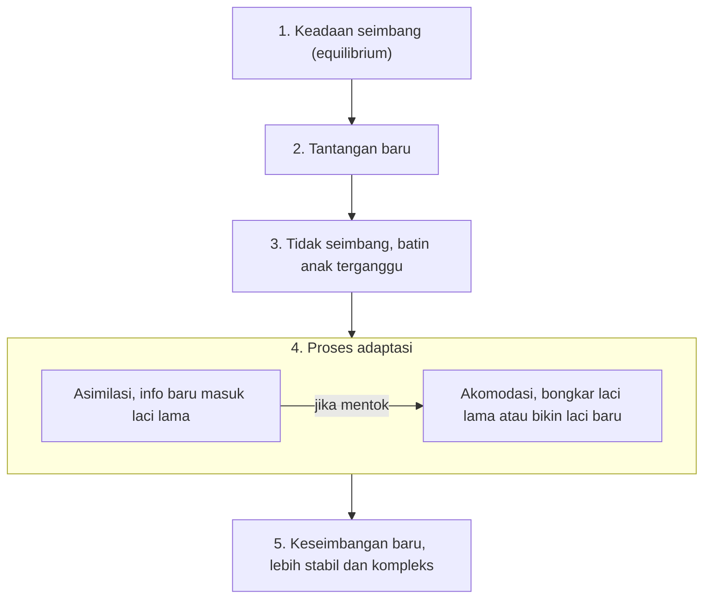

## Ekuilibrasi

Pernah bingung belajar sesuatu yang benar-benar baru? Rasanya semua serba membingungkan. Sampai akhirnya, *klik!* Semua mendadak masuk akal. Piaget menyebut momen itu **ekuilibrasi**.

Ekuilibrasi adalah konsep krusial tapi gampang-gampang susah dipahami. Bayangkan asimilasi dan akomodasi sebagai perkakasnya. Ekuilibrasi adalah mesin pendorongnya. Tanpanya, perkembangan kognitif kita mandek. Atau malah kacau balau.

### 1\. Apa Itu Ekuilibrasi?

Singkatnya, **ekuilibrasi adalah proses pencarian keseimbangan terus-menerus antara skema internal (isi kepala) dengan realitas baru (dunia nyata).**

Manusia itu makhluk pencari keteraturan. Kita benci bingung. Ketika fakta baru bertabrakan dengan skema lama, muncullah rasa gelisah. Kondisi tak nyaman ini bernama **disekuilibrium**. Ekuilibrasi hadir sebagai dorongan biologis untuk kabur dari kegelisahan tersebut menuju titik seimbang yang baru.

> Ekuilibrasi itu proses dinamis tanpa henti. Bayangkan sedang bersepeda: kamu terpaksa memutar kemudi ke kanan dan kiri seiring waktu, hanya supaya tubuh tidak terpelanting jatuh.

### 2\. Siklus Pertumbuhan Kognitif

Pola ekuilibrasi menyerupai spiral yang makin naik, makin rumit:

1. **Keadaan Seimbang (Equilibrium):** Anak merasa dunianya masuk akal. Skemanya cukup kuat menjelaskan lingkungan sekitar.
2. **Tantangan Baru:** Ada fenomena ganjil yang gagal diterjemahkan oleh skema lama.
3. **Ketidakseimbangan (Disequilibrium):** Batin anak terganggu. Frustrasi muncul karena jeda antara asumsi dan kenyataan.
4. **Proses Adaptasi (Asimilasi & Akomodasi):** Anak mulai merombak pikirannya.
	- Memaksa info baru masuk laci lama (**Asimilasi**).
	- Jika mentok, bongkar laci lama atau bikin laci baru (**Akomodasi**).
5. **Keseimbangan Baru (New Equilibrium):** Pikiran direorganisasi. Tingkat pemahamannya sekarang jauh lebih stabil dan kompleks.

Kelima langkah itu bisa kamu ikuti sebagai satu alur pada diagram berikut.

### 3\. Termostat Kognitif

Bayangkan isi kepala kita berfungsi macam **termostat AC**.

- **Set Point (Equilibrium):** Kamu pasang suhu $24^\circ\text{C}$. Ruangan sejuk. Sistem diam tanpa beban.
- **Perubahan Lingkungan:** Matahari siang terik. Suhu ruangan loncat ke $28^\circ\text{C}$. Inilah fase **disekuilibrium**.
- **Respon Ekuilibrasi:** Sensor termostat mendeteksi suhu naik. Mesin pendingin otomatis menyala.
- **Hasil:** Ruangan kembali ke $24^\circ\text{C}$. Bedanya, di dunia kognitif, titik keseimbangan yang baru ini punya struktur yang lebih kompleks dari sebelumnya.

### 4\. Menyeimbangkan Asimilasi dan Akomodasi

Ekuilibrasi berperan jadi wasit penengah asimilasi dan akomodasi.

- Kebanyakan **asimilasi**: Anak maksa memasukkan pengalaman baru ke laci lama yang sempit. Pikiran jadi kaku. Dunia terlihat kelewat sederhana.
- Kebanyakan **akomodasi**: Pikiran anak berubah total tiap melihat hal sepele. Isi kepala berantakan. Nggak punya pijakan solid sama sekali.

Ekuilibrasi menjaga keduanya tetap seimbang:

$$
\text{Ekuilibrasi} \approx \frac{\text{Asimilasi}}{\text{Akomodasi}} \rightarrow \text{Keseimbangan Mental}
$$

*Coba pikir: Pernah ketemu orang yang keras kepala (kebanyakan asimilasi)? Atau orang yang plin-plan nggak punya prinsip (kebanyakan akomodasi)? Menurut kacamata Piaget, ekuilibrasi mereka sedang macet.*

### 5\. Mengapa Langit Berwarna Biru?

Kita pantau ekuilibrasi bekerja lewat kisah Budi si balita.

**1. Equilibrium.** Budi yakin langit biru karena baru saja ada yang mengecatnya. Otaknya mencerna itu sebagai fakta paten (skema: warna ada karena kuas).

**2. Tantangan.** Budi melihat awan jalan-jalan. Nggak ada tanda-tanda tumpahan cat dari langit. Gurunya bilang warna biru itu gara-gara cahaya matahari, bukan tukang cat gaib.

**3. Disequilibrium.** Budi garuk-garuk kepala. *"Kalau nggak dicat, kok warnanya biru terus? Kenapa nggak luntur pas hujan deras?"* Batinnya gelisah. Pada saat inilah ekuilibrasi mulai bekerja.

**4. Ekuilibrasi & Akomodasi.** Budi berusaha mencerna omongan gurunya soal cahaya. Perlahan skemanya bergeser. Warna bukan cuma soal kuas yang dioles. Ternyata cahaya bisa menghasilkan warna.

**5. New Equilibrium.** Budi kembali tenang. Dunianya masuk akal lagi. Namun kali ini struktur pikirannya sudah naik satu level.

### 6\. Pentingnya "Kebingungan"

Bagi dunia pendidik dan pengasuhan, ekuilibrasi membawa satu pesan: **sedikit kebingungan itu menyehatkan.**

- **Tahan Jawabanmu:** Guru yang buru-buru ngasih kunci jawaban malah menghilangkan disekuilibrium. Tanpa rasa bingung, tak ada ekuilibrasi. Biarkan anak memikirkan pertanyaannya sebentar.
- **Beri Tantangan Pas:**
	- Terlalu gampang $\rightarrow$ Anak bertahan di zona equilibrium (hasilnya: bosan).
	- Terlampau susah $\rightarrow$ Anak stres dan memilih balik badan (ekuilibrasi batal).
	- **Titik Optimal:** Berikan soal yang sedikit di atas batas pemahaman mereka.

**Untuk Belajarmu Sendiri:** Mentok memahami algoritma koding? Jangan buru-buru tutup laptop. Kamu sedang mengalami **disekuilibrium**. Bukannya bodoh, kamu sedang berada di ambang pemahaman berikutnya.