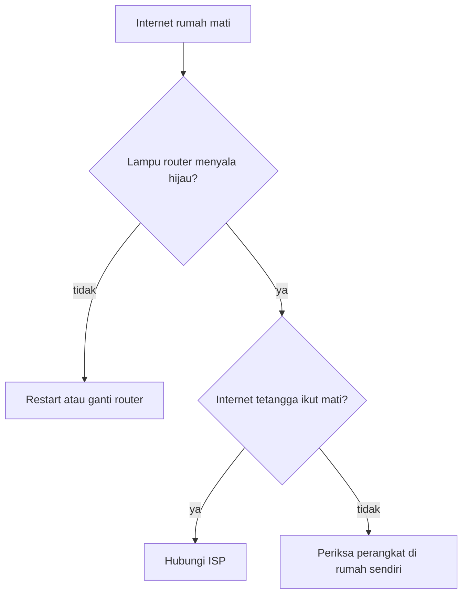

## Tahap Operasional Formal

Di tahap sebelumnya (Operasional Konkret), anak-anak sudah bisa berpikir logis, tapi pemikiran mereka masih terbatas pada objek fisik yang bisa dilihat dan disentuh. Nah, di **Tahap Operasional Formal**, batasan itu mulai hilang.

Ibaratnya seperti beralih dari melihat dengan mata telanjang ke memakai teleskop. Mereka mulai bisa melihat "galaksi" pemikiran yang lebih jauh,konsep-konsep abstrak yang bentuk fisiknya tidak ada, tapi secara logika mungkin terjadi.

## 1\. Apa itu Tahap Operasional Formal?

Mulai dari usia 11 atau 12 tahun sampai dewasa, otak mengalami transisi. Remaja tidak cuma memproses informasi konkret ("apa yang ada di depan mata"), tapi mulai memikirkan "apa yang mungkin terjadi". Mereka bisa mengutak-atik ide murni di dalam pikiran tanpa butuh alat peraga lagi.

> **Wawasan Penting:** Di fase ini, remaja juga mengembangkan kemampuan metakognisi, yaitu "berpikir tentang cara mereka berpikir".

## 2\. Karakteristik Utama Pemikiran Formal

Ada tiga ciri khas cara berpikir di tahap ini:

### A. Pemikiran Abstrak

Remaja mulai paham konsep tanpa wujud fisik seperti keadilan, cinta, nilai moral, atau politik. 

*Contoh: Anak tahap konkret mungkin mengartikan "jujur" sebagai mengembalikan uang kembalian ibu. Sedangkan remaja tahap formal sudah bisa berdebat tentang konsep kejujuran dalam sistem hukum korupsi.*

### B. Penalaran Hipotesis-Deduktif

Kemampuan membuat hipotesis (dugaan sementara) lalu menarik kesimpulan logis dari sana. Ini adalah akar dari cara berpikir ilmiah.

Dalam logika matematika, polanya seperti ini:
Jika $P \rightarrow Q$ (Jika P maka Q)
Dan kita tahu $P$ itu benar,
Maka kita bisa menyimpulkan $Q$ pasti benar.

### C. Pemikiran Sistematis

Saat memecahkan masalah, remaja mulai terorganisir. Mereka berhenti memakai cara coba-coba acak (*trial and error*) dan beralih menguji variabel satu per satu.

## 3\. Eksperimen Pendulum

Piaget sering memakai tes **Pendulum** untuk mengecek apakah seseorang sudah masuk ke operasional formal.

**Tugas:** Seseorang diberi beban dengan berat berbeda-beda dan tali yang panjangnya juga bervariasi. Misi mereka adalah mencari tahu faktor mana yang paling mempengaruhi kecepatan ayunan pendulum.

- **Anak Operasional Konkret:** Biasanya langsung mencoba acak. Mengganti beban dan panjang tali bersamaan, sehingga tebakannya sering meleset karena variabelnya campur aduk.
- **Remaja Operasional Formal:** Mulai mengisolasi variabel. Mereka menahan beban agar tetap sama sambil mencoba berbagai panjang tali, atau sebaliknya.

Secara matematis, mereka secara intuitif mencoba memahami rumus periode ayunan:

$$
T = 2\pi \sqrt{\frac{L}{g}}
$$

Mereka secara sistematis mengetes apakah $T$ (periode) berubah jika $L$ (panjang tali) diubah, tanpa mengubah berat beban.

## 4\. Logika Proposisional

Remaja di tahap ini sanggup mengevaluasi kebenaran logika suatu pernyataan (proposisi), biarpun isinya tidak masuk akal di dunia nyata.

*Contoh:*
1. Semua kucing bisa terbang. (Premis 1)
2. Meong adalah seekor kucing. (Premis 2)
3. Jadi, Meong bisa terbang. (Kesimpulan)

Anak tahap konkret akan protes keras: *"Mana ada kucing terbang!"*
Tapi remaja tahap formal bisa bilang: *"Secara logika kesimpulannya benar karena mengikuti premis awal, biarpun di dunia nyata itu salah."*

## 5\. Aplikasi Dunia Nyata & Skenario

### Dalam Pembelajaran Sains dan Matematika

Siswa mulai siap belajar aljabar. Huruf seperti $x$, $y$, dan $z$ menggantikan angka. Mereka juga bisa membayangkan bentuk grafik $f(x) = x^2$ tanpa perlu repot menggambar setiap titiknya di kertas.

### Dalam Debat Sosial dan Etika

Remaja mulai kritis terhadap aturan dan otoritas. Mereka sering membayangkan versi dunia yang ideal lalu membandingkannya dengan realita. Tidak heran kalau masa remaja sering dipenuhi idealisme berapi-api.

### Skenario Pemecahan Masalah Teknis

Dalam dunia teknis, operasional formal sangat penting untuk *debugging* atau merancang sistem.

**Contoh Kasus Troubleshooting Jaringan**
Seorang teknisi remaja memakai logika deduktif saat internet rumah mati:
1. **Hipotesis 1:** Masalah ada di router. (Cara tes: lihat lampu indikator).
2. **Hipotesis 2:** Masalah ada di kabel pusat ISP. (Cara tes: cek koneksi rumah tetangga).
3. **Analisis:** Kalau router menyala hijau tapi internet tetap mati, kemungkinan besar masalahnya dari ISP.
4. **Tindakan:** Kalau lampu router tidak menyala hijau, router perlu di-restart atau diganti. Kalau router hijau dan internet tetangga ikut mati, saatnya menghubungi ISP. Kalau router hijau dan internet tetangga lancar, yang perlu diperiksa adalah perangkat di rumah sendiri.

Remaja operasional formal bisa menelusuri percabangan ini di kepala mereka sebelum mulai bertindak:

## 6\. Egosentrisme Remaja

Uniknya, lonjakan kecerdasan ini juga memunculkan egosentrisme jenis baru. Karena mereka sekarang bisa memikirkan "apa yang orang lain pikirkan", remaja sering salah mengira bahwa semua orang selalu memperhatikan mereka.

- **Audiens Imajiner:** Merasa seisi kelas diam-diam memperhatikan jerawat di hidungnya.
- **Dongeng Pribadi (*Personal Fable*):** Merasa pengalaman dan penderitaannya paling unik, sampai merasa tidak ada orang dewasa yang bisa paham perasaannya.

## Refleksi & Latihan

*Coba ingat-ingat lagi saat kamu berumur 12-15 tahun.* Pernahkah kamu berdebat dengan orang tua bukan karena murni ingin memberontak, tapi karena kamu menangkap ada lubang logika di aturan mereka? Kalau iya, itu bukti nyata otak kamu sedang bertransisi ke tahap Operasional Formal!

**Latihan Cepat:** Coba pikirkan, *"Apa yang terjadi kalau semua mata uang di dunia tiba-tiba hilang besok pagi?"*

Kalau kamu mulai membayangkan kembalinya sistem barter, ambruknya rantai pasok global, dan bergesernya struktur kekuasaan sosial,selamat! Kamu baru saja mempraktikkan **Pemikiran Hipotesis-Deduktif** kamu.