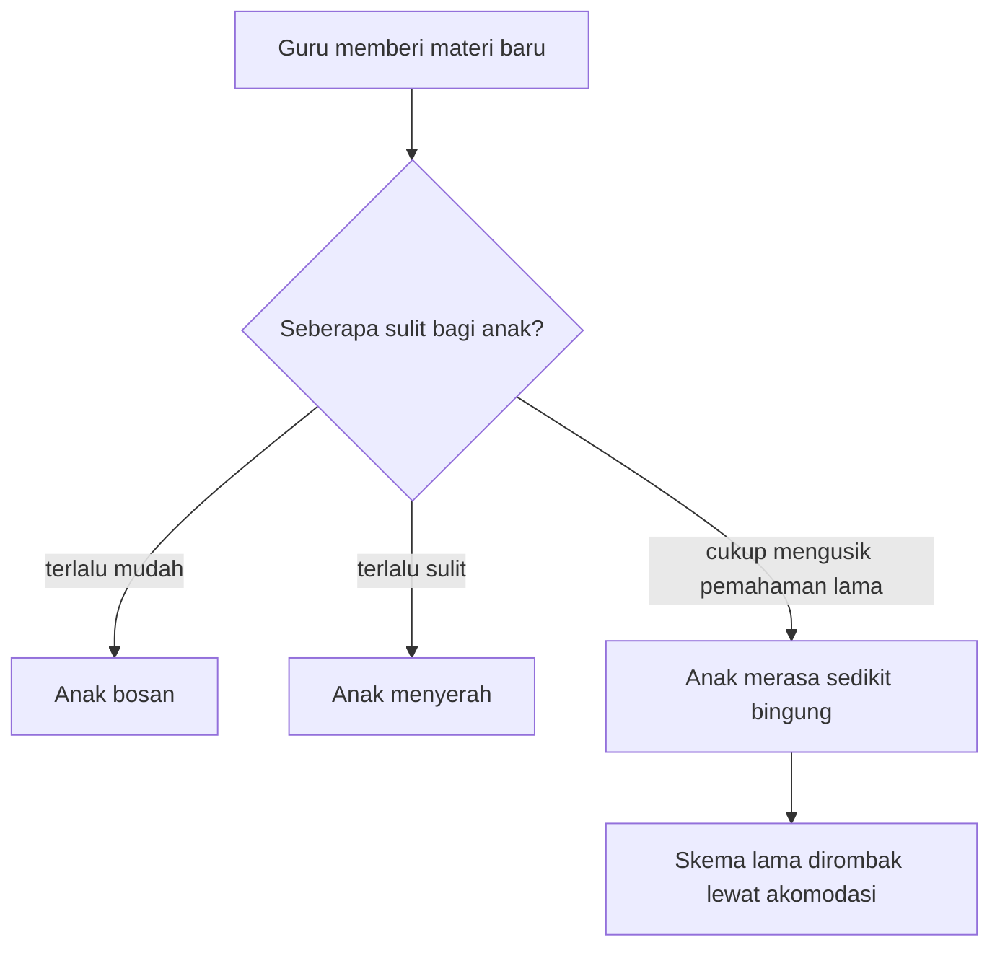

## Implikasi Teori Piaget dalam Strategi Pembelajaran

Lalu, bagaimana kita menerapkan semua teori kognitif ini di dalam kelas? 

Jean Piaget punya pandangan yang agak berbeda dari pendidik pada zamannya. Ia menganggap anak-anak itu seperti ilmuwan kecil. Mereka secara aktif membangun pemahaman tentang dunia mereka sendiri. Jadi, tugas guru bukan lagi menjejalkan informasi ke dalam "wadah kosong".

### Pembelajaran Penemuan (Discovery Learning)

Konsep Discovery Learning sangat kental dengan pengaruh Piaget. Guru tidak lagi mendominasi kelas dengan ceramah satu arah. Pengetahuan tidak bisa ditransfer begitu saja, melainkan harus dikonstruksi sendiri oleh siswa melalui pengalaman.

Sebagai contoh, daripada sekadar menuliskan rumus $\text{Air} + \text{Panas} = \text{Uap}$ di papan tulis, guru bisa memfasilitasi eksperimen. Sediakan kompor, air, dan termometer. Biarkan siswa mengamati prosesnya, mencatat suhu yang berubah, lalu menarik kesimpulan dari apa yang mereka lihat.

Dalam model ini, eksplorasi fisik sangat ditonjolkan. Guru lebih sering melontarkan pertanyaan pemantik untuk memancing pemikiran siswa. Kesalahan pun tidak dianggap sebagai kegagalan, tapi justru diakui sebagai langkah krusial dalam proses ekuilibrasi.

### Kesiapan Kognitif dan Adaptasi Materi

Memaksa anak belajar sesuatu di luar tahap perkembangannya sering kali berujung pada kebingungan. Ibarat menginstal *game* berat di komputer jadul, sistemnya pasti akan kewalahan. Karena itu, instruksi harus selalu disesuaikan dengan tahap kognitif anak.

Untuk anak tahap Praoperasional (seperti TK atau awal SD), instruksi perlu dibuat sesingkat mungkin. Gunakan banyak alat peraga visual. Mengajar berhitung dengan tumpukan kelereng asli akan jauh lebih masuk akal bagi mereka ketimbang hanya menulis angka abstrak di kertas.

Ketika mereka masuk ke tahap Operasional Konkret, mereka sudah bisa mengklasifikasi objek. Berikan eksperimen sains sederhana di mana mereka bisa langsung memanipulasi variabel. Kaitkan juga materi dengan kejadian sehari-hari yang dekat dengan dunia mereka.

Barulah pada tahap Operasional Formal (sekitar usia 11 atau 12 tahun ke atas), siswa siap diberi pertanyaan hipotesis. *"Apa yang akan terjadi jika...?"* menjadi alat utama guru. Di fase ini, mereka sudah mampu mendiskusikan konsep abstrak seperti etika, politik, atau teori sains tingkat lanjut menggunakan penalaran deduktif.

### Memicu Konflik Kognitif

Proses belajar yang sesungguhnya baru terjadi saat anak merasa sedikit bingung. Kondisi ini disebut disekuilibrium. 

Coba bayangkan: kalau materi yang diberikan terlalu mudah, anak pasti bosan. Tapi kalau kelewat susah, mereka akan menyerah. Guru harus jeli mencari titik tengah. Berikan informasi baru yang cukup mengusik pemahaman lama mereka, tapi tetap bisa diproses lewat akomodasi.

Takaran tantangan itulah yang menentukan nasib sebuah materi baru di kepala anak:

Misalnya saat belajar fisika. Siswa mungkin punya pemikiran awal bahwa "semua benda besar dan berat pasti tenggelam". Guru lalu menunjukkan fenomena kapal kayu besar yang mengapung, sementara kelereng kecil malah tenggelam. Kontradiksi ini akan memaksa otak anak untuk melakukan akomodasi dan membongkar skema pemahaman mereka yang lama.

### Peran Baru Seorang Guru

Kerangka kerja Piagetian menuntut perubahan peran pendidik. Guru kini bertindak sebagai arsitek lingkungan belajar. Mereka menyiapkan ruang kelas yang kaya stimulus untuk memancing rasa ingin tahu.

Selain itu, guru bertugas mengobservasi tingkat pemahaman siswa secara intens. Tujuannya memastikan tantangan yang diberikan pas takarannya. Guru juga wajib mendorong interaksi sosial, seperti debat antarsiswa. Meskipun Piaget lebih fokus pada eksplorasi fisik, ia sangat setuju bahwa interaksi sosial efektif untuk mengubah cara pandang egosentris anak.

### Penerapan pada Konsep Siklus Air

Mari kita lihat perbedaan strategi mengajar untuk satu topik yang sama: siklus air.

- **Praoperasional:** Anak-anak mewarnai gambar awan. Bisa juga dengan membiarkan mereka mengamati genangan air yang pelan-pelan mengering di bawah terik matahari.
- **Operasional Konkret:** Praktik langsung membuat miniatur siklus air. Siswa memasukkan air ke dalam botol tertutup, menjemurnya, lalu mengamati uap air yang menempel di dinding botol.
- **Operasional Formal:** Siswa diminta menganalisis data perubahan iklim global. Mereka mendiskusikan prediksi dampaknya terhadap siklus air dan ekosistem di masa depan.

### Merancang Momen Aha

Ingatlah bahwa setiap anak punya kecepatan berkembang yang tidak bisa disamaratakan. Paksaan untuk seragam bisa menghambat perkembangan mereka. Terkadang, memberi ruang bagi tangan mereka untuk aktif lebih efektif untuk membangun logika mereka. 

Pernahkah kamu merasa frustrasi saat belajar hal baru, lalu tiba-tiba muncul momen *"Aha! Sekarang aku paham!"*? Itulah ekuilibrasi yang sedang bekerja. Tugas utama guru adalah merancang sebanyak mungkin momen "Aha!" tersebut di dalam kelas.