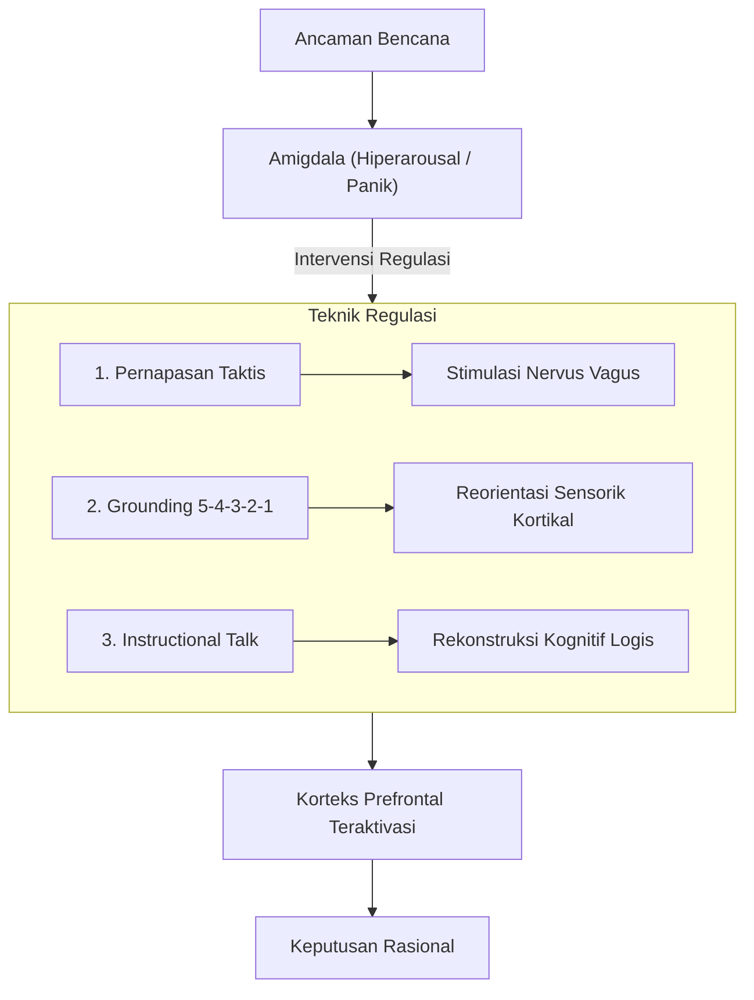
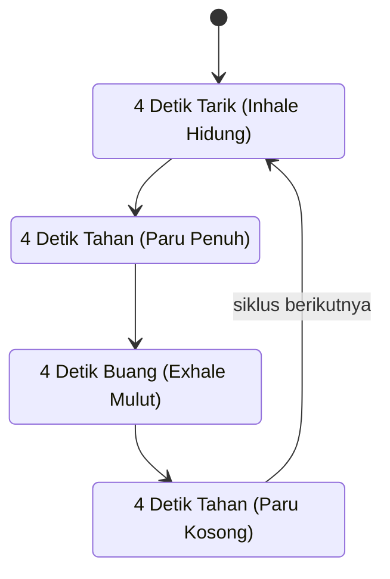
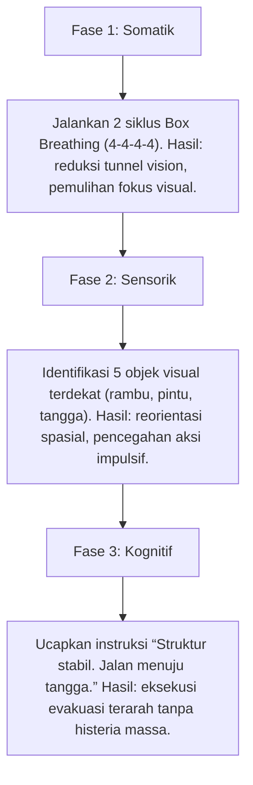

## Teknik Manajemen Panik dan Regulasi Diri

Sistem saraf manusia dalam menghadapi bencana dapat diibaratkan sebagai kendaraan berkecepatan tinggi dengan respons akselerasi yang sangat sensitif. Begitu ancaman fisik atau psikologis terdeteksi, sirkuit neural secara otomatis mengaktifkan mekanisme pertahanan instingtif (**respons fight-flight-freeze**). Tanpa instrumen regulasi diri yang terarah, lonjakan neurotransmiter stres dapat memicu fenomena *overheating* kognitif, yang pada akhirnya melumpuhkan kapasitas bernalar rasional dan melahirkan kepanikan buta (*blind panic*).

Teknik regulasi diri berfungsi sebagai sistem pengereman manual yang memungkinkan pemulihan kendali atas mekanisme neurofisiologis tersebut. Melalui intervensi somatosensorik dan kognitif yang terstruktur, sistem saraf pusat dapat diarahkan kembali menuju kondisi homeostatis, menjaga kejernihan berpikir di tengah situasi darurat yang kacau.

Skema berikut merangkum jalur regulasi sistem saraf otonom, dari ancaman bencana sampai keputusan rasional.

---

### 1. Pernapasan Taktis (Tactical Breathing)

Pernapasan taktis merupakan metode modulasi pernapasan terstruktur yang diterapkan secara luas oleh unit penyelamat profesional, personel taktis, dan petugas medis darurat untuk mempertahankan kestabilan performa di bawah tekanan ekstrem. Prosedur ini bukan sekadar relaksasi pasif, melainkan sebuah intervensi biologis langsung terhadap sistem saraf otonom.

#### Landasan Neurobiologis

Ketika serangan panik terjadi, tubuh secara otomatis mengadopsi pola napas dangkal dan cepat (*hiperventilasi*). Pola ini menurunkan kadar karbon dioksida dalam darah, memicu vasokonstriksi serebral, dan mengirimkan sinyal bahaya lanjutan ke amigdala. 

Melalui pernapasan taktis dengan ritme terkontrol, individu merangsang **Saraf Vagus** (*Nervus Vagus*), komponen utama dari sistem saraf parasimpatis. Stimulasi vagal melepaskan asetilkolin yang bekerja langsung menurunkan frekuensi denyut jantung, meredakan ketegangan otot lurik, serta mengembalikan perfusi oksigen optimal ke korteks serebral.

#### Latihan Metode Kotak (Box Breathing)

Protokol ini menggunakan ritme seimbang dengan rasio waktu \\( 4 - 4 - 4 - 4 \\) detik:

Putaran empat tahap metode kotak tampak pada bagan berikut.

1. **Inhalasi (4 Detik):** Tarik udara perlahan melalui rongga hidung. Pastikan diafragma mengembang ke arah luar tanpa mengangkat bahu secara berlebihan.
2. **Retensi Penuh (4 Detik):** Tahan udara di dalam rongga dada secara stabil tanpa menegangkan otot leher atau pita suara.
3. **Ekshalasi (4 Detik):** Hembuskan udara secara perlahan dan konstan melalui bibir yang sedikit dirapatkan, menyerupai hembusan terarah.
4. **Retensi Kosong (4 Detik):** Pertahankan kondisi paru-paru dalam keadaan kosong selama empat detik sebelum memulai siklus berikutnya.

> **Catatan Prosedural:** Pengulangan siklus minimal empat kali secara berurutan terbukti secara klinis mampu mendekompresi ketegangan simpatis dan menjernihkan persepsi kognitif yang sempat terdistorsi.

---

### 2. Metode Grounding 5-4-3-2-1

Dalam situasi bencana, arus pikiran sering kali terdistorsi oleh kecenderungan katastrofisasi, yaitu proyeksi mental destruktif tentang skenario terburuk masa depan. *Grounding* sensorik adalah instrumen psikologis untuk mereorientasi kesadaran kembali ke titik jangkar ruang dan waktu saat ini (*here and now*).

Metode ini memindahkan dominasi aktivitas saraf dari **Amigdala** (pusat pemrosesan rasa takut reaktif) menuju **Korteks Prefrontal** (pusat integrasi sensorik dan logika analitis).

#### Langkah-Langkah Operasional Sensorik

| Urutan Sensorik | Saluran Reseptor | Fokus Identifikasi Lapangan |
| :--- | :--- | :--- |
| **5 Objek** | Visual | Mengamati detail konkret di sekitar: kontur dinding, posisi pintu darurat, warna perlengkapan, titik rambu evakuasi, atau tekstur lantai. |
| **4 Objek** | Taktil | Mengidentifikasi sensasi fisik langsung: gesekan kain pakaian, suhu dingin pegangan tangga, kekerasan pijakan kaki, atau genggaman tali ransel. |
| **3 Sumber** | Auditori | Memilah suara nyata di lingkungan: dengungan generator darurat, instruksi petugas evakuasi, atau ritme tarikan napas sendiri. |
| **2 Aroma** | Olfaktori | Mendeteksi aroma partikulat di udara: bau debu reruntuhan, aroma kayu basah, atau aroma kain masker. |
| **1 Sensasi** | Gustatori | Memperhatikan sensasi pada indra pengecap: kelembapan rongga mulut atau sisa rasa mineral air minum. |

Efektivitas teknik ini bertumpu pada hukum keterbatasan kapasitas kognitif (*cognitive load limitation*). Otak manusia tidak mampu mempertahankan kepanikan intensitas tinggi saat seluruh modalitas sensorik diarahkan secara aktif untuk mengumpulkan dan memetakan data lingkungan yang faktual.

---

### 3. Dialog Internal Terarah (Instructional Self-Talk)

Suara batin (*internal voice*) bertindak sebagai komando operasional bagi seluruh respons fisiologis dan motorik. Apabila narasi internal dipenuhi oleh kepanikan emosional, respons motorik akan menjadi kacau dan destruktif. Rekonstruksi narasi internal berfungsi menyalurkan energi kecemasan menjadi instruksi taktis yang konkret.

#### Mengganti Pikiran Katastrofik

| Pikiran Katastrofik (Disruptif) | Rekonstruksi Taktis (Fungsional) |
| :--- | :--- |
| "Napas tercekat, kondisi ini mematikan." | "Ini reaksi pelepasan adrenalin. Oksigen tetap mengalir. Lanjutkan hitungan empat detik." |
| "Seluruh akses tertutup, situasi tanpa harapan." | "Kepanikan mempersempit pandangan. Mulai dari satu langkah kecil: temukan jalur keluar terdekat." |
| "Ketakutan ini melumpuhkan seluruh tubuh." | "Rasa takut adalah alarm biologis untuk waspada, bukan alasan untuk berhenti bertindak." |

#### Karakteristik Perintah Internal Fungsional

Instruksi mandiri yang efektif harus memenuhi kriteria singkat, imperatif, dan bebas dari ambiguitas:

- *"Berhenti sejenak. Ambil napas. Amati medan sekitar."*
- *"Selesaikan satu tindakan taktis pada satu waktu."*
- *"Rendahkan posisi tubuh, bergerak secara terukur menuju titik aman."*

---

### 4. Penerapan Lapangan pada Penyintas Pasca-Gempa

Sebagai gambaran praktis, tinjau situasi seorang penyintas yang berada di lantai lima sebuah gedung bertingkat saat gempa tektonik berkekuatan besar melanda. Setelah getaran utama mereda, pasokan listrik terputus dan alarm darurat menyala. Terjadi manifestasi panik akut yang ditandai oleh kelemahan motorik ekstrem, penyempitan lapang pandang (*tunnel vision*), dan kebingungan spasial.

Urutan tiga fase yang dijalankan penyintas tersebut tersaji pada alur di bawah ini.

1. **Intervensi Somatik Segera:** Menjalankan dua siklus *Box Breathing*. Tindakan ini meregulasi denyut nadi dan memperluas kembali lapang pandang visual yang sempat menyempit.
2. **Stabilisasi Sensorik:** Memindai lima objek konkret di jalur evakuasi (pintu darurat, meja pelindung, lampu penunjuk arah, pegangan tangga, tas darurat). Langkah ini mengunci kesadaran pada realitas fisik dan mencegah tindakan gegabah seperti melompat ke area berbahaya.
3. **Instruksi Kognitif Bertahap:** Mengarahkan diri dengan komando verbal tegas: *"Struktur bangunan telah stabil. Langkah utama adalah mencapai tangga darurat dengan tenang dan teratur."*

---

### 5. Regulasi Saraf Seperti Termostat

Proses regulasi sistem saraf dapat dianalogikan dengan prinsip kerja termostat pada sistem pemanas tertutup. Ketika ancaman eksternal datang, energi eksitasi saraf meningkat pesat mendekati ambang kritis:

$$
T_{\text{respons}} \to T_{\text{kritis}} \approx 100^\circ \text{C}
$$

Jika dibiarkan tanpa sistem pendinginan, tekanan emosional akan melampaui batas toleransi kognitif, memicu ledakan kepanikan yang merusak.

- **Pernapasan Taktis** berperan mereduksi suplai panas pada sumber pembakaran (*fuel reduction*).
- **Metode Grounding** berfungsi mengalirkan fluida pendingin untuk menstabilkan temperatur sistem (*heat absorption*).
- **Dialog Internal Fungsional** bertindak sebagai kalibrasi ulang panel instrumen (*system recalibration*), mempertahankan operasi sistem pada rentang kerja yang aman bagi pengambilan keputusan kritis.

> **Wawasan Kunci:** Ketenangan psikologis bukanlah ketiadaan rasa takut, melainkan kapasitas neurokognitif untuk **mengelola dan mengarahkan** ketakutan tersebut, sehingga kesadaran rasional tetap memegang kendali penuh atas setiap tindakan penyelamatan diri.

---

### 6. Matriks Evaluasi Kesiapsiagaan Regulasi Diri

Untuk memastikan kesiapan refleks fisiologis saat krisis terjadi, berikut matriks indikator kesiapan regulasi mandiri:

| Dimensi Regulasi | Parameter Evaluasi | Target Kinerja Minimum |
| :--- | :--- | :--- |
| **Kapasitas Vagal** | Eksekusi otomatis *Box Breathing* saat ritme napas meningkat. | Mampu menstabilkan ritme pernapasan dalam \\( 4 \\) siklus pertama. |
| **Kecepatan Reorientasi** | Pemetaan lima objek visual dan taktil di lingkungan baru. | Selesai dalam durasi kurang dari \\( 10 \\) detik tanpa keraguan. |
| **Disiplin Kognitif** | Penggantian narasi katastrofik dengan kalimat komando fungsional. | Terbentuknya rumusan aksi tunggal dalam waktu \\( 3 \\) detik pasca-kejutan. |
