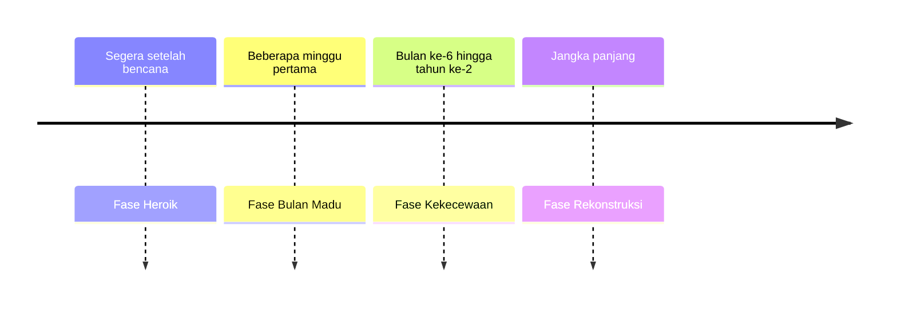

## Dampak Psikologis Jangka Panjang dan PTSD

Bencana alam atau krisis berskala masif sering kali diibaratkan seperti ledakan di tengah danau yang tenang. Gelombang fisik yang menghancurkan mungkin mereda dengan cepat, tetapi riak di permukaan air akan terus bergerak hingga ke tepian yang jauh, lama setelah ledakan itu berhenti.

Dalam psikologi bencana, pemulihan infrastruktur fisik sebuah wilayah sering kali berlangsung jauh lebih cepat dibandingkan pemulihan kondisi mental para penghuninya. Bab ini mengkaji bagaimana riak psikologis pascakrisis bermanifestasi menjadi trauma kronis, khususnya *Post-Traumatic Stress Disorder* (PTSD), serta membedah lintasan pemulihan psikologis jangka panjang.

## 1. Memahami Spektrum Trauma Pascabencana

Bagi sebagian besar penyintas, reaksi stres akut segera setelah bencana merupakan respons adaptif yang wajar terhadap situasi yang tidak wajar. Namun, apabila reaksi tersebut menetap melampaui rentang waktu satu bulan dan secara signifikan melumpuhkan fungsi kehidupan sehari-hari, respons adaptif tersebut telah bergeser ke ranah psikopatologi jangka panjang.

### Gejala Umum Manifestasi Trauma Kronis

Dampak psikologis tidak selalu tampak dalam bentuk histeria atau ekspresi emosional yang eksplisit. Trauma kronis kerap bermanifestasi secara terselubung dalam pola perilaku sehari-hari:

- **Gangguan Kognitif:** Penurunan konsentrasi, disorientasi spasial-temporal, hilangnya memori kerja secara parsial, dan kebingungan kronis.
- **Gejala Somatisasi (Fisik):** Keluhan fisiologis tanpa etiologi medis organik yang jelas, seperti sefalalgia (sakit kepala kronis), gangguan motilitas pencernaan, takikardia idiopatik, atau ketegangan muskuloskeletal yang persisten.
- **Perubahan Pola Relasi dan Kepribadian:** Transformasi kepribadian mendadak, penarikan diri secara sosial (*social withdrawal*), sinisme ekstrem, anhedonia, atau reaktivitas emosional yang mudah tersulut.

> "Trauma bukanlah apa yang terjadi padamu. Trauma adalah apa yang terjadi di dalam dirimu sebagai akibat dari apa yang terjadi padamu." (Gabor Maté, wawancara CBC Radio, 2022)

## 2. Post-Traumatic Stress Disorder (PTSD)

PTSD merupakan gangguan kesehatan mental kompleks yang terpicu oleh paparan terhadap peristiwa traumatik ekstrem, baik melalui keterlibatan langsung, penyaksian secara visual, maupun paparan berulang terhadap detail peristiwa mengerikan.

### Kriteria Diagnostik PTSD (DSM-5)

Dalam klasifikasi diagnostik klinis, simptom PTSD dikelompokkan ke dalam empat klaster utama:

1. **Intrusi (*Re-experiencing*):** Penyintas mengalami kembali peristiwa traumatik secara involunter melalui kilas balik (*flashbacks*) yang nyata, mimpi buruk berulang (*nightmares*), serta distres psikologis intens saat terpapar stimulus pemicu (*triggers*).
2. **Penghindaran (*Avoidance*):** Upaya aktif dan persisten untuk menghindari memori, pikiran, atau percakapan internal yang berhubungan dengan trauma, serta menghindari stimulus eksternal seperti lokasi, rute perjalanan, individu, atau aktivitas pengingat bencana.
3. **Perubahan Kognisi dan Suasana Hati Negatif (*Negative Alterations in Cognition and Mood*):** Keyakinan negatif yang terdistorsi mengenai diri sendiri dan lingkungan (misalnya, *"Dunia sama sekali tidak aman"*), perasaan bersalah atau menyalahkan diri sendiri secara irasional, mati rasa emosional (*emotional numbing*), serta hilangnya minat terhadap aktivitas bermakna.
4. **Hiperarousal dan Reaktivitas (*Hyperarousal and Reactivity*):** Kewaspadaan berlebih yang konstan (*hypervigilance*), refleks terkejut yang berlebihan (*exaggerated startle response*), insomnia kronis, iritabilitas tinggi, serta ledakan agresi verbal atau fisik tanpa provokasi berarti.

| Klaster Simptom | Manifestasi Klinis Utama | Dampak Fungsional |
| :--- | :--- | :--- |
| **Klaster Intrusi** | *Flashback*, mimpi buruk, reaksi distres fisiologis terhadap pemicu | Disrupsi konsentrasi dan stabilitas emosional seketika |
| **Klaster Penghindaran** | Isolasi dari lokasi bencana, penolakan membahas peristiwa | Pembatasan mobilitas, penurunan fungsi okupasi |
| **Klaster Kognisi & Afek** | *Belief* pesimistik global, anhedonia, alienasi sosial | Kerusakan relasi interpersonal, depresi komorbid |
| **Klaster Hiperarousal** | *Hypervigilance*, insomnia, refleks kaget berlebih | Kelelahan sistem saraf simpatis kronis |

Sebagai analogi neurobiologis, kondisi PTSD menyerupai sistem alarm kebakaran gedung yang mengalami kerusakan sirkuit, sehingga terus-menerus berdering memekakkan telinga kendati tidak terdapat api atau ancaman nyata. Amigdala penyintas terus mengirimkan sinyal bahaya dan mengaktifkan respons *fight-or-flight*, meskipun peristiwa bencana telah lama berlalu.

## 3. Model Pemulihan Komunitas Zunin & Myers

Pemulihan psikososial pascabencana bukanlah proses linier yang bergerak stabil ke arah positif, melainkan lintasan dinamik dengan fluktuasi emosional yang tajam. Model Zunin & Myers memetakan fase-fase psikologis komunitas penyintas:

1. **Fase Heroik (*Heroic Phase*):** Berlangsung segera setelah bencana melanda. Ditandai oleh ledakan energi altruistik tinggi, tindakan penyelamatan spontan, dan dorongan solidaritas untuk mempertahankan hidup sesama anggota komunitas.
2. **Fase Bulan Madu (*Honeymoon Phase*):** Terjadi dalam rentang beberapa minggu pertama. Muncul optimisme kolektif yang didorong oleh kedatangan bantuan logistik, liputan media massa yang intens, serta janji rekonstruksi dari otoritas.
3. **Fase Kekecewaan (*Disillusionment Phase*):** Terjadi antara bulan ke-6 hingga tahun ke-2. Realitas pemulihan yang lambat mulai memicu keputusasaan. Bantuan eksternal menyusut drastis, kelelahan fisik dan mental mencapai titik kulminasi, konflik interpersonal meningkat, dan pada fase inilah manifestasi PTSD serta depresi berat paling banyak meletup.
4. **Fase Rekonstruksi (*Reconstruction Phase*):** Fase jangka panjang ketika individu dan komunitas mulai menata ulang fondasi kehidupan, memulihkan kemandirian ekonomi, serta mengintegrasikan narasi trauma sebagai bagian dari sejarah hidup yang dapat ditoleransi.

Urutan keempat fase itu beserta rentang waktunya dapat kamu telusuri pada garis waktu berikut.

$$
\text{Pemulihan} = f(\text{Waktu}, \text{Dukungan Sosial}, \text{Resiliensi Individu})
$$

## 4. Kecemasan dan Depresi Sekunder

Selain PTSD, penyintas bencana kerap mengalami spektrum gangguan penyerta (*comorbidity*) yang saling memperberat:

- **Gangguan Kecemasan Menyeluruh (*Generalized Anxiety Disorder* / GAD):** Kekhawatiran kronis yang tidak terkendali terhadap masa depan, disertai antisipasi konstan bahwa bencana berikutnya akan segera terjadi kapan saja.
- **Rasa Bersalah Penyintas (*Survivor Guilt*):** Beban moral yang mendalam dan melumpuhkan akibat selamat dari bencana sementara anggota keluarga atau rekan terdekat tewas. Fenomena ini sering menjadi hambatan terbesar dalam proses penerimaan diri dan terapi.
- **Penyalahgunaan Zat (*Substance Use Disorder*):** Penggunaan alkohol atau obat sedatif sebagai mekanisme koping maladaptif untuk membungkam memori intrusif yang menyiksa.

## 5. Penerapan Klinis pada Rekonstruksi Pascatsunami

**Skenario Kasus:** Santi merupakan seorang penyintas tsunami 2004. Dua tahun pascaperistiwa, hunian fisiknya telah selesai dibangun kembali. Kendati demikian, ia menolak keras untuk mendekati area pesisir pantai, termasuk untuk keperluan mata pencaharian. Setiap kali mendengar deru mesin truk berat (yang menyerupai frekuensi suara gemuruh gelombang tsunami), frekuensi denyut jantungnya melonjak drastis, tubuhnya gemetar, dan ia mengalami serangan panik akut dengan sensasi tercekik.

**Formulasi Klinis dan Intervensi:**

1. **Identifikasi Simptom:** Santi menunjukkan manifestasi klasik dari *klaster penghindaran* (menolak area pesisir) dan *klaster intrusi* (reaksi distres fisiologis terhadap stimulus auditori analog).
2. **Protokol Intervensi:**
   - **Psikoedukasi Neurobiologis:** Membantu Santi memahami bahwa respons fisiologis tubuhnya merupakan mekanisme pertahanan amigdala yang terkalibrasi secara berlebihan, bukan tanda kelemahan karakter.
   - **Terapi Desensitisasi Sistematis (*Systematic Desensitization*) & EMDR:** Paparan bertahap (*in vivo* dan *in sensu*) terhadap stimulus suara dan visual dalam lingkungan klinis yang terkontrol, dipadukan dengan stimulasi bilateral untuk memproses ulang memori traumatik yang tersimpan secara terfragmentasi.
   - **Kelompok Dukungan Sebaya (*Peer Support Group*):** Interaksi terstruktur dengan sesama penyintas untuk menormalisasi pengalaman emosional, mengurangi isolasi sosial, dan merestrukturisasi atribusi makna hidup.

## 6. Modalitas Terapeutik Terverifikasi

Pemulihan psikologis komprehensif mengandalkan modalitas berbasis bukti (*evidence-based practice*):

- **Psikoterapi Trauma Terfokus:** *Cognitive Behavioral Therapy* khusus trauma (TF-CBT) dan *Eye Movement Desensitization and Reprocessing* (EMDR) merupakan standar intervensi lini pertama untuk mereduksi distres trauma.
- **Terapi Paparan Naratif (*Narrative Exposure Therapy* / NET):** Metode rekonstruksi kronologis pengalaman bencana yang membantu korteks prefrontal mengorganisasi fragmen memori emosional menjadi narasi terintegrasi dengan batasan ruang dan waktu yang jelas.
- **Regulasi Fisiologis Somatis:** Latihan pernapasan diafragma lambat (*paced breathing*), yoga trauma-sensitif, dan pemulihan higiene tidur untuk menurunkan aktivitas aksis HPA (*Hypothalamic-Pituitary-Adrenal*) yang hiperaktif.

> [!IMPORTANT]
> Jangan pernah melakukan diagnosis mandiri (*self-diagnosis*) atau melabeli orang lain semata-mata berdasarkan daftar gejala di atas. Penetapan diagnosis klinis PTSD dan gangguan komorbid harus ditegakkan secara formal oleh psikolog klinis atau psikiater berlisensi.

## Kapan Bantuan Profesional Diperlukan?

Intervensi klinis mendesak wajib dicari apabila seorang penyintas atau individu di sekitar lingkungan kita mengalami indikator berikut selama lebih dari empat minggu pascabencana (kecuali butir pertama, yang menuntut bantuan segera tanpa menunggu empat minggu):

1. Munculnya ideasi atau dorongan aktif untuk menyakiti diri sendiri maupun orang lain.
2. Disfungsi okupasional dan domestik yang parah (ketidakmampuan merawat diri, bekerja, atau berinteraksi secara fungsional).
3. Episode disosiasi atau kilas balik intens yang menghilangkan kontak dengan orientasi realitas saat ini.
4. Ketergantungan terhadap zat psikoaktif, alkohol, atau medikasi penenang tanpa pengawasan medis untuk meredakan kecemasan.

> Pemulihan bukan berarti melupakan peristiwa yang telah terjadi. Pemulihan menandakan bahwa memori traumatik tersebut tidak lagi mendikte dan mengendalikan setiap detik jalannya kehidupan.
