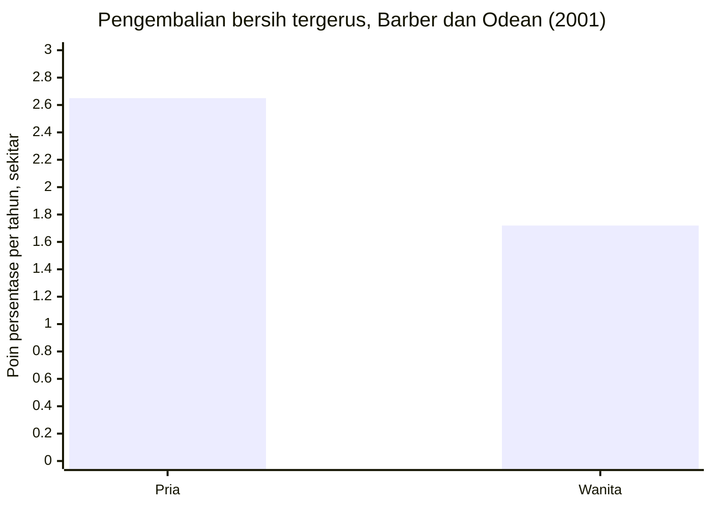

## Terlalu Percaya Diri

Dari 66.465 rumah tangga investor, kelompok yang paling rajin berdagang justru memperoleh hasil paling rendah. Data itu tercatat selama enam tahun penuh.

Kalau kamu pernah mendengar nasihat "yang rajin pasti untung", data dari pasar saham Amerika punya versi cerita yang berlawanan. Brad Barber dan Terrance Odean (2000) meneliti catatan transaksi 66.465 rumah tangga yang memiliki akun di satu perusahaan efek ritel besar, mengikuti mereka dari tahun 1991 sampai 1996. Temuannya jelas. Rumah tangga yang paling aktif berdagang, yang memutar portofolionya paling sering, memperoleh pengembalian tahunan bersih sekitar 11,4 persen, sementara pasar menghasilkan 17,9 persen. Yang jarang berdagang justru memperoleh sekitar 18,5 persen, sedikit di atas pasar. Jadi, makin rajin memindahkan posisi, makin tipis hasilnya, terbalik dari intuisi.

### Selisih tujuh persen setahun

Perlu kamu pahami, selisih tujuh persen setahun itu tidak bisa dianggap kebetulan statistik, dan ia menumpuk dari tahun ke tahun. Meskipun pilihannya benar, setiap perpindahan posisi menelan biaya transaksi dan sering kali masuk di waktu yang buruk. Penelitian Barber dan Odean menghitung pengembalian sebagai net annualized geometric mean, angka yang sudah memotong semua biaya itu. Artinya, investor yang sering berdagang membayar biaya terus-menerus untuk keputusan yang rata-rata tidak menambah apa-apa, bahkan menurunkan hasilnya jauh di bawah opsi paling membosankan yang ada, yaitu memegang saja dan membiarkan pasarnya bekerja.

Lalu, kenapa orang terus melakukannya, tahun demi tahun, padahal hasilnya terbaca di rekening sendiri? Jawaban yang paling konsisten dengan data adalah kelebihan percaya diri. Orang yang terlalu yakin terhadap kemampuannya memilih waktu dan memilih saham akan merasa berdagang itu menguntungkan, sehingga ia berdagang, lalu kebanyakan berdagang. Sistem 1 yang kita kenal di bab kedua menyukai cerita seperti "saya bisa membaca pasar", dan Sistem 2 yang malas jarang sempat meminta bukti.

### Pria berdagang 45 persen lebih banyak

Bukti yang membuat hipotesis kelebihan percaya diri ini semakin kuat datang dari perbandingan gender. Dalam studi lanjutan mereka, Barber dan Odean (2001) meneliti data lebih dari 35.000 rumah tangga pada periode Februari 1991 sampai Januari 1997, mengandalkan temuan psikologi bahwa pria, secara rata-rata, menunjukkan kelebihan percaya diri yang lebih besar pada tugas-tugas yang dianggap maskulin, termasuk urusan keuangan. Jika teorinya benar, prediksinya tegas bahwa pria akan berdagang lebih berlebihan daripada wanita.

Data mengikuti prediksi itu dengan rapi. Pria berdagang 45 persen lebih banyak dibanding wanita. Dan karena setiap tambahan perdagangan menambah biaya, konsekuensinya juga terukur. Perdagangan tersebut menggerus pengembalian bersih pria sekitar 2,65 poin persentase per tahun, dibanding 1,72 poin untuk wanita. Lebih sering yakin, lebih sering bergerak, lebih banyak biaya, hasil lebih tipis. Pola ini berlaku untuk dua gender sekaligus; selisihnya hanya pada intensitasnya.

Grafik ini membandingkan berapa poin pengembalian bersih yang hilang setiap tahun pada tiap gender.

> Kepercayaan diri itu seperti garam. Sedikit membuat semuanya lebih baik, dan berlebih membuat seluruh hidangan tidak bisa dimakan, sementara si juru masak terus menambah karena merasa masih kurang.

### Menyadari dirimu sedang terlalu yakin

Sisi tidak nyamannya, kelebihan percaya diri hampir tidak terasa dari dalam. Ia terasa seperti kompetensi. Karena itu, perilakunya lebih berguna untuk dipantau daripada perasaannya. Ada beberapa sinyal perilaku yang dekat dengan temuan riset. Kamu memindahkan posisi jauh lebih sering daripada rencana awalmu, kamu membuka aplikasi investasi setiap jam sementara strategimu semestinya jangka panjang, dan setiap keuntungan kamu atribusikan pada kemampuan sementara setiap kerugian kamu atribusikan pada sial atau pasar yang gila. Pola terakhir ini paling sulit dikenali, karena ia memelihara kepercayaan berlebih di tengah bukti yang bertolak belakang.

Jawaban dari temuan Barber dan Odean memang membosankan, dan itu justru kekuatannya. Kurangi frekuensi. Setiap keputusan dagang harus melewati senggang satu malam dan satu pertanyaan sederhana, "kalau saya belum memegang posisi ini, apakah saya akan membelinya hari ini dengan harga ini?" Kalau jawabannya ragu, biaya terbesar yang kamu hemat adalah biaya dari keputusan yang tidak perlu. Bagi kebanyakan orang yang bukan profesional, pasivitas yang disiplin ternyata strategi yang lebih jujur daripada aktivitas yang merasa pintar.

## Poin Penting

- Rumah tangga yang paling aktif berdagang memperoleh pengembalian bersih sekitar 11,4 persen setahun, jauh di bawah pasar yang menghasilkan 17,9 persen, dan angka itu sudah dipotong biaya transaksi (Barber dan Odean, 2000).
- Penjelasan yang paling konsisten dengan data adalah kelebihan percaya diri, dan pria, yang berdagang 45 persen lebih banyak daripada wanita, kehilangan lebih banyak pengembalian bersih karenanya (Barber dan Odean, 2001).
- Pantau perilakumu, lalu beri setiap keputusan dagang senggang satu malam dan tanyakan apakah kamu akan membelinya hari ini dengan harga ini.

Kepercayaan berlebih pada diri sendiri meninggalkan jejak di rekeningmu. Kepercayaan pada kerumunan bekerja lebih diam-diam, karena ia tidak merasa perlu dianalisis. Semua orang sudah membeli, lalu apa ragunya?
