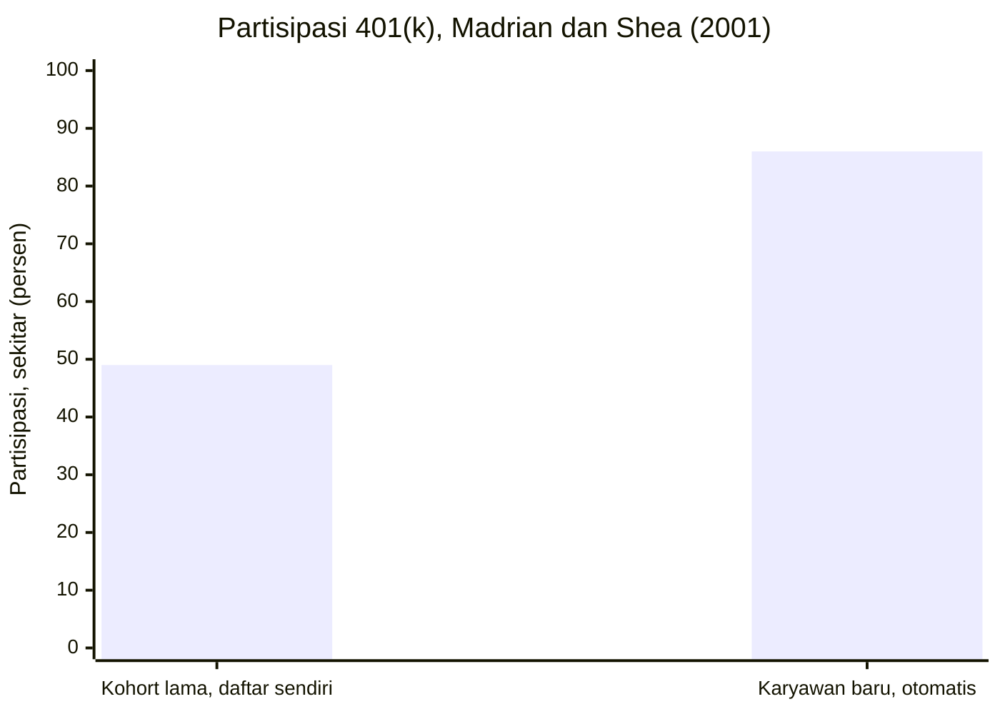

## Jebakan Status Quo dan Kekuatan Default

Dari 850.000 peserta dana pensiun, hanya 28 persen yang pernah mengubah alokasi dana mereka satu kali pun, sementara sisanya tidak pernah menyentuhnya.

Angka itu bukan slogan, melainkan temuan yang dikutip William Samuelson dan Richard Zeckhauser (1988) dalam studi mereka tentang bias status quo. Dalam studi yang sama, data riil dari perusahaan yang mengelola rencana dana pensiun TIAA/CREF menunjukkan kurang dari 2,5 persen peserta mengubah distribusi premi antar dana dalam satu tahun. Pola yang sama muncul di bidang yang lebih personal: hanya 3 persen karyawan Harvard pindah rencana kesehatan setiap tahunnya. Padahal biaya pindahnya hampir nol, cuma isi formulir. Kalau kamu pernah setahun, dua tahun, lima tahun memakai rekening bank, paket internet, atau asuransi yang sama tanpa pernah membandingkan ulang, kamu sudah mengalami pola yang mereka ukur ini.

### Menolak pindah, bahkan dari pilihan yang jelek

Dalam serangkaian eksperimen, Samuelson dan Zeckhauser menemukan pola yang konsisten: posisi memengaruhi pilihan. Untuk mayoritas alternatif yang diuji, persentase pemilihan suatu opsi paling tinggi ketika opsi itu diletakkan sebagai pilihan awal (status quo), lebih rendah ketika ia netral, dan paling rendah ketika ia diletakkan sebagai alternatif yang harus diambil alih. Isi paketnya sama persis, hanya posisinya yang berubah, tapi keputusan orang ikut berubah.

Kenapa begitu? Bias status quo dirawat oleh beberapa rasa sekaligus. Ada rasa takut rugi yang kita bahas di bab enam: kelemahan pilihan baru lebih terasa daripada kelemahan pilihan lama. Ada biaya mental: membandingkan ulang semua opsi itu melelahkan, dan kita tahu dari bab pertama bahwa otak hemat energi. Dan ada rasa bersalah: kalau kamu pindah dan hasilnya buruk, kamu menyalahkan dirimu; kalau kamu bertahan dan hasilnya buruk, kamu menyalahkan keadaan. Bertahan itu terasa lebih aman secara emosional, bahkan ketika secara angka ia lebih mahal.

### Pendaftaran otomatis rekening 401(k)

Kekuatan status quo ini punya konsekuensi yang jauh lebih besar daripada rekening bank yang malas dipindah, karena orang yang merancang sistem tahu tentang kekuatan itu. Brigitte Madrian dan Dennis Shea (2001) menguji hal ini pada satu perusahaan besar yang mengubah aturan 401(k), rekening pensiun di Amerika, dari sistem tempat karyawan harus mendaftar sendiri menjadi sistem tempat semua karyawan baru otomatis didaftarkan dan harus keluar sendiri kalau tidak mau.

Di bawah sistem pendaftaran otomatis, sekitar 86 persen karyawan baru berpartisipasi, dibanding sekitar 49 persen pada kohort lama dengan masa kerja serupa. Satu perubahan arah pintu, naik hampir dua kali lipat. Efek default tidak berhenti di situ: mayoritas karyawan yang didaftarkan otomatis juga tidak pernah mengubah tingkat kontribusi bawaan maupun alokasi investasi bawaan, dan 61 persen dari mereka tidak melakukan perubahan apa pun. Default bukan cuma menentukan siapa yang ikut; ia menentukan isi pilihan mereka bertahun-tahun kemudian. Karyawan itu tidak memilih rencana mereka; mereka mewarisinya dari pintu masuk.

Lonjakan partisipasi dari studi Madrian dan Shea itu bisa kamu lihat pada dua batang berikut.

> Ketika pintunya diseret ke arah tertentu, sebagian besar orang akan berjalan melewatinya, lalu berhenti di sana dan menyebutnya keputusan.

Ini pikiran yang perlu kamu bawa pulang: default itu netral secara teknik, tapi tidak netral secara akibat. Merancang default adalah memilih untuk jutaan orang tanpa mereka sadari, dan karena itu kejujuran tentang siapa yang menaruh default di sana jadi penting. Untungnya, mekanisme yang sama bisa dipakai untuk kebaikanmu sendiri, dan ada buktinya.

### Program Save More Tomorrow

Richard Thaler dan Shlomo Benartzi (2004) mendesain program yang bekerja bersama psikologi manusia, bukan melawannya, dengan nama Save More Tomorrow. Ide kuncinya tiga lapis. Pertama, karyawan diminta berkomitmen sekarang untuk menyisihkan sebagian kenaikan gaji di masa depan, jadi dirimu hari ini tidak pernah merasa kehilangan apa-apa (bias masa kini di bab lima tertangani). Kedua, kenaikan tabungan otomatis berjalan seiring kenaikan gaji, jadi uang yang "hilang" ke tabungan tidak pernah sempat terasa hadir di rekening (rasa takut rugi di bab enam tertangani). Ketiga, karyawan bisa keluar kapan saja, jadi ada rasa kendali.

Di perusahaan tempat program pertama dijalankan, tingkat tabungan peserta yang mendaftar naik dari 3,5 persen menjadi 13,6 persen pendapatan dalam sekitar 40 bulan, tanpa satu pun perintah memaksa. Idenya lalu menyebar luas: Benartzi dan Thaler (2013) mengestimasi sekitar 4,1 juta peserta pensiun kini memiliki tingkat tabungan yang naik otomatis. Semua itu berawal dari arah default yang diputar.

### Menjadi perancang default untuk dirimu sendiri

Kalau default cukup kuat untuk mengatur perilaku jutaan orang, kamu bisa memakainya untuk mengatur dirimu. Arahkan secara sengaja hal-hal yang terjadi kalau kamu tidak melakukan apa-apa: aktifkan transfer otomatis ke tabungan pada tanggal gajian supaya default-mu adalah menabung, bukan menunggu sisa. Jadikan dana investasi bulanan terpotong lebih dulu sebelum kamu sempat menyentuhnya. Simpan aplikasi belanja jauh dari layar utama, dan pasang tagihan utilitas pada pembayaran otomatis agar keterlambatan bukan pilihan bawaan. Kamu tidak perlu jadi orang yang sangat disiplin; kamu perlu sekali saja memutar arah pintu, lalu membiarkan inersia bekerja untukmu.

Default dipasang dari luar dirimu, oleh perusahaan atau oleh dirimu sendiri yang berpikir jernih. Namun ada satu pertahanan terakhir yang bekerja dari dalam: kemampuan mengikat dirimu di masa depan sebelum godaan datang.

## Key Takeaways

- Untuk mayoritas alternatif yang diuji, opsi yang diletakkan sebagai status quo paling sering dipilih (Samuelson dan Zeckhauser, 1988), dan hanya 28 persen dari 850.000 peserta dana pensiun yang pernah mengubah alokasinya.
- Pendaftaran otomatis menaikkan partisipasi 401(k) dari sekitar 49 persen pada kohort lama menjadi sekitar 86 persen pada karyawan baru dengan masa kerja serupa (Madrian dan Shea, 2001), dan default menentukan bukan cuma siapa yang ikut, tapi juga isi pilihannya bertahun-tahun kemudian.
- Save More Tomorrow (Thaler dan Benartzi, 2004) dan transfer otomatis di tanggal gajian memakai mekanisme yang sama untuk kebaikan: menabung menjadi pilihan bawaan, bukan usaha.

Semua bab sejauh ini berakhir di satu titik yang sama: keputusan baik yang bergantung pada tekad akan selalu rapuh, sedangkan keputusan yang dirancang agar terjadi dengan sendirinya akan bertahan. Tinggal merakit semua alat tadi, dari akuntansi mental sampai default, menjadi rencana pertahanan pribadi yang bisa kamu pasang malam ini juga.
