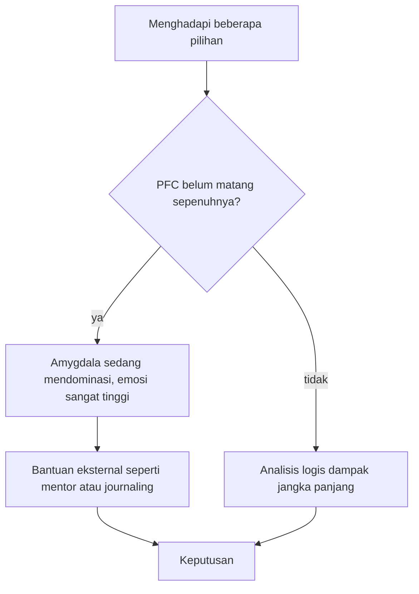

## Psikologi Perkembangan Dewasa Muda

Pernahkah kamu merasa seperti mengendarai mobil di tengah kabut tebal tanpa peta, sementara semua orang di media sosial tampak sudah sampai di tujuan? Jika iya, kamu tidak sendirian. Apa yang kamu rasakan bukan cuma "galau" biasa; ada penjelasan ilmiah dan psikologis di baliknya.

Dalam bagian ini, kita akan membedah apa yang sebenarnya terjadi di dalam kepala dan hatimu selama rentang usia 20 hingga 30 tahun. Kita akan mengeksplorasi mengapa fase ini membingungkan, tetapi juga menentukan bagi pembentukan dirimu di masa depan.

## 1\. Mengenal 'Emerging Adulthood'

Dahulu, psikologi membagi transisi hidup secara kaku: masa remaja lalu langsung masa dewasa. Namun, psikolog **Jeffrey Jensen Arnett** menyadari adanya celah besar di antaranya yang ia sebut sebagai **Emerging Adulthood**, biasanya terjadi pada usia 18 hingga 29 tahun.

Arnett (2000) menggambarkannya sebagai masa ketika seseorang sudah bukan remaja lagi, tetapi belum sepenuhnya merasa menjadi orang dewasa.

Arnett mengidentifikasi lima fitur utama dari fase ini:

1. **Eksplorasi Identitas (Identity Exploration)**: Mencoba berbagai kemungkinan dalam cinta dan pekerjaan.
2. **Ketidakstabilan (Instability)**: Sering berpindah tempat tinggal, pekerjaan, atau pasangan.
3. **Fokus pada Diri Sendiri (Self-focused)**: Masa ketika kamu memiliki kewajiban paling sedikit terhadap orang lain dan kebebasan terbesar untuk memutuskan apa yang kamu inginkan.
4. **Perasaan "Di Antara" (Feeling In-between)**: Merasa sudah dewasa dalam beberapa hal, tapi masih merasa seperti anak kecil dalam hal lain.
5. **Usia Peluang (Age of Possibilities)**: Masa yang penuh dengan harapan dan peluang untuk mengubah arah hidup secara drastis.

Apakah kamu merasa lebih sering menjawab "Iya dan Tidak" secara bersamaan ketika ditanya apakah kamu sudah merasa dewasa? Itulah esensi dari emerging adulthood.

## 2\. Otak yang Masih 'Dalam Perbaikan'

Sering kali kita menyalahkan kurangnya motivasi atau karakter yang lemah saat menghadapi *Quarter-Life Crisis*. Padahal, ada faktor biologis yang berpengaruh: **Otak manusia belum sepenuhnya matang hingga usia pertengahan 20-an.**

### Prefrontal Cortex dan Amygdala

Bagian otak yang bertanggung jawab atas perencanaan masa depan, pengendalian impuls, dan pengambilan keputusan logis disebut **Prefrontal Cortex (PFC)**.

Bayangkan PFC sebagai CEO dari sebuah perusahaan. Pada usia 20-an, CEO ini masih dalam tahap "orientasi". Sementara itu, **Amygdala**, pusat emosi dan respons fight-or-flight, sudah bekerja dengan kekuatan penuh.

**Analogi "Situs Konstruksi":**

> Memasuki usia 20-an ibarat tinggal di rumah yang sedang direnovasi besar-besaran. Kabel-kabel (saraf) sedang disambungkan kembali, dan struktur utama (PFC) sedang diperkuat. Kamu tidak bisa mengharapkan rumah tersebut berfungsi sempurna saat tukang bangunannya masih bekerja di dalam.

### Hormon Stres dan Ketidakpastian

Ketidakpastian di usia 20-an memicu pelepasan hormon stres seperti **Kortisol**. Jika otak tidak memiliki "rem" yang kuat (karena PFC belum matang), kecemasan ini bisa terasa sangat berat. Secara matematis, kita bisa melihat keseimbangan respons emosional sebagai:

$$
\text{R}_{\text{emosi}} \approx \frac{\text{Stimulus}_{\text{eksternal}}}{\text{Kematangan}_{\text{PFC}}}
$$

Saat $\text{Kematangan}\_{\text{PFC}}$ masih rendah, $\text{R}\_{\text{emosi}}$ (respons emosional atau kecemasan) akan melonjak tinggi terhadap stimulus yang sama.

## 3\. Perkembangan Emosi

Di rentang usia 20-30 tahun, perkembangan emosi kita mengalami pergeseran dari "mencari validasi luar" menjadi "membangun integritas dalam".

### Intimacy vs. Isolation menurut Erik Erikson

Menurut psikolog perkembangan Erik Erikson, tugas utama di masa dewasa awal adalah membangun hubungan yang intim dengan orang lain. Namun, sebelum bisa membangun hubungan yang sehat dengan orang lain, kamu harus memiliki identitas yang stabil.

Ketidakpastian karier dan finansial sering kali menghambat proses ini, menciptakan perasaan **isolasi** karena kita merasa "tidak layak" atau "tertinggal" dibandingkan rekan sebaya.

### Regulasi Emosi di Tengah Krisis

Kemampuan mengelola emosi (emotional regulation) berkembang pesat di fase ini. Kamu belajar bahwa:

- Kegagalan bukan berarti akhir dari segalanya.
- Perasaan tidak nyaman adalah sinyal untuk tumbuh, bukan sinyal untuk berhenti.
- Ketidakpastian adalah bagian permanen dari kehidupan dewasa.

## 4\. Strategi Berbasis Psikologi

Memahami teori saja tidak cukup. Bagaimana cara menerapkan pengetahuan tentang perkembangan otak dan emosi ini dalam keseharianmu?

### Menghadapi Analysis Paralysis

Kamu memiliki tiga tawaran pekerjaan atau pilihan hidup, dan kamu merasa lumpuh karena takut salah pilih.

**Langkah Berbasis Psikologi:**

1. **Sadarilah Keterbatasan PFC**: Terima bahwa otakmu memang sedang didesain untuk merasa waspada terhadap risiko. Jangan membenci diri sendiri karena merasa cemas.
2. **Gunakan Teknik 'Micro-Decisions'**: Karena otak sulit memproses ketidakpastian jangka panjang, pecahlah keputusan besar menjadi langkah-langkah kecil 24 jam.
	- *Hari ini: Hanya riset tentang perusahaan A.*
		- *Besok: Hanya berbicara dengan satu teman yang bekerja di sana.*
3. **Self-Compassion**: Gunakan dialog internal yang mendukung. Mengatakan "Saya sedang berproses" cenderung lebih menenangkan dibandingkan mengatakan "Saya payah karena tidak tahu harus berbuat apa."

### Memutuskan Saat Emosi Sedang Tinggi

Coba bayangkan cara otakmu menimbang pilihan sebagai sebuah percabangan. Selama PFC belum matang sepenuhnya, yaitu sampai sekitar pertengahan 20-an, amygdala sedang mendominasi dan emosi terasa sangat tinggi. Dalam kondisi ini, gunakan bantuan dari luar, seperti berdiskusi dengan mentor atau menulis jurnal (*journaling*), sebelum memutuskan. Kalau PFC sudah lebih matang, analisis logis tentang dampak jangka panjang dari tiap pilihan bisa berjalan lebih stabil. Pesannya sederhana: jangan membuat keputusan permanen saat kendali PFC-mu sedang lemah atau emosimu sedang tinggi.

Kedua jalan menuju keputusan itu tampak seperti ini.

## 5\. Mengapa Fase Ini Penting?

Memahami psikologi perkembangan di balik Quarter-Life Crisis membantu kamu untuk berhenti menyalahkan diri sendiri. Kamu bukan sedang gagal; kamu sedang **berkembang**.

**Poin-poin Penting untuk Diingat:**

- **Ketidakpastian adalah normal**: Otakmu sedang dalam tahap *fine-tuning*.
- **Emerging Adulthood adalah kesempatan**: Ini adalah waktu paling fleksibel dalam hidupmu untuk mencoba dan gagal.
- **Biologi bukan takdir**: Meskipun otak belum matang sempurna, kamu bisa melatihnya melalui meditasi, refleksi, dan aksi nyata.

**Penting:** Quarter-Life Crisis adalah sinyal bahwa identitas lama kamu sudah tidak cukup besar untuk menampung potensi baru kamu. Jangan hindari krisisnya, pelajari pesannya.

Jika kamu tahu bahwa otakmu masih berkembang, apakah kamu akan memberikan sedikit lebih banyak ruang bagi dirimu untuk melakukan kesalahan hari ini?
